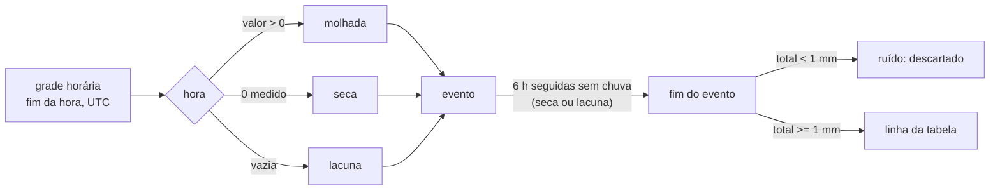

# Eventos de chuva — tabela e resumo por tipo

- Tarefa: F6-ANALISE-01 · Data: 2026-11-08 · Decisão de método: ADR 0017 (proposto)
- Código: `service/analise/RainEventDetector` (detecção, lógica pura), `RainEventClassifier`, `RainEventSummarizer`, `impl/RainEventServiceImpl`, `repository/analise/RainEventReadRepository`, `controller/RainEventController`
- Testes: `RainEventDetectorTest` (casos e propriedades), `RainEventSummarizerTest`, `RainEventIntegrationTest` (Testcontainers, ADR 0004)

## Para que serve

A tabela alimenta o modelo estocástico da galeria como sistema reparável. Dela saem a frequência, a duração e a intensidade por tipo de evento, e as horas em que a chuva passou da capacidade de projeto (candidata a falha). Não há coleta nova: tudo vem da série consolidada (`observation`) e da grade horária (`observation_hourly_v`) do pipeline (ADR 0006).

## Endpoints

| Método | Caminho | O que devolve |
|---|---|---|
| GET | `/api/analise/eventos-chuva` | uma linha por evento |
| GET | `/api/analise/eventos-chuva/resumo` | uma linha por ponto e tipo (FRACA, MEDIA, FORTE, TOTAL) |

Autenticados (qualquer perfil). `format=json` devolve `{manifest, events}` (ou `{manifest, rows}`); `format=csv` devolve o CSV. Nos dois formatos o cabeçalho `X-Dataset-Id` é o SHA-256 do CSV, igual a `manifest.datasetId`. O CSV não tem carimbo de geração: o mesmo intervalo, com as mesmas regras e o mesmo banco, dá sempre o mesmo id (`RainEventIntegrationTest.mesmoIntervaloDuasVezesDaOMesmoDatasetId`). Para guardar o manifesto junto do CSV, peça a mesma URL com `format=json`.

### Parâmetros

| Parâmetro | Padrão | Origem do padrão |
|---|---|---|
| `slug` | obrigatório; aceita `all` | — |
| `from`, `to` | obrigatórios (UTC) | — |
| `source` | `ANA` | `ANA` = `ANA_SOAP` (15 min); `OPEN_METEO_ARCHIVE` = reanálise horária |
| `dryGapHours` | 6 | ADR 0017, item 1 |
| `minEventMm` | 1,0 | ADR 0017, item 2 |
| `classification` | `IDF` | `IDF` ou `METEOROLOGICA` (ADR 0017, item 3) |
| `idfThresholdMmH` | 50,3 | i(TR 2, 60 min), `PARAMETROS-MODELO-FISICO.md` linha 6 |
| `capacityMmH` | 60,1 | chuva de projeto TR 5, 60 min, linha 8 (é o `iT` do M1a, ADR 0014) |
| `runoffCoefficient` | 0,86 | C, linha 1 |
| `tideSillM` | vazio | soleira no NR da DHN; `[sem fonte]` por ponto (ADR 0009) |
| `springRangeM` | 1,70 | mediana da amplitude diária da maré: 1 875 dias locais com 2 ou mais extremos, 2021-09-29 a 2026-11-18 (DHN e TabuaMare, a TabuaMare vence no mesmo instante, como em `ObservationReadRepository.tideExtremes`; query sobre o banco do snapshot `2026-10-10-pos-carga`, 2026-11-08) |
| `format` | `json` | `json` ou `csv` |

Todos entram em `manifest.params`; regra diferente gera `eventId` e `datasetId` diferentes.

## Definição de evento

1. Hora rotulada pelo fim do intervalo `(t-1h, t]`, em UTC. O horário de Recife aparece só em `startLocal`, `endLocal`, `month` e `season`.
2. Hora molhada: valor > 0. Hora seca: 0 medido. Hora incompleta ou sem leitura: lacuna, nunca zero. Na ANA a hora exige as 4 leituras de 15 min e descarta a leitura logo depois de lacuna (V15, `docs/INGESTAO.md`).
3. O evento começa na primeira hora molhada e termina na última hora molhada antes de `dryGapHours` horas não molhadas seguidas. `startUtc` = início da primeira hora molhada; `endUtc` = fim da última. A duração tem resolução de 60 min nas duas fontes.
4. Lacuna dentro do evento, ou nas `dryGapHours` horas antes ou depois, marca `hasGap`. Uma lacuna longa (≥ `dryGapHours`) fecha o evento, mas o seguinte fica com `dryHoursBefore` vazio: não se sabe se choveu nela.
5. Evento abaixo de `minEventMm` é descartado; suas horas contam no intervalo entre os vizinhos.
6. Evento que começa antes de `from`, termina depois de `to` ou encosta na borda da série lida (a série vai de `from − 78 h` a `to + 6 h`) é `truncated`. Fica na tabela, sai do resumo.

## Colunas da tabela

Identificação e tempo: `floodPointSlug`, `eventId` (16 hex do SHA-256 de slug, início, fonte e regras), `source`, `startUtc`, `endUtc`, `startLocal`, `endLocal`, `durationMin`, `dryHoursBefore` (horas entre o fim do evento anterior e o início deste; daqui sai a taxa de chegada).

Chuva: `totalMm`, `meanIntensityMmH` (total ÷ duração), `maxHourlyMmH`, `max15minMmH` (maior leitura de 15 min × 4; só ANA), `type`, `peakOffsetMin` (minutos do início ao início da hora de pico).

Qualidade: `expectedReadings`, `receivedReadings` (4 por hora na ANA, 1 na reanálise), `hasGap`, `truncated`, `provenanceRunIds` (separados por `;` no CSV), `stationId`, `stationDistanceM`.

Contexto (não muda o evento):

| Coluna | Cálculo | Fonte |
|---|---|---|
| `tideMaxM`, `tideMeanM` | máximo e média da maré prevista nas horas cheias de `startUtc` a `endUtc` | `TIDE_PE02_HOURLY`, NR DHN |
| `hoursTideAboveSill` | horas com maré > `tideSillM`; vazio sem soleira | idem |
| `tideRangeDayM`, `tideRegime` | máx − mín dos extremos do dia local do início; SIZIGIA se ≥ `springRangeM` | DHN / TabuaMare |
| `riverStationId`, `riverStationDistanceM`, `riverLevelMaxM` | estação ANA com nível mais próxima; maior leitura com carimbo em `(startUtc, endUtc]` (o nível da ANA é `EVENT` e não entra na grade horária; sem `run_id` no manifesto) | `ANA_SOAP` `water_level` |
| `riverAboveAlert` | nível > cota de alerta; vazio se a estação não tem `station.attrs.alertLevelM` | — |
| `soilMoistureBefore` | umidade 0–7 cm na hora que termina no início | `OPEN_METEO_ERA5LAND` |
| `antecedentRain24h`, `antecedentRain72h` | soma das 24/72 horas que terminam no início; vazio se faltar alguma | mesma fonte e estação da chuva |
| `terrainContributingAreaM2`, `terrainSlope` (%), `terrainStreetElevationM` | execução vigente de `point_terrain`; vazio se `NO_DATA` | ADR 0008 |
| `month`, `season` | mês local; VERAO (DJF), OUTONO (MAM), INVERNO (JJA), PRIMAVERA (SON) | — |
| `estimatedInflowMm` | `totalMm × C` | — |
| `excessOverCapacityMm` | soma, nas horas do evento, de `max(0, chuva horária − capacityMmH)`; com uma hora acima, é o pico menos a capacidade | — |
| `hoursAboveCapacity` | horas com chuva horária > `capacityMmH` | — |
| `ckanOccurrenceSameDay` | ocorrência CKAN casada com o ponto (linkage do export) em algum dia local do evento | `flood_occurrence` |

> **Aviso.** `ckanOccurrenceSameDay` é coluna de **validação**. O limiar de classificação, a capacidade, o intervalo seco e o mínimo do evento não podem ser calibrados olhando para ela: o resultado vira circular, o mesmo defeito que levou a desativar o realinhamento do rótulo ao pico de chuva (ADR 0006). O aviso também está no manifesto (`circularityWarning`) e na descrição do OpenAPI.

## Resumo por tipo

Uma linha por ponto e tipo, mais `TOTAL`. Só eventos não truncados.

| Coluna | Cálculo |
|---|---|
| `count`, `countWithoutGap`, `truncatedExcluded` | eventos usados; os mesmos sem `hasGap`; truncados excluídos |
| `countPerYear`, `countPerYearCovered` | `count` ÷ anos nominais da janela; ÷ anos cobertos (horas com valor ÷ 8 766) |
| `meanDurationMin`, `medianDurationMin` | — |
| `meanIntensityMmH`, `p90IntensityMmH` | média e p90 (interpolação linear) da intensidade média dos eventos |
| `meanDryHoursBefore` | média dos valores não vazios |
| `meanTotalMm` | — |
| `fractionOfTime` | horas de evento do tipo ÷ horas cobertas |
| `eventsAboveCapacity`, `meanHoursAboveCapacity` | eventos com `hoursAboveCapacity > 0`; média das horas entre eles |
| `coverageFraction` | horas com valor ÷ horas nominais |

## Limitações por fonte

- **ANA (`ANA_SOAP`).** Pluviômetro telemétrico mais próximo do ponto, a quilômetros (`stationDistanceM`): não é chuva no ponto. Leituras de 15 min com carimbo no fim; fuso verificado (V14). Lacunas frequentes; por isso `countPerYearCovered` e `coverageFraction`. O histórico 2021–2026 entrou na série consolidada por `REVALIDATE` (o bruto estava em quarentena de fuso até a V14).
- **Reanálise (`OPEN_METEO_ARCHIVE`).** Grade ERA5 via Open-Meteo, sem lacunas, mas suavizada no espaço e no tempo: picos menores e menos eventos fortes. Maior intensidade horária 2021–2024: 16,7 mm/h, contra 36 mm/h na ANA (`.claude/mapi/PROGRESSO.md`, medidas). Sem `max15minMmH`.
- **Maré.** Prevista (tábua), não medida; em NR DHN, não comparável à cota do MDT (ADR 0009). Sem soleira por ponto.
- **Capacidade.** Valor único de projeto, em chuva equivalente; a capacidade real por ponto é `[sem fonte]` (cadastro não público).
- **Rio.** As estações ANA com nível perto da RMR são açudes e rios a montante; nenhuma tem cota de alerta registrada no pipeline.

## Primeira extração: 5 pontos, 5 anos, duas fontes (2026-11-08)

Janela `2021-10-01T03:00Z` a `2026-10-01T03:00Z` (5 anos de dias locais), `slug=all`, regras padrão. Banco: cópia do snapshot `2026-10-10-pos-carga` (SHA-256 `24aa31ce…`, `docs/snapshots/`) restaurada em `tide_db_hist`, migrada até a V22 e com a ANA levada da quarentena para a série por `REVALIDATE` (run `b3592c5a-c2f5-4210-a56f-785c4bd038ad`: 555 737 brutos, 1 065 845 válidos, 0 em quarentena). Arquivos em `MAPI/exports/eventos-chuva-2026-11-08/` (fora do git), com manifesto e `SHA256SUMS.txt`.

| Arquivo | Linhas | `X-Dataset-Id` (16 primeiros hex) |
|---|---|---|
| `eventos_ANA.csv` | 2 680 (536 por ponto; 400 com lacuna; 0 truncados) | `95fbd86c805ef5a8` |
| `eventos_OPEN_METEO_ARCHIVE.csv` | 3 944 (5 truncados; 10 com lacuna) | `c601e99017ffc962` |
| `resumo_ANA.csv` | 20 | `04de3821b5ac9744` |
| `resumo_OPEN_METEO_ARCHIVE.csv` | 20 | `dc002e635284fb64` |

O código que gerou os arquivos estava sem commit (`codeVersion` termina em `-dirty`); o CSV não carrega a versão, então o hash não muda com o commit.

### Resumo lado a lado

Na ANA os 5 pontos usam o mesmo pluviômetro, 39187800 (São Lourenço da Mata II), a 11,6 km (CIN_UFPE) até 19,9 km (MASCARENHAS_IMBIRIBEIRA): as 5 tabelas de eventos são iguais, só muda o contexto. Na reanálise cada ponto tem sua célula; os números abaixo são de AGAMENON_DERBY, com a faixa dos 5 pontos entre colchetes quando difere. Fonte: `resumo_*.csv`.

| Tipo | Fonte | Eventos | Por ano | Duração média (min) | Intensidade média (mm/h) | p90 (mm/h) | Seco antes, média (h) | Total médio (mm) | Fração do tempo |
|---|---|---|---|---|---|---|---|---|---|
| FRACA | ANA | 395 | 79,0 | 655 | 0,77 | 1,44 | 37,1 | 5,2 | 0,111 |
| FRACA | Reanálise | 735 [735–783] | 147,0 [147,0–156,6] | 1 718 | 0,22 | 0,38 | 26,4 | 7,2 | 0,480 |
| MÉDIA | ANA | 132 | 26,4 | 1 240 | 2,07 | 3,85 | 29,3 | 33,9 | 0,070 |
| MÉDIA | Reanálise | 33 [33–46] | 6,6 [6,6–9,2] | 4 851 | 0,87 | 1,62 | 20,1 | 66,1 | 0,061 |
| FORTE | ANA | 9 | 1,8 | 1 707 | 7,75 | 14,42 | 24,6 | 105,7 | 0,007 |
| FORTE | Reanálise | **0** (nos 5 pontos) | 0 | — | — | — | — | — | 0 |
| TOTAL | ANA | 536 | 107,2 | 816 | 1,21 | 2,67 | 34,8 | 13,9 | 0,188 |
| TOTAL | Reanálise | 768 [768–829] | 153,6 [153,6–165,8] | 1 853 | 0,25 | 0,46 | 26,1 | 9,7 | 0,541 |

Cobertura: ANA 0,885 das horas (por isso `countPerYearCovered` = 121,2 no total); reanálise 0,9999.

Leitura:

- A reanálise suaviza o pico, como esperado: maior chuva horária de 21,1 mm/h contra 41,0 mm/h no pluviômetro, e nenhum evento FORTE contra 9 na ANA.
- A reanálise também "chove fraco" quase o tempo todo: os eventos duram em média 31 h e ocupam 54% das horas cobertas, contra 14 h e 19% na ANA. A garoa contínua da grade raramente deixa 6 h secas seguidas, e os eventos se fundem. A taxa de chegada e a duração do modelo mudam muito conforme a fonte; isso é resultado, não defeito do extrator.
- Na ANA, o maior pico de 15 min dentro de um evento é 111,2 mm/h (uma leitura de 27,8 mm). Duas leituras maiores no bruto (68,8 mm em 2026-08-21 e 51 mm em 2022-01-30, 15 min) ficaram fora: a regra das 4 leituras e a da leitura pós-lacuna (V15) as descartaram.

### Eventos acima da capacidade de projeto

Com `capacityMmH` = 60,1 mm/h (TR 5 anos, 60 min), **nenhum evento passou da capacidade em nenhuma das fontes**: 0 de 2 680 na ANA (pico horário máximo 41,0 mm/h) e 0 de 3 944 na reanálise (21,1 mm/h). As colunas `eventsAboveCapacity`, `hoursAboveCapacity` e `excessOverCapacityMm` saem zeradas. Por chuva sozinha e com a capacidade de projeto, a galeria nunca falharia em 5 anos; a falha do modelo terá de vir da capacidade efetiva menor (obstrução, subdimensionamento reconhecido pelo PDDR), da maré travando a saída ou de chuva no ponto mais intensa que a do pluviômetro a 12–20 km. A capacidade deve ser tratada como parâmetro de sensibilidade (faixa de 0 a 60 mm/h em passos de 20%, `PARAMETROS-MODELO-FISICO.md`), definida antes de olhar `ckanOccurrenceSameDay`.

### Pendências

- O snapshot de 2026-10-10 não tem a ANA depois de 2026-10-10 nem a reanálise depois de 2026-09-30; o banco de produção (`tide_db`) hoje só tem ~1 mês de dado ao vivo. Rodar nele exige a mesma carga histórica.
- `riverAboveAlert` sai vazio: nenhuma estação ANA tem cota de alerta registrada.
- `hoursTideAboveSill` sai vazio até existir soleira por ponto no referencial da maré (ADR 0009).
- Sensibilidade do intervalo seco (3 h e 12 h) e do mínimo (0,2 e 2,0 mm), prevista no ADR 0017, ainda não rodada.

## Segunda extração: `mapi_db` recarregado, com o raio do ADR 0018 (2026-11-09)

Mesma janela e regras padrão (`methodVersion` `eventos-chuva-v2`). Arquivos em `MAPI/exports/eventos-chuva-2026-11-09-mapi_db/` com manifesto e `SHA256SUMS.txt`.

- Com `source=ANA`, **todas** as 3 947 linhas saem com `rainOrigin = REANALYSIS_FALLBACK`: as estações ANA ficam a 11,6–19,9 km, fora do raio de 5 km. Até o histórico do Cemaden entrar, não há chuva medida por ponto. A extração de 2026-11-08 (seção anterior) continua sendo a referência "ANA a 12–20 km".
- O resumo pedido como `ANA` e como `OPEN_METEO_ARCHIVE` dá o mesmo `X-Dataset-Id` (`f84ff71a…`): é a mesma série.
- Os pares AGAMENON_DERBY/CIN_UFPE e AV_RECIFE_IBURA/MASCARENHAS_IMBIRIBEIRA têm resumo idêntico: cada par cai na mesma célula da grade da reanálise. Na prática a reanálise dá 3 séries distintas para 5 pontos.
- Pico horário máximo 21,1 mm/h; 0 eventos acima de 60,1 mm/h; 0 eventos FORTE; `ckanOccurrenceSameDay` verdadeiro em 0 eventos (nenhuma ocorrência a 500 m depois da nova geocodificação, `REVISAO-INGESTAO-2026-11` §7.3).
