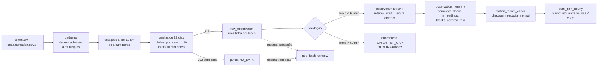

# Ingestão — guia operacional do pipeline alvo

- Tarefa: F2-DADOS-05 · Data: 2026-10-10 · Status: **alvo proposto**. Nada abaixo existe no código ainda; o desenho, as tabelas e as decisões estão em `docs/adr/0006-pipeline-de-ingestao.md` (proposto, depende do ADR 0005). Os nomes de endpoint e comando são propostas sujeitas à aprovação de contrato.

## Fluxo em uma linha

Fonte → parser (declara o fuso) → `raw_observation` (bruto, append-only) → validação (converte para UTC, confere faixa, unidade, duplicata e lacuna; reprovado vai para `ingestion_quarantine`) → `observation` (série consolidada, `timestamptz`, chave natural) → view horária (`observation_hourly_v`) → export com manifesto. Cada passo grava uma linha em `ingestion_run`.

## Regras que valem sempre

1. UTC no banco; `America/Recife` só na exibição (ADR 0001).
2. O fuso é convertido na validação, não no parser. Fonte com fuso `UNVERIFIED` (ANA, APAC meteorologia24h e Cemaden, até serem verificadas) fica em quarentena `TZ_UNVERIFIED`.
3. Nunca preencher lacuna com constante: ausência é `NULL` mais flag.
4. Hora é a grade do dataset, rotulada pelo **fim** do intervalo. Total diário da APAC (`P1D`) é série separada e não entra na grade horária.
5. Nada é apagado. Correção da agência cria nova `revision`; o valor anterior fica em `observation_revision`.
6. Schema só muda por Flyway, com aprovação (ADR 0003). Testes de ingestão usam Testcontainers (ADR 0004).

## Como rodar uma carga histórica

A carga parte do zero (não há histórico de 5 anos em lugar nenhum). Ordem recomendada, após as migrations V3–V6 aplicadas e aprovadas:

1. Confirmar o fuso da fonte em `source_registry` (estado diferente de `UNVERIFIED`) e o `variable_catalog` preenchido com faixas e fontes citadas.
2. Disparar o backfill por fonte e intervalo (proposta): `POST /api/admin/ingestion/runs` com `{"source":"OPEN_METEO_ARCHIVE","from":"2021-01-01T00:00:00Z","to":"2026-01-01T00:00:00Z","mode":"REFETCH"}` (papel `ADMIN`). Fazer por blocos (por exemplo, um ano) para limitar o tamanho de cada lote; uma transação por lote.
   **O `POST` é assíncrono.** Ele responde `202` com `{"runId": ...}` na hora e o run continua em segundo plano (`status = RUNNING`, depois `OK` ou `FAILED`). Disparar vários seguidos faz os runs rodarem em paralelo; a maré horária (`TIDE_PE02_HOURLY`) depende dos extremos (`DHN_TABUA_PE02`, `TABUAMARE_PE02`) já gravados e, se rodar antes, termina `OK` com 0 linhas (F2-BACK-21). O roteiro deve, para cada run: (a) disparar; (b) consultar `GET /api/admin/ingestion/runs/{runId}` até `status` sair de `RUNNING`; (c) só então disparar o próximo; (d) se `FAILED`, ler `errorSummary` antes de repetir. Ordem da maré: `DHN_TABUA_PE02`, `TABUAMARE_PE02`, por último `TIDE_PE02_HOURLY`.

   Respeitar o limite da TabuaMare: o `RateLimiter 'tabuaMare'` permite 15 chamadas por 60 s (`application.yml`, `limit-for-period: 15`, `limit-refresh-period: 60s`), e `TABUAMARE_PE02` faz uma chamada por mês. Janela longa pode esgotar o limite e o run termina `FAILED` ("RateLimiter 'tabuaMare' does not permit further calls"; ocorreu no F2-BACK-21). Dividir a janela em blocos de no máximo 12 meses e esperar 60 s entre blocos da TabuaMare. Exemplo (cookie `accessToken` de um ADMIN no arquivo `$JAR`):

   ```bash
   run() {  # run <json>: dispara, espera o estado final e retorna erro se não for OK
     id=$(curl -s -b "$JAR" -X POST localhost:8080/api/admin/ingestion/runs \
          -H 'Content-Type: application/json' -d "$1" | jq -r .runId)
     while :; do
       st=$(curl -s -b "$JAR" "localhost:8080/api/admin/ingestion/runs/$id" | jq -r .status)
       [ "$st" != RUNNING ] && break; sleep 5
     done
     echo "$id $st"; [ "$st" = OK ]
   }
   run '{"source":"DHN_TABUA_PE02","from":"2021-09-29T03:00:00Z","to":"2026-01-01T03:00:00Z","mode":"REFETCH"}' &&
   run '{"source":"TABUAMARE_PE02","from":"2026-01-01T03:00:00Z","to":"2026-11-03T03:00:00Z","mode":"REFETCH"}' &&
   run '{"source":"TIDE_PE02_HOURLY","from":"2021-10-01T03:00:00Z","to":"2026-11-01T03:00:00Z","mode":"REFETCH"}'
   ```

   Se um bloco da TabuaMare falhar por limite, `sleep 70` e repetir o mesmo bloco (idempotente).
   **Cemaden PED (`CEMADEN_PED`, ADR 0021).** Um run só para os 5 anos, sem blocos: o adaptador baixa janelas de 29 dias por estação a 10 requisições por minuto (~2 900 janelas, 5 a 6 h em 2026-11-09). Pré-requisitos: `CEMADEN_PED_EMAIL` e `CEMADEN_PED_SENHA` no `.env` e um usuário ADMIN. Exemplo, com o `run` acima:

   ```bash
   run '{"source":"CEMADEN_PED","from":"2021-09-01T00:00:00Z","to":"2026-10-08T00:00:00Z","mode":"REFETCH","kind":"BACKFILL"}'
   # depois da carga: checagem espacial mensal, série do ponto e vínculo (ADR 0022)
   curl -s -b "$JAR" -X POST "localhost:8080/api/admin/chuva-ponto/rebuild?from=2021-09-01T00:00:00Z&to=2026-10-08T00:00:00Z"
   ```

   Se o run terminar `PARTIAL` (PED fora do ar, token recusado que não renovou), dispare o mesmo pedido de novo: as janelas já gravadas em `ped_fetch_window` são puladas. **Atenção:** pela mesma razão, num banco que já tem a carga, repetir o pedido NÃO baixa de novo. Para forçar a nova leitura da PED, suba a API com `CEMADEN_PED_RESUME=false docker compose up -d mapi-api` (o compose repassa como `MAPI_INGESTION_CEMADENPED_RESUME`) (ou apague as linhas da faixa em `ped_fetch_window`, que é só controle de progresso). Num banco novo e vazio a tabela começa vazia e tudo é baixado.

3. Conferir o `ingestion_run`: `status = OK`, e as contagens `fetched = raw_inserted + raw_unchanged`, `valid + quarantined` coerente com `fetched`.
4. Revisar a quarentena (consulta abaixo) antes de liberar o dataset.
5. A leitura horária é a view `observation_hourly_v` (sem materialização): não há agregado para atualizar. Hora rotulada pelo fim do intervalo `(t−1h, t]`.
6. Rótulos: importar o CKAN (`source = CKAN_RECIFE`), conferir o filtro Cobrade em `label_filter` e o raio em `linkage_config`. O realinhamento ao pico de chuva fica desativado.

## Como reprocessar `[t0, t1]` de uma fonte

Mesma chamada, com `kind` implícito `REPROCESS`:

- `"mode":"REFETCH"`: baixa de novo a fonte (para pegar correção da agência); registros sem mudança também são revalidados.
- `"mode":"REVALIDATE"`: não vai à agência; reaplica regras e fuso sobre o bruto já guardado, selecionado pelo instante de origem (use depois de corrigir uma regra, uma faixa ou o fuso de uma fonte). Uma linha deslocada pelo fuso pode cair fora de `[t0, t1)`; isso é esperado.

Garantias: só registros de origem em `[t0, t1)` são lidos; repetir a chamada sobre a mesma resposta não insere nem altera nada (`raw_inserted`, `obs_inserted`, `obs_updated` zerados na segunda vez); registro que a agência deixou de devolver não é apagado (conta em `absent_in_refetch`). Há um reprocessamento por fonte por vez (advisory lock).

## Como auditar

Consultas de partida (nomes do ADR 0006; ajustar ao schema aprovado):

```sql
-- o que uma execução fez
SELECT * FROM ingestion_run WHERE id = :run_id;

-- o que mudou numa execução (valores corrigidos)
SELECT * FROM observation_revision WHERE superseded_by_run_id = :run_id;

-- de onde veio um valor exportado: do provenanceId ao bruto
SELECT o.*, r.payload, r.source_ts_text, r.source_tz
FROM observation o
JOIN raw_observation r ON r.content_hash = o.raw_hash AND r.source = o.source
WHERE o.run_id = :provenance_id AND o.station_id = :station AND o.ts_utc = :ts;

-- quarentena aberta por regra
SELECT rule_id, reason, count(*) FROM ingestion_quarantine
WHERE resolved_at IS NULL GROUP BY 1, 2 ORDER BY 3 DESC;
```

No dataset exportado, o **manifesto** (`/api/export/ia-dataset/{slug}/manifest`, proposto) lista `datasetId` (SHA-256 do CSV), período, fusos, `linkage_config` usada, `rule_version` e os `run_id` por fonte e variável. É o documento que a banca recebe junto do CSV.

## Chuva da CEMADEN e maré da timeline (2026-10-21)

- **Leitura = bloco.** Cada leitura do endpoint `/cemaden/` da APAC é a chuva de um bloco de 10 min (com chuva) ou 60 min (seco), com carimbo no fim; não é acumulado. A soma dos blocos de 24 h bate com o `acc24hr` publicado pela CEMADEN.
- **Hora.** A V22 põe a chuva `EVENT` das fontes com `source_registry.event_rain_blocks` (só CEMADEN) em `observation_hourly_v`: a hora é a soma dos blocos com fim nela. Bloco que falta numa hora com leitura conta como zero; hora sem leitura não gera linha (estação calada é lacuna).
- **Coleta.** O coletor entrega ao pipeline todas as leituras da janela de ~24 h ainda não entregues (marca por estação, em memória). Ao subir a API, a janela inteira vai de novo, e é isso que recupera uma parada; o pipeline é idempotente pela chave natural. O fluxo legado (`sensor_data`) segue só com a última leitura. O lote ao vivo grava também as estações (`station`), com coordenadas.
- **Pico isolado.** A chuva horária servida (timeline, última hora do mapa público e dos alertas) descarta a hora de uma estação com 10 mm ou mais quando pelo menos 2 vizinhas a até 6 km informam a mesma hora abaixo de 1 mm (`RainSpatialCheck`). Caso real: Bonsucesso (Olinda), 40,7 mm com as 15 vizinhas em 0. Nada é apagado de `observation`.
- **Conferência.** `GET /api/sensors/cemaden/accumulated` traz os acumulados oficiais de 1 a 96 h do painel público da CEMADEN (`resources.cemaden.gov.br/graficos/interativo/getJson2.php?uf=PE`, sem credencial) e a diferença para a soma de 24 h do MAPi.
- **Maré.** `TideObservationSyncTask` recarrega TABUAMARE_PE02 em `observation` (3 dias atrás a 10 à frente, no máximo até 31/12) quando falta cobertura. Se ainda assim não houver extremo, a timeline usa a tábua local `tide_tables`.

## Revisão de 2026-11 (proposta, ADRs 0018–0020)

- **Recarga e nome novo.** O banco passa a se chamar `mapi_db`, em volume novo; `tide_db` e o volume antigo ficam até aprovação para apagar. Ordem e o que se preserva: ADR 0020. Antes de começar: dump `tide_db-2026-11-08-pre-recarga` (`docs/snapshots/2026-11-08-pre-recarga.md`) com cópia fora da máquina.
- **Vínculo estação↔ponto.** Raio máximo (padrão proposto 5 km) e regra em `linkage_config`; fora do raio, reanálise declarada (ADR 0018).
- **Fontes novas de chuva.** APAC histórica: só total diário, série `P1D` fora da grade horária; XLSX bruto com hash; o adaptador falha de forma visível se a planilha mudar ou vier vazia; uma requisição por vez. Cemaden histórico: API PED com token, blocos de 10 a 60 min (seção abaixo, ADR 0021).
- **Rótulos.** Modelo multifonte com precisão temporal e espacial, confiança, deduplicação entre fontes e negativos verificados (ADR 0019). Toda fonte de rótulo passa por bruto, fuso declarado e quarentena.

> **Aviso.** Nada ingerido como rótulo pode realimentar a definição de evento, o limiar de classificação ou a capacidade da galeria (ADR 0006, 0017, 0019).

Detalhes e números: `docs/REVISAO-INGESTAO-2026-11.md`.

## Cemaden histórico pela PED e chuva do ponto (2026-11-09, ADRs 0021 e 0022)

DADOS DA REDE OBSERVACIONAL DO CEMADEN/MCTIC (citação obrigatória, `docs/FONTES-E-LICENCAS.md` seção 6.1).



**Como rodar.** Credenciais em `.env` (`CEMADEN_PED_EMAIL`, `CEMADEN_PED_SENHA`), repassadas pelo compose. Carga: `POST /api/admin/ingestion/runs` com `{"source":"CEMADEN_PED","mode":"REFETCH","kind":"BACKFILL","from":...,"to":...}`. Depois da carga: `POST /api/admin/chuva-ponto/rebuild?from=...&to=...` (horas cheias UTC) refaz a checagem, a série do ponto e o vínculo.

**Fluxo.** Síncrono, sem agendamento: a `dados_pcd` devolve até 30 dias de uma estação na hora. O agendamento da PED (`/controle-agendamento/pcds-dados-historicos`) não é usado: leva até 3 dias e o arquivo expira em 30 dias (ADR 0021, opção A). Se um dia for preciso usá-lo, o identificador do pedido e a data de expiração entram em `ingestion_run.params` e o download sai assim que o status for `CONCLUIDA`.

**Limite de requisições.** A PED bloqueia o usuário externo que passa de 12 requisições por minuto. O cliente faz uma a cada 6 s (10 por minuto), contando a emissão de token, sem rajada (`mapi.ingestion.cemaden-ped.min-interval-ms`). Erro transitório (rede, 429, 5xx) espera 30 s, 60 s, 120 s; depois o run falha e pode ser retomado.

**Retomada.** Cada janela (estação × 29 dias) entra em `ped_fetch_window` na mesma transação do bruto e da observação. Uma carga interrompida é retomada disparando o mesmo pedido: as janelas gravadas são puladas (`resume`). Repetir uma janela é idempotente (bruto pelo hash, observação pela chave natural).

**Token.** Renovado 5 min antes do `exp` e depois de um 401/403. Expiração é erro recuperável, nunca "zero registros".

**Sem dado.** HTTP 202 "Nenhum resultado foi encontrado" = janela `NO_DATA`. Não é erro e não gera zero de chuva: a hora fica lacuna.

**Bloco e hora.** A duração do bloco é o intervalo até a leitura anterior; a requisição começa 70 min antes da janela para que a anterior esteja sempre na resposta. Bloco acima de 60 min vai para a quarentena. A hora segue a V22 (soma dos blocos com fim nela; bloco que falta numa hora com leitura conta zero). Por hora, a view declara `n_readings` (blocos), `blocks_covered_min` e `first_block_start_utc`: uma hora com seis blocos de 10 min e uma com um bloco de 60 min ficam distinguíveis.

**Qualificação.** O código `qualificacao` vai para `observation.qualifier`. `0002` vai para a quarentena `QUALIFIER / SUSPECT_QUALIFIER` (70 blocos em 5 anos, todos acima de 25 mm; decisão de 2026-11-09, ADR 0021); `0000` e `0004` sem filtro. Significado em consulta (`docs/extratos/cemaden-ped.md`, seção 5).

**Vínculo e checagem.** Antes de tudo, a hora de pico isolado sai da série (`RainSpatialCheck`, mesma regra da chuva ao vivo). Dentro de 5 km, maior valor horário entre as estações aprovadas na checagem espacial do mês; reprovada fica em `station_month_check` com o motivo (travado, entupimento, excesso, cobertura parcial dos blocos). Cada hora de `point_rain_hourly` declara a estação, a distância e quantas estavam válidas (ADR 0022).

**Conta.** Conta da PED inativa por um ano é removida pela plataforma: usar a API pelo menos uma vez antes de 2027-11.

## Estação canônica e acumulado medido (2026-11-15, ADR 0023)

DADOS DA REDE OBSERVACIONAL DO CEMADEN/MCTIC.

**Unificação.** A mesma estação física chega pela coleta ao vivo (`CEMADEN`) e pela PED (`CEMADEN_PED`). `POST /api/admin/stations/unify` refaz `station_canonical` e `station_alias`: cada estação ao vivo a até 150 m da estação PED mais próxima vira apelido dela; duas estações da mesma fonte nunca se fundem; nome só vai para o registro. Na API recém-migrada, o primeiro ciclo de acumulados roda a unificação sozinho se a tabela estiver vazia.

Resultado em `mapi_db`, 2026-11-15 (log de `StationUnificationServiceImpl`; ensaio em SQL com o mesmo resultado):

| Medida | Valor |
|---|---|
| Estações lidas: PED / ao vivo | 46 / 47 |
| Canônicas | 68 |
| Unificadas (PED + ao vivo) | 25, todas com o mesmo código, a 0 m |
| Só PED / só ao vivo | 21 / 22 |
| Menor distância de uma estação ao vivo não unificada até a PED | 1 039 m |
| Horas comparadas / divergências (> 0,5 mm) | 0 / 0: sem sobreposição de horas (ao vivo de 2026-11-08 a 11-09; PED até 2026-10-07) |
| Mesmo código, nome diferente | 1 (260960004A: "[APAC] Ouro Preto" × "Jardim Fragoso") |

Para medir divergência é preciso a PED no período da coleta ao vivo: `run '{"source":"CEMADEN_PED","from":"2026-11-07T00:00:00Z","to":"2026-11-16T00:00:00Z","mode":"REFETCH","kind":"BACKFILL"}'` e depois `unify`.

**Série canônica.** `canonical_rain_hourly_v`: por estação canônica e hora, o valor da PED quando existe; senão, o da coleta ao vivo. Filtrar por `canonical_id` e hora.

**Acumulado medido.** `/pcds-acum/acumulados-recentes?codibge=` (um município por requisição; `uf` não é aceito, HTTP 400). Ciclo agendado a cada 10 min (`mapi.ingestion.cemaden-ped.accumulation-refresh-ms`), fora da requisição HTTP, pelo mesmo cliente da carga (uma requisição a cada 6 s). Municípios = os dos códigos das canônicas (14 na RMR). `null` numa janela = sem leitura; HTTP 202 = município sem dado; nenhum dos dois vira zero. `datahora` é o instante do cálculo em UTC, não a última leitura. Primeiro ciclo em 2026-11-15: 81 estações, 14 municípios, 0 sem dado, 0 falhas (13 estações fora do cadastro do MAPi, como a `A301` do INMET).

**Acumulado por ponto.** `point_rain_accum_v` soma 3, 6, 12 e 24 h de `point_rain_hourly` (uma linha por hora, inclusive lacunas). Janela com qualquer hora sem valor = `NULL`; `rain_<N>h_n` diz quantas horas tinham valor.

**Entradas físicas por ponto (V27, modelo v3).** `point_physical_inputs_v` fica ao lado de `point_rain_accum_v`, na mesma grade (`hour_end_utc`, hora rotulada pelo fim), cada entrada com sua coluna de origem; ausente é `NULL`.

| Coluna | Unidade | Origem | Regra | Cobertura (medida em 2026-11-16) |
|---|---|---|---|---|
| `rain_max_10min_mm` | mm | blocos de 10 min da PED, da mesma estação que deu o valor horário | maior bloco da hora; `NULL` se algum bloco maior que 10 min tem chuva (pico desconhecido); bloco longo com 0 mm vale 0 | 100% das horas secas; 19,9% das horas com menos de 1 mm; 28,4% de 1 a 5 mm; 42,7% de 5 a 10 mm; 59,6% com 10 mm ou mais |
| `tide_trend_m_h` | m/h | `TIDE_PE02_HOURLY` | nível na hora menos o da hora anterior; positivo = enchendo | de 2021-10-01 a 2026-11-14 |
| `river_level_m` | m | régua do Duas Unas (APAC, `APAC-RIO-260790119H`) | média da hora; só para ponto a até 1 km da régua (hoje, `JABOATAO_CENTRO`, a 556 m) | **só desde 2026-11-09** (12 leituras): não há histórico para treino |
| `soil_moisture` | m³/m³ | ERA5-Land, 0–7 cm (**reanálise**) | valor da hora anterior | de 2021-01-01 a 2026-11-01: chega com cerca de duas semanas de atraso, **ausente ao vivo** |

A previsão ao vivo manda as mesmas quatro, com as mesmas regras (`PointPhysicalInputService`), nos campos `rain_max_10min_mm`, `tide_trend_m_h`, `river_level_m` e `soil_moisture` do pedido à IA.

### Próxima recarga da PED: `/pcds/pcds-dados-pg` (registrado, não executado)

A carga de 2026-11-09 usou `/pcds/dados_pcd`: uma estação e no máximo 30 dias por requisição, ~2 900 janelas e 5 a 6 h. A PED tem uma rota paginada (especificação em `https://sws.cemaden.gov.br/PED/api/ui/swagger.json`, lida em 2026-11-15):

| Parâmetro | Uso |
|---|---|
| `rede` | obrigatório, `11` (Cemaden) |
| `datainicio`, `datafim` | obrigatórios, `aaaaMMddHHmm` ou `aaaaMM`; sem o limite de 30 dias |
| `uf` ou `codibge` | opcionais: o estado ou o município inteiro numa consulta |
| `sensor` | opcional, `10` (chuva) |
| `scroll` | identificador da página seguinte, devolvido na primeira; expira em 30 s |

Caminho proposto: um município por consulta (`codibge`), `sensor=10`, período inteiro, seguindo o `scroll` até a última página. O `scroll` expira em 30 s, e o intervalo de 6 s entre requisições cabe nisso. A retomada passa a ser por (município, página), e não por (estação, janela); a duração do bloco continua vindo da leitura anterior da mesma estação, então as páginas de uma estação precisam ser ordenadas antes da validação. Antes de usar: conferir numa amostra que a rota devolve as mesmas leituras e a mesma `qualificacao` da `dados_pcd` (mesmo hash de bruto). Também existe `/pcds-acum/acumulados-historicos`, não avaliada.

## Retenção e compressão (resumo)

Staging bruto e série consolidada **não têm `drop_chunks`**. Compressão (14 dias no bruto, 60 na consolidada) e continuous aggregates estão **adiados** (migração de compressão, número a definir): entram só se um limiar de medição for atingido (ADR 0006, seção 9). Apagar bruto exige exportar para arquivo com SHA-256 e aprovação explícita. Detalhe e volumes: ADR 0006, seção 9.

## Pendências antes de usar

- Aprovação de contrato e das migrations V3–V6 (ADR 0006, "Contratos que mudam").
- Verificação do fuso de APAC meteorologia24h (ANA: V14; Cemaden ao vivo: V13; Cemaden PED: V24).
- Decisão sobre os ~4 semanas de dados de desenvolvimento (ADR 0006, seção 4).
- ADR 0005 (banco) aprovado.
