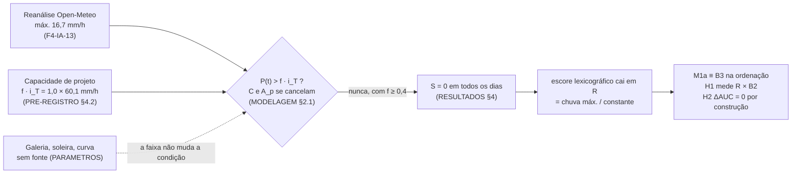

# Interpretação da avaliação F1 e limitações

- Tarefa: F4-IA-03 · Data: 2026-10-11 · Autor: Agente 3 (nível Máximo, interpretação) · Revisão pendente: Lucas e orientador
- Só documentação. Nenhum código, banco, parâmetro ou escore foi alterado; nenhuma análise nova foi rodada sobre os rótulos.
- Lê: `docs/PRE-REGISTRO-AVALIACAO.md` com as emendas (abaixo, "PRE-REGISTRO"), `docs/RESULTADOS-AVALIACAO-F1.md`
  ("RESULTADOS"), `docs/revisao/fase-4/F4-IA-13.md` ("F4-IA-13"), `docs/MODELAGEM-IA.md` §0–10 ("MODELAGEM"),
  `docs/PARAMETROS-MODELO-FISICO.md` ("PARAMETROS"), `docs/MEMO-ESCASSEZ-DE-ROTULO.md` ("MEMO"),
  `docs/REVISAO-CRITICA.md` ("RC"), `docs/HANDOFF-fase-2.md`, `docs/HANDOFF-fase-3.md`, ADR 0009 e `.claude/mapi/PROGRESSO.md`.
- Escopo: só H1 e H2. A rede de Petri, o emulador, H3 e H4 estão **fora do escopo** por decisão do autor (PRE-REGISTRO,
  emenda 3 de 2026-10-11). Por isso não aparecem aqui como pendência da avaliação.
- Única conta nova deste documento: a extensão da fórmula de Hanley e McNeil do PRE-REGISTRO, Apêndice A, para outros
  tamanhos de amostra (§4.2). O método está descrito lá.

## Resumo em seis linhas

1. **Confirmatório:** H1 é **inconclusiva** (ΔAUC +0,113, IC 95% [−0,010; +0,252]) e **degenerada**. H2 **não foi testada**
   por causa da regra de parada (RESULTADOS §4, §5, §7).
2. O balde **nunca transbordou**: `S = 0` em todos os 14 positivos e alerta em 0 de 689 dias de N. O AUC de 0,891 vem do
   desempate `R`, que é a chuva horária máxima da reanálise dividida por uma constante (RESULTADOS §4).
3. A causa é a escala da forçante: a reanálise chega a no máximo 16,7 mm/h, contra 50,3 mm/h do limiar IDF e 60,1 mm/h da
   capacidade de projeto (F4-IA-13, comparação §4.3).
4. Nada disso diz se o modelo físico tem ou não habilidade. O teste não chegou a exercitar o modelo.
5. Um teste com poder precisa, ao mesmo tempo, de chuva pontual (pluviômetro com fuso verificado), de mais episódios
   (≥ 43 para recall com ±0,15; MEMO §1.3) e de rótulo com hora e endereço. Hoje não há nenhum dos três.
6. A dissertação lê o resultado no enquadramento da opção G (MEMO §6), como estava declarado antes da junção
   (PRE-REGISTRO §7, último parágrafo; MODELAGEM §0, item 3).

---

## 1. O que o resultado diz e o que não diz

### 1.1 Confirmatório (as duas únicas hipóteses do protocolo)

| Hipótese | Classificação pelo protocolo | Números | Origem |
|---|---|---|---|
| H1: M1a > B2 (climatologia sazonal) | **Inconclusiva** e degenerada | AUC M1a 0,891 [0,747; 0,970]; B2 0,777 [0,641; 0,890]; ΔAUC +0,113 [−0,010; +0,252] | RESULTADOS §4 |
| H2: M1a > B3 (regra de chuva de IDF) | **Não testada** (regra de parada da PRE-REGISTRO §1) | ΔAUC 0,000 por construção, só descritivo | RESULTADOS §5 |

O que se pode escrever na dissertação, nos termos da PRE-REGISTRO §7: "Com 14 positivos em 13 episódios, M1a não é
distinguível de B2". Não se afirma superioridade nem equivalência, porque não há margem de equivalência com fonte nem poder
para isso (MODELAGEM §7, item 3).

Três qualificações, todas exigidas pelo próprio protocolo:

1. **A inconclusão de H1 não é sobre o balde.** Pela condição de degeneração (PRE-REGISTRO §7, linha "Degenerado"), o
   escore lexicográfico de M1a caiu inteiro no desempate `R = máx. chuva horária / (f · i_T)`. Logo, o ΔAUC de H1 compara
   "chuva horária máxima da reanálise" com "normal mensal do INMET". Mesmo que o IC tivesse excluído 0, a afirmação
   possível seria essa, e não "o balde físico agrega algo" (RESULTADOS §4, último parágrafo).
2. **H2 não foi testada, e não "deu zero".** O ΔAUC exatamente 0 é identidade algébrica: com `S ≡ 0`, M1a e B3 ordenam os
   dias do mesmo jeito (RESULTADOS §5). Esse desfecho estava previsto por escrito antes da junção (MODELAGEM §2.4;
   PRE-REGISTRO §7: "inconclusivo ou degenerado em H2").
3. **A faixa de sensibilidade não muda nada.** As 24 variantes de M1 dão o mesmo AUC (0,891) e o mesmo ΔAUC. O motivo é que
   só `f = 0,2` e `f = 0` produzem `S > 0`, e em nenhum dos dois casos a ordenação muda (RESULTADOS §6). Isso **não** é
   robustez do modelo. É sinal de que os parâmetros não chegaram a atuar.

O limite inferior do IC de H1 fica 0,010 abaixo de zero. Isso indica que H1 está "no limite", e não "claramente nula"
(RESULTADOS §10, item 8). A classificação, porém, é a que o protocolo fixou: inconclusiva. Ler −0,010 como "quase
significativo" seria mudar a regra depois de ver o dado.

### 1.2 Secundário pré-registrado (descritivo, sem correção para multiplicidade)

| Medida | Valor | Origem | Leitura |
|---|---|---|---|
| Recall de M1a e de B3 (50,3 mm/h e variantes de limiar por hora) | 0/14 [0; 0,232]; 0/18 [0; 0,185] | RESULTADOS §8 | Nenhum alerta. As métricas binárias não informam |
| Alerta em N (689 dias sem registro) | 0/689 [0; 0,0053] | RESULTADOS §8 | Idem |
| B3-24h (30 mm em 24 h, PLACON) | 4/14 [0,084; 0,581]; 4/689 [0,0016; 0,0148] | RESULTADOS §8 | Única regra que alerta. É limiar de mobilização por previsão, não de alagamento (PARAMETROS, "Por que este e não outro") |
| McNemar M1a × B3 | 0 e 0 discordantes, p = 1,0 | RESULTADOS §8 | Nenhuma informação |
| AUC contra 0,5 | M1a = B3 = 0,891; B3-24h 0,891 [0,735; 0,976]; B2 0,777 | RESULTADOS §8 | Todos os IC excluem 0,5. M1 e B3 têm o mesmo escore: não são evidências independentes |
| Análise com 18 positivos (17 episódios) | M1a/B3 0,854 [0,704; 0,962]; B2 0,795 [0,680; 0,889] | RESULTADOS §8 | 2022-07-12 (posto 0,07) puxa para baixo |
| Verificação de consistência com Fonseca Neto et al. (2026) | B3-50 não alerta em nenhum dia | RESULTADOS §8 | O resumo relata 89 alertas a 50% do limiar com pluviômetro (PARAMETROS, "Limiar da regra de chuva"). A diferença é a forçante, não o limiar |

O que essa tabela autoriza: dizer, **como descrição secundária**, que ordenar os dias pela chuva horária máxima da
reanálise (B3) ou pela normal mensal (B2) coloca os dias com registro acima dos dias sem registro com AUC pontual
acima de 0,5.

Esse resultado, porém, não surpreende e não é independente do que já se sabia. O MEMO já tinha olhado a chuva dos dias
positivos: a regra "≥ 10 mm/dia" cobria 8 de 14 (PRE-REGISTRO §9, item 1). O viés de positivos e não rotulados também pode
favorecer escores de chuva, se o registro depender da intensidade da chuva (PRE-REGISTRO §2.2, último parágrafo).

### 1.3 Exploratório (fora do protocolo; não é achado)

1. **"A chuva horária máxima da reanálise carrega sinal."** O AUC de 0,891 do desempate `R` (igual ao de B3) sugere isso.
   Mas a comparação B3 × B2 **não era hipótese**. O ΔAUC é o mesmo +0,113, com IC que contém 0 (RESULTADOS §9, item 2).
   Na dissertação, entra como observação exploratória rotulada, para gerar hipótese numa análise futura pré-registrada.
   Não entra como resultado.
2. **`f = 0,2` com limiar:** 1/14 alertas em positivos e 1/689 em N (RESULTADOS §9, item 1). São dois dias. `f = 0,2` não
   tem fonte e não pode ser promovido a valor central por ter alertado.
3. **Dias de chuva baixa na reanálise** (2022-07-12, 2024-01-15): conferem com o conhecimento prévio declarado
   (PRE-REGISTRO §9). Não são achado novo (RESULTADOS §9, item 3).

### 1.4 O que não pode ser concluído

A lista completa está em RESULTADOS §10. Para a banca, os pontos centrais são estes:

- Não se pode afirmar que o modelo físico tem habilidade, nem que não tem. Ele não foi exercitado.
- Não se pode afirmar que a regra de IDF "não funciona" no Recife. Ela foi aplicada a uma forçante que não alcança as
  intensidades para as quais foi derivada.
- Nada se pode dizer sobre galeria, curva cota-volume, maré ou refluxo (RESULTADOS §10, item 5; MODELAGEM §7, item 4).
- Nada se pode dizer sobre previsão por ponto, antecedência ou calibração (MODELAGEM §7, itens 1 e 2). O `riskLevel` em
  produção não tem validação empírica. A emenda 1 do ADR 0007 (`modelValidationStatus`, RC-03) existe para que o painel
  diga isso.

## 2. Por que o teste degenerou

A degeneração tem três causas, que se somam. As duas primeiras bastam, cada uma, para explicá-la.

### 2.1 Escala da forçante: reanálise × chuva convectiva pontual

| Grandeza | Valor | Origem |
|---|---|---|
| Máximo horário da reanálise, 2021-04 a 2024-12, 4 pontos | 14,9 (Ibura, Imbiribeira) e 16,7 mm/h (CIn, Derby) | F4-IA-13, comparação §4.3 |
| Quantil 0,999 da chuva horária da reanálise | 6,65 a 6,81 mm/h | idem |
| Horas ≥ 25,2 / 35,2 / 50,3 / 60,1 mm/h | 0 em todos os pontos (131 632 pontos-hora) | idem |
| Limiar IDF de B3 (TR 2 anos, 60 min) | 50,3 mm/h | PARAMETROS, linha 6 (Silva e Araújo 2013, Eq. 16) |
| Capacidade de projeto da galeria (TR 5, 60 min) | 60,1 mm/h | PARAMETROS, linha 8; PRE-REGISTRO §4.2 |
| Máximo horário ÷ limiar IDF | 16,7 / 50,3 = 33% | RESULTADOS §5 |
| Maior chuva diária da grade em 2023–2024 | 41,1 mm (Imbiribeira); nenhum dia ≥ 50 mm | MEMO §1.5 |

A IDF descreve a chuva num ponto (pluviômetro). A reanálise dá a média de uma célula de grade. Por isso ela suaviza a
chuva convectiva de curta duração, que é a que alaga ruas (MODELAGEM §2.3, "Escala da chuva"; MEMO §1.5, leitura 2).

Sobre o tamanho da célula, os documentos do repositório só dizem "dezenas de km" (MEMO §1.5). O modelo de reanálise do
archive usado no export continua `[a verificar]` (PRE-REGISTRO §10, item 5). Um valor como "~10 km" fica `[sem fonte]`
até esse modelo ser fixado. Há, porém, evidência empírica de que a célula é maior que a distância entre pontos:
Derby e CIn têm quantis idênticos, e Ibura e Imbiribeira também, ou seja, cada par cai na mesma célula (F4-IA-13). Ibura
e Imbiribeira distam 2 695 m (MEMO §2, opção A).

A PRE-REGISTRO §4.3 previa medir essa diferença contra pluviômetro antes da junção. A medida foi **impossível**: o Cemaden
verificado só existe no banco a partir de 2026-10-09, e o archive vai até 2026-09-30. São **0 horas comuns**, contra o
mínimo de 1 ano exigido (F4-IA-13). Por isso as variantes M1-ef e B3-ef, que transfeririam o limiar por igual
frequência, não foram geradas. O resultado fica classificado como **"limitado pela escala da forçante"**, como previsto
(MODELAGEM §2.3), e isso não é motivo para reajustar parâmetros.

### 2.2 Cancelamento de C e da área contribuinte

No método racional, a capacidade é `q_p = f · C · i_T · A_p`, e a condição de transbordar `Q_in > q_p` equivale a
`P(t) > f · i_T`. **C e A_p se cancelam** (MODELAGEM §2.1). Eles só controlam quanto volume se acumula depois que a chuva
passa da capacidade. Com `f = 1,0` e `i_T = 60,1 mm/h`, o balde só transborda numa hora com mais de 60,1 mm.

Na reanálise, essa hora não existe: o máximo é 16,7 mm/h. Por isso nenhuma variante de `C` (0,70 a 0,95), `i_T` (50,3 a
68,7), `h_crit`, curva (±30%) ou snap (5/10/20 m) produziu transbordo (F4-IA-13, "Descrição das saídas"). Só `f ≤ 0,2`
deixa o limiar abaixo de 16,7 mm/h: 0,2 × 60,1 = 12,0 mm/h. É o único caso em que aparece `S > 0`, em 4 dias
(RESULTADOS §6).

A consequência estava declarada antes: sem cadastro de galerias, M1 é, na essência, "chuva horária acima da intensidade
de projeto, com armazenamento e memória". H2 mediria só o que o armazenamento acrescenta (MODELAGEM §2.1, §10 item 3).

### 2.3 Parâmetros sem fonte

| Parâmetro | Situação | Origem |
|---|---|---|
| Capacidade da galeria (`f`) | `[sem fonte]`; o central 1,0 é hipótese de "galeria como projetada" | PARAMETROS, "Parâmetros sem fonte"; MODELAGEM §2.3 |
| Soleira / `λ_NR` | `[sem fonte]`; M1b não roda | PARAMETROS; ADR 0009 |
| Curva cota-volume | derivada do MDT, ±30% sem fonte; ignora cavidades < 1 m e edificações | PARAMETROS |
| Área contribuinte | instável ao snap: Ibura 28 / 208 / 10 880 m² (5 / 10 / 20 m); Derby 26 / 62 / 14 875 m² | MODELAGEM §10, item 5 (`TERRENO-PE3D.md` §5.1) |
| Cadastro de microdrenagem | existe na Prefeitura, sem diâmetro nem declividade, não público; ~20% com cota de fundo | PARAMETROS, "Existe cadastro público" |

Na avaliação atual, esses parâmetros não causaram a degeneração: a forçante a causou antes. Eles importam para o futuro.
Se uma forçante pontual fizer o balde transbordar, o resultado passa a depender de `f` e da curva. Aí o risco de cair em
"positivo condicional", que o protocolo conta como inconclusivo (PRE-REGISTRO §7), fica real.

## 3. Ameaças à validade

### 3.1 Validade de construto (o que o rótulo e o escore medem)

1. **O rótulo mede atendimento registrado, não alagamento.** São ocorrências canônicas da Defesa Civil, categoria
   "alagamento", todas com precisão `DAY` (PRE-REGISTRO §2.1; MEMO §1.1). A sensibilidade do registro varia por ano: 1
   ocorrência em 64 855 registros em 2021, tipo vazio em 94% dos registros de 2022 (PRE-REGISTRO §2.2).
2. **Resolução de bairro, não de ponto.** São 77 coordenadas para 197 ocorrências, com distância mediana de 2 456 m ao
   ponto. A 500 m, só 3 eventos-dia casam (MEMO §1.1; F2-BACK-16 via MEMO). A unidade dia × Recife foi escolhida depois
   de ver isso: é mudança de desenho pós-hoc (MODELAGEM §0, item 1; RC-05 f).
3. **Ausência de registro não é ausência de alagamento.** N é "sem registro". A taxa sobre N chama-se "taxa de alerta em
   dias sem registro", nunca "falso alarme" (PRE-REGISTRO §2.2, decisão 2). MEMO §1.5: dos 12 dias com ≥ 20 mm na grade do
   Derby em 2023–2024, só 3 têm registro.
4. **O escore de M1a mediu chuva, não o balde.** Com `S ≡ 0`, o construto "lâmina simulada" não foi observado (§2).
5. **Ponte ponto → cidade.** Quatro pontos servem de índice para registros espalhados por 39 bairros (MODELAGEM §3, §10
   item 7).
6. **Mecanismo de maré fora.** Dias de alagamento sem chuva são perdidos por construção. Exemplo: 2024-01-15 teve 0,2 mm
   na grade (MEMO §1.5; MODELAGEM §2.1, último parágrafo).

### 3.2 Validade interna

1. **Contaminação declarada.** A chuva dos dias positivos já tinha sido olhada (MEMO, Apêndice B). As datas e os bairros são
   conhecidos, e o autor conhece os eventos por vivência (PRE-REGISTRO §9). Isso não foi cegado. O que protege o resultado:
   os limiares e parâmetros vieram de fontes externas e foram congelados antes (PRE-REGISTRO §4.2).
2. **O que foi feito a favor da validade interna:** escores cegos com SHA-256 congelado antes da junção (`4615d416…`); script
   rodado **uma vez** sobre os rótulos reais; consulta do Apêndice B sem alteração, com saída idêntica à tabela esperada
   (RESULTADOS, cabeçalho, §1 e §2).
3. **Convenção horária da chuva.** O teste de fuso da ANA deu argmax de −4 h nas 4 estações. A RC-16 aponta que esse
   deslocamento de ~1 h pode estar no rótulo da hora da ANA **ou** do Open-Meteo. Se estiver no Open-Meteo, o dia local
   (`t − 4 h`, MODELAGEM §2.4) desloca a hora perto da meia-noite. O efeito sobre o máximo diário deve ser pequeno, mas
   não foi medido `[a verificar quando a reavaliação da ANA (F2-DADOS-10) terminar]`. Observação: o Open-Meteo documenta
   "sum of the preceding hour" (PROGRESSO, F2-BACK-12), o que pesa contra o erro estar do lado dele.
4. **Decisões de desenho tomadas sob autorização durável.** Exemplos: 2021 como "sem rótulo" e o limiar só de fonte
   externa. A RC-25 pede confirmação explícita do autor. O cabeçalho do PRE-REGISTRO ainda mostra a caixa de confirmação
   e a leitura do orientador em aberto.

### 3.3 Validade estatística (de conclusão)

1. **14 positivos em 13 episódios.** O menor AUC cujo IC exclui 0,5 é ≈ 0,66, supondo positivos independentes. A diferença
   detectável fica entre ≈ 0,07 e 0,15, conforme a correlação entre os escores (PRE-REGISTRO §6.1 e Apêndice A).
2. **Bootstrap com 13 clusters é aproximado** (RESULTADOS §10, item 8). Com tão poucos clusters, a cobertura real do IC
   percentil pode ficar abaixo dos 95% nominais `[sem fonte no repositório; afirmação geral de método]`. Por isso a leitura
   "no limite" de H1 não deve ser forçada em nenhuma direção.
3. **As 24 variantes não são 30 evidências.** Elas compartilham o escore `R` (RESULTADOS §8).
4. **Positivos e não rotulados:** `AUC_medido = (1 − θ) · AUC_real + θ · 0,5` se os não registrados se parecerem com os
   registrados (conservador). Se o registro depender da intensidade da chuva, o viés favorece escores de chuva
   (PRE-REGISTRO §2.2). O sentido do viés aqui é desconhecido.
5. **Métricas binárias sem informação:** 0 alertas, McNemar sem discordantes (RESULTADOS §8).

### 3.4 Validade externa

1. Recife, 2023–2024, registro da Defesa Civil, quadra chuvosa: 4 dos 6 positivos de 2023 caem entre 06-14 e 07-07
   (MEMO §1.2).
2. A forçante é uma reanálise específica, que não foi fixada `[modelo do archive a verificar]`. Outra reanálise ou
   pluviômetro pode dar outro resultado. É exatamente isso que a 2ª análise (§6.1) testaria.
3. A produção usa `OPEN_METEO_CURRENT`/previsão, e a avaliação usou o archive: há *skew* de fonte (ADR 0006, limitação 2).
   Mesmo um resultado positivo não transferiria direto para o painel.

### 3.5 Independência parcial das fontes

| Fonte | Relação com os rótulos | Origem |
|---|---|---|
| Normal INMET 1991–2020 (B2) | independente: série sem sobreposição com o teste | PRE-REGISTRO, emenda 1 |
| IDF de Silva e Araújo (2013): 50,3 e 60,1 mm/h | independente: equação ajustada a 9 anos de série de chuva, sem ocorrências | PARAMETROS, linha 6 |
| Fonseca Neto et al. (2026) | **parcial:** testou limiares contra ocorrências do Cemaden de 2016–2025, sobrepostas ao teste. Entrou só como verificação de consistência | PARAMETROS, ressalva 1; PRE-REGISTRO §9, item 3 |
| `C` (Silva Júnior 2015 via Xavier Filho 2016) | independente, mas de fonte secundária | PARAMETROS, linha 1 |
| Reanálise Open-Meteo | independente dos rótulos; sem verificação contra chuva medida (0 h comuns) | F4-IA-13 |
| Revisões do desenho | todas feitas por modelos da mesma família (Opus); pontos cegos correlacionados | RC-11 |

## 4. O que seria necessário para um teste com poder

O teste falhou em dois pontos que não se resolvem com mais n: a forçante e o rótulo. Aumentar o número de episódios sem
trocar a forçante só estreitaria o IC de uma comparação entre `R` e B2, que não é a pergunta.

### 4.1 Condições necessárias, nesta ordem

1. **Forçante que alcance as intensidades de projeto.** Uma de três:
   - pluviômetro com fuso verificado nos anos do teste, para M1-pluv (MODELAGEM §2.3, último item);
   - transferência por igual frequência, que exige ≥ 1 ano de horas comuns reanálise × pluviômetro (PRE-REGISTRO §4.3);
   - Gumbel sobre 1991–2020 da própria grade, que exige o *backfill* da dependência 5 da PRE-REGISTRO §10.

   Sem isso, qualquer n reproduz a degeneração.
2. **Capacidade da galeria com fonte.** Com `q_p` medido (cadastro EMLURB/SESAN), o cancelamento de C e A deixa de valer
   (MODELAGEM §2.1). Sem ele, H2 mede só armazenamento e memória, e o resultado fica condicionado à faixa de `f`.
3. **Mais episódios independentes.** Os números abaixo saem das contas do MEMO e da PRE-REGISTRO.
4. **Rótulo com hora e endereço.** Só assim se volta à pergunta por ponto e com antecedência. Com precisão `DAY` e
   resolução de bairro, a unidade continua dia × cidade (MEMO §1.4).

### 4.2 Quantos episódios

**Métricas binárias** (MEMO §1.3 e Apêndice A, aproximação normal com recall 0,5):

| Meta | Positivos independentes | Origem |
|---|---|---|
| IC de recall com ±0,15 | ≈ 43 | MEMO §1.3 (42,7) |
| IC de recall com ±0,10 | ≈ 96 | MEMO §1.3 (96,0) |
| McNemar p < 0,05 com todos os discordantes a favor do modelo | ≥ 6 discordantes | MEMO §1.4 (`2 · 0,5^m`) |
| Portão para reabrir o supervisionado | ≥ 43 dias positivos independentes com local | MEMO §3.2 |

**Discriminação (ΔAUC).** Conta deste documento: a fórmula de Hanley e McNeil e o EP da diferença da PRE-REGISTRO,
Apêndice A, com AUC = 0,75, 689 negativos e o número de positivos variando. A linha de 14 reproduz o Apêndice A. A conta
supõe positivos independentes; com episódios agrupados, o IC real é mais largo.

| Positivos (episódios) | EP do AUC | ΔAUC detectável (1,96·EP_Δ), r = 0,5 / 0,8 / 0,9 |
|---|---|---|
| 14 | 0,076 | 0,149 / 0,094 / 0,067 |
| 20 | 0,064 | 0,125 / 0,079 / 0,056 |
| 30 | 0,052 | 0,103 / 0,065 / 0,046 |
| 43 | 0,044 | 0,086 / 0,054 / 0,038 |
| 60 | 0,037 | 0,073 / 0,046 / 0,033 |
| 100 | 0,029 | 0,057 / 0,036 / 0,026 |

Não existe, no repositório, um ΔAUC mínimo de interesse com fonte. Ele precisa ser fixado no próximo pré-registro, antes
de ver qualquer dado novo. Atenção: não se deve calcular o n "necessário" a partir do ΔAUC observado (+0,113). Isso seria
poder *post hoc*, e aquele Δ mede `R` × B2, não o balde (§1.1).

**De onde viriam os episódios.** O registro público de 2023–2024 dá 14. O de 2021–2022 não fornece negativos, e
2025–2026 não têm registro (PRE-REGISTRO §2.2). O Atlas Digital de Desastres tem, para a RMR em 2021–2025, 1 inundação,
0 alagamento e 15 "chuvas intensas", só em dia × município, e não serve para validar dia × cidade (PROGRESSO, F4-IA-12).
A única fonte realista de dezenas de episódios novos é o registro interno da Defesa Civil, pedido por LAI
(`docs/pedidos/05-…`). O prazo e o conteúdo da resposta estão fora do controle do autor (MEMO, opção C).

## 5. Como isso se encaixa na contribuição da dissertação

### 5.1 O que fica de pé, e o que não fica

Sob F1, a pergunta Q1 era se o modelo físico parametrizado externamente ordena os dias melhor que a climatologia e que a
regra de chuva (MODELAGEM §1). **A avaliação não responde Q1.** Não há como apresentar o balde como modelo validado, nem o
AUC de 0,891 como desempenho do MAPi. Afirmar qualquer uma das duas coisas contraria a RESULTADOS §10.

O enquadramento da opção G (MEMO §6) foi declarado **antes da junção** como a leitura de um resultado inconclusivo ou
degenerado (PRE-REGISTRO §7, último parágrafo; MODELAGEM §0, item 3). Usá-lo agora não é troca de desenho. Há, porém, uma
diferença a registrar com franqueza. A MODELAGEM §0 previa a leitura G para "inconclusivo por sensibilidade a parâmetro
sem fonte". O que aconteceu foi degeneração pela escala da forçante, que a PRE-REGISTRO §7 também cobre ("inconclusivo
ou degenerado em H2").

Passam a ser parte natural do texto, porque são resultados medidos e com origem:

1. **Demonstração quantitativa de que os dados abertos não sustentam o teste.** É o núcleo da opção G. São 18 dias com
   registro em 5 anos, 13 episódios no período útil e resolução de bairro (MEMO §1). A reanálise não alcança as
   intensidades de projeto (máximo de 16,7 contra 50,3 mm/h). Não existe série de pluviômetro com fuso verificado
   sobreposta (0 horas comuns). A §4 dá a ordem de grandeza do que faltaria. Esse resultado negativo é informativo para
   quem quiser validar previsão de alagamento urbano no Recife com dados públicos.
2. **Protocolo pré-registrado executado como escrito,** com degeneração prevista por escrito e confirmada. É uma
   demonstração de método: commit `77e41de`, escores congelados (`4615d416…`), execução única (RESULTADOS, cabeçalho). Vale
   pelo rigor, não pelo desfecho.
3. **Pipeline auditável:** proveniência por observação, fuso verificado por teste pré-fixado (Cemaden UTC−3; ANA reprovada
   e mantida em quarentena), maré oficial reconstruída dos PDFs da DHN (44 568 h) e terreno reprodutível com SHA-256 fixo
   (HANDOFF-fase-2; HANDOFF-fase-3).

### 5.2 O que não deve ser dito (viés de "salvar o trabalho")

- Que a engenharia se justifica pelo resultado. A RC-14 registra que a infraestrutura é grande para 5 pontos e 18 dias, e
  o custo-benefício nunca foi medido.
- Que o pré-registro "acertou" ao trocar para a tarefa diária. Esse disparo era previsível desde a Fase 1 (RC-04;
  MODELAGEM §0, item 2). A lição a registrar é de sequência: medir o rótulo antes de construir.
- Que o modelo físico "funciona, mas faltou dado". Isso não foi testado. O correto é: "não foi possível testá-lo com os
  dados disponíveis".
- Que o resultado favorece F1 sobre G, ou o contrário. A escolha entre F1 e G foi feita pelo autor e pelo orientador
  (pergunta 28). Este documento só registra que o desfecho de F1 coincide com o conteúdo de G.

Recomenda-se a leitura do orientador deste texto e da RESULTADOS antes da redação final (RC-11). Toda a cadeia de revisão
foi feita por modelos da mesma família.

## 6. Próximos passos condicionais

Cada passo abaixo só se aplica se a condição ocorrer. Nenhum deles muda a classificação da 1ª análise (H1 inconclusiva,
H2 não testada), que fica registrada como está.

### 6.1 Se a ANA sair da quarentena de fuso (F2-DADOS-10)

Decisão já registrada: a análise com pluviômetro será uma **2ª análise pré-registrada**, declarada como **posterior à
junção da 1ª**, com os **mesmos parâmetros congelados** (PROGRESSO, decisão de 2026-10-11). Para que ela tenha valor:

1. **Novo documento de pré-registro**, commitado antes de qualquer escore. Ele deve declarar o conhecimento acumulado:
   resultado da 1ª análise, chuva da reanálise nos positivos e as datas (complemento da PRE-REGISTRO §9).
2. **Mesma §4.2, sem reajuste.** `f`, `C`, `i_T`, `h_crit`, limiar de B3 e faixas como estão. Mesmos 14 + 4 positivos, os
   mesmos 689 negativos e o mesmo bootstrap.
3. **Etapa cega de novo:** escores com pluviômetro gerados e com SHA-256 commitado antes da junção.
4. **Conferir antes da junção, só com chuva:** cobertura da ANA em 2023–2024 nos pontos `[a medir]`, a comparação da
   PRE-REGISTRO §4.3 (agora possível, se houver ≥ 1 ano de horas comuns) e a frequência de horas ≥ 50,3 e 60,1 mm/h. Se o
   pluviômetro também não alcançar essas intensidades, o resultado degenera de novo e isso pode ser dito antes da junção.
5. **Leitura:** se o balde passar a transbordar, H1 e H2 passam a testar o modelo. Aí a faixa de `f` e da curva entra de
   verdade, e "positivo condicional" é um desfecho provável (§2.3).
6. **Resolver a RC-16 antes:** se o deslocamento de ~1 h estiver no Open-Meteo, isso também é limitação da 1ª análise
   (§3.2, item 3) e entra na 2ª como correção declarada.

### 6.2 Se o pedido LAI à Defesa Civil trouxer registros com hora

1. **Os 18 dias já foram usados como teste.** Os registros novos desses dias não reabrem a 1ª análise. No máximo, servem
   para auditar o rótulo: hora, endereço e se 2024-01-15 foi chuva, maré ou outro mecanismo (MEMO §1.5, leitura 3).
2. **Dias novos e disjuntos** (por exemplo, 2025–2026, que hoje não têm registro, e anos anteriores a 2021, se vierem)
   formam um conjunto de teste novo. 2025–2026 foram período de desenvolvimento sem rótulo (PRE-REGISTRO §5, passo 4).
   Os modelos foram rodados ali só para depuração, sem rótulo, então o período continua utilizável.
3. **Antes de ver o desempenho:** protocolo de fusão e deduplicação com o CKAN (MEMO, opção C), regra de casamento
   ocorrência ↔ ponto com raio fixado e contagem de episódios independentes.
4. **Portão:** com ≥ 43 dias positivos independentes com local, a pergunta supervisionada pode voltar, com novo
   pré-registro e treino só nos dias novos (MEMO §3.2; MODELAGEM §4, item 3).
5. **Com hora:** a verificação por ponto e com antecedência volta a ser formulável. Ela ainda depende de previsão de chuva
   arquivada, que o pipeline não guarda (MODELAGEM §1, "Natureza do teste").

### 6.3 Se o Δ do ADR 0009 for fechado (refluxo de maré)

1. **Δ sozinho não basta para M1b.** O bloqueio por maré exige `λ_NR`, a cota da soleira do exutório **em NR**, vinda de
   documento (MODELAGEM §2.1). Com Δ aprovado, uma soleira cadastrada no datum do MDT pode ser convertida para NR
   (`cota_NR = H + Δ`, ADR 0009). Mas a soleira em si continua `[sem fonte]` até o cadastro da EMLURB/SESAN chegar
   (PRE-REGISTRO §10, itens 9 e 10).
2. **Com Δ e soleira:** M1b vira hipótese nova, em novo pré-registro. A maré de 2023–2024 já foi carregada (RC-06: 17 544 h,
   F2-BACK-21). Varrer `λ` sobre os 18 dias continua proibido, porque consumiria os eventos que checam Δ (ADR 0009,
   ressalva 4; MODELAGEM §2.1).
3. **O que M1b poderia mostrar:** dias de alagamento com pouca chuva (2024-01-15, 2022-07-12) como candidatos a refluxo.
   Esses dias já são conhecidos (PRE-REGISTRO §9), então qualquer acerto neles fica com peso de verificação de
   consistência, não de teste.
4. **Sem Δ:** continuam proibidos "nível lá fora − cota da rua", a folga até a soleira com maré e "áreas abaixo da maré"
   (HANDOFF-fase-3; ADR 0009).

## Condições que mudariam esta interpretação

- Erro encontrado no script de avaliação ou nos escores. Exigiria nova execução com o diff registrado na PRE-REGISTRO §8,
  e esta interpretação seria refeita.
- Confirmação de que o deslocamento horário (RC-16) está no Open-Meteo, com efeito mensurável no máximo diário.
- O modelo de reanálise do archive se revelar diferente entre períodos (PRE-REGISTRO §10, item 5).
- Revogação, pelo autor ou pelo orientador, das decisões de desenho da RC-25 (conjunto de teste, limiar de B3).

> **Errata (2026-10-11):** versões anteriores deste documento diziam "30 variantes" de M1. O `resultado_etapa2.json` e o `escores_cegos.csv` têm **24** (central + 23: C 0,70/0,95; i_T 50,3/68,7; h_crit 10/30 cm; f 0,0–0,8; curva ±30%; snap 5/20 m; 8 cantos). A classificação (inconclusivo em toda a faixa) não muda. Divergência apontada em F4-IA-06.
