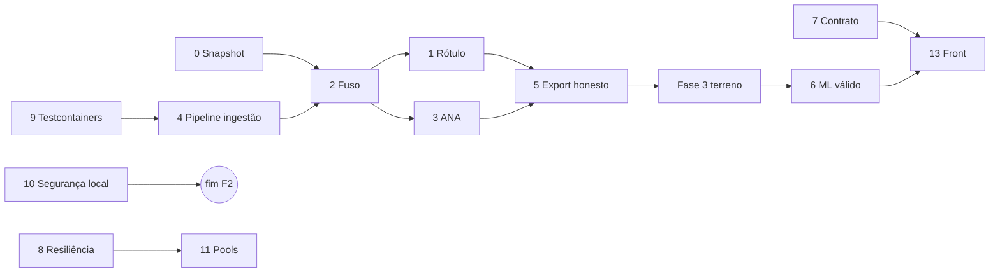

# Matriz de prioridade — Fase 1

- Tarefa: F1-ARQ-02 · Data: 2026-10-10 · Autor: Arquiteto · Checkpoint Máximo: ver §4
- Entrada: 90 achados (F1-B2: 26, F1-B3: 26, F1-I2: 17, F1-F2: 21) em `docs/revisao/fase-1/`.
  Agrupados em 15 itens de backlog. Critério de ordem: (1) afeta a validade do resultado da
  dissertação, (2) bloqueia fase seguinte, (3) risco operacional, (4) esforço.
- Esforço: P ≤ 1 dia · M ≤ 1 semana · G > 1 semana (estimativa do Arquiteto, sem medição).

## 1. P0 — invalidam o resultado da dissertação se não forem corrigidos

| # | Item | Achados | Esforço | Fase | Nível | Depende de |
|---|---|---|---|---|---|---|
| 0 | **Snapshot auditável do banco atual** (`pg_dump` + SHA-256 + contagem por tabela) antes de qualquer migração ou correção retroativa — é o "antes" que a banca audita | checkpoint, ressalva 4 | P | 2 (início) | Rápido | banco de pé |
| 1 | **Rótulo circular**: `alignFloodEventsToRainPeaks` sobrescreve a hora do evento CKAN com o pico de chuva, então o rótulo passa a ser derivado da feature. Parar o realinhamento, preservar a data original e declarar a precisão (dia) | B3-04, B3-12 | M | 2 | Equilibrado + checkpoint | 2 (o fuso define o dia civil do evento), pergunta 9 |
| 2 | **Fuso unificado** (implementar ADR 0001): 5 tratamentos nas mesmas colunas, `now()` como fallback de parse | B3-02, B3-03, B3-18, B2-07, B2-21, F2-19 | G | 2 | Equilibrado | 0, 9 |
| 3 | **ANA fora do export** (sem lat/lon) e colisão de `sensor_id = slug` | B3-05, B3-06 | M | 2 | Equilibrado | 4 |
| 4 | **Pipeline de ingestão idempotente com proveniência** (staging → validação → consolidada; unique em `weather_data`; correção retroativa; raio gravado) | B3-01, B3-09, B3-10, B3-11, B3-13, B3-15, B3-16, B2-04, B2-05, B3-26 | G | 2 | Equilibrado + checkpoint (F2-DADOS-05) | 0, 9; a chave única de `weather_data` é definida em UTC: ou a conversão de fuso acontece no staging, ou a constraint só nasce depois do item 2 |
| 5 | **Export honesto**: imputação vira `null` + flag; APAC diário fora do `max` horário; CSV com unidade, fuso e manifesto (hash, período, versão) | B2-18, B2-19, B3-07, B3-08, B3-22 | M | 2 | Equilibrado | 2, 3 |
| 6 | **Pipeline de ML válido**: horizonte 3/6 h, split temporal, scaler no treino, baselines, métricas, metadata do artefato, fim do fallback sintético, mesmas features no treino e na inferência | I2-01…I2-06, I2-11, I2-12, I2-15 | G | 4 | Máximo (formulação) + Equilibrado | 1, 5, Fase 3 (terreno), pergunta 9 (horizonte 3/6 h × rótulo com precisão de dia) e escolhas de métrica e baseline do autor |

## 2. P1 — importantes (operação, contrato, base de teste)

| # | Item | Achados | Esforço | Fase | Nível | Depende de |
|---|---|---|---|---|---|---|
| 7 | **Contrato de degradação**: enum fechado `LOW/MEDIUM/HIGH/UNKNOWN`; probabilidade `null` em falha; `modelVersion`; fim do INSERT em GET e do POST por clique; UNKNOWN neutro no front. **Sobe para P0 se a dissertação usar `flood_predictions` (taxa de alerta, auditoria)**; caso contrário, registrar que essa tabela não entra nos resultados | B2-24, B2-25, I2-07, I2-08, I2-10, F2-02, F2-04, F2-06 | M | 2–4 | Equilibrado | pergunta 8 |
| 8 | **Resiliência da coleta**: timeouts em todos os clientes; fallback que não mascara falha (hoje 0/0 = sucesso, Retry nunca dispara); alerta Prometheus de dado parado; backfill pós-queda | B2-01, B2-02, B2-03, B2-06 | M | 2 | Equilibrado | — |
| 9 | **Testes reais**: Testcontainers (ADR 0004); testes de export, coleta, idempotência e predição; corrigir teste que fixa o `now()`. Se estourar o esforço, priorizar export e idempotência, que protegem os P0 | B2-20, B2-21, F2-21 | M | 2 | Equilibrado | — |
| 10 | **Segurança local e integridade do dataset** (`wipe-database` e registro aberto ao export ameaçam o dataset, não só a segurança): portas 5433/8000 em 0.0.0.0 (corrigido em F1-QA-02), JWT padrão público, registro aberto que dá acesso ao export, `wipe-database`, rate limit contornável | B2-12, B2-13, B2-14, B3-21 | P | 1 | Equilibrado | pergunta 10 |
| 11 | **Transações e pools**: transação aberta durante HTTP externo; Hikari 10 = executor 10; agendador de 1 thread | B2-08, B2-09 | M | 2 | Equilibrado | 8 |
| 12 | **Performance**: maré carrega o ano inteiro por leitura; GET faz trabalho de export; export sem limite e em memória | B2-10, B2-15, B2-16, B3-17 | M | 2 | Equilibrado | medir antes (k6) |
| 13 | **Front para Defesa Civil**: estado de erro (hoje "Sistemas Online" fixo), legenda, contraste ≥ 4,5:1, 390 px, projeção, painel com causa, lâmina e cota | F2-04, F2-09…F2-13, F2-16 | G | 4 | Equilibrado + frontend-design | 7 |

## 3. P2 — desejáveis

| # | Item | Achados | Esforço |
|---|---|---|---|
| 14 | ArchUnit (4 violações hoje); dividir `MapiServiceImpl` (775 linhas, 5 responsabilidades); cache com entidade mutável | B2-22, B2-23, B2-26 | M |
| 15 | Limpeza: tipos do front a partir do OpenAPI, dependência morta, `alert()`, polling sem abort, bundle de 1,2 MB, código morto da IA, README da IA (payload), distância duplicada e `acos` sem clamp | F2-01, F2-03, F2-05, F2-07, F2-08, F2-14, F2-15, F2-17, F2-18, F2-20, I2-13, I2-14, I2-16, I2-17, B3-23…B3-25, B2-11, B2-17 | M |

## 4. Checkpoint Máximo

Revisor independente (subagente Opus, sem acesso ao histórico da sessão) lê só este arquivo e
`docs/CONSISTENCIA-ENTRE-REPOS.md`. Veredito registrado abaixo e no PROGRESSO.md (F1-ARQ-02).

- Veredito (2026-10-10): **APROVADO com 6 ressalvas**, todas aplicadas nesta versão: (1) item 6 depende de decisão do autor e da pergunta 9; (2) item 1 depende do 2, item 6 depende da Fase 3; (3) chave única de `weather_data` em UTC; (4) snapshot auditável antes de migrar (novo item 0); (5) condição para o item 7 subir a P0; (6) item 10 tratado também como integridade do dataset.

## 5. Ordem de execução proposta

Testes primeiro (9), para que a migração de fuso e de pipeline tenha rede de proteção.
