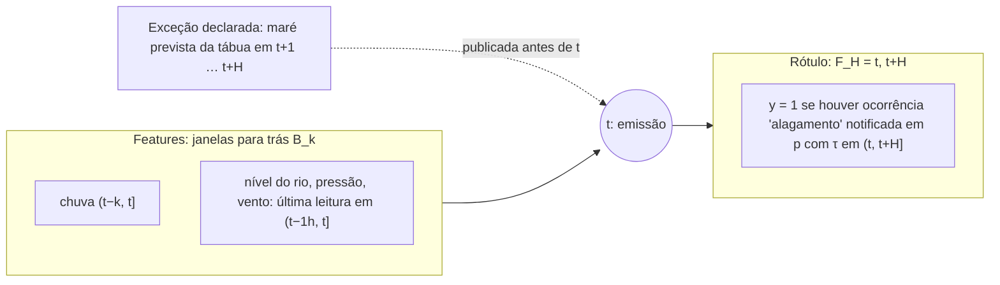
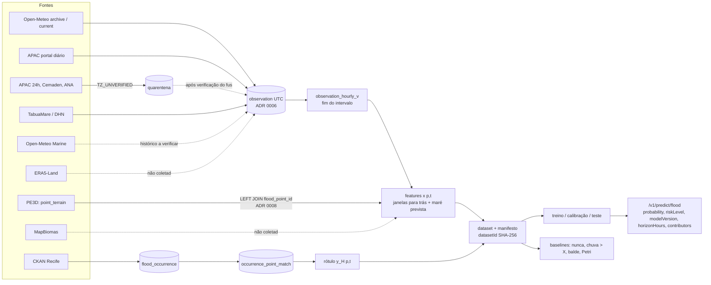
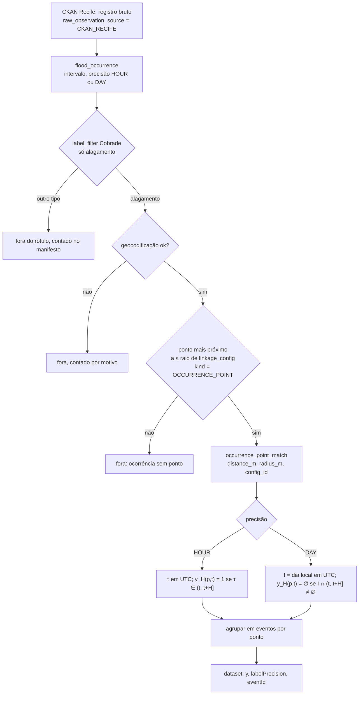

# Modelagem do MAPi (F1): modelo físico-estocástico, verificação diária e papel do ML

> **Escopo atual (2026-10-11, decisão do autor):** a rede de Petri e o emulador de ML não fazem parte da avaliação em curso (a Petri ainda não está pronta). As seções sobre Petri/emulador descrevem trabalho futuro e só entram por novo pré-registro. A avaliação em curso testa o modelo do balde contra os baselines (H1, H2).

- Tarefa: F4-IA-10 · Data: 2026-10-11 · Autor: Agente 3 (nível Máximo, desenho de pesquisa) · Revisão pendente: Lucas e orientador
- Status: **proposta**, amarrada ao protocolo `docs/PRE-REGISTRO-AVALIACAO.md`. Nenhum modelo foi rodado nos dias
  rotulados e nenhum desempenho foi olhado. Só documentação: nada mudou em código, banco ou export.
- Substitui a formulação supervisionada da F4-IA-01 (2026-10-10). Aquele texto foi movido **sem cortes** para a seção
  "Histórico" no fim deste arquivo, com os títulos rebaixados dois níveis. Ele continua sendo a referência das decisões
  daquela data (perguntas 17, 25 e 26).
- Origem da decisão: pergunta 28 respondida pelo Lucas em 2026-10-11, opção **F1** do `docs/MEMO-ESCASSEZ-DE-ROTULO.md`
  (abaixo, "MEMO"; registro no PROGRESSO, commit `c311ed8`).
- Respeita: ADR 0006 (grade horária pelo fim do intervalo), 0007 (contrato), 0008 (terreno), 0009 (só cotas relativas),
  `docs/GLOSSARIO.md` v1 (ficha = 5 mm) e a skill `mapi-ml-pipeline`, com as exceções da §8.

---

## 0. O que mudou e por quê

| Item | Antes (F4-IA-01, 2026-10-10) | Agora (F1, 2026-10-11) | Motivo (fonte) |
|---|---|---|---|
| Tarefa | Classificação horária por ponto, H = 6 h e 3 h | Verificação de um modelo físico em **dia × Recife** | 0 ocorrências `HOUR`; 225 ocorrências `DAY` em **18 dias** (F2-BACK-16 §1; F2-BACK-17-20, F2-BACK-18) |
| Modelo principal | XGBoost supervisionado | Balde e rede de Petri, parametrizados por fontes externas | Com 18 positivos não se treina, calibra e testa ao mesmo tempo (MEMO §1.3–1.4) |
| Uso do rótulo | Treino, validação e teste | **Só teste** | Nenhum parâmetro vê os eventos |
| Baselines | Nunca alaga; chuva > X (X ajustado no treino); balde; Petri | Nunca alaga; climatologia constante; climatologia sazonal externa; regra de chuva com limiar externo | O balde e a Petri viraram o modelo; o limiar de chuva foi "queimado" (MEMO, cabeçalho e §5 item 15) |
| ML | O modelo | Emulador da Petri e correção da chuva de entrada | Rótulo sintético ou de chuva, abundante; nunca os 18 dias |
| Unidade | Ponto-hora, raio de 500 m | Dia local × Recife; bairro como análise secundária; pontos como estudo de caso | A 500 m casam 3 ocorrências (F2-BACK-16 §2a); a geocodificação é de bairro (mediana de 2 456 m ao ponto) |
| Maré | Feature temporal | Entrada do balde **só** se houver limiar em NR com fonte (§2.1) | ADR 0009 |

Três registros exigidos pela `docs/REVISAO-CRITICA.md`:

1. **A troca de unidade é mudança de desenho pós-hoc** (RC-05 f). Ela foi decidida depois de ver que 3 ocorrências casam a
   500 m e que a resolução real do rótulo é o bairro. Não estava fixada antes da carga.
2. **A troca para a tarefa diária não conta como acerto do pré-registro** (RC-04). A precisão `DAY` do CKAN já era
   conhecida na Fase 1 (F1-BACK-03). Lição de processo: medir o rótulo antes de construir a infraestrutura.
3. **F1 não se justifica por "aproveitar o trabalho do autor"**. Esse motivo do MEMO §3.1 foi retirado (RC-05 a). Fica
   a razão epistêmica: F1 é o único desenho em que nenhum dos 18 dias é gasto em ajuste. Ela traz um custo que a opção G
   (MEMO §6) não tem: parâmetros sem fonte (§2.3). Se o protocolo terminar em "inconclusivo por sensibilidade a parâmetro
   sem fonte", a dissertação lê o resultado no enquadramento da opção G (dados auditáveis + resultado negativo
   documentado). Isso é leitura do resultado, previamente declarada, e não troca de desenho.

## 1. Pergunta de pesquisa

Esta redação parte da proposta do MEMO §3.1, corrigida para 18 dias (RC-06) e para o conjunto de teste do pré-registro.

**Q1 (principal, confirmatória).** "Um modelo físico de balanço de massa (balde, com versão estocástica em rede de Petri),
alimentado só por dados abertos (chuva horária de reanálise, maré prevista da DHN e terreno LiDAR do PE3D) e
parametrizado só por fontes externas, sem consultar os registros de alagamento, **ordena** os dias com alagamento
registrado pela Defesa Civil do Recife acima dos dias sem registro, em 2023–2024, melhor que a climatologia sazonal e
que uma regra de chuva com limiar de fonte externa?"

**Q2 (ML, confirmatória se a Petri for exportada).** "Um emulador de aprendizado de máquina reproduz a probabilidade de
excedência da rede de Petri dentro do erro de Monte Carlo da própria simulação, com tempo de inferência compatível com o
ciclo de previsão do MAPi?"

**Q3 (secundária, descritiva).** "Nos dias com registro, os bairros dos pontos com maior lâmina simulada estão entre os
bairros com registro?"

Por que "ordena" e não "distingue com um limiar": o nível absoluto da lâmina simulada depende de parâmetros com fonte
fraca ou ausente (capacidade da galeria, escala da chuva; §2.3). A ordem dos dias depende menos deles. Por isso a
métrica principal é de discriminação (AUC), e as métricas com limiar ficam como secundárias pré-registradas.

**Natureza do teste.** O modelo é forçado com a **chuva observada do próprio dia** (reanálise). É uma simulação
diagnóstica (*hindcast* com forçante observada), **não previsão com antecedência**. O pipeline não arquiva previsão de
chuva (Histórico, A.1.4 (b)). A regra de chuva, que é o baseline, usa a mesma informação, então a comparação é justa.
A antecedência fica fora da pergunta.

## 2. Modelo principal

### 2.1 Balde (M1)

Pontos: AV_RECIFE_IBURA, CIN_UFPE, AGAMENON_DERBY e MASCARENHAS_IMBIRIBEIRA. JABOATAO_CENTRO fica fora por dois motivos:
não tem folha do PE3D (`TERRENO-PE3D.md` §3) e fica em outro município, que o CKAN do Recife não cobre. A grade é
horária em UTC, e cada hora é rotulada pelo fim do intervalo (ADR 0006 §5). A simulação é contínua, de 2021-04-01 a
2026-09-30, com estado inicial `V = 0`. Os primeiros 30 dias são aquecimento e não entram em nenhuma métrica.

```
Entrada (m³/h):    Q_in(t)  = C · P(t) · A_p / 1000                P em mm/h, A_p em m²
Capacidade (m³/h): q_p      = f · C · i_T · A_p / 1000             método racional; i_T = i(TR, 60 min) em mm/h;
                                                                    f = fração da capacidade de projeto (§2.3)
Saída (m³/h):      Q_out(t) = mín( q_p · g(t) ,  V_p(t−1)/1 h + Q_in(t) )
Balanço (m³):      V_p(t)   = máx(0, V_p(t−1) + [Q_in(t) − Q_out(t)] · 1 h)
Nível (m):         z_p(t)   = curva_p⁻¹(V_p(t))                    acima do fundo da bacia (point_terrain_curve)
Lâmina na rua (mm):h_p(t)   = 1000 · máx(0, z_p(t) − (cota_rua_p − fundo_p))   tudo relativo, no datum do MDT
Fichas:            n_p(t)   = ⌊h_p(t) / 5⌋                         1 ficha = 5 mm (GLOSSARIO)
Bloqueio:          g(t) ≡ 1                                         versão principal M1a
                   g(t) = 0 se maré_NR(t) ≥ λ_NR, senão 1           M1b, só se λ_NR tiver fonte (abaixo)
```

- **Curva fora da faixa.** A curva cota-volume vai até +2 m acima do fundo, em 41 níveis (`TERRENO-PE3D.md` §5). Se `V`
  passar do volume a +2 m, `z` satura em +2 m e o ponto-hora é contado como "fora da curva". A contagem vai no relatório.
- **Consequência do método racional, declarada aqui.** Com `q_p = f · C · i_T · A_p`, a condição `Q_in > q_p` equivale a
  `P(t) > f · i_T`: **C e A se cancelam na condição de transbordar**. Eles só controlam quanto volume se acumula diante da
  curva cota-volume. Sem cadastro de galerias, M1 é, na essência, "chuva horária acima da intensidade de projeto, com
  armazenamento e memória". Por isso a comparação com a regra de chuva (H2 do pré-registro) mede apenas o que o
  armazenamento, a memória entre horas e a curva do terreno acrescentam. Se o cadastro da Emlurb trouxer `q_p` medido,
  o cancelamento deixa de valer.

| Entrada | Fonte | Disponível | Observação |
|---|---|---|---|
| `P(t)` chuva horária | Open-Meteo archive, `precipitation`, na coordenada de cada ponto | 2021-10 → 2026-10 no export (snapshot de 2026-10-10); 2021-04 a 2021-09 precisa de *backfill* | Reanálise que suaviza extremos: máximo de 41,1 mm/dia em 2023–2024 (MEMO §1.5). Modelo do archive usado no export: `[a verificar; fixar o mesmo modelo em todos os períodos]` |
| `P(t)` alternativa | Cemaden (fuso verificado UTC−3, F2-DADOS-07); APAC 24h (quarentena) | cobertura de 2022–2024 `[a medir]` | Só análise secundária |
| `maré_NR(t)` | DHN, carta 902, `pe02`, `TIDE_PE02_HOURLY`, metros sobre o NR | 2021-10 → 2026-10, 44 568 h (F2-BACK-14, F2-BACK-21) | Só em M1b e só comparada com `λ_NR` na mesma régua |
| `A_p` | `point_terrain`, Whitebox, regra de snap de 10 m (`TERRENO-PE3D.md` §5.1) | 4 pontos | Premissa fixada na Fase 3, antes de qualquer rótulo. Instável: faixa {5, 10, 20} m |
| `curva_p`, `cota_rua_p`, `fundo_p` | `point_terrain_curve`, `point_terrain` | 4 pontos | Só diferenças de cota (ADR 0009, opção C) |
| `C`, `TR`, `i_T`, `h_crit`, `f`, `λ_NR` | `docs/PARAMETROS-MODELO-FISICO.md` (F4-IA-11, 2026-10-11) | levantado; congelar no commit do pré-registro | §2.3 e pré-registro §4 |

**Proibido pelo ADR 0009 enquanto Δ não for aprovado:** converter cota do MDT para NR (inclusive com a estimativa de
trabalho de Δ ≈ +1,04 ± 0,3 m, que o próprio ADR marca como "não usar"); comparar maré com `cota_rua` ou com soleira
derivada do MDT; calcular folga até a soleira; marcar pontos como "sujeitos a refluxo". `λ_NR` só é admitido se vier de
documento que o declare **em NR**, por exemplo cota de soleira de exutório no cadastro de drenagem referida ao NR. Aí a
comparação é maré × maré, na mesma régua. **Sem essa fonte, M1b não roda na fase confirmatória.** Uma varredura de `λ`
sobre os dias de teste seria uma varredura implícita de Δ + soleira. Pela ressalva 4 do ADR 0009, ela consumiria os
eventos que depois checariam Δ. Fica adiada para depois da checagem de Δ.

O que isso faz com a conclusão: **sem soleira com fonte, o modelo principal é só de chuva.** Ele não testa o mecanismo de
refluxo, e dias de alagamento sem chuva serão perdidos por construção (ver pré-registro §9, conhecimento prévio).

### 2.2 Rede de Petri (M2): o que o autor precisa exportar

A rede de Petri estocástica do autor (Mercury) usa o mesmo balanço do balde, em fichas de 5 mm, e acrescenta
estocasticidade nas transições. Para entrar no protocolo, o autor entrega:

**(a) Descrição auditável da rede**, antes da execução no teste: arquivo da rede com SHA-256; lugares e transições com
significado físico; quais transições são estocásticas, com distribuição e parâmetros; e, para **cada** parâmetro, a mesma
tabela de fontes do pré-registro §4. É obrigatório declarar se algum parâmetro foi escolhido conhecendo eventos de
alagamento do Recife em 2021–2024 (CKAN, notícias, memória). Se sim, ele passa a ser tratado como **sem fonte** (faixa de
sensibilidade).

**(b) Saída diária por ponto**, que substitui o formato horário do Histórico A.3.8:

| Campo | Conteúdo |
|---|---|
| `flood_point_id`, `date_local` | slug do ponto; dia em America/Recife (regra de dia da §2.4) |
| `p_exceed` | fração das réplicas com lâmina máxima do dia ≥ `h_crit` (mesma `h_crit` do balde, em fichas) |
| `depth_max_mean_mm`, `depth_max_q50_mm`, `depth_max_q90_mm` | distribuição da lâmina máxima do dia |
| `p_exceed_any` (opcional) | fração das réplicas em que **algum** dos 4 pontos excede, se os pontos forem simulados juntos com forçante comum |
| `n_replications`, `seed` | `n_replications ≥ 2 500`, para que o erro de Monte Carlo de `p_exceed` seja ≤ 0,01 em p = 0,5 (`√(0,25/2 500)`) |
| `model_hash`, `params_hash`, `params_table_commit` | versão da rede, dos parâmetros e da tabela congelada |
| `input_sha256`, `forcing_source` | SHA-256 do CSV de entrada (o mesmo do balde) e fonte da chuva |
| `runtime_s` | tempo de simulação por ponto-dia, para a Q2 |

**(c) Condição inicial declarada:** simulação contínua por réplica (recomendada) ou reinício diário a partir do estado do
balde às 00:00 local. A escolha é feita antes da execução no teste.

**(d) Simulações para o emulador:** as mesmas saídas sobre forçantes sem rótulo (§4). M2 entra como hipótese
confirmatória **só** se (a) e (b) chegarem antes do commit do pré-registro, ou por emenda registrada antes de qualquer
junção com os rótulos (pré-registro §1).

### 2.3 Parâmetros: valores congelados e faixas

Regra completa no pré-registro §4. Valores de `docs/PARAMETROS-MODELO-FISICO.md` (F4-IA-11, levantado em 2026-10-11 sem
abrir banco, exports nem relatórios com chuva por dia positivo, segundo aquele documento). Decisões de método do Arquiteto
registradas na mesma data.

| Parâmetro | Central (primário) | Faixa de sensibilidade | Fonte (PARAMETROS, linha) | Situação |
|---|---|---|---|---|
| `C`, coeficiente de escoamento | 0,86 | 0,70 a 0,95 | linha 1 (Silva Júnior 2015 via Xavier Filho 2016; URB Recife 2018) | fonte secundária |
| `TR` de projeto da microdrenagem | 5 anos | 2 a 10 anos | linha 7 (URB Recife 2018, p. 8) | fonte primária |
| `i_T = i(TR, 60 min)` | 60,1 mm/h (TR 5, Silva e Araújo 2013, Eq. 16) | 50,3 (TR 2) a 68,7 mm/h (TR 10), mesma IDF; EMLURB 55,3 mm/h como verificação | linhas 6 e 8; tabela de limiares | fonte primária |
| `h_crit`, lâmina crítica | 15 cm = 30 fichas | 10 a 30 cm (20 a 60 fichas) | linha 9 | fonte secundária |
| `Ia`, abstração inicial | 5,2 mm (registrada) | 1,0 a 9,0 mm | linha 4 | **não entra em M1a**: somar `Ia` e `C` contaria a perda duas vezes (PARAMETROS, linha 4 e "Uso sugerido", item 3). Só numa variante exploratória com CN |
| `f`, fração da capacidade de projeto da galeria | 1,0 (galeria como projetada: hipótese declarada, não medida) | 0 a 1,0 em passos de 0,2 (0 = totalmente obstruída) | `[sem fonte]` (PARAMETROS, "Parâmetros sem fonte") | **só faixa** |
| `A_p`, área contribuinte | snap de 10 m (premissa da Fase 3) | snap {5, 10, 20} m; a faixa de ±30% do PARAMETROS é estreita demais diante de 28 → 10 880 m² no Ibura | `TERRENO-PE3D.md` §5.1 | terreno, sem validação |
| Curva cota-volume | derivada do MDT | ±30% no volume por cm | `[sem fonte]` (PARAMETROS) | **só faixa** |
| Soleira / `λ_NR` | — | a faixa do PARAMETROS (rua − 0,5 a 3,0 m, mais Δ ± 0,3 m) **não é executável**: compara maré em NR com cota do MDT, o que o ADR 0009 proíbe | `[sem fonte]` | M1b não roda |
| Obstrução e demais taxas da Petri | — | faixa a declarar pelo autor | `[sem fonte provável]` | **só faixa** |

O valor central `f = 1,0` está no topo da faixa. Ele foi escolhido a priori por ser a única hipótese com âncora documental
(a galeria escoa a chuva de projeto). Não sai de ajuste. Como `f` não tem fonte, o resultado confirmatório só vale como
"positivo robusto" se a categoria se mantiver em toda a faixa de `f` (pré-registro §7).

**Escala da chuva (risco de modelo degenerado).** A IDF é de chuva **pontual**. A reanálise é média de célula de grade e
quase não alcança intensidades de projeto: o máximo diário em 2023–2024 foi de 41,1 mm (MEMO §1.5). Com
`i_T = 60,1 mm/h`, M1a provavelmente quase nunca transborda. PARAMETROS (ressalva 2 do limiar) e o Arquiteto exigem
comparar a distribuição da chuva horária da reanálise com a de pluviômetro **sem olhar rótulos** antes de aplicar um
limiar derivado de pluviômetro ou de IDF. Tratamento fixado agora (pré-registro §5, passo 2):

- **Passo obrigatório antes da execução:** comparar a reanálise Open-Meteo na célula de cada ponto com o pluviômetro de
  fuso verificado mais próximo (Cemaden, UTC−3), nas horas comuns e sem nenhuma informação de alagamento. Medidas:
  quantis 0,9 / 0,99 / 0,999, máximo e frequência de horas acima de 50,3 e 60,1 mm/h. O relatório é commitado antes da
  junção com os rótulos.
- **Análise principal:** usa os valores da IDF como estão, sobre a reanálise, conforme a decisão do Arquiteto. Se o
  passo acima mostrar que a reanálise não alcança essas intensidades, o resultado é lido como "limitado pela escala da
  forçante" e não vira motivo de reajuste.
- **Variante secundária pré-registrada (transferência por igual frequência):** o limiar sobre a reanálise passa a ser o
  quantil da reanálise com a mesma frequência de excedência que o limiar da IDF tem no pluviômetro, nas horas comuns.
  O cálculo usa só chuva. Sem série de pluviômetro com sobreposição suficiente (≥ 1 ano de horas comuns), a variante
  usa o nível de retorno de mesmo `TR` da própria grade (Gumbel por momentos sobre os 30 máximos anuais de chuva horária
  de 1991–2020, um período sem rótulo).
- **Quando os pluviômetros forem liberados para os anos do teste,** a forçante pontual com a IDF pontual vira a versão
  consistente (análise secundária).


### 2.4 Escores por ponto-dia

- **Dia local:** a hora `t` (UTC, fim do intervalo) pertence ao dia local da data de `t − 4 h`, que é o início do
  intervalo em UTC−3 (mesma regra do MEMO, Apêndice B). Um dia é completo com ≥ 23 de 24 horas de chuva. Dia incompleto
  sai da avaliação e entra na contagem.
- **M1:** lâmina máxima `S(p, d) = máx_{t ∈ d} h_p(t)`, em mm. Alerta `A(p, d) = 1` se `S(p, d) ≥ h_crit`. Razão entre
  demanda e capacidade: `R(p, d) = máx_{t ∈ d} P(t) / (f · i_T)`.
- **Escore contínuo principal de M1, fixado contra empates:** ordenação lexicográfica, primeiro por `S` e, nos empates
  (em especial `S = 0`), por `R`. Se M1 quase nunca transbordar, a ordenação passa a ser dada por `R`, que ordena os dias
  como a chuva horária máxima. Então M1 ≈ B3 e o resultado de H2 é "inconclusivo por degeneração". Isso é declarado
  agora e não autoriza mudar parâmetros.
- **M2:** `p_exceed(p, d)`.


## 3. Unidade de análise e agregação ponto → dia × Recife

**Unidade principal: dia local × Recife.** O rótulo é "≥ 1 ocorrência canônica de alagamento no dia, em qualquer lugar
do Recife" (F2-BACK-16 §3; consulta no pré-registro, Apêndice B).

**Regra de agregação, fixada a priori:**

```
S_cidade(d) = máx_p S(p, d)            sobre os 4 pontos com terreno
A_cidade(d) = 1 se algum A(p, d) = 1   (OU lógico)
p_cidade(d) = máx_p p_exceed(p, d)     M2, versão principal (sempre disponível)
p_any(d)                               M2, secundária, se exportada (§2.2)
```

Por que o máximo: o rótulo diz "algum lugar alagou", e o análogo é "algum ponto excede". O máximo não supõe
independência entre pontos, ao contrário do noisy-OR, e os pontos compartilham a chuva. O máximo das marginais é um
limite inferior de `P(algum ponto excede)`; por isso `p_any` entra como secundária.

**Ponto fraco declarado (a "ponte" do MEMO §2, D).** Quatro pontos representam mal uma cidade cujos registros se espalham
por 39 bairros (F2-BACK-16 §3). A verificação testa se a lâmina simulada nos 4 pontos funciona como **índice** do dia de
alagamento na cidade. Ela não testa o alagamento em cada ponto. Um balde agregado por bairro (opção B2 do MEMO) fica fora
do escopo, porque depende dos polígonos oficiais de bairro, ainda não obtidos.

**Bairro (secundária, Q3).** Cada ponto é atribuído ao seu bairro pelo polígono oficial `[a obter: base cartográfica da
Prefeitura do Recife]`. Para cada ponto: acertos nos dias com registro no próprio bairro, em contagem, sem teste
estatístico. Exemplo de escala: o bairro com mais dias, Imbiribeira, tem 20 ocorrências em 13 dias (F2-BACK-16 §3).

**Pontos (estudo de caso).** Séries de chuva, lâmina e fichas em torno de cada dia positivo e de dias negativos
sorteados com semente fixa. Não há métrica estatística por ponto.

## 4. Papel do ML

1. **Emulador da rede de Petri (contribuição de ML, Q2).** Aprende `(janela de chuva, estado inicial, terreno do
   ponto[, maré se M1b]) → p_exceed`.
   - **Treino:** simulações da Petri sobre forçantes **sem rótulo**: período de desenvolvimento 2025-01-01 a 2026-09-30,
     climatologia 1991–2020 e tempestades sintéticas de projeto (hietogramas da IDF).
   - **Teste de fidelidade:** forçante de 2021-04 a 2024-12. É permitido porque o emulador é comparado com a Petri, não
     com os registros.
   - **Algoritmos:** ao menos dois, por exemplo gradient boosting e MLP, mais um emulador ingênuo (média climatológica de
     `p_exceed` por ponto).
   - **Critério:** pré-registro §6.4.
   - **Aviso (RC-05 c):** fidelidade a um simulador não validado **não** diz nada sobre alagamento. É contribuição
     computacional. A habilidade em alagamento continua sendo a da Petri (H3).
2. **Correção da forçante (secundária).** Um modelo de ML corrige a chuva da reanálise contra pluviômetros (Cemaden com
   fuso verificado; APAC depois da quarentena). O rótulo é chuva medida, **nunca** alagamento. Ele entra no protocolo só
   como forçante alternativa, especificada antes da junção com os rótulos.
3. **Proibido:** treinar, calibrar ou selecionar qualquer modelo com os 18 dias. Isso inclui correção de resíduo do
   modelo físico, classificador supervisionado diário, empilhamento e escolha de limiar. O classificador diário
   "exploratório" do MEMO §3.1 **sai**: com os 18 dias no teste, não sobra rótulo de treino. Se a opção C (pedido LAI à
   Defesa Civil, S2iD; F4-IA-12) trouxer dias rotulados novos, disjuntos dos 18, um experimento supervisionado só pode ser
   feito com **novo pré-registro** e treino apenas nos dias novos.

## 5. Baselines

| Id | Baseline | Escore contínuo | Alerta binário | Papel |
|---|---|---|---|---|
| B0 | Nunca alaga | 0 | nunca | âncora: recall 0, taxa de alerta 0; Brier = taxa de base |
| B1 | Climatologia constante | taxa de positivos do próprio conjunto de teste | — | referência do Brier skill score. Usa a taxa do teste, o que **favorece a referência** e é conservador para o modelo |
| B2 | Climatologia sazonal externa | normal climatológica mensal de chuva do Recife, 1991–2020 (APAC, Atlas Climatológico, ou INMET, Normais) `[fonte e valores a obter; não está no PARAMETROS]` | — | "habilidade acima da sazonalidade" (H1) |
| B3 | Regra de chuva com limiar de IDF | `máx_p máx_{t ∈ d} P(t)`, chuva horária máxima do dia | alerta se ≥ 50,3 mm em 60 min | comparação principal (H2) |

**Limiar de B3 (decisão de método do Arquiteto, 2026-10-11).** O limiar vem das curvas IDF publicadas, com TR = 2 anos e
duração de 60 min. O valor central é **50,3 mm/h**, de Silva e Araújo (2013, Eq. 16, artigo revisado por pares). A faixa
é **47,4 a 55 mm/h**, das outras duas IDF independentes: EMLURB/PDDR 47,4 e Torres et al. (2025) 55 (PARAMETROS, linha
6). Ele **não** vem de Fonseca Neto et al. (2026). Esse resumo de congresso testou 50% a 100% do limiar contra ocorrências
do Cemaden de 2016 a 2025, período que se sobrepõe aos rótulos do MAPi, então a independência é só parcial. O estudo entra
apenas como verificação de consistência declarada (pré-registro §9).

**Regras secundárias de sensibilidade, pré-registradas:**

| Regra | Limiar | Observação |
|---|---|---|
| B3-50 | 50% do central = 25,2 mm em 60 min | — |
| B3-70 | 70% do central = 35,2 mm em 60 min | — |
| B3-24h | 30 mm em 24 h | PLACON 2024 da Prefeitura. É **limiar de mobilização por previsão de chuva**, não de alagamento observado (PARAMETROS, "Por que este e não outro") |

B3 usa a **mesma forçante** de M1, nos mesmos 4 pontos, com a mesma agregação pelo máximo. O AUC de B3 depende só da
janela (60 min), não do limiar: B3, B3-50 e B3-70 têm o mesmo AUC. Os limiares só afetam as métricas binárias. O AUC de
B3-24h usa a chuva de 24 h.


## 6. Métricas adequadas a n ≈ 18 (resumo; regras completas no pré-registro §6)

Positivos para as métricas principais: os 14 dias de 2023–2024, em 13 episódios. Negativos: 689 dias de 2023–2024 sem
registro, depois das exclusões do pré-registro §2. Contas deste documento (método no pré-registro, Apêndice A):

| Grandeza | Valor | Leitura |
|---|---|---|
| Recall 7/14, IC 95% exato | [0,23; 0,77] | largura 0,54 |
| Recall 10/14 | [0,42; 0,92] | |
| Recall 14/14 | [0,77; 1,00] | nem o resultado perfeito exclui recall de 0,77 |
| Recall 9/18 (todos os positivos) | [0,26; 0,74] | |
| Recall 2/4 (2021–2022) | [0,07; 0,93] | não informativo sozinho |
| Taxa de alerta 35/689 em dias sem registro | [0,036; 0,070] | o denominador grande estreita o IC |
| EP do AUC com 14 × 689 (Hanley–McNeil), AUC = 0,75 | 0,076 | IC ≈ ±0,15 |
| Menor AUC cujo IC 95% exclui 0,5 | **0,66** | supõe positivos independentes; com 13 episódios agrupados o IC real é mais largo |
| Diferença de AUC detectável entre dois escores (2 × EP da diferença) | ≈ 0,15 / 0,10 / 0,07 para correlação de 0,5 / 0,8 / 0,9 entre escores | M1 e B3 devem ser muito correlacionados (§2.1), o que ajuda a detectar diferença, mas a diferença esperada também é pequena |
| McNemar exato, todos os discordantes num sentido | p = 0,031 só com ≥ 6 discordantes | igual ao MEMO §1.4 |

Brier e Brier skill score (B1 como referência) entram para M2, que é probabilístico, com IC por *bootstrap* estratificado
(positivos reamostrados por episódio, negativos em blocos de semana ISO). A curva de confiabilidade é só descritiva: com
14 positivos, cada faixa terá 0 a 2 positivos.

**Leitura sob positivos e não rotulados.** Os negativos são "sem registro". Se os alagamentos não registrados se
parecerem com os registrados (hipótese de seleção ao acaso), o AUC medido é `AUC_medido = (1 − θ) · AUC_real + θ · 0,5`,
em que θ é a fração de dias alagados entre os "sem registro". O AUC medido fica então mais perto de 0,5 que o real, o que
é conservador. Se o registro depender da intensidade da chuva (imprensa, volume de chamados), o viés pode ir para o outro
lado e favorecer escores de chuva. Isso fica declarado, não corrigido.

## 7. O que NÃO será afirmado

1. Que o MAPi prevê alagamento **por ponto** ou **com 3–6 h de antecedência**. A verificação é diária, na cidade, com
   chuva observada.
2. Que alguma probabilidade é **calibrada empiricamente**. `p_exceed` é probabilidade sob o modelo; o `riskLevel` em
   produção (ADR 0007) sai sem calibração e precisa dizer isso (MEMO, pergunta 14; RC-03).
3. **Superioridade** de M1 ou M2 sobre B2 ou B3 se o IC incluir zero. Também não se afirma **equivalência**: não há margem
   com fonte nem poder para isso.
4. Qualquer atribuição de **mecanismo** (chuva × refluxo de maré). O refluxo está fora do modelo principal pelo ADR 0009.
5. Que o registro do CKAN mede alagamento. Ele mede atendimento registrado, e o negativo é "sem registro".
6. Que a fidelidade do emulador implica habilidade em prever alagamento.
7. Generalização para outros pontos, bairros ou cidades.
8. Qualquer resultado obtido fora do protocolo, ou depois de mudar parâmetros, como confirmatório. Isso é exploratório e
   rotulado como tal.

## 8. Exceções à skill `mapi-ml-pipeline` (registro; a skill não foi editada)

| Regra da skill | Situação em F1 |
|---|---|
| §1 tarefa por ponto, H ∈ {3, 6} h | Substituída pela verificação dia × Recife (§1, §3) |
| §2 divisão temporal treino/validação/teste | Não há treino com rótulo. Vale o espírito da regra: nenhum parâmetro vê os 18 dias. Para o emulador, a divisão é por período de forçante |
| §5 calibração em validação separada | Não aplicável: não há validação com rótulo |
| §6 métricas por ponto e por mecanismo | Impossíveis (MEMO §1.4). Os pontos são estudo de caso |
| §6 baselines "chuva > X" com X do treino; balde e Petri como baselines | Substituídos pelos da §5 |
| §6 "modelo que não vence o baseline físico não é positivo" | Reformulado como "o modelo físico vence B2/B3?" (pré-registro §7) |

Recomenda-se atualizar a skill depois do commit do pré-registro (tarefa separada).

## 9. Dependências e bloqueios

Lista completa, com o que bloqueia o início, no pré-registro §10. Em resumo: (1) congelar no commit do pré-registro os
valores do `docs/PARAMETROS-MODELO-FISICO.md` (já levantados) e obter a normal mensal de chuva para B2; (2) confirmação do
conjunto de teste pelo Lucas (RC-25); (3) comparação da distribuição de chuva reanálise × pluviômetro, sem rótulos;
(4) *backfill* da chuva de 2021-04 a 2021-09 (para 2021-05-13) e de 1991–2020 (só para a variante secundária), com o mesmo
modelo de reanálise; (5) implementação de M1 e do script de avaliação testado com rótulos sintéticos (F4-IA-13); (6) export
da Petri pelo autor, que bloqueia só H3 e H4. Não bloqueiam: Δ do ADR 0009, cadastro de galerias e soleiras (pedido LAI à
EMLURB/SESAN; entram como faixa até chegarem), polígonos de bairro (só Q3).

## 10. Riscos para a validade

1. **Positivos poucos e agrupados:** 14 dias em 13 episódios no teste principal. Todo IC é largo (§6).
2. **Rótulo é registro de atendimento,** com sensibilidade desconhecida e variável por ano (2021: 1 em 64 855 registros;
   F2-BACK-16 §1).
3. **M1 é quase uma regra de chuva** com `q` racional (§2.1). H2 mede só o armazenamento e a memória.
4. **Escala da chuva:** a reanálise suaviza os extremos convectivos, e os limiares de IDF são pontuais. Há comparação de
   distribuições sem rótulos e uma variante por igual frequência (§2.3), mas o problema não está resolvido.
5. **Área contribuinte instável** ao snap (Ibura: 28 / 208 / 10 880 m² com 5 / 10 / 20 m; Derby: 26 / 62 / 14 875 m²;
   `TERRENO-PE3D.md` §5.1) e cega a galerias.
6. **Sem soleira e sem Δ:** o mecanismo de maré fica fora do teste (ADR 0009).
7. **Ponte ponto → cidade:** 4 pontos como índice de 39 bairros com registro.
8. **Conhecimento prévio do teste:** a chuva dos dias positivos já foi olhada (MEMO, Apêndice B); o autor conhece os
   eventos. Declarado no pré-registro §9; não é cegável.
9. **Escolhas do pesquisador** (agregação pelo máximo, ±1 dia de exclusão, `f = 1,0` como central, duração de 1 h, snap): todas fixadas no
   pré-registro antes da execução, com sensibilidade onde indicado.
10. **Voz única nas revisões** (RC-11): este desenho foi escrito e revisado por modelos da mesma família. Recomenda-se a
    leitura do orientador antes do commit do pré-registro.

## 11. Decisões pendentes do autor

1. Confirmar o conjunto de teste do pré-registro §2: 2021 e 2025–2026 sem rótulo (MEMO §5, item 9, pendente de
   confirmação pela RC-25), e a decisão nova deste documento: **2022 só com positivos**, sem negativos.
2. Confirmar o limiar de B3 decidido pelo Arquiteto (IDF, TR 2 anos, 60 min, 50,3 mm/h; MEMO §5, item 15; RC-25).
3. Rede de Petri: procedência de cada parâmetro (§2.2 a), simulação conjunta dos pontos (`p_any`), número de réplicas e
   prazo do export. Decidir se M2 é promovida a hipótese confirmatória por emenda.
4. Confirmar os valores centrais do balde (`C` = 0,86, `TR` = 5 anos, `h_crit` = 15 cm, `f` = 1,0). Só podem mudar antes
   do commit do pré-registro.
5. Enviar o pedido LAI à EMLURB/SESAN do cadastro de microdrenagem com cota de fundo e diâmetro (PARAMETROS, última
   seção). Se chegar antes do commit, `f` e a soleira ganham fonte; se chegar depois, só por emenda antes da junção.
6. `riskLevel` em produção: vem de M1/M2 sem calibração ou fica suspenso (MEMO, pergunta 14, ainda em aberto).

## Exemplo real do dataset de entrada

Recorte do export real do ponto `AGAMENON_DERBY` (F4-IA-05, 2026-10-11). Arquivo fora do git: `MAPI/exports/AGAMENON_DERBY_mare-pipeline_2021-10-02_2026-10-01.csv` e `.manifest.json` (gerados em 2026-10-10 pelo `GET /api/export/ia-dataset/{slug}/csv` e `/manifest`, API.md §2.6 e §3.2). Os números abaixo vêm do manifesto e de contagens diretas no CSV; nada foi imputado.

| Item | Valor | Origem |
|---|---|---|
| Granularidade | horária, `timestampUtc` = fim da hora, UTC | manifesto `timezone`, `label.policy` |
| Período | 2021-10-02T00:00Z a 2026-10-01T00:00Z | manifesto `periodFrom`, `periodTo` |
| Linhas | 43 801 (mais o cabeçalho) | manifesto `rows`; `wc -l` = 43 802 |
| `datasetId` | `8f3e27029d87d719cce3979a43b1f2db302fe392952151fde043f6d0ec455b37` = SHA-256 do CSV | manifesto; `sha256sum` conferido |
| Versões | `ruleVersion` 2026.10.1; `codeVersion` `unknown` | manifesto |
| Terreno | `terrain_run_id` 1; VRT SHA-256 `d63e3b12…8070` (`d63e3b123507631b276eb98a1d247d3337655e50d4456168b61b582dc5408070`) | manifesto `terrain` |
| Rótulo | ADR 0006: `flood_occurrence` + `occurrence_point_match`, `linkageConfigId` 3, raio 500 m, `NEAREST_WITHIN_RADIUS`; `isFlooded` e `severity` são legados (`deprecatedColumns`) | manifesto `label` |

**Fontes (manifesto `provenance`).** O manifesto lista `runIds` (UUID do `ingestion_run`, o `provenanceId` do ADR 0006) por fonte e variável, sem `provenanceId` por linha:

| Fonte | Variáveis | `runIds` (`maxRevision` 1) |
|---|---|---|
| `OPEN_METEO_ARCHIVE` | precipitation, temperature, pressure, humidity, wind_speed, solar_radiation, weather_code | 5 execuções: `a5a771a0-c048-4dd1-8eb2-46149915980d`, `bf7b542b-26c6-4653-bd6b-6b986ff8dc3e`, `c9bf24f8-d01d-49dd-8c6c-9951e707aa3a`, `5f046dc6-fbae-4989-a006-e19ca27c5b0f`, `6c88d797-3b61-497f-b5d9-4ce62cff40ba` |
| `OPEN_METEO_ERA5LAND` | soil_moisture_0_7cm | 5 execuções: `9fe9b2ab-b350-4f10-8552-c60a7b59ea78`, `a8d78d65-46dc-44e4-b931-bea0f275a7cb`, `aab3619a-5c29-4d4b-9fe5-cacb701085c6`, `415d1f6e-f01d-40be-a775-51f582226dad`, `668d4910-d996-4880-a50a-f7e49a909172` |
| `TIDE_PE02_HOURLY` | tide_height_hourly (DHN, Porto do Recife, pe02, interpolação por cosseno entre extremos; referência vertical `NR_DHN_pe02`, não convertida ao datum do MDT, ADR 0009) | 1 execução: `acce70da-2203-42d1-b58d-e5f84df2246a` |
| Terreno PE3D | `terrain_*` | `terrain.runId` 1 |
| Sensores ANA, APAC, Cemaden | `sensor*` | ainda lidos de `sensor_data` (legado, fuso não verificado; manifesto `sourcesNotMigrated`) |

**Colunas, com unidade** (cada variável com ausência possível tem uma `<var>_missing`: 1 = ausente, 0 = presente; célula vazia = ausente):

| Grupo | Colunas | Unidade / valores |
|---|---|---|
| Identificação | `floodPointSlug`, `timestamp` (hora local ingênua, redundante), `timestampUtc` | texto, ISO 8601 |
| Sensores (legado) | `sensorPrecipitation`, `sensorWaterLevel`, `sensorSoilHumidity` | unidade do sensor de origem, `[sem fonte]` no manifesto; 43 786, 43 801 e 43 801 linhas ausentes |
| Tempo (Open-Meteo) | `weatherPrecipitation` (mm na hora), `weatherTemperature` (°C), `weatherPressure` (hPa), `weatherCode` (código WMO) | 1 linha ausente cada |
| Acumulados | `accumulated3h`, `6h`, `12h`, `24h`, `48h` | mm; vazio se a janela não tem N horas (3, 6, 12, 24 e 48 linhas ausentes) |
| Maré | `tideHeight` (m, NR DHN), `tide_height_t1`…`t6` (m, prevista em t+1…t+6 h), `tide_max_next_6h` (m), `tide_hours_to_next_high` (h), `tide_range_day_m` (m, máx. − mín. dos extremos do dia em America/Recife), `tide_rising` (0/1; vazio se derivada nula, 449 linhas), `tide_slope_m_h` (m/h) | 0 ausentes, exceto `tide_rising`. A maré futura é exceção declarada de "futuro" (tábua publicada antes; seção A.2.2 do Histórico) |
| Solo | `soil_moisture_0_7cm` | m³/m³ (ERA5-Land, camada 0–7 cm); 1 ausente |
| Terreno (constantes do ponto) | `terrain_run_id`, `terrain_street_elevation_m` (m, MDT), `terrain_mean_slope_pct` (%), `terrain_depression_depth_m` (m), `terrain_contributing_area_m2` (m²) | iguais em todas as linhas do ponto |
| Rótulo (alvo, nunca feature) | `label_h6`, `label_h3`, `label_day`, `label_excluded_reason`, `occurrence_ids`; legados `isFlooded`, `severity` | 0/1; vazio = hora excluída |

**Rótulos (manifesto `label.counts`).**

| Rótulo | Positivos | Negativos | Excluídos | Motivo das exclusões |
|---|---|---|---|---|
| `label_h6` (6 h) | 0 | 43 729 | 72 | `DAY_EVENT_SAME_DAY` 60 + `POST_EVENT_WINDOW` 12 (motivo refere-se ao maior horizonte) |
| `label_h3` (3 h) | 0 | 43 741 | 60 | |
| `label_day` | 48 linhas-hora em dias com ocorrência (`dayLabelPositives`) | 43 753 | 0 | `occurrencesHour` 0, `occurrencesDay` 2 |

Não há positivo horário neste ponto: as 2 ocorrências casadas são de precisão DIA e nunca viram negativo (por isso as 60 horas excluídas). Por isso o recorte de exemplo abaixo só tem horas negativas. As 48 linhas de `label_day` são horas, não eventos: o tamanho efetivo da amostra é o número de eventos (A.3.2). Para o contexto do rótulo diário e dos 18 positivos da avaliação F1, ver `PRE-REGISTRO-AVALIACAO.md` §2.1.

**Cinco linhas de exemplo.** Escolha sem olhar rótulo: entre as 82 horas em que o dia UTC inteiro tem `weatherPrecipitation` = 0, `accumulated48h` = 0 e `soil_moisture_0_7cm` e `tide_rising` presentes, sorteadas 5 com `random.seed(2026)` e ordenadas no tempo. As colunas `accumulated*` e `weatherPrecipitation` valem 0,0 nas cinco; `sensor*` ausentes (`_missing` = 1) e `isFlooded` = false nas cinco; todos os demais `_missing` valem 0. Valores de `terrain_*` iguais nas cinco: `terrain_run_id` 1, cota 2,58 m, declividade 4,404 %, profundidade da depressão 0,0 m, área contribuinte 62,0 m².

| Coluna | 2023-11-25T13Z | 2023-11-25T15Z | 2026-07-13T15Z | 2026-08-15T22Z | 2026-08-15T23Z |
|---|---|---|---|---|---|
| `weatherTemperature` (°C) | 29,5 | 29,4 | 29,1 | 25,7 | 25,8 |
| `weatherPressure` (hPa) | 1013,9 | 1012,9 | 1013,7 | 1015,5 | 1016,1 |
| `weatherCode` | 1 | 1 | 3 | 3 | 3 |
| `tideHeight` (m) | 0,62 | 1,60 | 1,12 | 2,11 | 1,73 |
| `tide_height_t1` (m) | 1,08 | 2,04 | 1,64 | 1,73 | 1,24 |
| `tide_height_t6` (m) | 1,98 | 1,02 | 1,48 | 0,38 | 0,74 |
| `tide_max_next_6h` (m) | 2,28 | 2,28 | 2,25 | 1,73 | 1,24 |
| `tide_hours_to_next_high` (h) | 4,4 | 2,4 | 3,27 | 11,2 | 10,2 |
| `tide_range_day_m` (m) | 2,1 | 2,1 | 2,1 | 2,33 | 2,33 |
| `tide_rising` / `tide_rising_missing` | 1 / 0 | 1 / 0 | 1 / 0 | 0 / 0 | 0 / 0 |
| `tide_slope_m_h` | 0,37 | 0,48 | 0,5 | −0,27 | −0,44 |
| `soil_moisture_0_7cm` (m³/m³) / `_missing` | 0,173 / 0 | 0,171 / 0 | 0,394 / 0 | 0,378 / 0 | 0,378 / 0 |
| `sensorPrecipitation` / `_missing` | vazio / 1 | vazio / 1 | vazio / 1 | vazio / 1 | vazio / 1 |
| `label_h6`, `label_h3`, `label_day` | 0, 0, 0 | 0, 0, 0 | 0, 0, 0 | 0, 0, 0 | 0, 0, 0 |

Leitura: a primeira linha do arquivo (2021-10-02T00Z) mostra o caso de ausência esperado do início da série: `accumulated*` vazios com `_missing` = 1 por falta de janela. Os `terrain_*` não variam no tempo; entram como contexto do ponto, não como sinal horário.


---

## Histórico: formulação supervisionada (abandonada em 2026-10-11, motivo: MEMO)

> Texto integral da F4-IA-01 (2026-10-10), movido sem alterações de conteúdo. Os títulos foram rebaixados dois níveis.
> Motivo do abandono: com 0 eventos `HOUR` e 18 dias `DAY` na cidade em 5 anos (F2-BACK-16, F2-BACK-18), nenhuma das
> tarefas abaixo tem positivos para treinar, calibrar e testar (`docs/MEMO-ESCASSEZ-DE-ROTULO.md` §1). A regra de troca
> da A.1.4 disparou com N_HOUR = 0, um resultado previsível desde a Fase 1 (REVISAO-CRITICA, RC-04). As decisões
> registradas aqui (perguntas 17, 25 e 26) valem como histórico. Onde conflitam com as seções 0–11, valem as seções 0–11.
> Números desta seção que ficaram defasados: "0 eventos no banco" (hoje 225 ocorrências) e "área contribuinte do Ibura
> 573 046 m²" (motor antigo; hoje 208 m² com Whitebox e snap de 10 m, `TERRENO-PE3D.md` §5).

### Modelagem de IA do MAPi: tarefa, rótulo, features e baselines

- Tarefa: F4-IA-01 (seções A.1, A.2 e A.3 do relatório de ML) · matriz de prioridade, item 6
- Data: 2026-10-10 · Autor: Agente 3 (nível Máximo) · Revisão pendente: Lucas
- Status: **proposta para defesa**. Nenhum resultado numérico de modelo aparece aqui: ainda não existe dado
  carregado. O banco tem 0 eventos de alagamento, 555 leituras de sensor e 40 de clima
  (fonte: `docs/snapshots/2026-10-10-pre-revisao.md`), e a carga histórica será feita do zero pelo
  pipeline do ADR 0006.
- Respeita: skill `mapi-ml-pipeline` (regras 1 a 9), `docs/GLOSSARIO.md` v1, ADR 0006 (ingestão),
  0007 (contrato de predição), 0008 (terreno) e 0009 (referência vertical).
- Decisões do autor que este documento não reabre: o rótulo positivo é só "alagamento" (Cobrade), sem
  "inundação" (ADR 0006, status); `flood_predictions` fica fora dos resultados (ADR 0007 §7); ANA,
  APAC meteorologia24h e Cemaden ficam em quarentena `TZ_UNVERIFIED` até a verificação do fuso
  (ADR 0006 §4). A escolha entre rótulo diário e horizonte de 3/6 h (pergunta 17) foi delegada a esta
  formulação e está decidida na seção A.1.4.

---

#### A.1 Tarefa formal

##### A.1.1 Notação

| Símbolo | Significado |
|---|---|
| `p ∈ P` | ponto crítico (`flood_points.id`). Hoje `|P| = 5`; com terreno, 4 (JABOATAO_CENTRO sem folha do PE3D, `docs/TERRENO-PE3D.md` §3, ramo `feat/terreno-pe3d`) |
| `t` | instante de emissão da previsão, na grade horária UTC. Cada hora é rotulada pelo **fim** do intervalo: a linha `t` contém só dado com timestamp em `(t − 1 h, t]` (ADR 0006 §5) |
| `H` | horizonte, em horas. `H ∈ {3, 6}`, um modelo por horizonte (skill §1). `horizonHours` no contrato (ADR 0007 §5) |
| `B_k(t) = (t − k, t]` | janela para trás de `k` horas, usada em toda feature observada |
| `F_H(t) = (t, t + H]` | janela futura do rótulo |
| `x(p, t)` | vetor de features do ponto `p` disponível no instante `t` (seção A.2) |
| `y_H(p, t) ∈ {0, 1, ∅}` | rótulo: 1 = alagamento notificado em `F_H(t)`; 0 = nenhum; `∅` = ambíguo, fora do treino e da avaliação (A.1.4 e A.3) |
| `τ_e`, `I_e = [from_e, to_e)` | instante (precisão `HOUR`) ou intervalo (precisão `DAY`) da ocorrência `e` em `flood_occurrence` (ADR 0006 §6) |
| `p̂_H(p, t)` | probabilidade calibrada que o modelo emite (`floodProbability`) |

Universo de instâncias: 5 pontos × 8.760 h × 5 anos = **219.000 ponto-horas** por horizonte (derivado;
mesma conta de `docs/revisao/fase-1/F1-BACK-03.md` §6, citada no ADR 0006 §9).



##### A.1.2 Tarefa principal

Classificação binária probabilística: estimar `P(y_H(p, t) = 1 | x(p, t))` para `H = 6 h` (modelo
principal) e `H = 3 h` (segundo modelo). A saída é a probabilidade calibrada; `LOW/MEDIUM/HIGH` é
derivada por limiares (A.1.5). Divisão temporal: treino até a data `D₁`, validação em `(D₁, D₂]` (para
calibração e limiares), teste em `(D₂, fim]`. Validação cruzada dentro do treino: blocos por evento
(`GroupKFold` pelo identificador de evento, A.3.2) ou `TimeSeriesSplit` com intervalo de guarda ≥ `H`.
Nunca embaralhar (skill §2).

##### A.1.3 Tarefas secundárias

| Tarefa | Formulação | Viável com o rótulo disponível? |
|---|---|---|
| Tempo até o evento | Risco discreto por hora: `h_k(p, t) = P(T = k | T ≥ k, x(p, t))`, `k = 1 … K`, com censura em `K`. Coerente com a tarefa principal, pois `P(T ≤ H) = 1 − ∏_{k ≤ H} (1 − h_k)`. Substituiria o campo `estimatedTimeToEvent`, hoje obsoleto e sempre `null` (ADR 0007 §5) | Só com eventos de precisão `HOUR`; o `T` medido é o tempo até a **notificação**, não até o início da lâmina (A.3.5). Exploratória |
| Severidade ordinal pela lâmina | Classes ordenadas de lâmina, com fronteiras múltiplas da ficha (5 mm), para casar com a rede de Petri | **Não com o CKAN**, até prova em contrário: nenhum documento lido mostra campo de lâmina no CKAN. O CSV atual do export tem uma coluna `severity` (`F1-IA-02.md` §2) de origem não documentada `[a verificar]`. Se não houver lâmina observada, a severidade só existe na saída dos modelos físicos (balde, Petri) e não é tarefa supervisionada |
| Duração | Horas com lâmina > 0 | **Não**: o CKAN registra notificação, não fim do alagamento; `to_e` é construído pelo pipeline (1 h ou 1 dia), não observado. Fica para medição de campo ou para a rede de Petri |

##### A.1.4 Decisão: horizonte × precisão do rótulo (pergunta 17)

**Problema.** O CKAN tem ocorrências com data e hora (`HOUR`) e ocorrências só com data (`DAY`). O
ADR 0006 §6 proíbe converter `DAY` em hora. Com `H = 3` ou `6 h`, uma ocorrência `DAY` cobre 24 h e não
cabe em nenhuma janela `F_H(t)`. A proporção `HOUR`/`DAY` **não é conhecida** (0 eventos no banco; o
ADR 0009 registra a quantidade de eventos do CKAN como "sem fonte").

**Alternativas.**

**(a) `H = 3 h` e `6 h`, treinando e avaliando só com eventos `HOUR`.** Instâncias que tocam um dia com
evento `DAY` no ponto ficam `∅` (excluídas), nunca 0.
- Utilidade para a Defesa Civil: a maior das três. Uma previsão emitida com 3 a 6 h de antecedência
  permite mobilizar equipe, interditar via e avisar moradores antes da lâmina.
- Positivos: só `N_HOUR` eventos. Cada evento gera até `H` instâncias positivas por ponto (de
  `t = τ − H` até `t = τ − 1 h`), muito correlacionadas; o tamanho efetivo da amostra é o número de
  eventos, não o de horas.
- Vieses próprios: (i) seleção, se ocorrências com hora diferirem sistematicamente das sem hora (por
  exemplo, por canal de registro, turno ou gravidade); (ii) o horário registrado é o da notificação, que
  vem depois do início da lâmina (A.3.5), e esse atraso é da ordem do próprio `H`; (iii) a probabilidade
  calibrada passa a significar "probabilidade de um alagamento notificado **com hora**", que é um limite
  inferior da probabilidade de alagamento.

**(b) Tarefa diária: "haverá alagamento no ponto `p` no dia local `d`?"** Features até um corte fixo
(proposta: 06:00 em America/Recife = 09:00Z, valor `[sem fonte]` a fixar com a Defesa Civil), mais a maré
prevista do dia inteiro.
- Utilidade: boletim de prontidão diário. Não diz em que hora agir.
- Positivos: `N_HOUR + N_DAY` dias-evento distintos, o máximo possível.
- Limite físico: a chuva que causa o alagamento cai, em boa parte dos casos, **depois** do corte. Sem
  previsão de chuva como feature (o pipeline não coleta previsões arquivadas de chuva), o modelo diário
  só enxerga umidade antecedente, chuva até 06:00, estação do ano e maré do dia. É de esperar habilidade
  concentrada nos eventos de maré e de chuva longa, e baixa nos de chuva convectiva [hipótese a medir].
  Mudar o corte para mais tarde aumenta a habilidade e reduz a antecedência; com o corte no fim do dia, a
  tarefa vira diagnóstico, não previsão.

**(c) Rótulo intervalar / aprendizado multi-instância.** O dia `d` é uma "bolsa" de instâncias horárias;
um evento `DAY` diz que ao menos uma hora da bolsa é positiva. O modelo continua horário e agrega por
`máx` ou noisy-OR (`1 − ∏(1 − p̂)`).
- A favor: usa todos os eventos no treino e mantém o produto horário.
- Contra, e decisivo: (i) a calibração horária não é identificável a partir de rótulos de bolsa. O
  noisy-OR supõe horas independentes, e horas consecutivas de chuva são fortemente dependentes; a
  probabilidade horária que alimenta `LOW/MEDIUM/HIGH` ficaria sem garantia. (ii) Calibração, escolha de
  limiar e teste exigem rótulo no nível horário, que só os eventos `HOUR` dão. Logo (c) aumenta os
  positivos de **treino**, mas não os de **avaliação**, que é a restrição que importa para uma banca.
  (iii) Exige função de perda própria no XGBoost e mais graus de liberdade com poucos positivos.

**Decisão.** **(a) é a tarefa principal**, `H = 6 h` e `H = 3 h`, com três regras complementares:

1. **Máscara, não negativo.** Toda instância `(p, t)` cuja janela `F_H(t)` intersecta o intervalo de uma
   ocorrência `DAY` casada com `p` recebe `y = ∅` e sai do treino, da calibração e do teste. Rotulá-la 0
   seria ruído no rótulo exatamente nos dias de chuva.
2. **Verificação diária com os eventos `DAY`.** O mesmo modelo horário é avaliado também no nível do dia:
   `s(p, d) = máx_t p̂_H(p, t)` sobre as emissões do dia local `d`. Os eventos `DAY` (que não entraram
   no treino) servem de teste externo de discriminação diária. Essa verificação não mede antecedência e
   é reportada como tal.
3. **Regra de troca pré-registrada.** Depois da carga e **antes de treinar**, conta-se `N_HOUR,teste`
   (eventos `HOUR` de "alagamento" casados com algum ponto no período de teste, A.3.7). Se
   `N_HOUR,teste < N_min`, a tarefa principal passa a ser **(b)** e (a) fica como exploratória. Proposta:
   `N_min = 20` eventos. Origem: com 20 eventos e recall verdadeiro de 0,5, o erro-padrão binomial do
   recall é `√(0,25/20) = 0,112`, e o intervalo de 95% fica com ≈ ±0,22; com 10 eventos, ±0,31 (cálculo
   deste documento). Abaixo de 20, nenhuma comparação com baseline sai do ruído. O valor final de
   `N_min` é decisão do autor (lista ao fim), mas precisa ser fixado antes de olhar os dados.

(c) fica registrada como extensão: só faz sentido se `N_HOUR,teste ≥ N_min` e os positivos de treino
forem o gargalo.

| | (a) principal | (b) troca | (c) extensão |
|---|---|---|---|
| Antecedência útil | 3–6 h | até o fim do dia, sem hora | 3–6 h |
| Positivos de treino | `N_HOUR` | `N_HOUR + N_DAY` | `N_HOUR + N_DAY` |
| Positivos de avaliação horária | `N_HOUR` | não se aplica | `N_HOUR` |
| Probabilidade calibrada no nível de uso | sim | sim (diária) | não garantida |
| Casa com o contrato do ADR 0007 (`horizonHours`) | sim | `horizonHours` ≈ 24, com corte | sim |

##### A.1.5 De probabilidade a `LOW/MEDIUM/HIGH`

Pré-condição: `p̂` calibrada (Platt ou isotônica) **em validação separada** do treino, com curva de
confiabilidade antes e depois (skill §5). Sem calibração, o limiar abaixo não tem sentido.

Critério de custo (teoria da decisão de Bayes): com custo `c_FN` de deixar de alertar um alagamento e
`c_FA` de um falso alarme, alertar é ótimo quando `p̂ ≥ θ = c_FA / (c_FA + c_FN)`. Dois limiares, um por
ação da Defesa Civil:

| Classe | Ação associada | Limiar | Razão de custo |
|---|---|---|---|
| `HIGH` | mobilização (equipe na rua, interdição) | `θ_H = c_FA,mob / (c_FA,mob + c_FN)` | falso alarme caro |
| `MEDIUM` | atenção / prontidão (aviso interno, monitorar) | `θ_M = c_FA,pront / (c_FA,pront + c_FN)`, com `θ_M < θ_H` | falso alarme barato |
| `LOW` | nenhuma | `p̂ < θ_M` | — |

Procedimento, sem inventar valores:

1. A razão `c_FN / c_FA` de cada ação vem do autor ou da Defesa Civil, em linguagem operacional
   (ex.: "aceito até `k` mobilizações falsas para não perder um alagamento"). Enquanto não existir, os
   resultados saem para uma faixa de razões, não para um valor.
2. Na validação: **curva de confiabilidade** (justifica usar `p̂` como probabilidade), **curva de
   benefício líquido** (decision curve: benefício líquido × limiar, comparando com "alertar sempre" e
   "nunca alertar") para mostrar em que faixa de `θ` o modelo tem valor, e **curva precisão-recall**
   para ler precisão e recall em `θ_M` e `θ_H`. Critério alternativo, se a Defesa Civil preferir: maior
   recall com taxa de falso alarme ≤ `m` por ponto por mês, convertida em limiar na mesma validação.
3. Os limiares são escolhidos na validação, congelados, gravados no `metadata.json` do artefato (ADR 0007
   §2; skill §7) e só então aplicados ao teste, com matriz de confusão em cada limiar e custo descrito em
   alarmes por mês e alagamentos perdidos.
4. Um par de limiares por horizonte (3 h e 6 h são modelos distintos).
5. Lembrar a escala: sob (a), `p̂` é probabilidade de alagamento **notificado com hora**. A comparação com
   o custo real precisa dessa ressalva.

---

#### A.2 Cadeia dado → resposta e features

##### A.2.1 Cadeia



Leitura fonte por fonte (o detalhe de cada feature está na tabela A.2.3):

- **Chuva.** Open-Meteo é a única fonte de chuva horária sem bloqueio: treino com `OPEN_METEO_ARCHIVE`,
  produção com `OPEN_METEO_CURRENT`; a diferença entre as duas (reanálise × tempo real) é limitação
  declarada no ADR 0006 (limitação 2) e precisa ser medida. APAC meteorologia24h, Cemaden e ANA
  (pluviômetros) entram só depois da verificação de fuso. O total diário do portal APAC (`P1D`) só fica
  disponível às 03:00Z do dia seguinte (ADR 0006 §5) e por isso entra apenas como "chuva do dia anterior".
- **Maré prevista (TabuaMare/DHN).** Determinística, publicada antes do evento: é a exceção legítima de
  janela futura (A.2.2). Em metros sobre o NR da DHN, usada **só como série temporal** (altura, fase,
  amplitude), nunca contra a cota da rua (ADR 0009, decisão C). Fuso: ler `tide_tables.timezone` na
  primeira carga (ADR 0006 §4, "a consultar no banco").
- **Nível do rio (ANA/APAC).** Em quarentena de fuso. Mesmo liberado, a régua tem referência própria
  (ADR 0009, Consequências), então entra como nível da própria régua, variação e distância à cota de
  alerta da mesma estação, nunca combinado com maré ou cota da rua.
- **Nível do mar (Open-Meteo Marine) e resíduo.** O resíduo do glossário é "observado/modelado − tábua".
  As duas séries têm referências verticais diferentes e não confirmadas; uma diferença constante entre
  referências, porém, some ao subtrair a média do treino. Por isso a feature é a **anomalia** do resíduo
  (média ajustada só no treino, dentro do `Pipeline`). Disponibilidade de histórico de 5 anos e
  presença de maré astronômica na variável do Open-Meteo Marine: `[a verificar]`.
- **Umidade do solo (ERA5-Land).** Não coletada. Além disso, a reanálise chega com atraso de dias
  `[a verificar a latência exata]`, então não estaria disponível em `t` na produção: usar só se houver
  equivalente em tempo real com a mesma definição. Substituto disponível já: índice de precipitação
  antecedente calculado da própria chuva.
- **Vento e pressão.** Open-Meteo. Componente do vento soprando do mar para a costa (empilhamento de água)
  e pressão ao nível do mar (efeito do barômetro inverso sobre o nível do mar `[referência a anexar]`).
  Mecanismos de resíduo meteorológico, úteis enquanto o resíduo direto não está disponível.
- **Terreno (PE3D).** Atributos estáticos por ponto, por `LEFT JOIN` com `point_terrain` vigente
  (`terrain_run.current`), nunca por cópia manual (skill §3; ADR 0008). 4/5 pontos cobertos. Cotas só
  relativas até o Δ do ADR 0009.
- **Impermeabilização (MapBiomas).** Não coletada. Fração impermeável na área contribuinte; serve mais
  como coeficiente de escoamento do modelo do balde do que como feature (ver A.2.4).
- **Calendário.** Hora local e mês em seno/cosseno. A hora do dia pode aprender o **padrão de
  notificação** (horário de atendimento) em vez do fenômeno; entra com ablação obrigatória (A.3.4).
- **Derivadas do modelo físico.** Lâmina simulada pelo balde em `t` e, se exportada, a probabilidade da
  rede de Petri. Entram como features só se seus parâmetros forem calibrados apenas no treino.

##### A.2.2 Exceção declarada: maré prevista no futuro não é vazamento

As features `tide_height_tk` (`k = 1 … H`), `tide_max_next_m`, `hours_to_next_high_tide` e
`tide_range_day_m` usam valores da tábua em instantes **depois** de `t`. Isso não é vazamento porque:

1. A tábua é previsão astronômica determinística, calculada por constantes harmônicas e publicada pela
   DHN antes do ano a que se refere (glossário, "Tábua de maré"). Em `t` ela já é conhecida para
   `t + 1 … t + H`, na produção e no treino, com o mesmo valor.
2. Ela não contém informação do evento: não depende de chuva, vento nem notificação. O que ela não
   prevê (o resíduo meteorológico) só entra observado, até `t`.
3. A versão da tábua usada no treino precisa ser a mesma publicada antes do período (a registrar no
   manifesto: identificador da tábua, ano e porto `pe02`). Se a DHN republicar com constantes novas, usar
   a versão vigente na época evita vazamento por revisão.

Qualquer outra variável com valor posterior a `t` (chuva, rio, resíduo, rótulo) é proibida, inclusive
defasada como contagem de eventos passados no ponto (skill §2).

##### A.2.3 Tabela de features

Convenções: `featureId` em inglês `snake_case`, como no contrato IA → backend (ADR 0007 §3, exemplo
`tide_height_t1`); o termo do glossário aparece entre parênteses. Toda janela é para trás, `B_k(t)`, salvo
as linhas marcadas com **(exceção)**. "Nulo": o pipeline não imputa constante (ADR 0006 §1); o valor
ausente vai como `NaN` com coluna `*_missing`; o XGBoost trata ausência nativamente; qualquer imputador
de baseline linear é ajustado só no treino (skill §2). Se faltar **toda** fonte de chuva, a IA responde
422 e o backend devolve `UNKNOWN` (ADR 0007 §3–4).

Legenda de status: **D** = disponível agora (fonte aprovada no pipeline, sem bloqueio além da carga);
**Q** = depende da quarentena de fuso; **V** = depende do ADR 0009 (Δ vertical); **N** = depende de dado
não coletado.

| # | featureId (termo) | Unid. | Fonte | Janela | Nulo | Justificativa física | Disponível em `t` | Status |
|---|---|---|---|---|---|---|---|---|
| 1 | `rain_1h_mm` | mm | Open-Meteo `precipitation` | `B_1` | NaN + flag | intensidade atual excede a capacidade da galeria | sim (current; treino com archive) | D |
| 2 | `rain_3h_mm` | mm | Open-Meteo | `B_3` | NaN se < 80% das horas (limiar do ADR 0006, `[sem fonte]`) | volume do evento em curso | sim | D |
| 3 | `rain_6h_mm` | mm | Open-Meteo | `B_6` | idem | volume que enche a depressão | sim | D |
| 4 | `rain_24h_mm` | mm | Open-Meteo | `B_24` | idem | saturação e armazenamento ocupado | sim | D |
| 5 | `rain_72h_mm` | mm | Open-Meteo | `B_72` | idem | umidade antecedente | sim | D |
| 6 | `rain_max_1h_6h_mm` | mm/h | Open-Meteo | máximo horário em `B_6` | idem | pico de intensidade, diferente de volume | sim | D |
| 7 | `antecedent_precip_index` | mm | derivada de `rain_1h_mm` | recursiva, `API_t = κ·API_{t−1} + rain_1h`; `κ` ajustado só no treino | NaN se lacuna > 24 h | substituto da umidade do solo | sim | D |
| 8 | `gauge_rain_1h_mm` | mm | APAC 24h / Cemaden / ANA, estação de `point_station_link` | `B_1` | NaN + flag | chuva medida perto do ponto (Open-Meteo é grade) | sim, com atraso da agência `[a medir]` | Q |
| 9 | `gauge_rain_3h_mm` | mm | idem | `B_3` | idem | idem | idem | Q |
| 10 | `gauge_rain_24h_mm` | mm | idem | `B_24` | idem | idem | idem | Q |
| 11 | `apac_rain_prev_day_mm` | mm | APAC portal `P1D` | dia local anterior completo | NaN | umidade antecedente medida | sim a partir das 03:00Z (ADR 0006 §5) | D |
| 12 | `tide_height_m` | m (NR) | TabuaMare/DHN, interpolada entre extremos (ADR 0006 §5) | instante `t` | recusa: maré é obrigatória | nível do corpo receptor da galeria | sim | D |
| 13 | `tide_height_tk`, `k = 1…H` (H colunas) | m (NR) | TabuaMare/DHN | `t + k` **(exceção)** | recusa | galeria bloqueada por preamar durante a janela | sim (publicada antes) | D |
| 14 | `tide_max_next_m` | m (NR) | TabuaMare/DHN | máximo em `(t, t + H]` **(exceção)** | recusa | pior bloqueio da janela | sim | D |
| 15 | `hours_to_next_high_tide` (preamar) | h | TabuaMare/DHN | próximo extremo **(exceção)** | recusa | coincidência chuva × preamar | sim | D |
| 16 | `tide_range_day_m` (sizígia/quadratura) | m | TabuaMare/DHN | amplitude do dia local de `t` **(exceção)** | recusa | sizígia eleva a preamar | sim | D |
| 17 | `tide_rising` | 0/1 | TabuaMare/DHN | sinal da derivada em `t` | recusa | enchente × vazante | sim | D |
| 18 | `river_level_m` | m (régua própria) | ANA/APAC | última em `B_1` | NaN + flag | nível do rio receptor | sim | Q |
| 19 | `river_level_change_3h_m` | m | ANA/APAC | `nível(t) − nível(t − 3 h)` | NaN | rio subindo | sim | Q |
| 20 | `river_level_above_alert_m` | m | ANA/APAC + `station.attrs` (cota de alerta da mesma régua) | instante | NaN | proximidade do extravasamento (mesma referência) | sim | Q |
| 21 | `sea_level_residual_anom_m` (resíduo) | m | Open-Meteo Marine − tábua, menos a média do treino | última em `B_1` | NaN + flag | sobre-elevação meteorológica não prevista pela tábua | sim (observado/analisado até `t`) | N (histórico a verificar) |
| 22 | `soil_moisture_0_7cm` | m³/m³ | ERA5-Land | última disponível | NaN | infiltração reduzida | **não** em produção (latência da reanálise) | N |
| 23 | `wind_onshore_ms` | m/s | Open-Meteo vento + orientação da costa (parâmetro a definir) | média em `B_6` | NaN | empilhamento de água na costa | sim | D |
| 24 | `pressure_msl_hpa` | hPa | Open-Meteo | instante | NaN | barômetro inverso | sim | D |
| 25 | `pressure_change_24h_hpa` | hPa | Open-Meteo | `p(t) − p(t − 24 h)` | NaN | sistema frontal se aproximando | sim | D |
| 26 | `street_elevation_m` (cota da rua) | m, datum do MDT, **só relativa** | `point_terrain.street_elevation_m` | estática | ponto `NO_DATA` → modelo sem terreno (A.2.4) | ponto baixo acumula | sim | D (4/5 pontos; uso absoluto contra maré = V) |
| 27 | `depression_depth_m` | m | `point_terrain.depression_depth_m` | estática | idem | armazenamento local antes de espalhar | sim | D (4/5) |
| 28 | `contributing_area_m2` (área contribuinte) | m² | `point_terrain.contributing_area_m2` | estática | idem | volume de entrada ∝ área | sim | D (4/5, **em validação**: sensível ao snap, `TERRENO-PE3D.md` §5) |
| 29 | `mean_slope_pct` | % | `point_terrain.mean_slope_pct` | estática | idem | escoamento lento em terreno plano | sim | D (4/5) |
| 30 | `storage_m3_per_cm_10cm` (curva cota-volume) | m³/cm | `point_terrain_curve`, nível de 10 cm acima do fundo | estática | idem | lâmina sobe mais rápido onde o armazenamento é pequeno | sim | D (4/5) |
| 31 | `outside_level_m` (nível lá fora) | m | `máx(rio, maré prevista + resíduo)` | instante e `(t, t+H]` | — | bloqueio da galeria | — | V (e Q pelo rio) |
| 32 | `sill_clearance_m` (folga até a soleira) | m | soleira − nível lá fora | idem | — | galeria afogada se < 0 | — | V e N (soleira sem fonte própria, ADR 0009) |
| 33 | `tide_minus_street_m` | m | maré prevista − cota da rua | `(t, t+H]` | — | refluxo | — | V (**proibida** até Δ aprovado) |
| 34 | `impervious_fraction` | 0–1 | MapBiomas na área contribuinte | estática anual | — | coeficiente de escoamento | sim | N |
| 35 | `hour_local_sin`, `hour_local_cos` | — | calendário, America/Recife | `t` | — | ciclo diurno de convecção; **risco de aprender o horário de notificação** | sim | D |
| 36 | `month_sin`, `month_cos` | — | calendário | `t` | — | sazonalidade da chuva | sim | D |
| 37 | `bucket_depth_mm` (lâmina simulada) | mm (múltiplo da ficha, 5 mm) | modelo do balde (A.3.8), parâmetros do treino | estado em `t` + maré prevista | NaN se ponto sem terreno | balanço de massa | sim | D (versão sem bloqueio por nível lá fora); completa = V |
| 38 | `petri_exceed_prob` | 0–1 | rede de Petri estocástica (export, A.3.8) | estado em `t` + maré prevista | NaN | modelo físico estocástico | depende do tempo de simulação | N |

**Contagem por status** (linhas da tabela): **D = 25** (1–7, 11–17, 23–30, 35–37); **Q = 6** (8–10,
18–20); **V = 3** (31–33); **N = 4** (21, 22, 34, 38). Total 38 linhas. Das 25 "disponíveis", 5 são de
terreno com só 4 pontos cobertos e 1 (`contributing_area_m2`) está em validação.

**Excluídas de propósito**, com motivo: `latitude`/`longitude` (memorizam o ponto, `F1-IA-02.md` §3.4);
`is_high_tide` com limiar de 2,0 m sem origem nem referência vertical (`F1-IA-02.md` §4, item 28);
`altitude` de cadastro (vem do Open-Meteo, diferença média de −2,82 m para o MDT, `TERRENO-PE3D.md` §6);
`distance_to_*` (constantes ou com distribuição diferente entre treino e inferência, `F1-IA-02.md` §4);
temperatura, umidade do ar, radiação e ondas (sem mecanismo de alagamento nos pontos, que não estão na
orla, e 9 delas chegavam zeradas na inferência, F1-I2-01); qualquer rótulo defasado.

##### A.2.4 Um modelo multiponto × um modelo por ponto

**Decisão: um único modelo multiponto por horizonte**, com métricas reportadas por ponto (skill §6).

Argumento principal, a quantidade de rótulo por ponto: os eventos se dividem entre 5 pontos. Um modelo
por ponto precisaria, **em cada ponto**, de positivos suficientes para treino, para calibração em
validação separada e para teste, cada um em bloco temporal próprio. Com o critério de `N_min = 20`
eventos só no teste (A.1.4), isso exigiria ao menos 20 eventos de teste por ponto, cinco vezes mais
eventos no total, e ainda sobraria a calibração com poucas dezenas de positivos, onde a isotônica é
instável. O modelo multiponto compartilha o efeito de chuva e maré, que é físico e comum, entre todos os
pontos.

Consequências que precisam constar na defesa:

1. **Feature estática com 4 valores = identidade do ponto.** `street_elevation_m`, `contributing_area_m2`
   e as demais de terreno assumem só 4 valores distintos. O modelo não aprende "efeito da área
   contribuinte"; aprende um efeito fixo por ponto, rotulado com um nome físico. As contribuições
   (`topContributors`, ADR 0007) atribuídas a terreno **não** podem ser lidas como efeito físico. O papel
   físico do terreno fica com o modelo do balde, onde entra por equação (A.3.8).
2. **Interações por ponto são legítimas e esperadas.** O Derby é dominado por maré e a Imbiribeira é plana
   com escoamento lento (glossário, "Ponto crítico"): árvores podem aprender maré × ponto.
3. **Generalização para ponto novo não é demonstrável** com 4–5 pontos. Avaliação deixando um ponto de
   fora entra como análise de sensibilidade e deve ser reportada mesmo se falhar.
4. **JABOATAO_CENTRO** (sem terreno): ou fica fora dos modelos que usam terreno, ou entra com as features
   de terreno ausentes e flag. Decisão do autor (lista ao fim).

---

#### A.3 Rótulo e baselines

##### A.3.1 Procedimento de casamento ocorrência ↔ ponto ↔ hora



1. **Filtro de tipo.** `label_filter` aceita só "alagamento". Na Cobrade, alagamento é o código
   1.2.3.0.0, separado de inundação (1.2.1.0.0) e enxurrada (1.2.2.0.0) (Classificação e Codificação
   Brasileira de Desastres; **conferir contra a base e contra o nome real do campo no CKAN**, pendência do
   ADR 0006 §6). Se o CKAN trouxer texto livre em vez de código, a tabela de mapeamento texto → código é
   versionada no `label_filter` e o número de registros por texto vai para o manifesto.
2. **Fuso e precisão.** Data com hora → instante em America/Recife convertido para UTC, precisão `HOUR`;
   só data → `[D 03:00Z, D+1 03:00Z)`, precisão `DAY` (ADR 0006 §4 e teste T3). Nunca se consulta a chuva
   para "adivinhar" a hora: o realinhamento ao pico de chuva foi removido porque tornava o rótulo circular
   (matriz, item 1).
3. **Geocodificação.** `geocode_method` e precisão gravados; falha conta no manifesto. Uma geocodificação
   pelo centroide do bairro tem erro maior que o raio proposto abaixo; essas ocorrências precisam de
   marcação própria e análise com e sem elas.
4. **Casamento espacial.** `NEAREST_WITHIN_RADIUS` com o raio de uma `linkage_config` de
   `kind = OCCURRENCE_POINT`. O ADR 0006 §7 só fixou o valor inicial para sensores (3.000 m, copiado do
   código, `[sem fonte]` como critério). Para ocorrências, 3 km é largo demais: AV_RECIFE_IBURA e
   MASCARENHAS_IMBIRIBEIRA estão a 2.695 m um do outro (cálculo sobre as coordenadas EPSG:31985 de
   `TERRENO-PE3D.md` §3), e os círculos de 3 km se sobrepõem; o rótulo passaria a significar "a região",
   não "o ponto". Os demais pares distam entre 6.268 m (CIN_UFPE–AGAMENON_DERBY) e 14.397 m. **Proposta
   `[sem fonte]`:** raio principal de 500 m, com sensibilidade em {250, 500, 1.000, 3.000} m (cada raio é
   uma `linkage_config` própria; o ADR 0006 já preserva as anteriores). Âncora física aproximada: o raio
   de um círculo com a área contribuinte do Ibura (573.046 m²) é 427 m (cálculo deste documento). O raio
   principal é fixado **antes** de treinar e não é escolhido pelo desempenho do modelo.
5. **Janela temporal.** `y_H(p, t) = 1` se existe ocorrência `HOUR` casada com `p` com `τ ∈ (t, t + H]`;
   `∅` se a janela encosta num dia `DAY` do ponto (A.1.4, regra 1); 0 caso contrário, desde que as
   features obrigatórias existam em `t`.
6. **Máscara pós-evento.** Instâncias com uma ocorrência no ponto em `(t − G, t]` também ficam `∅`: a rua
   pode continuar alagada, e rotular 0 ali ensinaria o modelo a "desligar" no meio do evento. Proposta
   `G = H` `[sem fonte]`.

##### A.3.2 Eventos e independência

Ocorrências do mesmo ponto separadas por menos de `G` horas formam um só evento (`eventId`). O evento é a
unidade de contagem de positivos, de agrupamento na validação cruzada (`GroupKFold`) e de reamostragem no
bootstrap dos intervalos de confiança. Contar horas positivas como se fossem independentes infla a
evidência por um fator de até `H`.

##### A.3.3 Viés de notificação e leitura do recall

O CKAN registra o que **foi comunicado** à Defesa Civil, não o que alagou. Consequências:

- **Recall medido = recall sobre alagamentos notificados.** Se a notificação depende de fatores que também
  aparecem nas features (chuva forte gera mais ligações, eventos noturnos geram menos), o recall medido
  pode ser maior que o recall sobre todos os alagamentos.
- **Precisão medida é pessimista.** Parte dos "falsos alarmes" são alagamentos não notificados. O rótulo 0
  significa "sem notificação", não "sem alagamento"; o problema tem estrutura de aprendizado com
  positivos e não rotulados.
- **Heterogeneidade.** A taxa de notificação pode variar entre pontos (renda, fluxo de pessoas, atenção da
  imprensa) e ao longo dos anos (mudança do sistema de registro). Medida obrigatória após a carga:
  ocorrências por ano e por ponto, para detectar quebra de série antes de escolher `D₁` e `D₂`.

##### A.3.4 Hora do dia e notificação

Se o horário de registro se concentra no expediente, `hour_local_sin/cos` pode aprender quando as pessoas
ligam, não quando alaga. Controle: ablação com e sem as features de hora, e distribuição de `τ` por hora
local comparada com a distribuição da chuva intensa por hora local. Se a ablação não piorar o modelo, a
feature sai.

##### A.3.5 Notificação não é início

O `τ` registrado é posterior ao início da lâmina, com atraso desconhecido. Com `H = 3 h`, uma notificação
às `t + 1 h` pode corresponder a uma lâmina que já começou antes de `t`, e o modelo estaria fazendo
detecção, não previsão. Medida: para cada positivo do teste, a chuva já caída em `B_3(τ)` e a fração dos
acertos em que `rain_1h_mm` no instante de emissão já era alta. Reportar a antecedência efetiva, não só a
nominal.

##### A.3.6 Alagamento de maré em dia de sol (limitação declarada)

Alagamento por refluxo em preamar de sizígia sem chuva tende a ser **subnotificado** (é recorrente,
previsível e muitas vezes não gera chamado). O modelo vai aprender pouco desse mecanismo, e o recall por
mecanismo (exigido pela skill §6) terá poucos casos de maré. Definição operacional de mecanismo para o
relatório: "maré" se `rain_24h_mm` no ponto for desprezível e houver preamar em `(τ − 3 h, τ + 3 h]`;
"chuva" caso contrário; o limiar de "desprezível" é fixado antes do teste `[a definir]`. Os mesmos eventos
de maré servem à checagem do Δ do ADR 0009; pela ressalva 4 daquele ADR, os que entrarem em qualquer
varredura de Δ são congelados por id e retirados da avaliação do modelo.

##### A.3.7 Quantos positivos esperar em 5 anos × 5 pontos

**Não há dado para estimar.** O banco tem 0 eventos (snapshot de 2026-10-10), a quantidade de registros do
CKAN não foi levantada (ADR 0009, "Como validar": "sem fonte; levantar antes") e a fração `HOUR`/`DAY` é
desconhecida. Qualquer número aqui seria inventado.

O que se pode dizer é a forma da conta. Com `N` eventos `HOUR` por ponto em 5 anos, sem sobreposição,
a taxa de instâncias positivas por ponto é `N·H / 43.800` (43.800 = 8.760 h × 5 anos). Por exemplo, **valores
hipotéticos, não estimativas**: `N = 10` e `H = 6` dão 0,14% de positivos; `N = 50`, 0,68%. Em qualquer
cenário plausível o problema é de evento raro, o que justifica PR-AUC, Brier e as estratégias de
desbalanceamento da skill §5.

**Como medir depois da carga** (sobre as tabelas do ADR 0006, antes de qualquer treino, com o resultado
registrado no manifesto e em `docs/medidas/`):

1. Registros CKAN brutos por ano; depois do filtro Cobrade; depois da geocodificação.
2. Casados com algum ponto, por raio (250/500/1.000/3.000 m), por ponto e por precisão (`HOUR`/`DAY`).
3. Eventos distintos (agrupamento por `G`) por ponto, precisão e ano.
4. `N_HOUR,teste` para os cortes `D₁`/`D₂` propostos, que decide a regra de troca da A.1.4.
5. Eventos de mecanismo "maré" pela definição de A.3.6.

##### A.3.8 Baselines obrigatórios

Todos rodam no **mesmo split**, sobre o mesmo dataset (`datasetId`) e as mesmas instâncias não mascaradas,
e são avaliados com as mesmas métricas (skill §6).

**B0 — "Nunca alaga".** `p̂ = 0`. Recall 0 e zero falso alarme: ancora a matriz de confusão e o custo. Para
o Brier skill score, a referência é a **climatologia** do treino, `p̂ = π_treino` (taxa de positivos do
treino), porque `p̂ = 0` tem Brier igual à taxa de positivos e não é a referência usual.

**B1 — "Alaga se chuva > X mm/h".** Regra: `ŷ_H(p, t) = 1` se `rain_1h_mm(p, t) > X` (persistência da
chuva atual sobre a janela futura). Para as curvas (PR-AUC), o escore é a própria `rain_1h_mm`.
Escolha de `X` sem vazar: varre-se `X` **só no treino**, maximizando o mesmo critério usado para os
limiares do modelo (custo da A.1.5 ou recall a precisão fixa); `X` é congelado e aplicado à validação e
ao teste. Variante obrigatória: com `rain_max_1h_6h_mm` em vez da chuva da última hora. Se o modelo usar
pluviômetro (status Q liberado), o B1 usa a mesma fonte, para a comparação ser justa.

**B2 — Modelo do balde** (glossário). Estado por ponto: volume armazenado `V_p(t)` em m³; lâmina pela
curva cota-volume.

```
Entrada (m³/h):    Q_in(t)  = C_p · P(t) · A_p / 1000          P em mm/h, A_p em m²
Saída (m³/h):      Q_out(t) = q_p · g(t)                        q_p = capacidade da galeria
Balanço:           V_p(t)   = máx(0, V_p(t−1) + Q_in(t) − Q_out(t))
Lâmina (mm):       h_p(t)   = curva_p⁻¹(V_p(t))                 point_terrain_curve
Fichas:            n_p(t)   = ⌊h_p(t) / 5⌋                     1 ficha = 5 mm
Previsão em t:     simular t+1 … t+H com P = 0 (chuva futura desconhecida) e g da maré prevista;
                   ŷ = 1 se máx h_p ≥ h_crit em (t, t+H]; escore contínuo = máx h_p
```

- O que precisa: `A_p` = `contributing_area_m2`; curva cota-volume (`point_terrain_curve`); chuva
  horária; `C_p` (coeficiente de escoamento, idealmente da impermeabilização do MapBiomas, hoje não
  coletada); `q_p` e `h_crit` (lâmina crítica, em fichas). `C_p`, `q_p` e `h_crit` são calibrados **só no
  treino**, com no máximo 3 parâmetros por ponto ou compartilhados (decisão do autor).
- O termo de bloqueio `g(t)`: no balde completo, `g = 1` se nível lá fora < soleira e `g = 0` (ou
  parcial) se a galeria está afogada. Isso exige nível lá fora e soleira na mesma referência e soleira
  de fonte própria: **bloqueado pelo ADR 0009**. Até lá rodam duas variantes:
  - **B2a** sem bloqueio (`g ≡ 1`): totalmente disponível.
  - **B2b** com bloqueio por limiar de maré calibrado: `g = 0` se `tide_height_tk > λ_p` (em NR). `λ_p`
    é aprendido no treino como parâmetro, sem comparar maré com cota. Atenção: `λ_p` estima
    implicitamente Δ + cota, isto é, **é uma varredura de Δ**; os eventos de treino que o calibram não
    podem ser usados na checagem do Δ do ADR 0009 (ressalva 4 daquele ADR).
- Limitação já visível: AGAMENON_DERBY e MASCARENHAS_IMBIRIBEIRA têm área contribuinte de 61 m² e 34 m²,
  e a sensibilidade ao snap vai de 0 a 13.396 m² no Derby (`TERRENO-PE3D.md` §5). O MDT não vê galerias,
  então o balde nesses pontos recebe quase nenhuma água por construção. Sem cadastro de drenagem, o B2 é
  um baseline fraco nesses dois pontos, e isso deve ser dito, não corrigido com parâmetro livre.
  JABOATAO_CENTRO não tem terreno: B2 não se aplica.

**B3 — Rede de Petri estocástica (Mercury).** Para comparar no mesmo split, o modelo estocástico precisa
exportar, para **cada** instância `(p, t, H)` do teste (e da validação, se for usado em empilhamento):

| Campo | Conteúdo |
|---|---|
| `flood_point_id`, `t_utc`, `horizon_hours` | chave idêntica à do dataset |
| `p_exceed` | fração das replicações com lâmina ≥ `h_crit` em `(t, t+H]` (mesma `h_crit` do balde, em fichas) |
| `depth_mean_mm`, `depth_q50_mm`, `depth_q90_mm` | distribuição da lâmina máxima na janela |
| `n_replications`, `seed` | para refazer o número |
| `model_hash`, `params_hash`, `calibration_end` | versão da rede e dos parâmetros; `calibration_end ≤ D₁` |
| `dataset_id` | SHA-256 do CSV de entrada, o mesmo do manifesto |

Regras: entradas só até `t`, mais maré prevista; parâmetros calibrados só com dado até `D₁`; mesmas
máscaras. Se simular todas as instâncias for caro, simula-se todos os positivos e uma amostra aleatória
estratificada dos negativos, com peso inverso na métrica, e isso é declarado. Como o balde, a parte da
rede que compara nível lá fora com soleira herda o bloqueio do ADR 0009.

##### A.3.9 Por que vencer o baseline físico é a prova

O balde tem 2 a 3 parâmetros e codifica conservação de massa: chuva × área entra, galeria tira, maré
bloqueia. Um classificador com dezenas de features que **não** supera B2 (e B3, quando existir) no mesmo
split não acrescentou conhecimento sobre o fenômeno: a capacidade a mais está ajustando ruído, a
identidade do ponto ou o padrão de notificação (A.2.4, A.3.4), e suas explicações (`topContributors`)
contam uma história que o dado não sustenta. Critério: diferença de PR-AUC e de Brier entre modelo e
baseline com intervalo de 95% por bootstrap **em blocos de evento**; "vence" só se o intervalo excluir
zero. Com poucos eventos, o resultado provável é "inconclusivo", e ele deve ser reportado assim (skill
§6), não arredondado para vitória.

---

#### Riscos para a validade

1. **Positivos insuficientes.** Sem contagem, nada garante `N_HOUR,teste ≥ 20`; a regra de troca da A.1.4
   mitiga, mas a tarefa diária tem menos utilidade operacional.
2. **Rótulo é notificação.** Recall otimista, precisão pessimista, negativos ruidosos; a taxa de
   notificação pode mudar entre anos e pontos.
3. **Viés de seleção `HOUR`.** Se os eventos com hora não representam os sem hora, o modelo horário aprende
   um subconjunto; a verificação diária com eventos `DAY` é o único teste disso.
4. **Antecedência ilusória.** Notificação depois do início da lâmina transforma parte da previsão em
   detecção (A.3.5).
5. **Treino × produção.** Archive (reanálise) no treino e current na produção (ADR 0006, limitação 2);
   valores revisados no backtest (limitação 1).
6. **Terreno = identidade do ponto** com 4 pontos; nenhuma generalização espacial demonstrável.
7. **Mecanismo de maré pouco observável**: subnotificado e sem Δ vertical; as features que o explicariam
   (31–33) estão bloqueadas.
8. **Quarentena de fuso pode não se resolver**: perde-se a chuva medida e o rio (6 features).
9. **Escolhas de pesquisador** (raio, `G`, corte diário, `N_min`, limiar de "chuva desprezível"): cada uma
   é fixada antes do treino e testada em sensibilidade, ou vira caminho bifurcado não declarado.
10. **Área contribuinte instável** ao snap e cega a galerias; o baseline físico é fraco em 2 dos 4 pontos.

#### Decisões que dependem do autor

##### Respostas do autor (2026-10-10, pergunta 25)

- **Aprovadas** (tinham proposta): 1 tarefa horária H = 6 h / 3 h com máscara DAY; 2 `N_min` = 20 e troca
  automática para a tarefa diária; 3 corte às 06:00 local; 4 raio principal 500 m (conjunto de sensibilidade
  mantido); 5 `G = H`.
- **Resolvida pelo código**: 12 — `severity` não é lâmina observada: eventos do CKAN recebem `MEDIUM` fixo
  (`CivilDefenseServiceImpl.java:294`; padrão em `FloodEventServiceImpl.java:81`). A severidade ordinal sai
  das tarefas supervisionadas; não há rótulo para ela.
- **Aprovadas na pergunta 26 (recomendações do Arquiteto)**: 6 limiares definidos pela taxa máxima de falso alarme por ponto/mês informada pela Defesa Civil (pedido em `docs/pedidos/04-…`); até a resposta, reportar a curva PR inteira, sem limiar fixo; 7 JABOATAO_CENTRO fora dos modelos com terreno e avaliado num modelo sem terreno (ablação do efeito do terreno); 9 coletar umidade do solo ERA5-Land e o histórico do Open-Meteo Marine (se existir série histórica), MapBiomas depois; 10 balde com parâmetros compartilhados entre pontos, sem a variante B2b até o ADR 0009 fixar Δ; 11 o autor exporta a rede de Petri (Mercury) no formato da A.3.8.
- **Pendente por desenho**: 8 (datas de corte) — só depois da carga, olhando a série de ocorrências por ano, sem ver desempenho.


1. Confirmar a decisão da pergunta 17: tarefa horária (a) com `H = 6 h` principal e `3 h` secundário,
   máscara dos dias `DAY` e verificação diária.
2. Fixar `N_min` (proposta: 20 eventos `HOUR` no teste) e aceitar a troca automática para a tarefa diária
   (b) abaixo dele.
3. Horário de corte da tarefa diária, se ela for acionada (proposta: 06:00 local).
4. Raio principal de casamento ocorrência ↔ ponto (proposta: 500 m) e o conjunto de sensibilidade.
5. Janela de agrupamento e máscara pós-evento `G` (proposta: `G = H`).
6. Razões de custo `c_FN/c_FA` para `MEDIUM` (prontidão) e `HIGH` (mobilização), ou a taxa máxima de falso
   alarme por ponto por mês aceita pela Defesa Civil.
7. JABOATAO_CENTRO: fora dos modelos com terreno, ou dentro com terreno ausente e flag.
8. Datas de corte `D₁` e `D₂`, depois de ver a série de ocorrências por ano (sem ver o desempenho do
   modelo).
9. Coletar ou não: histórico do Open-Meteo Marine (resíduo), umidade do solo ERA5-Land e MapBiomas
   (features 21, 22, 34).
10. Se o balde usa parâmetros compartilhados entre pontos ou por ponto, e se a variante B2b (limiar de
    maré calibrado) entra, sabendo que ela consome eventos que não podem checar o Δ do ADR 0009.
11. Quem exporta a rede de Petri no formato da A.3.8 e com que número de replicações.
12. Origem da coluna `severity` do export atual: se não for lâmina observada, a severidade ordinal sai das
    tarefas supervisionadas.
