# Modelo de dados

Fonte: `src/main/resources/db/migration/V1__baseline_schema.sql` e `V2__add_river_alert_levels.sql`
(Flyway, ADR 0003). Banco: PostgreSQL 16 + TimescaleDB (ADR 0005, proposto). Tarefa F2-DADOS-03.
Hypertables (partição por `timestamp`): `sensor_data`, `weather_data`, `flood_predictions`,
`flood_scenario_labels`. Continuous aggregate: `hourly_precipitation` (view sobre `sensor_data`, por hora e
`sensor_id`). Não há chave estrangeira entre as séries e `flood_points`; a ligação é por `station_id`,
`sensor_id` ou lat/lon (texto/valor), sem integridade referencial. Colunas temporais ainda sem fuso (ADR 0001).

```mermaid
erDiagram
    users ||--o| refresh_token : "user_id"
    flood_points ||--o{ flood_point_pluviometers : "flood_point_id"
    flood_points ||--o{ flood_point_river_levels : "flood_point_id"
    flood_points ||--o{ flood_point_weather_stations : "flood_point_id"
    flood_points ||--o{ flood_events : "flood_point_id"
    tide_tables ||--o{ geo_locations : "tide_table_id"
    tide_tables ||--o{ month_data : "tide_table_id"
    month_data ||--o{ day_data : "month_data_id"
    day_data ||--o{ hour_data : "day_data_id"

    users {
        bigint id PK
        varchar username UK
        varchar password
        varchar role "USER|ADMIN"
    }
    refresh_token {
        bigint id PK
        varchar token UK
        timestamptz expiry_date
        bigint user_id FK,UK
    }
    flood_points {
        bigint id PK
        varchar name
        varchar slug UK
        varchar description
        double latitude
        double longitude
        varchar municipality
        varchar basin_name
        double altitudem
        double distance_to_channelm
        double alert_threshold_mm
        boolean active
    }
    flood_point_pluviometers {
        bigint flood_point_id FK
        varchar station_id
    }
    flood_point_river_levels {
        bigint flood_point_id FK
        varchar station_id
    }
    flood_point_weather_stations {
        bigint flood_point_id FK
        varchar station_id
    }
    flood_events {
        bigint id PK
        bigint flood_point_id FK
        timestamp start_time
        timestamp end_time
        varchar severity "LOW|MEDIUM|HIGH|CRITICAL"
        text description
        varchar confirmed_by
    }
    sensor_data {
        bigint id PK
        timestamp timestamp PK "hypertable"
        varchar sensor_id UK
        double value
        varchar unit
        varchar station_name
        double latitude
        double longitude
        varchar municipality
        varchar type
        varchar source
        double temperature
        double humidity
        double pressure
        double wind_speed
        varchar wind_direction
        double solar_radiation
        double accumulated_precipitation
        varchar soil_humidity
        double water_level
        double flow_rate
        varchar basin_name
        double tide_height
        double fog_value_reference
        varchar code
        varchar battery_status
        text raw_data
        varchar river_name
        double river_pre_alert_level
        double river_alert_level
        double river_flood_level
    }
    weather_data {
        bigint id PK
        timestamp timestamp PK "hypertable"
        double latitude
        double longitude
        double temperature
        double apparent_temperature
        double humidity
        double pressure
        int weather_code
        boolean is_day
        double precipitation
        double wind_speed
        double solar_radiation
        timestamp created_at
    }
    flood_predictions {
        bigint id PK
        timestamp timestamp PK "hypertable"
        varchar station_id
        double latitude
        double longitude
        double current_rainfall
        double rainfall_3h_accumulated
        double rainfall_6h_accumulated
        double rainfall_12h_accumulated
        double rainfall_24h_accumulated
        double tide_level
        double river_level
        double flood_probability
        varchar risk_level
        varchar status
        text message
    }
    flood_scenario_labels {
        bigint id PK
        timestamp timestamp PK "hypertable"
        double latitude
        double longitude
        boolean is_flooded
        double current_rainfall
        double rainfall_24h_accumulated
        double tide_level
        double river_level
        double wave_height
        double wave_period
        double wave_direction
        double wind_speed
        double temperature
        double humidity
        double pressure
        double solar_radiation
    }
    hourly_precipitation {
        timestamp bucket "continuous aggregate"
        varchar sensor_id
        double avg_precip
        double max_precip
    }
    tide_tables {
        bigint id PK
        varchar harbor_name
        varchar state
        int year
        varchar timezone
        varchar card
        varchar data_collection_institution
        real mean_level
    }
    geo_locations {
        bigint id PK
        bigint tide_table_id FK
        varchar lat
        varchar lng
        varchar decimal_lat
        varchar decimal_lng
    }
    month_data {
        bigint id PK
        bigint tide_table_id FK
        int month
        varchar month_name
    }
    day_data {
        bigint id PK
        bigint month_data_id FK
        int day
        varchar weekday_name
    }
    hour_data {
        bigint id PK
        bigint day_data_id FK
        varchar hour
        real level
    }
```

Simplificações do diagrama: `flood_scenario_labels` omite colunas de chuva 3 h/6 h/12 h, `apparent_temperature`
e `wind_direction`; `geo_locations` omite `lat_direction`/`lng_direction`. A lista completa está no V1.
As séries se relacionam com `flood_points` só por convenção: `sensor_data.sensor_id` ↔
`flood_point_*.station_id`, e `weather_data`/`flood_*` por latitude/longitude.

## Alvo

O modelo-alvo (proveniência, idempotência, séries por fonte, terreno por ponto) está no
**ADR 0006** (pipeline de ingestão) e em `docs/adr/0005-escolha-do-banco.md` (banco e extensão PostGIS).
Este arquivo descreve apenas o schema atual.
