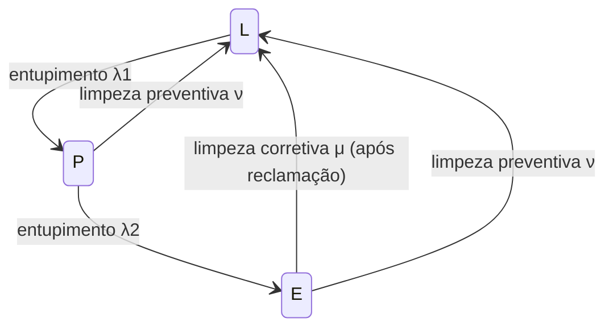

# Modelo de disponibilidade da galeria (desenho para o orientador)

- Data: 2026-11-21 · Prompt 3, tarefa 5 · Status: **desenho**; nada implementado, nada rodado sobre dia de alagamento.
- Ideia (orientador): tratar a drenagem do ponto como um sistema que **falha** (entope) e é **reparado** (limpo). O alerta deixa de
  supor galeria perfeita e passa a considerar em que estado ela provavelmente está.
- Entradas: capacidade com tudo limpo (prompt 1, cadastro ESIG); fatores por estado (`PARAMETROS-ENTUPIMENTO.md`); taxas da
  Central 156 (`docs/extratos/emlurb-156/RELATORIO-156.md`), do campo (`docs/campo/FICHA-BOCAS-DE-LOBO.md`) e da limpeza preventiva
  (pedido 09).

## 1. Estados

| Estado | Capacidade de entrada | Fonte do fator |
|---|---|---|
| L — livre | `Q_cap` (100%) | prompt 1 |
| P — parcialmente obstruída | `f_P · Q_cap`, f_P de 0,5 a 0,9 | Guo (2012), 1 − fator de projeto |
| E — entupida | `f_E · Q_cap`, f_E de 0 a 0,5 | `[sem fonte]`, faixa física |

O fator multiplica a capacidade de **entrada** (bocas de lobo). A capacidade do ponto continua sendo o mínimo entre entrada e cano
(prompt 1); o assoreamento do cano fica fora desta versão (sem dado).

## 2. Transições

| Taxa | Significado | De onde vem | Limite |
|---|---|---|---|
| λ1, λ2 | entupimento parcial e total, por dia | chamados de limpeza de galeria/canaleta da 156 por boca de lobo e ano (tipos a aprovar); ficha de campo (taxa medida) | a 156 é entupimento **percebido e reclamado**: limite inferior de λ. Pode depender de dias secos e da estação chuvosa |
| μ | limpeza corretiva | tempo da abertura até ATENDIDA na 156, com os chamados nunca fechados como **censurados** | inclui fila e burocracia, em dias inteiros; sem data de conclusão própria |
| ν | limpeza preventiva | frequência programada por logradouro (pedido 09) | sem resposta, fica como faixa (de 0 a 1 por mês) |

Com transições exponenciais isso é uma cadeia de Markov a tempo contínuo. A probabilidade de cada estado no regime permanente sai de
`π·Q = 0`, `Σπ = 1`. Com intervalo de limpeza preventiva fixo (não exponencial), a versão certa é dependente do tempo desde a última
limpeza: `π(t)`, com reinício em L a cada limpeza.

## 3. Como entra no alerta

O balde roda uma vez por estado, com a capacidade do estado. A probabilidade de a lâmina passar de 15 cm é a soma das probabilidades
dos estados em que ela passa:

`P(h ≥ 15 cm) = Σ_s π_s · 1[h_s ≥ 15 cm]`

É uma mistura, não uma média de capacidades: com a média, o estado entupido some dentro de um número intermediário. São 3 rodadas do
balde em vez de 1 por ciclo; o custo é pequeno (o balde roda em milissegundos, `bucketMs` no ciclo).

## 4. Rede de Petri estocástica (Mercury)

| Rede de Petri | Modelo |
|---|---|
| Lugares | `Livre`, `Parcial`, `Entupida` (uma ficha = a boca de lobo, ou o conjunto do ponto) |
| Transições temporizadas exponenciais | `entope_parcial` (λ1), `entope_total` (λ2), `limpeza_corretiva` (μ), `limpeza_preventiva` (ν, de `Parcial` e de `Entupida`) |
| Métrica | probabilidade de marcação em cada lugar no regime permanente (análise estacionária) ou no tempo (transiente) |
| Variante | N fichas para N bocas de lobo; o lugar `Entupida` com N fichas dá o número de bocas entupidas; o fator do conjunto segue Guo (2012), Eq. 5.1, para unidades em série |
| Limpeza a intervalo fixo | transição determinística (DSPN) ou aproximação por fases (Erlang) |

Precedente: Rodrigues, Neves, Wallis, Brook e Morosiuk (2023) usam uma rede de Petri estocástica para prever faixas de nível de
sedimento em caixas de boca de lobo e a probabilidade de atingir um estado-limite para uma frequência de limpeza dada, com
aprendizado de máquina para classificar as caixas sem dado (só o resumo foi lido; ver `PARAMETROS-ENTUPIMENTO.md`, item 14). A
diferença aqui é a saída: não o estado da caixa, mas a lâmina na rua para a chuva medida e prevista.

## 5. Conta de exemplo (valores **ilustrativos**, sem fonte, só para mostrar o funcionamento)

Taxas: λ1 = 1/60 por dia, λ2 = 1/90 por dia, μ = 1/20 por dia, ν = 1/180 por dia. Regime permanente:

- π_L = 0,455; π_P = 0,455; π_E = 0,091.

Balde simplificado: área 10.000 m², C = 0,86, capacidade 125,4 mm/h (20,9 mm em 10 min), depressão prismática de 400 m², rua no
fundo. Chuva sintética de 60 min em passos de 10 min: 5, 15, 25, 10, 5, 0 mm (não é evento observado). Fatores: f_P = 0,5 (grelha,
Guo 2012) e f_E = 0.

| Estado | Fator | Lâmina máxima |
|---|---|---|
| Livre | 1,0 | 88 mm |
| Parcial | 0,5 | 411 mm |
| Entupida | 0,0 | 1.290 mm |

`P(h ≥ 15 cm) = π_P + π_E = 0,545`. Com a galeria suposta perfeita, a resposta seria "não alaga" (88 mm). O exemplo mostra o que muda:
o alerta passa a depender de quanto tempo a galeria passa entupida, e isso se mede (156, campo, pedido 09). Conta reproduzível:
`python3 -I scripts/modelo-estados/exemplo_ilustrativo.py`.

## 6. O que falta para rodar de verdade

1. Aprovação dos tipos de chamado que contam como entupimento (relatório da 156, seção 5).
2. Contagem de bocas de lobo por ponto (prompt 1) para λ por boca de lobo.
3. Pelo menos 3 meses de ficha de campo para separar P de E (a 156 não diz o grau de obstrução).
4. Capacidade com tudo limpo por ponto (prompt 1), aprovada.
5. Pré-registro: valores, faixas e a regra de mistura congelados antes de rodar sobre qualquer evento.

## 7. Fora de escopo agora (trabalho futuro)

- Câmera com visão computacional para classificar obstrução: há trabalhos com cerca de 85% de acurácia em bueiros `[sem fonte lida]`,
  mas obstrução visual não é obstrução hidráulica (grelha coberta de folhas pode passar água; caixa assoreada por baixo parece limpa).
- Sensor de nível em poço de visita: mediria a galeria cheia diretamente; custo, energia, vandalismo e permissão da EMLURB.

## 8. Limpeza recente reduz a chance de alagar (2026-11-21, aprovado pelo Lucas)

Versão com dado medido, mais simples que a cadeia de 3 estados: dois estados (livre e entupida) e a probabilidade de estar entupida
dependendo do **tempo desde a última limpeza**, `P(entupida | t) = 1 − exp(−λ_re · t)`. λ_re é a taxa de reentupimento medida na Central
156: o tempo entre uma limpeza ATENDIDA e o próximo chamado de limpeza a até 150 m do ponto
(`docs/extratos/emlurb-156/entupimento/RESULTADOS.md`).

- Ibura: λ_re = 0,0235 por dia (53 limpezas): P(entupida) = 0,07 três dias depois da limpeza, 0,51 com 30 dias, 0,88 com 90 dias.
- Derby: λ_re = 0,0053 por dia (24 limpezas). CIn e Imbiribeira: sem taxa (0 e 4 limpezas casadas) → comportamento de hoje.
- Frequência de limpeza: a oficial não está publicada (pedido 09); a observada perto do Ibura e do Derby é de uma a cada 60–69 dias,
  coerente com a literatura (seção 4 dos resultados).
- Código: `projeto-mapi-ai/mapi_ai/entupimento.py` (`p_entupida`, `prob_alagar`), com 5 testes; **não ligado ao alerta ao vivo**. Para
  ligar: a API precisa da data da última limpeza de cada ponto (ingestão dos Dados Vivos da 156, com atraso de até 15 min) e de uma
  emenda ao ADR 0027. Hoje, além disso, Ibura e Derby estão em revisão de terreno (trava da área), então a mistura só teria efeito neles
  depois de a área ser resolvida.
