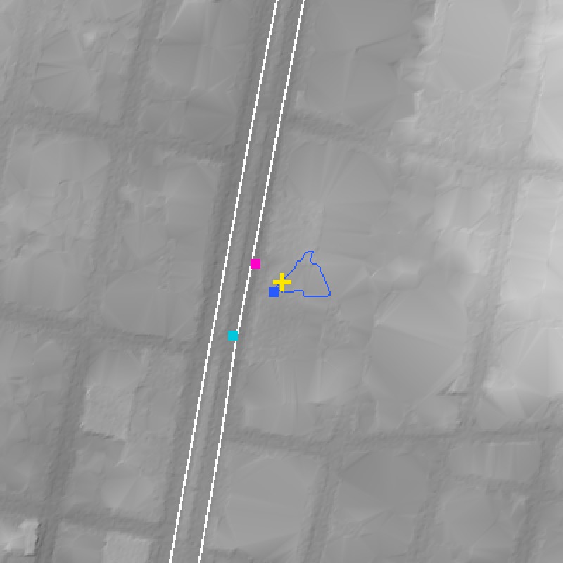
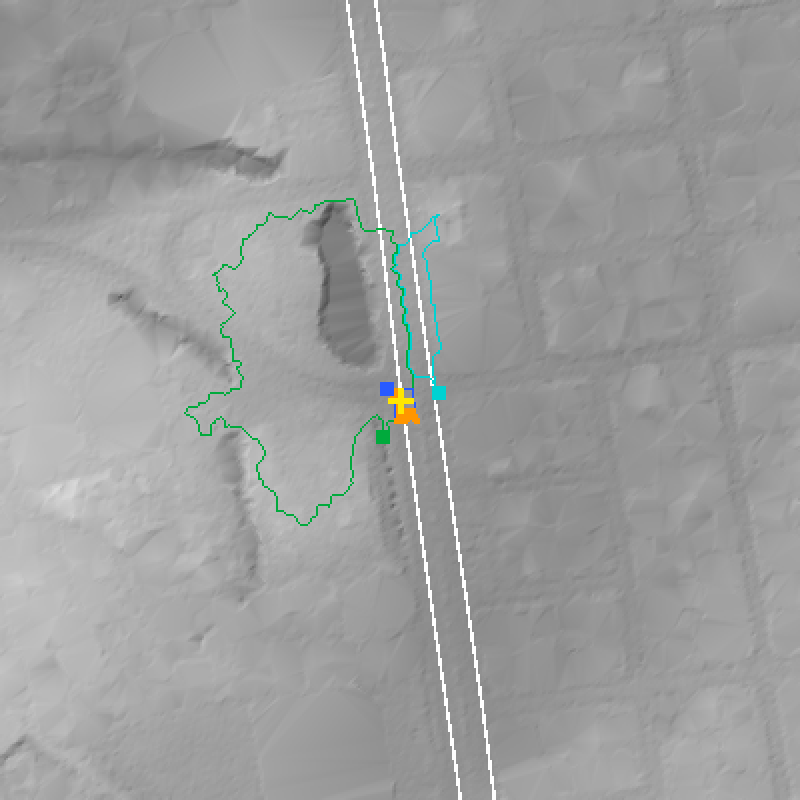
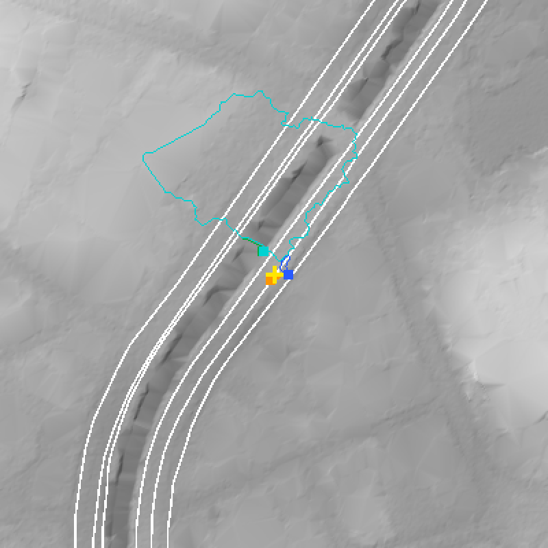
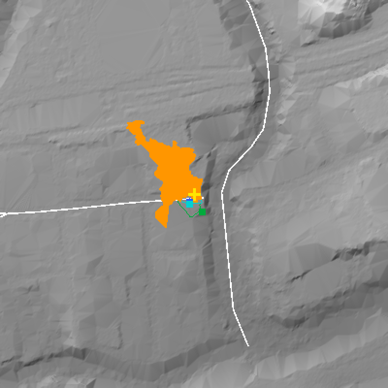

# Onda 16, Fase 3 — destravar os pontos

- Data: 2026-11-22/23 · Status: **aplicado** (ponto de parada D coberto pelo aval geral do Lucas de 22/11)
- Rodado por: `tools/terreno/run.sh onda16_fase3` (diagnóstico) e `tools/terreno/run.sh cobertura atributos` (terreno novo),
  com `DADOS_JABOATAO` e `OUT=MAPI/terreno/onda16`; imagem GDAL e WhiteboxTools fixados por hash (`tools/terreno/README.md`).
- Resultado bruto: `docs/onda16/fase3/fase3.json`; mapas em `docs/onda16/fase3/*.png` (400 m × 400 m, legenda em
  `tools/terreno/area_regras.py`).
- Nenhum dia de alagamento, nenhuma data de notícia e nenhuma intensidade foi usada. As regras olham só o MDT, o OSM e o
  lugar citado.

## 1. Achado antes de tudo: o banco ainda usa o terreno de antes do alinhamento

O alinhamento de 21/11 (V39) mudou as coordenadas de Ibura, Derby e Mascarenhas e o `terreno.json` da IA, mas o
`terrain_run` vigente no banco continuou o de antes (run 2, lido de `MAPI/terreno/ponto_terreno.csv`). No ar, em 22/11, o
alerta de Mascarenhas rodava com 10.103 m² e rua a 2,068 m, que são da posição antiga, 1,4 km ao sul
(`select ... from point_terrain join terrain_run where current`, 22/11 02h50 UTC). A Fase 3 carrega o terreno novo (seção 6).

## 2. Mascarenhas: por que a profundidade da depressão deu 0,0 m

| | Posição do alinhamento (V39) | Fonte |
|---|---|---|
| Coordenada | −8,107178; −34,911237 | `docs/ALINHAMENTO-PONTOS.md` |
| Como foi feita | ponto médio dos nº 2557 e 2857 no Nominatim | idem |
| Distância ao eixo da Av. Mascarenhas de Moraes (OSM) | **24,0 m** | `fase3.json`, `mascarenhas.ponto` |
| Cota no ponto | 3,072 m | idem |
| Cota do eixo da avenida a até 200 m (404 amostras a cada 2 m) | 1,98 a 2,56 m | `perfil_mascarenhas.csv` |
| Profundidade da depressão no ponto e a até 5 m | 0,0 m | idem |
| Exutório do snap de 10 m | a 9,5 m, cota 2,948 m, fora de depressão | idem |
| Bacia | 713 m², e a cota mais baixa da bacia é o próprio exutório | `MAPI/terreno/onda14/ponto_terreno.csv` |

**Explicação.** O Nominatim põe o número da casa no lote, não na rua. O ponto caiu dentro do quarteirão, 24 m fora da
avenida e 0,9 m acima dela, num terreno que escoa para a avenida. Ali não há depressão: a água passa. A curva cota-volume
de 713 m² tratava uma encosta como reservatório (o fundo da curva era o exutório, por onde a água sai). A água do exutório
anda 15,7 m e para numa depressão de 2,3 cm a 7,7 m do eixo da avenida.

**A avenida tem depressão de verdade.** A maior depressão a até 200 m do ponto tem 9.243 m², 0,62 m de profundidade, fundo a
1,76 m, transbordo a 2,38 m e 1.775 m³, e encosta na avenida (fundo a 2,9 m do eixo).

**Correção aplicada (R1).** O ponto vai para a projeção perpendicular no eixo da avenida: −8,107134; −34,911454 (24,4 m).
Lá a cota é 2,183 m, o ponto fica **dentro** da depressão grande (0,197 m de profundidade no pixel, 0,28 m a até 5 m) e a área
é estável: 38.900 / 38.990 / 40.159 m² com snap de 5, 10 e 20 m (razão 1,0). Pela regra R2 (abaixo), 40.159 m², rua 0,23 m
acima do fundo, volume de 34.303 m³ até 2 m.

## 3. Ibura e Derby: quadro das regras da área de contribuição

Posições do alinhamento (V39). Lâmina ilustrativa: um passo de 10 min com 20,9 mm (IDF TR 5, Te 10 min) e galeria obstruída,
como em `docs/PROPOSTA-REGRA-AREA-CONTRIBUICAO.md` (não roda sobre série nem dia de alagamento). Fontes: `docs/terreno/area-contribuicao/area_regras.csv`
(a, b, c, d, rodado sobre as posições alinhadas) e `fase3.json` (c').

| Regra | Ibura (Av. Recife × Dom Hélder) | Derby (Agamenon, sentido Olinda) |
|---|---|---|
| (a) snap 10 m com trava A(20)/A(5) ≤ 10 | razão 111,3 → SEM_DADO (207 m²) | razão 415,0 → SEM_DADO (74 m²) |
| (b) bacia D8 até a boca de lobo do ESIG mais próxima do ponto baixo | BL 3603 a 41 m do ponto baixo: **68 m²**, lâmina 176 mm | BL 10058 a 33 m: **3.663 m²**, lâmina 0 |
| (c) maior acumulação a 20 m, só em pixel a ≤ 6 m de qualquer via de veículo | 10.879 m², lâmina 0 | 2.721 m², lâmina 0 |
| (c') igual a (c), só na **via citada** pela fonte | **1.146 m²** (Av. Recife), lâmina 302 mm | **10.765 m²** (Agamenon), lâmina 0 |
| (d) faixa 5–20 m | 102 a 11.354 m² | 26 a 10.790 m² |
| Depressão no ponto (pixel / máx. a 5 m) | 0,218 / 0,306 m | 0,0 / 0,045 m |
| Fundo da bacia (c') | 1,15 m, 0,16 m abaixo da rua | −0,083 m, **2,51 m abaixo da rua**, a 49 m (canal da Agamenon) |

Leitura: no Ibura o ponto está numa depressão (o cruzamento) e a via citada drena 1.146 m² para ela. No Derby o ponto não é
o fundo de nada: o fundo da bacia é o leito do canal no canteiro da Agamenon, 2,51 m abaixo da rua; o alagamento ali depende
do canal (maré e chuva da bacia do canal), que o balde de acúmulo local não representa.

 

## 4. Jaboatão: posição nova pelo lugar

Fontes públicas citam a Av. Barão de Lucena e a margem do Rio Duas Unas (só o lugar). Geometria: OSM por Overpass, baixada em
`tools/terreno/vias_osm/jaboatao_lugar/` (ODbL; data e SHA-256 na pasta). Cruzamento da avenida com o rio: −8,111886; −35,013838.

| | Regra escrita antes de rodar | Regra da margem (escrita depois) |
|---|---|---|
| Critério | pixel da avenida (≤ 6 m do eixo) a até 200 m do cruzamento, fora do vão da ponte (≥ 20 m do rio), com a maior profundidade de depressão | igual, mas a até 50 m do eixo do rio |
| Resultado | −8,112036; −35,015607 · 43,31 m · depressão 0,277 m · **215 m do rio** | **−8,111854; −35,013919** · 41,49 m · depressão 0,13 m · **28 m do rio** · 9,6 m do cruzamento |
| Área (snap 5 / 10 / 20 m; razão) | 23.226 / 23.384 / 24.585 m²; 1,1 | 2.976 / 3.038 / 3.308 m²; 1,1 |

A primeira regra caiu a 215 m do rio: não é "margem". Escrevi a segunda depois de ver isso, sem olhar alagamento, e adotei
a dela. Declaro a ordem para a dissertação. A posição antiga (encosta a 64,8 m) fica a 595 m ao norte. Pela regra R2
(Barão de Lucena), 3.088 m², rua 0,14 m acima do fundo.

## 5. Regra adotada (igual para os 5 pontos)

- **R1.** Ponto citado por uma via fica no eixo dela (projeção perpendicular no OSM). Mascarenhas move 24,4 m; Ibura e Derby
  já estavam no eixo (0,0 m); Jaboatão vai para a margem do Duas Unas.
- **R2.** Exutório = pixel de maior acumulação a até 20 m do ponto, só entre pixels a até 6 m do eixo da via citada
  (`tools/terreno/exutorio_por_via.csv`; implementado em `terreno.py atributos`, coluna `regra_exutorio`). CIn não é citado
  por via: continua com o snap de 10 m e a trava (a).
- **R3.** Terreno OK só com depressão no MDT a até 5 m do ponto (fill − MDT > 2 cm).
- **R3b** (conferência de cálculo, escrita depois de ver o Derby): a curva cota-volume vai de 0 a 2 m acima do fundo; se a rua
  + 15 cm fica acima do topo, o balde não consegue calcular lâmina na rua, e o ponto fica em revisão.

| Ponto | Área (m²) | Rua acima do fundo (m) | Depressão a 5 m (m) | Status |
|---|---|---|---|---|
| Ibura | 1.146 | 0,16 | 0,306 | **OK** (antes: em revisão) |
| CIn | 82.378 | 0,109 | 0,24 | OK |
| Derby | 10.765 | 2,51 | 0,045 | em revisão (R3b; motivo escrito) |
| Jaboatão | 3.088 | 0,14 | 0,15 | **OK** (antes: em revisão) |
| Mascarenhas | 40.159 | 0,23 | 0,28 | OK, terreno corrigido |

Fonte: `MAPI/terreno/onda16/ponto_terreno.csv` (SHA-256 em `projeto-mapi-ai/data/bucket10/terreno.json`, campo `fonte`);
status por `projeto-mapi-ai/scripts/terreno_bucket10.py`.

## 6. O que mudou no sistema

- `V48`: coordenadas de Mascarenhas e Jaboatão; seed igual (`MapiServiceImpl`).
- `mapi.alerta.flood.terrain-review` passa a ter só o Derby.
- Terreno novo carregado no banco (terrain_run 3) a partir de `MAPI/terreno/onda16`; os arquivos de antes ficam em
  `MAPI/terreno/pre-onda16/`.
- `projeto-mapi-ai/data/bucket10/terreno.json` regenerado; registros de 5 anos refeitos (`reports/bucket10/balde10_5anos.json`,
  `reports/fatores/RELATORIO.md`, seção "Atualização da Fase 3").
- Consequência a acompanhar: com o terreno certo, a maré passa a decidir a lâmina de Mascarenhas (185 eventos ≥ 15 cm em
  5,17 anos de chuva medida no cenário central; 17 no cenário de viés). Isso é frequência na física, não acerto.
- Ibura: a soleira da saída (0,10 m NR) fica abaixo do nível médio do mar; com o refluxo no nível, seriam 494 eventos em
  5,17 anos (saída fechada 81% do tempo). Refluxo de Ibura passa a `INFO` (ADR 0030, emenda 1): comporta e bomba não modeladas.

## 7. Data de quebra da Mascarenhas (obras)

O reservatório do ProMorar na Rua Muritiba (6.400 m³, bombeamento para o Canal da Mauricéia; Prefeitura do Recife, 10/09/2026,
conforme o prompt da onda 16) muda a física do ponto quando operar. Configuração por ponto, com a data de início de operação
vazia por enquanto:

- API: `mapi.obras.pontos.<slug>` (`ObrasProperties`); cada previsão gravada leva `api_context.obra_periodo` (`ANTES`,
  `DEPOIS` ou `SEM_OBRA`) em `flood_forecast_point.payload`.
- IA: `data/obras.json` e `mapi_ai/obras.py`; `flood/validate.py` chama `garante_sem_mistura` e para com erro se um ponto
  juntar antes e depois; `separa` devolve um pedaço por (ponto, período).

## 8. Pendências

- Os parâmetros da 156 (λ, limpezas a 150 m) de Mascarenhas são da posição de 21/11; a projeção move 24 m. Recalcular na
  próxima carga da 156.
- A série de chuva de 10 min de Jaboatão usada nos registros de 5 anos é a da posição antiga (595 m): exportar de novo pela
  API (`GET /api/alerta/serie-10min.csv`, ADMIN).
- Derby: precisa de um modelo de canal (nível do canal da Agamenon com maré), fora do balde local. Pergunta para o orientador.
- A soleira de saída de Mascarenhas (CG 88084) foi escolhida a até 150 m da posição de 21/11; continua valendo para a projeção
  (24 m), sem conferência de campo.
