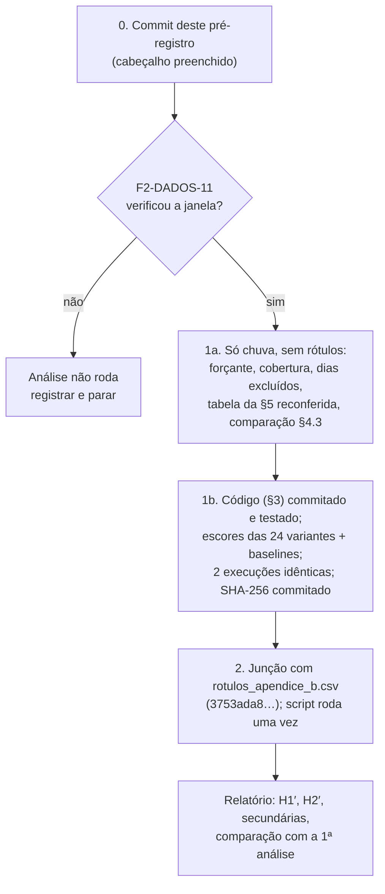

# Pré-registro da 2ª análise: balde forçado com chuva de pluviômetro (ANA)

- Tarefa: F4-IA-16 · Data: 2026-10-11 · Autor: Agente 3 (nível Máximo, desenho de pesquisa) · Versão 1
- Só documentação. Nenhum código, banco, parâmetro ou escore foi alterado; nada foi rodado para escrever este documento.
- Lê: `docs/PRE-REGISTRO-AVALIACAO.md` com as emendas (abaixo, "PRE-REGISTRO-1"), `docs/RESULTADOS-AVALIACAO-F1.md`
  ("RESULTADOS-1"), `docs/INTERPRETACAO-F1.md` ("INTERPRETACAO"), `docs/revisao/fase-2/F2-DADOS-10.md` ("F2-DADOS-10"),
  `docs/revisao/fase-2/F2-DADOS-07.md` ("F2-DADOS-07"), `docs/MODELAGEM-IA.md` ("MODELAGEM"),
  `docs/PARAMETROS-MODELO-FISICO.md` ("PARAMETROS") e o código de `projeto-mapi-ai`, branch `feat/avaliacao-f1`
  (lido com `git show`, sem executar).
- Escopo: só o balde (M1) e as baselines B2 e B3. A rede de Petri, o emulador, H3 e H4 estão fora (PRE-REGISTRO-1,
  emenda 3).
- **Commit do pré-registro:** `2b9352cc4bfdf6a746b8cc4e9746be2e87d9b6bd` (2026-10-11, `revisao/fase-0`)
- **SHA-256 deste arquivo no commit:** `21beddaba6e0fac98ea40eb2781bac164d2c11a966bac6745f91902c856fc581`
- **Commit da F2-DADOS-11 que verificou a janela (portão da §2.1):** `[preencher]`
- **Escores da etapa 1b (SHA-256, commitado antes da etapa 2):** `[preencher]`
- **Confirmação do autor (Lucas):** `[ ] confirmado em ____`
- Qualquer alteração depois do commit acima é **emenda** (seção "Emendas") e só vale se feita antes do commit dos escores
  da etapa 1b.

## 1. Pergunta e status

**Pergunta.** A classificação da 1ª análise (H1 inconclusiva e degenerada; H2 não testada; RESULTADOS-1 §7) muda quando a
chuva de entrada passa da reanálise Open-Meteo para a chuva horária medida por pluviômetro da ANA, mantendo tudo o mais
igual?

**Status, dito com franqueza:**

1. **Esta análise é posterior à junção.** Os 18 dias rotulados (14 principais em 13 episódios, 4 extras) e os 689
   negativos já foram juntados aos escores na 1ª análise, e o resultado é conhecido (RESULTADOS-1). Ela **não é uma
   confirmação independente** e **não substitui** a 1ª análise, que continua sendo o registro confirmatório.
2. **É uma análise de sensibilidade à forçante.** Só a chuva de entrada muda. Parâmetros, modelos, baselines, rótulos,
   conjunto de teste, métricas, semente, bootstrap e regras de classificação são os da PRE-REGISTRO-1 com as emendas.
   Nenhum parâmetro pode ser ajustado.
3. **Ela já estava prevista como secundária.** A PRE-REGISTRO-1 §3 listava `M1-pluv` ("forçante de pluviômetro, se
   disponível antes da §5, passo 5"). Não estava disponível: a ANA estava em quarentena de fuso e o Cemaden verificado só
   existia a partir de 2026-10-09 (PRE-REGISTRO-1, emenda 2, item c). Esta é a execução tardia daquela variante, agora
   como análise própria.
4. **Efeito de seleção.** A decisão de rodar esta análise foi registrada depois de ver o resultado da 1ª (INTERPRETACAO
   §6.1). Por isso qualquer mudança de categoria aqui é lida como dependência da forçante, nunca como "o resultado
   verdadeiro".

## 2. Forçante: chuva horária da ANA por ponto

### 2.1 Portão: a F2-DADOS-11 precisa verificar a janela

A chuva da ANA entra em `observation` com resolução `EVENT` e qualificador `WINDOW_UNVERIFIED`. A janela da leitura de
15 min não está confirmada, e por isso a chuva não entra em `observation_hourly_v` (F2-DADOS-10 §5, último parágrafo).
A F2-DADOS-11 (PROGRESSO: "verificar a janela das leituras EVENT e agregar para hora, rótulo no fim do intervalo") é
pré-requisito.

- **A análise só roda se a F2-DADOS-11 terminar com a janela verificada**, com critério commitado antes do teste (como
  em F2-DADOS-10, `283f6b7`), e com o commit dela preenchido no cabeçalho.
- Se a janela ficar não verificada, ambígua ou rejeitada, **a análise não roda**. Não se monta agregação alternativa
  "provável" e não se escolhe janela por conveniência. Este pré-registro fica como registrado e não executado, e isso é
  reportado.
- O fuso já está resolvido: ANA_SOAP `VERIFIED` em UTC−3 (`h = −3`), migração V14 (F2-DADOS-10 §1 e §4).

### 2.2 Agregação horária

- Hora UTC rotulada pelo fim, `(H − 1 h, H]` (ADR 0006 §5; MODELAGEM §2.1), com as leituras de 15 min atribuídas à
  hora conforme a janela verificada pela F2-DADOS-11.
- **Hora válida:** ≥ 3 de 4 leituras de 15 min; valor = soma das leituras presentes, sem reescala e sem preenchimento
  (mesma regra de F2-DADOS-07 §1.1 e F2-DADOS-10 §7). Se a F2-DADOS-11 gravar outra regra em `observation_hourly_v`,
  vale a desta seção, aplicada às leituras de 15 min com a janela verificada.
- **Nenhum filtro de controle de qualidade além do que a ingestão já aplica** (faixa do catálogo). Observação: F2-DADOS-10
  §5 registra leituras de 15 min de até 68,8 mm no período 2021–2026, valor que não aparece no máximo horário de
  2021–2024 (36,4 mm/h, F2-DADOS-10 §7). Onde está essa leitura e por que não entra no máximo horário fica
  `[a verificar na F2-DADOS-11]`. Um filtro decidido agora, sabendo as datas dos positivos, seria um grau de liberdade;
  por isso não há filtro novo. Se a F2-DADOS-11 fixar uma regra de qualidade, ela vale só se for commitada lá, sem
  referência a datas rotuladas, antes da etapa 1a.
- A duração de referência continua 60 min **de relógio** (PRE-REGISTRO-1 §4.2). A janela móvel de 60 min a partir das
  leituras de 15 min daria intensidades maiores e mais próximas da IDF, mas mudaria o modelo, não só a forçante. Fica
  fora desta análise.

### 2.3 Regra de escolha da estação por ponto (fixada a priori)

- **Candidatas:** as 4 estações com série contínua de pluviômetro em `IngestionProperties.anaHistoricalStations`:
  39187800 São Lourenço da Mata II, 39370100 Engenho Maranhão, 39167000 Vitória de Santo Antão Montante e 39084000 Caricé
  (F2-DADOS-07 §2; F2-DADOS-10 §7). Lista fechada.
- **Distância:** geodésica (haversine) entre a coordenada do ponto crítico e a coordenada da estação no inventário
  `ListaEstacoesTelemetricas`. **Raio máximo: 60 km**, o raio do inventário usado em F2-DADOS-07 §2. Empate: menor
  código de estação.
- **Cobertura mínima, por dia local:** a estação serve ao ponto `p` no dia `d` se tiver ≥ 23 de 24 horas válidas nesse
  dia (mesma regra de dia completo da MODELAGEM §2.4).
- **Escolha:** para cada ponto `p` e dia local `d`, usa-se a estação **mais próxima** de `p`, dentro do raio, que tenha
  o dia `d` completo. O dia inteiro vem de uma só estação (não se misturam estações dentro do dia).
- **Dia local:** a hora `t` (UTC, fim do intervalo) pertence ao dia da data de `t − 4 h` (MODELAGEM §2.4; função
  `dia_local` de `avaliacao/entradas.py`).

Distâncias conhecidas: 39187800 fica a 17,0 km do Derby e 19,9 km de Mascarenhas/Imbiribeira; 39370100 a 44,6 e 38,3 km;
39167000 a 47,6 e 45,8 km; 39084000 a 59,8 e 66,5 km (F2-DADOS-07 §3.1). Logo, Caricé fica fora do raio para Mascarenhas.
As distâncias a AV_RECIFE_IBURA e CIN_UFPE ficam `[a calcular na etapa 1a]`.

**Consequência esperada, declarada agora:** nos dias em que 39187800 estiver completa, ela será, pelas distâncias
conhecidas, a estação de Derby e de Mascarenhas, e provavelmente dos 4 pontos. Então os 4 pontos recebem **a mesma série
de chuva**, e o máximo sobre os pontos (MODELAGEM §3) se reduz a uma estação. Os pontos só diferem no terreno (`A_p`,
curva), que não entra na condição de transbordar (§5).

### 2.4 Lacunas (regra fixa, nunca por resultado)

1. **Ponto-dia incompleto:** nenhuma estação candidata tem o dia completo. Na simulação contínua, as horas desse dia
   entram com `P = 0` (o código exige série horária sem buracos, `carregar_chuva`), e o dia é marcado incompleto.
2. **Hora faltante dentro de um dia completo** (no máximo 1 de 24): entra com `P = 0` e é contada.
3. **Dia × Recife avaliável:** só se os 4 pontos tiverem o dia completo. Dias não avaliáveis saem de N e de P, como
   manda a PRE-REGISTRO-1 §2.2 (b) e §2.3. Positivo sem forçante completa sai, é listado e **não** é substituído.
4. **Memória do balde:** o dia seguinte a um dia incompleto entra normalmente, mas é contado e listado, porque o `P = 0`
   forçado pode ter esvaziado o balde.
5. **Início da simulação:** a carga da ANA começa em 2021-10-01 (F2-DADOS-10 §7). A simulação vai de **2021-10-01 a
   2024-12-31**, com estado inicial `V = 0` e aquecimento de 30 dias (2021-10-01 a 2021-10-30). Consequência sabida:
   **2021-05-13 (P_extra) não tem forçante e sai**; P_extra fica com no máximo 3 dias (2022).
6. **Cobertura mínima para testar:** se menos de **10** dos 14 dias de P_principal forem avaliáveis, H1′ e H2′ são
   classificadas **"não testadas por cobertura"** e só as secundárias descritivas são reportadas. O valor 10 é escolha de
   método `[sem fonte]`, fixada aqui: abaixo disso o menor AUC com IC acima de 0,5 sobe além do calculado na
   PRE-REGISTRO-1, Apêndice A, para 14 positivos.
7. A lista de dias excluídos é gerada na etapa 1a **para todos os dias do período, sem marcar quais são positivos**, e
   commitada antes da etapa 2. A contagem de positivos excluídos só aparece na etapa 2.

Cobertura anual já conhecida, só de chuva (F2-DADOS-10 §7): 39187800 com 8 657 h válidas em 2023 e 7 922 em 2024;
39370100 com 7 758 e 7 853; 39084000 com 7 891 e 8 733; 39167000 com 2 421 e 8 209. A cobertura diária por ponto em
2023–2024 fica `[a medir na etapa 1a]`.

## 3. Modelos e baselines: idênticos aos da 1ª análise

| Item | Valor | Origem |
|---|---|---|
| Parâmetros | tabela congelada da PRE-REGISTRO-1 §4.2, com as emendas; centrais `C` 0,86, `i_T` 60,1 mm/h, `h_crit` 15 cm, `f` 1,0, snap 10 m, curva do MDT | PRE-REGISTRO-1 §4.2; PARAMETROS |
| M1a′ | balde, `g ≡ 1`, valores centrais, escore lexicográfico (`S`, depois `R`), agregação pelo máximo nos 4 pontos | MODELAGEM §2.1, §2.4, §3 |
| Variantes | as mesmas **24** de M1 (central; C 0,70/0,95; i_T 50,3/68,7; h_crit 10/30 cm; f 0,0/0,2/0,4/0,6/0,8; curva ±30%; snap 5/20 m; 8 cantos) | RESULTADOS-1 §6 e errata |
| B2 | normal mensal INMET 82900, 1991–2020; **não depende da forçante**, mesmo escore da 1ª | PRE-REGISTRO-1, emenda 1 |
| B3′ | chuva horária máxima do dia nos 4 pontos, agora com a chuva da ANA; alerta ≥ 50,3 mm/h | PRE-REGISTRO-1 §3 |
| B3-50, B3-70, B3-24h, B3-47,4, B3-55 | mesmos limiares, sobre a chuva da ANA | idem |
| Convenções | `R` com `f = 0` usa `f = 1` no denominador; B3-24h = máximo da soma móvel de 24 h | PRE-REGISTRO-1, emenda 2 |
| Não roda | M1b (sem `λ_NR`, ADR 0009); M1-ef e B3-ef (a transferência por igual frequência existia para levar a IDF de pluviômetro à reanálise; com forçante de pluviômetro ela não se aplica) | PRE-REGISTRO-1 §3, §4.3 |

**Código.** Base: `projeto-mapi-ai`, `feat/avaliacao-f1` em `abbd831` (regressão contra a saída congelada de `f6ddacf`,
F5-ACAD-02). `avaliacao/balde.py` e a lista de variantes **não mudam**. Mudanças permitidas, todas restritas à entrada e
à contagem de completude, feitas e commitadas antes da etapa 1b:

1. Um construtor da forçante (novo módulo) que aplica as §2.2 a §2.4 e grava o CSV no formato que `carregar_chuva` já lê
   (`slug, ts_utc_fim_intervalo, precipitation_mm`), mais um arquivo de validade por ponto-dia.
2. Em `gerar_escores.py`: início em 2021-10-01, aquecimento até 2021-10-30, e `horas_no_dia` passando a contar **horas
   válidas** (hoje conta horas presentes, que na série preenchida seriam sempre 24).
3. Em `avaliar_h1_h2.py`: hoje `conjuntos()` aplica a completude só a N; P_principal entra inteira. É preciso excluir
   também os positivos incompletos (PRE-REGISTRO-1 §2.3, regra que a 1ª análise não exercitou porque teve 0 dias
   incompletos, RESULTADOS-1 §2) e recalcular episódios sobre os positivos restantes. Também é preciso aplicar o
   portão da §2.4, item 6.
4. Cada mudança tem teste com rótulos sintéticos (semente 7, como na 1ª) e o teste de regressão de `f6ddacf` continua
   passando com a forçante Open-Meteo. Diff commitado e listado no relatório.

Qualquer outra mudança no código é desvio e vai para a seção "Emendas" com motivo.

## 4. Hipóteses H1′ e H2′

Mesmas comparações, mesmos testes e mesmas regras da PRE-REGISTRO-1 §1, §6 e §7, com a forçante da ANA.

| Id | Hipótese | Comparação | Unidade |
|---|---|---|---|
| **H1′** | M1a′ ordena os dias com registro acima dos dias sem registro melhor que B2 | ΔAUC = AUC(M1a′) − AUC(B2) > 0 | dia × Recife, 2023–2024, dias avaliáveis |
| **H2′** | M1a′ ordena melhor que B3′ | ΔAUC = AUC(M1a′) − AUC(B3′) > 0 | idem |

- **Hierarquia:** H2′ só é testada se H1′ for positiva.
- **Métrica:** AUC de Mann–Whitney com empates 0,5; P_principal avaliável × N avaliável; ΔAUC pareado; IC percentil de
  95%, 10 000 réplicas, semente `20261011`; positivos reamostrados por episódio, negativos por semana ISO.
- **Categorias** (PRE-REGISTRO-1 §7): positivo robusto, positivo condicional (conta como inconclusivo), negativo,
  inconclusivo, degenerado. "Positivo robusto" exige IC > 0 na principal e em todas as variantes com parâmetro sem
  fonte (`f`, curva, snap).
- **Rótulos:** o arquivo já commitado `avaliacao/dados/rotulos_apendice_b.csv`, SHA-256
  `3753ada8218f77503f403f216d1d73038c63bcab1400379a993e6890872b25d3` (RESULTADOS-1 §2). Não se refaz a consulta.
- **Secundárias pré-registradas (descritivas, sem correção para multiplicidade):** as da PRE-REGISTRO-1 §6.2 (binárias
  com Clopper–Pearson, McNemar exato M1a′ × B3′, P_extra, AUC contra 0,5 de cada escore, análise com os positivos
  extras avaliáveis), a verificação de consistência de B3-50 com Fonseca Neto et al. (2026), agora possível porque a
  forçante é de pluviômetro, e mais duas:
  1. **Comparação de forçantes no mesmo conjunto de dias:** AUC de B3 com Open-Meteo (escores congelados `4615d416…`)
     contra AUC de B3′ com ANA, restritos aos dias avaliáveis desta análise, com as mesmas réplicas pareadas. É a
     medida direta da sensibilidade à forçante. Sem categoria e sem teste de hipótese.
  2. **Fronteira do dia:** fração dos dias de N e de P cuja hora de chuva máxima cai entre 23 h e 1 h local, para
     dimensionar o efeito de um erro residual de 1 h no rótulo (§6, risco 3).

## 5. Expectativa declarada antes de rodar

**Fato de partida.** O máximo horário da ANA em 2021–2024 é 36,4 mm/h (39370100, 2022); em 2023–2024 é 35,0 mm/h
(39167000, 2024) (F2-DADOS-10 §7). Como cada ponto recebe a série de uma dessas estações, nenhum ponto-hora pode passar
desses valores. Os números valem para a agregação de F2-DADOS-10 §7, feita com janela ainda não verificada; a etapa 1a
reconfere na série da F2-DADOS-11.

**Condição de transbordar.** Pelo método racional, `Q_in > q_p` equivale a `P(t) > f · i_T`; `C` e `A_p` se cancelam
(MODELAGEM §2.1; INTERPRETACAO §2.2). Ela é **necessária, não suficiente** para `S > 0`: o volume acumulado ainda
precisa subir acima da cota da rua na curva cota-volume.

| `f` | `f · i_T` com `i_T` = 60,1 | Pode transbordar em 2023–2024 (máx. 35,0)? | Em 2022 (máx. 36,4)? | Variantes afetadas |
|---|---|---|---|---|
| 1,0 | 60,1 (50,3 a 68,7 nas variantes de `i_T`) | **não** | não | central, C, i_T, h_crit, curva, snap, 4 cantos com `f = 1,0` |
| 0,8 | 48,1 | **não** | não | 1 |
| 0,6 | 36,06 | **não** (folga de 1,06 mm/h) | sim, só se 39370100 for a estação do dia | 1 |
| 0,4 | 24,0 | sim, em horas ≥ 24 mm/h `[contagem na etapa 1a]` | sim | 1 |
| 0,2 | 12,0 | sim | sim | 1 + 4 cantos |
| 0 | 0 (sem saída) | `S` é só armazenamento; na 1ª análise saturou e ficou constante | — | 1 |

(Contas: 0,2 × 60,1 = 12,02; 0,4 × 60,1 = 24,04; 0,6 × 60,1 = 36,06; 0,8 × 60,1 = 48,08. As variantes de `i_T` rodam com
`f = 1,0`, e os cantos só com `f` ∈ {0,2; 1,0}, PRE-REGISTRO-1 §6.3.)

**O que isso implica, dito antes da junção:**

1. **M1a′ (central) degenera com certeza.** `S = 0` em todos os dias, porque 35,0 < 60,1. O escore lexicográfico cai em
   `R′ = máx P / 60,1`, que ordena os dias como B3′. Se H2′ chegasse a ser testada, ΔAUC(M1a′, B3′) seria 0 por
   construção, como na 1ª.
2. **H1′ vai medir "chuva horária máxima de um pluviômetro a 17–60 km × sazonalidade"**, não o balde. A categoria
   "degenerado" da PRE-REGISTRO-1 §7 vale de antemão.
3. **Degeneração parcial:** das 24 variantes, só 6 (f = 0,2; f = 0,4; 4 cantos com f = 0,2) podem ter `S > 0` em
   2023–2024, mais o caso especial `f = 0`. Nas outras 17, `S ≡ 0` está garantido. A pergunta "positivo robusto?" só
   teria conteúdo físico nas 6.
4. **Binárias:** B3′ (50,3), B3-47,4 e B3-55 não podem alertar (35,0 < 47,4). B3-70 (35,2) também não alerta em
   2023–2024 (35,0 < 35,2, folga de 0,2 mm/h). B3-50 (25,2) e B3-24h (30 mm/24 h) podem alertar. As métricas binárias
   de M1a′ e B3′ não informam.
5. **Se o máximo da série da F2-DADOS-11 em 2023–2024 diferir do de F2-DADOS-10 §7** (por exemplo, por causa da janela),
   a tabela acima é refeita na etapa 1a, só com chuva, e commitada antes da junção. Os parâmetros não mudam.
6. **A distância é o novo limite.** O pluviômetro tem a escala de intensidade certa (pontual), mas está no lugar errado:
   a estação mais próxima fica a 17 km do Derby e nenhuma está na RMR urbana (F2-DADOS-10 §7). A chuva convectiva que
   alaga uma rua do Recife pode não ter chovido em São Lourenço da Mata, e o contrário também. A correlação horária entre
   essas estações e a grade na própria coordenada já é baixa, 0,25 a 0,33 (F2-DADOS-07 §3.1). A troca é, portanto, entre
   dois erros: suavização (reanálise) e deslocamento (pluviômetro distante).

## 6. Execução cega em duas etapas

Os rótulos já são conhecidos, então a etapa cega **não prova cegueira**. O que o hash prova é a ordem dos fatos: o código,
a forçante e os escores ficaram fixos antes de serem juntados aos rótulos, e não mudaram depois.

1. **Etapa 0.** Commit deste documento; o orquestrador preenche o cabeçalho. Portão da §2.1 conferido.
2. **Etapa 1a (só chuva).** Construir a forçante pelas §2.2 a §2.4. Relatório commitado com: estação escolhida por ponto e
   por ano (contagem de dias); distâncias dos 4 pontos às 4 estações; lista de dias não avaliáveis de 2023–2024 e de
   2022 **sem marcar positivos**; quantis 0,9 / 0,99 / 0,999 e máximo da chuva horária por ponto; contagem de horas
   ≥ 12,0 / 24,0 / 25,2 / 35,2 / 36,1 / 48,1 / 50,3 / 60,1 mm/h; reconferência da tabela da §5; e a comparação
   reanálise × pluviômetro da PRE-REGISTRO-1 §4.3, agora possível (horas comuns de 2021-10 a 2024-12), só descritiva.
   Nada desse relatório pode listar ou destacar as datas rotuladas.
3. **Etapa 1b (escores).** Código da §3 commitado com testes verdes. Rodar todos os modelos, variantes e baselines de
   2021-10-01 a 2024-12-31 e gravar o CSV no mesmo formato da 1ª (`modelo, variante, ponto, data, escore, desempate,
   alerta, periodo, horas_no_dia`). Duas execuções com SHA-256 idêntico. Commitar o hash, o SHA-256 do CSV de forçante e
   o commit do código **antes** da etapa 2.
4. **Etapa 2 (junção).** `avaliar_h1_h2.py` (versão commitada na etapa 1b) roda **uma vez** sobre o CSV da etapa 1b e o
   arquivo de rótulos `3753ada8…`. Saída commitada. Nova execução só para corrigir erro do script, com o diff registrado
   em "Emendas".
5. Qualquer análise além da §4 é **exploratória** e rotulada assim.

## 7. O que NÃO será concluído

1. **Que o balde tem habilidade.** Na parametrização central ele não pode transbordar com esta forçante (§5, item 1).
   Qualquer AUC de M1a′ é o AUC da chuva horária máxima do pluviômetro.
2. **Confirmação independente.** A análise é posterior à junção e motivada pelo resultado da 1ª. Uma mudança de categoria
   em H1′ significa "a classificação depende da forçante", não "agora o modelo funciona". Ela não reescreve a 1ª.
3. **Que a 1ª análise estava errada,** nem que esta é "a correta". As duas forçantes têm erros diferentes (§5, item 6);
   nenhuma é a chuva do ponto crítico.
4. **Qualquer escolha de `f`, `i_T` ou limiar** a partir do que as variantes mostrarem. Se `f = 0,2` ou `f = 0,4`
   ordenarem melhor, isso é descritivo e não autoriza adotar esses valores (sem fonte; PRE-REGISTRO-1 §4.1, item 5).
5. **Equivalência** entre M1a′ e as baselines (sem margem com fonte e sem poder).
6. **Alerta operacional.** A avaliação usa série histórica da ANA. A produção usa outra fonte e outro horizonte (ADR 0006,
   limitação 2). Mesmo um resultado positivo não transfere para o painel.
7. **Alagamento por ponto, antecedência ou calibração de probabilidade.** A unidade continua dia × Recife, o negativo é
   "sem registro" e há no máximo 14 positivos em 13 episódios.
8. **Mecanismo de maré, galeria real ou curva cota-volume.** Continuam sem fonte (INTERPRETACAO §2.3); M1b não roda.
9. **Rede de Petri, emulador, H3 ou H4.** Fora do escopo.
10. **Que a escolha da estação não importou,** se a maior parte dos dias usar uma só estação. Nesse caso, o resultado vale
    para aquela estação, não para "pluviômetro" em geral.

## 8. Conhecimento prévio e riscos (complemento da PRE-REGISTRO-1 §9)

1. **Resultado da 1ª análise conhecido** (RESULTADOS-1): AUC de M1a e B3 com a reanálise 0,891, B2 0,777, ΔAUC de H1
   +0,113 [−0,010; +0,252]; postos percentis dos dias de P_extra; 2022-07-12 e 2024-01-15 com pouca chuva na reanálise.
2. **Chuva da ANA nos dias rotulados:** até esta data, os documentos do repositório só trazem agregados anuais da ANA
   (F2-DADOS-10 §7). Nenhum documento lido lista a chuva da ANA nas datas rotuladas, e este documento foi escrito sem
   consultar o banco. Se alguém já olhou, deve registrar em "Emendas" antes da etapa 1b.
3. **Erro residual de 1 h no rótulo da ANA.** O relógio foi provado em outubro/2026; o histórico 2021–2024 é coberto pela
   constância relativa do braço 2, que separa UTC de UTC−3, mas não −4 de −3 isoladamente (F2-DADOS-10 §6, item 1). O
   viés de ~1 h que motivou a ameaça da INTERPRETACAO §3.2, item 3, fica atribuído à reanálise (F2-DADOS-10 §3). Para
   esta análise, o risco residual afeta só tempestades que cruzam a meia-noite local; a secundária 2 da §4 o dimensiona.
   Esse viés da reanálise é uma limitação da 1ª análise e **não** é corrigido retroativamente.
4. **Graus de liberdade fechados aqui:** estação (§2.3), raio, regra de dia completo, preenchimento com 0, início da
   simulação, portão de cobertura e ausência de filtro de qualidade. Todos foram fixados sem ver chuva da ANA nas datas
   rotuladas.

## Emendas

| Data | Emenda | Motivo | Antes do commit dos escores da etapa 1b? |
|---|---|---|---|
| — | — | — | — |
