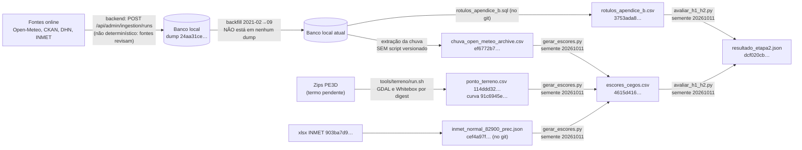

# Prontidão acadêmica do MAPi (F5-ACAD-01)

- Data: 2026-10-11 · Autor: Agente 8 (Acadêmico, nível Máximo) · Tarefa: F5-ACAD-01
- Só documentação. Nenhum código, banco ou commit foi alterado. As duas únicas execuções foram feitas numa cópia do código
  no scratchpad (`git archive 5f60b63`), com o venv `venv-f1` da F4-IA-13, sem tocar em banco nem nos artefatos originais (§1.3).
- Base lida: `.claude/mapi/PROGRESSO.md`, `docs/HANDOFF-fase-{0..3}.md`, `docs/INTERPRETACAO-F1.md`, `docs/RESULTADOS-AVALIACAO-F1.md`,
  `docs/PRE-REGISTRO-AVALIACAO.md`, `docs/MODELAGEM-IA.md`, `docs/REVISAO-CRITICA.md`, `docs/GLOSSARIO.md`, `docs/FONTES-E-LICENCAS.md`,
  `docs/CHECKLIST-RELEASE.md`, `docs/snapshots/*.md`, `docs/revisao/fase-4/F4-IA-13.md`, `tools/terreno/README.md` (ramo
  `feat/terreno-cog3857`) e a pasta `avaliacao/` do `projeto-mapi-ai` (ramo `feat/avaliacao-f1`, que **não tem README**).
- Escopo: a rede de Petri está fora do escopo atual (decisão do autor, 2026-10-11). A ponte com o modelo estocástico aparece
  só como requisito futuro (§4).
- Aviso de independência: este agente é da mesma família de modelo do Arquiteto e do revisor crítico (RC-11). Não substitui
  a leitura do orientador.

## Veredito

**Sustenta a dissertação, mas não como "modelo validado".** Sustenta no enquadramento declarado antes da junção (opção G do
MEMO; PRE-REGISTRO §7, último parágrafo): dados abertos auditáveis, protocolo pré-registrado executado como escrito e um
resultado inconclusivo e degenerado, com a causa medida (reanálise com máximo de 16,7 mm/h contra o limiar de 50,3 mm/h;
INTERPRETACAO §2.1).

A cadeia escores → métricas **é reprodutível bit a bit hoje** (§1.3). Faltam quatro coisas para a banca:

1. A cadeia dado → entradas não tem script versionado.
2. O código da avaliação existe só nesta máquina.
3. Os dumps têm uma única cópia, num disco com 96% de ocupação.
4. O selo "experimental" do painel não está em nenhum commit enviado.

As quatro são baratas de fechar e não dependem de terceiros (§5.1).

## 1. Reprodutibilidade

### 1.1 Peças que existem hoje

| Etapa | Comando | Versões travadas | Determinística? | Lacuna |
|---|---|---|---|---|
| Ingestão | endpoints admin do backend, um run por vez (`docs/INGESTAO.md`) | imagem `timescaledb-ha:pg16.15-ts2.30.2`; `codeVersion` só no ramo `fix/rastreabilidade-build` (F5-REV-02a) | **Não.** O ERA5 é revisado, o CKAN muda e o Nominatim depende do estado do OSM (RC-17) | O âncora é o dump. Também falta fixar o modelo do archive do Open-Meteo `[a verificar]` (INTERPRETACAO §3.4) |
| Backfill da chuva 2021-02→09 | 2 runs `BACKFILL` (`902c2b09…`, `8cba199e…`; `proveniencia.json`) | idem | Não | **Nenhum dump contém esse backfill.** O banco atual difere do `24aa31ce…` (F4-IA-13, "Entradas e backfill") |
| Extração das entradas | não há. `proveniencia.json` só descreve a consulta em prosa ("tabela observation, source=OPEN_METEO_ARCHIVE…") | — | — | **Script ausente** |
| Terreno | `tools/terreno/run.sh atributos` | GDAL 3.10.0 por digest; WhiteboxTools 2.4.0 com SHA-256 do zip conferido | Sim (2 execuções com o mesmo SHA; F3-GEO-07) | O ramo `test/hidrologia-terreno` não está em `integracao/fase-2` (só em `feat/terreno-cog3857`). Os zips do PE3D não podem ser redistribuídos até haver termo |
| Escores | `python -m avaliacao.gerar_escores --entradas DIR --normal JSON --saida DIR` | `requirements.txt`: numpy 1.26.4, pandas 2.2.3, psycopg2-binary 2.9.10, pytest 8.3.4. Python 3.12.3 registrado no `metadata.json`, mas não fixado | Sim (§1.3) | Sem hashes de pacote, sem versão de Python e sem contêiner. O venv está no scratchpad |
| Rótulos | `avaliacao/dados/rotulos_apendice_b.sql` contra o banco | idem banco | Sim, dado o dump | Depende de restaurar o dump |
| Métricas | `python -m avaliacao.avaliar_h1_h2 escores.csv rotulos.csv saida.json` | idem | Sim (§1.3) | — |

**Não existe comando único** nem Makefile. Hoje são cinco peças em três lugares: o backend, `tools/terreno/` e
`projeto-mapi-ai/avaliacao/`.

### 1.2 O que falta para um comando único, e quem faz

Proposta: `projeto-mapi-ai/avaliacao/reproduzir.sh`, com dois modos e uma conferência de SHA-256 ao fim de cada etapa. A
execução para na primeira divergência.

| Etapa | Modo `congelado` (offline, minutos; é o que a banca roda) | Modo `fontes` (online; não reproduz bit a bit e reporta a diferença) | Quem faz |
|---|---|---|---|
| 0 | Confere os SHA-256 de entradas, dumps e normal contra um `HASHES.sha256` versionado | idem | IA |
| 1 | Restaura o dump num contêiner descartável (`timescaledb_pre_restore`/`post_restore`; `docs/snapshots/2026-10-10-troca-de-imagem.md`) | Roda as cargas pelos endpoints admin, com os mesmos intervalos | Dados |
| 2 | `extrair_entradas.sql` → chuva CSV, que tem de dar `ef6772b7…` | idem; registra quantas horas diferem | Dados + IA (**script novo**) |
| 3 | Usa o `ponto_terreno.csv` arquivado (`114ddd32…`) | `tools/terreno/run.sh atributos` com os zips do PE3D | Geo |
| 4 | `gerar_escores` → tem de dar `4615d416…` | idem; reporta o diff | IA |
| 5 | `rotulos_apendice_b.sql` → tem de dar `3753ada8…` | idem | IA |
| 6 | `avaliar_h1_h2` → tem de dar `dcf020cb…` | idem | IA |

Pré-requisitos para o roteiro funcionar, por ordem de custo:

1. **Enviar ao GitHub** os ramos `feat/avaliacao-f1` e `fix/contrato-ia` do `projeto-mapi-ai`. O `git ls-remote --heads origin`
   de 2026-10-11 só lista `main` e três ramos `feature/*`. O PROGRESSO dá a RC-02 como resolvida, mas isso só vale para o
   `projeto-mapi-api`. **Quem faz:** Lucas.
2. **Fazer um dump depois do backfill**, com SHA-256 e manifesto em `docs/snapshots/`, para que a etapa 1 do modo congelado
   reproduza a chuva de 2021-04→09. **Quem faz:** Dados. Antes, é preciso liberar disco: `/home` tem 2,1 GB livres (96%
   ocupado; `df -h`, 2026-10-11).
3. **Versionar `extrair_entradas.sql`**, a consulta exata que gerou `chuva_open_meteo_archive.csv`, e conferir que ela
   reproduz `ef6772b7…` sobre o dump novo. **Quem faz:** IA.
4. **Fixar o ambiente:** ou uma imagem Python por digest, como o `run.sh` do terreno já faz com o GDAL, ou um
   `requirements.txt` com `--hash` e a versão do Python declarada. **Quem faz:** IA.
5. **Tirar uma cópia fora da máquina** de `MAPI/snapshots/`, `MAPI/avaliacao-f1/` e `MAPI/terreno/ponto_terreno*`, com os
   `.sha256` (RC-01 e RC-21 recomendavam isso; não há registro de que a cópia foi feita). **Quem faz:** Lucas.
6. **Escrever `avaliacao/README.md`**, com o roteiro, os hashes esperados e o que não é reprodutível (ingestão online). Hoje
   a pasta não tem README. **Quem faz:** IA.

### 1.3 Os hashes citados conferem e se reproduzem?

Medido em 2026-10-11 com `sha256sum`. Na coluna "Reproduzido", a execução foi feita a partir da cópia do código
(`git archive 5f60b63`, que contém `f6ddacf`), com as entradas arquivadas, Python 3.12.3, numpy 1.26.4 e pandas 2.2.3.

| Artefato | Hash citado | Arquivo hoje | Reproduzido nesta tarefa | Reproduzível pelo roteiro hoje? |
|---|---|---|---|---|
| `escores_cegos.csv` | `4615d416…` (PRE-REGISTRO; RESULTADOS §1) | confere | **sim, idêntico** (`gerar_escores`, 1,8 s) | Sim, a partir das entradas arquivadas |
| `resultado_etapa2.json` | `dcf020cb…` (RESULTADOS, cabeçalho) | confere | **sim, byte a byte** (`cmp`; `avaliar_h1_h2`, 6,8 s) | Sim |
| `rotulos_apendice_b.csv` | `3753ada8…` (RESULTADOS §2) | confere (versão no git, `feat/avaliacao-f1`) | não reexecutado (exige banco) | Sim, se o dump for restaurado e a consulta rodada. Não testado |
| `ponto_terreno.csv` | `114ddd32…` (F3-GEO-07; snapshot da 1ª carga, passo 3b) | confere em `MAPI/terreno/` e em `avaliacao-f1/entradas/` | não reexecutado (exige os zips e ~80 s de GDAL) | Sim (2 execuções idênticas, F3-GEO-07) |
| `chuva_open_meteo_archive.csv` | `ef6772b7…` (F4-IA-13) | confere | — | **Não:** falta o script de extração e o backfill não está em nenhum dump |
| `curva_cota_volume.csv` | `91c6945e…` (F4-IA-13) | confere | — | Sim, sai do mesmo `run.sh` |
| Dump pós-carga | `24aa31ce…` | confere com o `.sha256` | — | É âncora, não se regenera. Cópia única no mesmo disco |
| Dumps pré-revisão, pré-troca de imagem e pré-V3–V10 | `3ace3cde…`, `eac26687…`, `35dccf45…` | os três conferem | — | Idem |

Leitura: **escores → métricas está fechado.** O ponto fraco é dado → entradas, que hoje depende do banco vivo desta
máquina.

## 2. Eventos-teste como teste de regressão do modelo

### 2.1 O que o teste é, e o que não é

O teste de regressão verifica que **o código do modelo continua produzindo as mesmas saídas** para entradas congeladas. Ele
**não** verifica se o modelo "acerta" alagamento. Os 18 dias já foram gastos pelo pré-registro (PRE-REGISTRO §5, passo 6;
INTERPRETACAO §6.2, item 1). Qualquer avaliação nova sobre eles é exploratória.

Por isso o valor esperado de cada caso é **a saída congelada do commit `f6ddacf`**, e não o rótulo.

### 2.2 Lista curta proposta

Os casos foram escolhidos **sabendo os resultados**: este agente leu RESULTADOS §6 e §8. A lista serve de canário de
mecanismo, não de evidência. Isso precisa ser declarado no texto.

| # | Dia | Papel no teste | O que se verifica (contra o valor congelado) |
|---|---|---|---|
| R1 | 2024-06-15 (positivo, 28 ocorrências) | Maior `R` em 2023–2024. Único positivo com `S > 0` e alerta em `f = 0,2` (RESULTADOS §6 e §9) | M1a central: `S = 0` e `R` igual ao congelado. Variante `f0.2`: `S > 0` e `alerta = 1` |
| R2 | 2023-02-06 (positivo) | `S > 0` em `f = 0,2` sem alerta | `S` e `R` iguais ao congelado nas variantes central e `f0.2` |
| R3 | 2024-01-15 (positivo; 0,2 mm na grade) | Falha conhecida de um modelo só de chuva. Candidato a refluxo quando houver M1b (INTERPRETACAO §6.3) | M1a, B3 e B2 iguais ao congelado (escore baixo). Se um M1b futuro mudar este caso, o novo valor entra só como verificação de consistência |
| R4 | 2024-02-16 (positivo; 3,5 mm no dia, 17,5 mm na véspera; PRE-REGISTRO §9) | Fronteira do dia local (`t − 4 h`; MODELAGEM §2.4) | Escore igual ao congelado. Pega mudanças na convenção da hora (RC-16) |
| R5 | 2022-07-12 (P_extra; posto percentil 0,07) | Forçante baixa num dia registrado | Escore igual ao congelado. Pega mudança de modelo de reanálise na entrada |
| R6 | 2023-06-27 e 2023-06-30 | Junção em episódio (≤ 3 dias) | O código de episódios devolve 13 episódios em P_principal e 17 nos 18 dias |
| R7 | 2023-02-22 (sem registro; `S > 0` e alerta em `f = 0,2`) | Lembra que N é "sem registro", não "não alagou" | Escore igual ao congelado. O nome do caso no teste diz "sem registro" |
| R8 | Primeiro dia de 2025 com 0 mm nas 24 h dos 4 pontos (regra fixa de escolha; período de desenvolvimento, sem rótulo) | Invariante física | `S = 0`, `R = 0` e nenhum alerta em todas as 24 variantes. A variante `f = 0` só armazena |

Ainda não existe nenhum caso de **"não alagou" documentado.** O CKAN só registra atendimentos, e a ausência de registro não
é evidência (PRE-REGISTRO §2.2). O caso entra quando o pedido LAI 05 trouxer vistoria com "sem alagamento" e data/hora, ou
quando um dia de chuva forte de 2025–2026 tiver confirmação da Defesa Civil. Esses dias são disjuntos do teste gasto.

### 2.3 Como implementar sem virar ajuste aos eventos

1. **Arquivo de valores congelados** (`avaliacao/tests/regressao_f6ddacf.json`), gerado uma vez a partir de
   `escores_cegos.csv` (`4615d416…`). O teste compara `S`, `R` e `alerta` com tolerância de 1e-9 e confere o SHA das
   entradas antes de comparar.
2. **Teste de determinismo:** entradas com `ef6772b7…`, `114ddd32…`, `91c6945e…` e `cef4a97f…` têm de produzir o CSV
   `4615d416…`.
3. **Os invariantes que já existem continuam valendo:** os 10 testes de `test_balde.py` cobrem balanço de massa, `f = 0`,
   saturação da curva e NaN (F4-IA-13).
4. **Regra de mudança:** se o modelo mudar de propósito (por exemplo, com M1b ou o pluviômetro), os valores congelados são
   regenerados com uma linha no changelog e uma nova `modelVersion`. **Nenhuma métrica contra rótulo** é calculada no teste.
   Uma avaliação nova pede um novo pré-registro com dias disjuntos (INTERPRETACAO §6.1 e §6.2).
5. **Proibido:** casos do tipo `assert alerta(2024-06-15) == 1` na versão central, ou qualquer limiar escolhido para fazer um
   caso passar. Isso transformaria o teste em calibração sobre os eventos gastos.

## 3. Rastreabilidade: do dado ao painel

Base: front `wip/preservacao-2026-10-11` @ `cb0dc70`, backend `integracao/fase-2`, IA `fix/contrato-ia` @ `331f6c5`.

| Número exibido | Onde aparece | De onde vem | Proveniência disponível | O que dá para responder em banca |
|---|---|---|---|---|
| Risco (`riskLevel`) | Popup e cartão do ponto | `PredictionCycleRunner` → IA `/v1/predict/flood` → `flood_classifier.joblib` + `scaler.joblib` (SHA-256 `bf0cb270…` e `3afe76fd…`; versionados em 2026-06-20 no commit `42a0fc3`; **não estão em `main`**) | `modelVersion = "unversioned"`; `modelValidationStatus = NOT_VALIDATED` (backend b5d8c42); `degradationReason`; auditoria V8 | Só isto: "classificador legado, sem metadata, sem hash do dataset de treino, H = 0 (F1-IA-02), exibido como experimental". Sem dataset, features nem validação. `flood_predictions` não entra nos resultados (decisão de 2026-10-10) |
| Probabilidade (`floodProbability`) | Popup e cartão | Mesma saída do classificador | Idem. `null` em falha (ADR 0007) | Não é probabilidade calibrada. Na tese, chamar de "escore do classificador legado" |
| Chuva, "Acumulado Chuva (24h)" | Cartão do ponto | Cadeia de fallback em `FloodPointDetailCard.tsx`: `historicalAggregates.rain24h` → `nearestSensor.accumulatedPrecipitation` → Open-Meteo **current** `precipitation`, que é a chuva **da hora** | Tabelas legadas (`sensor_data`/`weather_data`), `revision` nulo (RC-03). O `provenanceId` existe nos DTOs, mas o front não o exibe | **Não dá para responder.** O mesmo rótulo pode mostrar três grandezas diferentes (24 h, acumulado do sensor, 1 h). A fonte usada não aparece na tela |
| Maré, "Status da Maré" e "Previsto p/ Porto Local" | Cartão do ponto | `tideHeight` do dado preciso, depois do sensor mais próximo, depois do ponto; `tideHeightTabuaMare`, da API TabuaMare pelo serviço legado `TideServiceImpl` | A referência (NR da DHN) não é exibida. A unidade aparece como "meters", em inglês. A série do pipeline (`TIDE_PE02_HOURLY`, `NR_DHN_pe02`) alimenta o export, não o painel `[a verificar no código do serviço]` | Parcial: "previsão astronômica da DHN via TabuaMare, em m acima do NR". O termo de uso da TabuaMare e da DHN está pendente (FONTES §8 e §9) |
| Cota (hipsometria) | Camada de terreno e legenda | `run.sh tiles` → PMTiles `3e375bf1…` (z12–17), feito do MDT PE3D 2016 | A legenda diz "Datum não confirmado — cotas relativas. Fonte: MDT PE3D, voo de 2016" | Sim, como cota relativa. **Não** comparar com a maré (ADR 0009). O `altitudeM` do Open-Meteo (até 5,42 m de diferença; F3-GEO-05) está no tipo do front, mas não é exibido. Deve continuar assim |
| Área contribuinte | **Não aparece no painel.** Só na API (`GET /api/pontos/{slug}/terrain`, campo `contributingAreaM2`) e no export (`terrain_*`) | `point_terrain`, `terrain_run` 1 | `provenanceId`, `vrtSha256`, `scriptSha256`, `flightYear`, aviso fixo | Valor pontual de uma grandeza que varia 4 → 10 880 m² com o snap (RC-18). A API devia devolver a faixa (snap 5/10/20 m), que já existe em `ponto_terreno.csv` |
| Nível do rio (`waterLevel`) | Cartão e sensores | Sensor mais próximo (ANA/APAC, legado) | A ANA está em quarentena de fuso. O nível vem em cm, e o catálogo espera m (F2-DADOS-07, pendência) | Não, até sair da quarentena e a unidade ser corrigida |

**RC-03, selo "experimental": entrou só em parte.**

- **Backend:** feito e integrado. `ModelValidationStatus` vale `NOT_VALIDATED` por padrão, e um `VALIDATED` vindo da IA é
  rebaixado com WARN (F4-IA-04, `integracao/fase-2` b5d8c42; ainda fora de `main`).
- **IA:** envia `NOT_VALIDATED` (`fix/contrato-ia` 331f6c5). **O ramo não está no GitHub.**
- **Front:** o selo "Previsão experimental — modelo não validado" está no commit `cb0dc70`, com testes
  (`ExperimentalLabel.test.tsx`). Mas o commit **não está em nenhum ramo remoto** (`git branch -r --contains cb0dc70` vazio).
  A árvore tem 7 arquivos modificados sem commit, entre eles `risk.ts` e `ExperimentalLabel.test.tsx`, e a F4-FRONT-01b
  segue em andamento.
- **Conclusão:** na banca, o selo só conta depois de commit, push e screenshot do painel rodando com a IA real.

## 4. Unidades e nomes: glossário × código × modelo estocástico futuro

| Termo | Glossário v1 | Código e documentos | Coerente? | Ação |
|---|---|---|---|---|
| Ficha | 1 ficha = 5 mm | Balde: `n_p = ⌊h_p / 5⌋`; `h_crit` 15 cm = 30 fichas (MODELAGEM §2.1, §2.3). A faixa de 10–30 cm vira 20–60 fichas | Sim | — |
| Lâmina | cm na exibição, mm no modelo estocástico; campo `waterDepth` *(proposto)* | O balde usa `h_p` em mm. O export da Petri prevê `depth_max_mean_mm` etc. (MODELAGEM §2.2), em snake_case | Unidade sim. Nome não | Fixar o campo do contrato futuro como `waterDepthMm` (camelCase com unidade, como `streetElevationM`) e registrar no glossário o mapeamento para os nomes da Petri |
| Curva cota-volume | m³ por cm | DTO com 41 níveis de **5 cm** (`aboveBottomCm`, `m3PerCm`) | Sim, mas cada degrau de 5 cm vale **10 fichas** | Escrever no glossário que a curva tem degrau de 5 cm (10 fichas) e que a conversão para fichas interpola. Assim 5 cm e 5 mm não se confundem |
| Cota da rua | m, ortométrica; campo `streetElevation` *(proposto)* | API `streetElevationM` (mediana do MDT num raio de 3 m). O balde usa `rua_rel_m = cota_rua − fundo_bacia` (0,037–0,109 m; F4-IA-13) | O nome diverge e há uma grandeza nova sem termo | Atualizar o campo para `streetElevationM`. Criar o termo "altura da rua sobre o fundo da depressão" (relativa; ADR 0009) |
| Nível lá fora | `máx(rio, maré + resíduo)`, campo `outsideLevel` *(proposto)* | Não existe no código. Está proibido até fechar Δ (ADR 0009) | Sim (nada usa) | Marcar no glossário: "não calculável até o ADR 0009 fixar Δ". A Petri futura precisa receber o nível lá fora e a soleira na mesma referência |
| Soleira | m | `[sem fonte]` (PARAMETROS; PRE-REGISTRO §4.2) | Sim | Depende do cadastro da EMLURB/SESAN (§5.2) |
| Área contribuinte | m², campo `contributingArea` | API `contributingAreaM2`. CSV `area_contribuinte_m2_snap{5,10,20}m` | O nome diverge e falta dizer que depende do snap | Glossário: campo `contributingAreaM2` e definição "depende da regra de snap (padrão 10 m)" |
| Maré | m (NR) | Export em `NR_DHN_pe02`. O painel mostra "meters", sem NR | Não, no painel | Front: "m (NR DHN)", em português |
| Risco | `LOW/MEDIUM/HIGH` + `UNKNOWN` | Contrato com `modelValidationStatus` e `degradationReason` (ADR 0007, emenda 1) | Falta termo | Acrescentar `modelValidationStatus` e `degradationReason` ao glossário |
| Rótulo | "casada com ponto e hora" | Dia local × Recife, precisão DAY. Negativo = "dia sem registro" (PRE-REGISTRO §2) | **Desatualizado** | Reescrever. Criar "dia sem registro" e "episódio" |
| Horizonte | 3 h e 6 h propostos | F1 trabalha no dia. A tarefa horária foi abandonada (MODELAGEM, Histórico) | Desatualizado | Marcar como "formulação supervisionada abandonada" |
| Modelo do balde | "baseline físico" | É o modelo principal M1 (MODELAGEM §2.1) | Desatualizado | Corrigir o papel |
| Fuso | "o histórico ainda está em hora local até a Fase 2" | A série consolidada está em UTC, com `source_tz` declarado por fonte | Desatualizado | Corrigir |
| Termos ausentes | — | `S` (lâmina máxima do dia), `R` (desempate), `f`, `i_T`, `h_crit`, Δ, forçante, reanálise, cota relativa | — | Incluir antes da redação. A banca vai ver esses símbolos |

O que já pode ser alinhado com a Petri, sem ela existir: ficha, lâmina em mm, `h_crit` em fichas, a curva em degraus de
5 cm e os nomes do export futuro (MODELAGEM §2.2), corrigidos para a convenção camelCase com unidade. O resto, como nível
lá fora, soleira e as taxas da Petri, espera o Δ e o autor.

## 5. Lacunas de evidência para a banca

Severidade: C = a banca derruba a afirmação; I = enfraquece e exige ressalva escrita; D = acabamento.

### 5.1 Depende só do projeto

| # | Sev. | Lacuna | Ação que fecha | Quem |
|---|---|---|---|---|
| L1 | C | O código da avaliação (`feat/avaliacao-f1`) e o contrato da IA (`fix/contrato-ia`) existem só nesta máquina (`git ls-remote`, 2026-10-11) | `git push` dos dois ramos e PR | Lucas |
| L2 | C | Os dumps, as entradas e os escores têm uma única cópia, no mesmo disco, com `/home` 96% ocupado (2,1 GB livres) | Cópia fora da máquina com os `.sha256` e um registro no PROGRESSO | Lucas |
| L3 | C | A cadeia dado → entradas não se reproduz: não há script de extração e o backfill 2021-02→09 não está em nenhum dump | Dump pós-backfill e `extrair_entradas.sql` conferindo `ef6772b7…` (§1.2, itens 2 e 3) | Dados + IA |
| L4 | C | Selo "experimental" fora de commit enviado (§3). Sem ele, "de onde vem este HIGH?" fica sem resposta defensável (RC-03) | Commit e push do front, mais screenshot com a IA real (F4-FRONT-01b) | Frontend + Lucas |
| L5 | I | Não há comando único | `avaliacao/reproduzir.sh` com os modos congelado e fontes, e `avaliacao/README.md` (§1.2) | IA |
| L6 | I | Pré-registro com confirmação do autor e leitura do orientador em branco, e o SHA do próprio arquivo como `[preencher]` (cabeçalho; RC-25, RC-11) | Lucas confirma por escrito, o orientador lê e o SHA é preenchido por emenda | Lucas + orientador |
| L7 | I | O modelo de reanálise do archive não foi fixado entre períodos (INTERPRETACAO §3.4; PRE-REGISTRO §10, item 5) | Registrar o `models=` usado e conferir que é o mesmo em 2021-04→2024-12 | Dados |
| L8 | I | A convenção da hora (deslocamento de ~1 h, ANA × Open-Meteo; RC-16) não está resolvida | Terminar a F2-DADOS-10 e medir o efeito no máximo diário | Dados |
| L9 | I | O painel mistura três grandezas em "Acumulado Chuva (24h)", a maré aparece sem referência e nenhuma fonte é exibida (§3) | Exibir só a grandeza do rótulo, com fonte e `provenanceId` (ou "indisponível") e a maré em "m (NR DHN)" | Frontend + Backend |
| L10 | I | Glossário v1 com 5 termos desatualizados e cerca de 10 ausentes (§4) | Glossário v2 antes da redação | Arquiteto |
| L11 | I | Área contribuinte como valor pontual (RC-18) | Faixa por snap na API e no texto | Geo |
| L12 | I | Os pareceres dos checkpoints não foram guardados (RC-11) | `docs/revisao/checkpoints/`, ou declarar a ausência na metodologia | Arquiteto |
| L13 | I | As respostas do Nominatim não foram guardadas: a posição do rótulo não se reproduz do zero (RC-17) | Arquivar o bruto com hash. Até lá, o rótulo vale pelo dump e por `3753ada8…` | Backend |
| L14 | I | Não há teste de regressão do modelo | Testes da §2.3 | IA |
| L15 | D | Ambiente Python sem hashes e sem versão de Python fixada | Imagem por digest ou `--hash` | IA |
| L16 | D | O ramo do terreno que gerou `114ddd32…` não está em `integracao/fase-2` | Integrar ou declarar no texto | Geo |

### 5.2 Depende de terceiros

Os pedidos 01–05 estão redigidos em `docs/pedidos/`. O envio é do Lucas, e o PROGRESSO não registra a data de envio de
nenhum deles `[a verificar]`.

| # | Sev. | O que falta | Pedido | O que destrava | Sem a resposta, o que se escreve |
|---|---|---|---|---|---|
| T1 | I | Ficha F-41 do Recife e termo de uso das tábuas | 01, CHM/DHN | Δ (ADR 0009) e redistribuição da maré derivada (RC-21) | Só cotas relativas, sem refluxo, e CSVs de maré fora do repositório público |
| T2 | I | Altitude da RN do marégrafo e NMM | 02, IBGE | Δ | Idem |
| T3 | I | Relatório técnico do MDT (datum e geoide) e termo de uso | 03, PE3D/APAC | Δ e publicação da camada de terreno | "Datum não confirmado" e camada só em uso local |
| T4 | D | Taxa de falso alarme aceitável | 04, Defesa Civil | Limiares MEDIUM/HIGH | Curva inteira, sem limiar operacional (MODELAGEM, decisão 6) |
| T5 | I | Registros com hora e endereço, incluindo vistorias sem alagamento | 05, LAI à Defesa Civil | Conjunto de teste novo e disjunto (2025–2026), auditoria do rótulo e casos de "não alagou" (§2.2) | 14 positivos e N = "sem registro" |
| T6 | I | Cadastro de microdrenagem (cota de fundo e diâmetro) | **Sem rascunho em `docs/pedidos/`** (PRE-REGISTRO §10, item 9: "a enviar") | `f` e soleira com fonte | `f` e soleira só como faixa |
| T7 | D | Termos da APAC e confirmação do uso não comercial do Open-Meteo | FONTES, pendências 5 e 7 | Seção de fontes da dissertação | Declarar a pendência |
| T8 | I | Série de pluviômetro com fuso verificado em 2022–2024 | ANA (documentação da hora) e F2-DADOS-10 | Uma 2ª análise com poder (INTERPRETACAO §6.1) | Resultado limitado pela escala da forçante |

Ordem sugerida para fechar antes de escrever: L1 → L2 → L4 → L3 → L5/L14 → L6 → L10. Nenhum desses itens depende de
terceiros.

## Condições que mudariam esta avaliação

- Uma divergência de hash na etapa 2 do roteiro (extração), que exigiria refazer os escores e declarar o desvio no
  PRE-REGISTRO §8.
- RC-16 confirmada do lado do Open-Meteo, com efeito no máximo diário.
- Um pedido LAI que traga dias disjuntos suficientes (≥ 43 dias com local; MEMO §3.2), o que reabriria a pergunta
  supervisionada com novo pré-registro.

> **Errata (2026-10-11):** este documento dizia "30 variantes" de M1; são **24** (central + 23), conferido no `resultado_etapa2.json`. Conclusões inalteradas.
