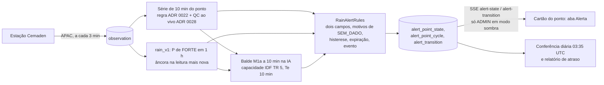

# Relatório — alerta de chuva forte com 20 min de antecedência, de ponta a ponta

- Data: 2026-11-17. Branch `alerta-20min`, com merge na `main` dos três repositórios (api `79f23b8`, ia `c686d13`,
  front `b78b840`), implantados e conferidos.
- DADOS DA REDE OBSERVACIONAL DO CEMADEN/MCTIC.
- Detalhe de cada número: handoffs `docs/handoff/alerta-etapa*.json` (api, ia, front) e os arquivos citados.

## 1. O caminho antes e depois (Etapa 0)

**Antes** (`docs/extratos/caminho-do-alerta-atual.md`):
- O destaque da tela era o risco em 6 h do `logreg_v3` (rótulo sintético).
- A previsão de chuva não disparava nada e não entrava no modelo (`usedByModel = false`).
- O balde só rodava no simulador.
- Nenhum modelo servido usava posição ou altitude; o `xgb_v2`, carregado mas não servido, usa latitude e longitude.
- IA e front não tinham identificador de versão.

**Depois:**

- **Dois campos** (ADR 0026): `rain_alert` (`NENHUM`, `ATENCAO`, `ALERTA`, `SEM_DADO`) e `point_flood` (`NAO`,
  `PROVAVEL`, `SEM_DADO`), sempre com motivo quando `SEM_DADO`.
- **Ciclo próprio** a cada coleta, com relógio injetado.
- **Tela:** o `logreg_v3` foi para a aba "Experimental", com o aviso de rótulo sintético.
- **Modo sombra ligado** (só ADMIN vê, marcado "em teste"). Desligar é decisão sua.

## 2. A antecedência que vale (Etapa 2.3)

A coleta ao vivo entrega as mesmas leituras da PED (2.142 blocos iguais, 0 diferentes); o que muda é o atraso.
Simulação nos 5 anos com a semântica do serviço (âncora na leitura mais nova, ciclo de 3 min), 28 eventos FORTE no
teste, IC 95% por bootstrap de evento (`projeto-mapi-ai/reports/rain_v1b/SIMULACAO.md`):

| Modelo de 1 h | Antecedência mediana (IC 95%) | Avisados | Falsos por evento |
|---|---|---|---|
| Laboratório | 20 min (10–40) | 20/28 | 3,0 |
| **Simulação, atraso de hora seca** (mediana 3,6 min, 1.487 leituras) | **16 min (3–33)** | 19/28 | 3,1 |
| Simulação, atraso das leituras com chuva (11 amostras) | 0 min (0–8) | 11/28 | 1,5 |

**Fica o `rain_v1`.** O `rain_v1b` não passou no critério em 1 h, nos dois cenários. A condição de parada foi
cumprida só no cenário de chuva, e você decidiu seguir (2026-11-17).

**Achado:** sem a âncora na leitura mais nova (entradas calculadas no relógio), a antecedência some (0 min).

## 3. Atraso por trecho (Etapa 2.1)

Dia seco, 2026-11-17, só leituras que entraram com o sistema rodando; cada leitura conta uma vez, no primeiro ciclo
que a usou (n = 35; fonte: `alert_point_cycle`, mesma conta de `GET /api/alerta/latencia`):

| Trecho | Mediana / p90 |
|---|---|
| Estação → coleta (fonte) | 3,6 min / 10,2 min |
| Banco → ciclo | — / 0,2 min |
| Ciclo → IA → estado → SSE | — / 4,5 s |
| **Total, estação → SSE** | **4,3 min / 12,7 min** (máx. 54,4) |

- **Orçamento:** p90 abaixo de 5 min em hora com chuva. **Não medido ainda**: não houve chuva desde a implantação.
  No dia seco ele estoura (12,7 min), e o atraso está na chegada pela APAC, não no MAPi. O relatório do primeiro dia
  com chuva acima de 10 mm sai sozinho (`alert_latency_report`).
- **Frescor de 15 min:** nos 30 dias até 16/11 deixaria os pontos em `SEM_DADO` de 39% a 83% do tempo (29% a 59% com
  chuva; com 70 min, 0%), porque a estação seca e boa parte das horas com chuva mandam bloco de 60 min. **Decisão em aberto.**

## 4. Falsos por evento: antes e depois da histerese e do agrupamento (Etapa 3)

Regra escrita antes; escolha na validação da simulação (`projeto-mapi-ai/reports/rain_v1b/regras_alerta.json`):
L_desliga = 0,3 × L_liga = **0,0316**; duração mínima **0** (não reduziu trocas). Expiração de 60 min, cancelamento
(< 0,2 mm em 30 min) e agrupamento de 60 min vêm do prompt.

| Teste da simulação | Sem histerese | Escolhido |
|---|---|---|
| Trocas de estado por evento | 9,64 | **7,86** |
| Falsos por evento antes do agrupamento | 2,61 | 2,61 |
| Falsos por evento depois do agrupamento | 2,25 | 2,25 |
| Antecedência (máquina de estados, passo de 10 min) | 20 min (5–40) | 20 min (5–40) |

**Controle de qualidade ao vivo** (ADR 0028), aplicado à previsão no teste: falsos de 87 para 73, mas 1 evento
perdido e antecedência de 16 para 6 min. Por isso ficou só na série medida (`ALERTA` e balde).

## 5. Reprise dos 5 eventos (Etapa 4.1)

Banco de teste, IA real, relógio simulado (`ReprisaEventosIT`). Linha do tempo completa em `docs/extratos/reprise-eventos.md`.

| Evento | Ligou no instante da simulação | SSE = banco | Terminou desligado | NENHUM/NAO com dado faltando | Balde fora do sistema |
|---|---|---|---|---|---|
| 28/05/2022 | sim (5 pontos; 72 a 105 min antes do 1º cruzamento) | 104 = 104 | sim | 0 | 555 chamadas, dif. 0,0 mm |
| FORTE 06/02/2026 | sim (Derby; demais não ligaram, como na simulação) | 115 = 115 | sim | 0 | 341, 0,0 mm |
| FORTE 06/09/2026 | sim | 121 = 121 | sim | 0 | 441, 0,0 mm |
| FORTE 23/04/2026 | sim (5 pontos) | 144 = 144 | sim | 0 | 540, 0,0 mm |
| 04/08/2026, 140 mm sem FORTE | sim (2 alarmes falsos, os mesmos da simulação) | 30 = 30 | sim | 0 | 360, 0,0 mm |

## 5b. O balde a 10 min (item 1.4)

5,17 anos (`projeto-mapi-ai/reports/bucket10/balde10_5anos.json`). Registro, nada calibrado.

| Ponto | Maior chuva em 10 min | Eventos ≥ 15 cm por ano (TR 2 / 5 / 10) | Situação no alerta |
|---|---|---|---|
| Ibura | 19,1 mm | 0 / 0 / 0 | NAO ou PROVAVEL |
| CIN/UFPE | 20,8 mm | 0,19 / 0 / 0 | idem |
| Imbiribeira | 19,1 mm | 0 / 0 / 0 | idem |
| Derby | 17,6 mm | 0 / 0 / 0 | `SEM_DADO` (área de 62 m², em revisão) |
| Jaboatão | 22,1 mm | — | `SEM_DADO` (sem terreno, fora do PE3D) |

- **Comparação com a cidade:** contra os 3,6 dias por ano da cidade inteira (comparação que mistura cidade e ponto), o
  balde quase não alaga.
- **Causa:** 86,9% das horas com chuva têm bloco maior que 10 min, e 64% a 69% dos passos com chuva vêm de bloco
  espalhado. O pico de 10 min fica achatado e quase nunca passa da capacidade TR 5 (20,9 mm em 10 min). Pelo mesmo
  motivo, o nível `ALERTA` quase nunca dispara.
- **Tempo no ciclo:** de 0,5 a 1 ms por ciclo; o ciclo inteiro, com a IA real, leva de 0,6 a 2,0 s para 5 pontos.

## 6. Critério de pronto

| # | Critério | Situação |
|---|---|---|
| 1 | Atraso da estação ao SSE com p90 < 5 min (dia seco medido; job do dia de chuva armado) | **Parcial.** Dia seco medido: p90 de 12,7 min, dominado pela chegada pela APAC (10,2 min); o caminho do MAPi tem p90 de segundos. Job armado. Hora com chuva ainda não medida |
| 2 | Antecedência na simulação com IC e acima de 5 min | **Sim no cenário de hora seca** (16 min, IC 3–33); **não no de chuva** (0 min, IC 0–8, 11 amostras). Você decidiu seguir |
| 3 | Os 5 eventos da reprise passam nos 4 testes | **Sim** |
| 4 | Zero `NENHUM`, `NAO` ou risco baixo com dado faltando | **Sim** (testes unitários, de integração, reprise; produção: 0 em 211 ciclos-ponto) |
| 5 | Todos os motivos de `SEM_DADO` testados, com "sem terreno" e "terreno em revisão" | **Sim** (`RainAlertRulesTest`, `AlertaIntegrationTest`) |
| 5b | Balde a 10 min dentro do ciclo de 3 min e igual ao rodado fora | **Sim** (≤ 2 s por ciclo; diferença 0,0 mm em 2.237 chamadas) |
| 5c | Nenhum modelo servido usa latitude, longitude ou altitude absoluta | **Sim** (`logreg_v3`, `rain_v1`; o `xgb_v2` usa, mas não é servido; ADR 0027) |
| 6 | Toda fonte do caminho com alarme de fonte velha | **Sim**: CEMADEN 90 min, CEMADEN_PED 180, MAPI_ALERTA (ciclo e IA) 15, APAC_RADAR 30. O Open-Meteo não tem limite, mas não entra no modelo de 1 h |
| 7 | Suíte dos três repositórios verde, sem os 7 erros do Mockito | **Sim**: API 539, 0 falhas, 0 erros; IA 87; front 570 (`useAuth.test` intermitente sob carga, preexistente) |
| 8 | Código em produção é o da `main` | **Sim** (`/actuator/info`, `/health`, `/version.json` = `main`) |
| 9 | Modo sombra ligado em produção, com a conferência diária rodando | **Sim**: `shadow=true`; conferência agendada para 03:35 UTC e já rodada à mão para 17/11 (5 pontos, 0 FORTE) |

## 7. Radar da APAC (O1)

- **Imagens gravadas:** 689 CAPPI 1 km e 688 acumulados de 1 h, de 12/11 18:25 UTC em diante, sem lacuna.
- **Armazenamento:** volume próprio com SHA-256 e manifesto no banco; fonte velha de 30 min.
- **Fuso:** UTC, verificado no serviço do painel.
- **Georreferenciamento:** extensão `[-33.1681, -10.462, -37.7434, -5.92565]` (EPSG:4326 → 3857), 700 × 700 px; radar
  em −8,19 / −35,464, com 250 km de alcance.
- **Legenda:** em mm/h (0 a 365).
- **Pendente:** legenda do acumulado `[sem fonte]` e termo de uso (`docs/extratos/radar-apac.md`).

## 8. Maré de 2027 (O3)

- **Tábua oficial:** não encontrada. A TabuaMare ainda serve 2026, e o site da Marinha está atrás do Cloudflare.
- **Previsão harmônica:** a F-41 não tem constantes, então elas foram estimadas com o UTide sobre a tábua da DHN de
  2021-10 a 2024-12.
- **Validação contra os extremos oficiais:**
  - 2025: altura com p95 de 1,8 cm (média de +0,3 cm); horário com p95 de 8 min (média de −2,9 min).
  - 2026: altura com p95 de 2,2 cm; horário com p95 de 8 min.
- **Uso:** com o seu ok, entrou como **reserva**, só onde não há extremo oficial a até 12 h (V36). 2027 já está
  carregado (1.410 extremos); a tábua da DHN, quando chegar, prevalece sozinha.

## 9. O que ficou esperando decisão sua

1. **Desligar o modo sombra**, depois de semanas de conferência.
2. **Frescor de 15 min:** deixa os pontos em `SEM_DADO` de 39% a 83% do tempo. Alternativa: frescor pelo modo da
   estação (60 min de silêncio depois de bloco seco = ainda seco).
3. **Antecedência sob atraso com chuva:** decidir com o relatório do primeiro dia de chuva (atraso medido de verdade).
4. **Capacidade da galeria e pico de 10 min:** com bloco espalhado, o `ALERTA` e o balde quase nunca disparam. Pedir o
   cadastro da galeria ou rever TR/Te.
5. **Regra da área de contribuição (Derby)** e terreno de Jaboatão.
6. **Termo de uso do radar** e legenda do acumulado (pedir à APAC).
7. **Usuário de serviço `claude.servico` (ADMIN)**, criado com a sua autorização para carregar a maré e conferir as
   rotas: manter ou desativar.

## Fora deste prompt (pendente no PROGRESSO)

Satélite, METAR, Open-Meteo multimodelo, CPTEC WRF; conversão do radar em chuva; disponibilidade, MTTF e MTTR da galeria
para o modelo estocástico; decisão da regra de área de contribuição; rótulo por bairro e dia.
