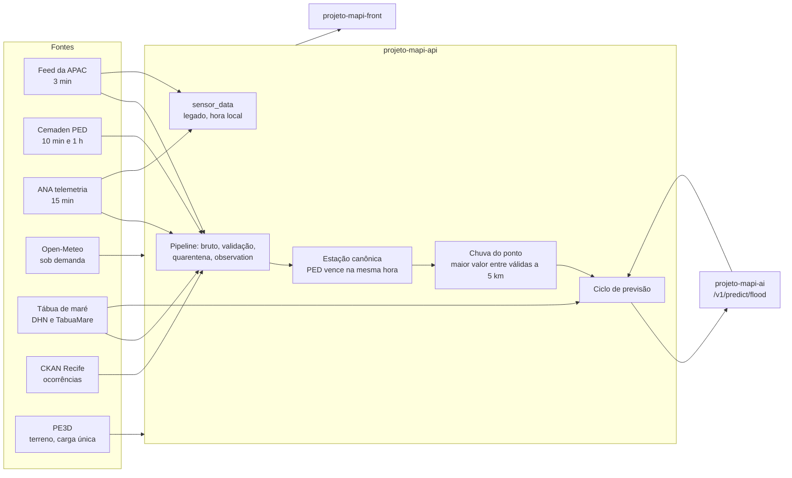

# MAPi — relatório geral e plano de melhorias (2026-11-16)

Cobre os três repositórios (`projeto-mapi-api`, `projeto-mapi-ai`, `projeto-mapi-front`), nas branches `feat/modelo-v3` (api e ai) e `feat/novos-cenarios` (front). Os números vêm do banco de desenvolvimento, dos logs e dos relatórios do próprio dia; a origem de cada um está na seção 10.

DADOS DA REDE OBSERVACIONAL DO CEMADEN/MCTIC. Todo número de modelo abaixo é de **rótulo sintético** (experimento controlado), não de alagamento real.

## 1. O que importa, em uma página

1. **A previsão não antecipa.** Com as entradas atuais (chuva e maré da hora `t`), o primeiro alerta sai na hora em que o evento começa: antecedência mediana de 0 h, nos horizontes de 0, 3 e 6 h. Para alertar antes, o modelo precisa de previsão de chuva como entrada (seção 5.4).
2. **Não existe rótulo real utilizável.** As 225 ocorrências do CKAN não têm hora, e nenhuma fica a 500 m de um ponto. Tudo o que o modelo "sabe" vem de uma fórmula. Enquanto isso não mudar, o risco exibido é uma função da chuva medida, não uma previsão validada.
3. **A chuva que entra no modelo agora é a medida.** Até 16/11 era a do Open-Meteo, com 0,0 fabricado quando faltava sensor. Passou a ser a série do ponto (PED, completada pela coleta ao vivo), com lacuna declarada. Desde a troca: 750 previsões, nenhuma indisponível, leitura mais velha com 64 min.
4. **APAC e Cemaden não se sobrescrevem no front; a regra é do backend.** Na mesma hora e estação, vale a PED. Mas o front mostra as duas origens em lugares diferentes da mesma tela, sem dizer qual é qual (seção 4).
5. **O terreno do PE3D não entra no modelo de IA.** Entra no simulador do balde, na avaliação F1, na análise de local e na camada do mapa.
6. **Três fontes estão paradas ou mudas sem ninguém ser avisado:** a meteorologia de 24 h da APAC (100% em quarentena), a reanálise do Open-Meteo (parada em 01/11) e a maré horária (até 14/11). A carga da PED ficou 40 dias parada pelo mesmo motivo: não há alarme de fonte velha.

## 2. Como o sistema funciona

Em palavras:

- **Coleta.** Jobs agendados buscam cada fonte. O que entra passa pelo pipeline (bruto, validação, quarentena, `observation` em UTC com versão). O feed da APAC e a ANA gravam também em `sensor_data`, a tabela antiga, em hora local.
- **Unificação.** A mesma estação física chega pelo feed da APAC (`CEMADEN`) e pela PED (`CEMADEN_PED`). Estações a até 150 m viram uma só (68 canônicas: 46 da PED, 25 delas também ao vivo, e 22 só ao vivo).
- **Chuva do ponto.** Para cada ponto crítico e hora: o maior valor entre as estações da PED válidas a até 5 km. Estação reprovada na checagem do mês fica fora. Refeita a cada hora.
- **Previsão.** Ao fim de cada ciclo de coleta, a API monta as entradas de cada ponto, chama a IA e grava o resultado. As telas só leem o que foi gravado.
- **Telas.** O front não calcula risco nem escolhe fonte: mostra o que a API devolve.

## 3. Cada fonte de dados: como se comporta e o que influencia

Estado medido em 2026-11-16 (janela de 7 dias para as execuções).

| Fonte | O que traz | Frequência | Estado hoje | Influência na IA |
|---|---|---|---|---|
| **Feed da APAC** (`CEMADEN`, ao vivo) | Chuva das estações do Cemaden e da APAC; régua do rio Duas Unas | 3 min | 318 execuções, 317 ok, 1 falha; 47 estações, 2 203 leituras novas | Preenche a hora mais recente da chuva do modelo enquanto a PED não chega |
| **Cemaden PED, série de 10 min** (`CEMADEN_PED`) | A série consolidada do Cemaden, 46 estações | 1 h (desde 16/11; antes, manual) | 8 execuções, 7 ok; 22 698 leituras novas; 413 em quarentena por "depois de lacuna", 84 por qualificador suspeito | **É a chuva do modelo** (treino e previsão) |
| **Cemaden PED, acumulados recentes** | Acumulado de 1 a 120 h por estação | 10 min | 81 estações na resposta, 45 com acumulado de 3 h, 15 sem dado | Nenhuma: só os rótulos de chuva do mapa |
| **APAC Meteorologia 24 h** | 1 estação meteorológica | 5 min | **302 execuções, 0 leituras aceitas: tudo em quarentena por fuso não verificado** | Nenhuma |
| **APAC histórico diário** | Chuva diária, 77 estações | carga manual | Última carga em 08/11 | Nenhuma |
| **ANA telemetria** (`ANA_SOAP`) | Nível de rio (9 estações) e chuva (3) | 15 min | 90 execuções, todas ok; 6 leituras fora de faixa em quarentena | Nenhuma no modelo atual (o rio saiu das entradas) |
| **Open-Meteo, previsão do tempo** | Temperatura, umidade, vento, chuva estimada | sob demanda, com cache | Responde | **Saiu da previsão em 16/11.** Só aparece na análise de local, etiquetada como estimada |
| **Open-Meteo, reanálise e ERA5-Land** | Chuva e umidade do solo históricas por ponto | carga manual | **Paradas em 2026-11-01** | Umidade do solo testada no v3: não melhorou o modelo |
| **Maré** (tábua da DHN, TabuaMare, maré horária) | Preamar e baixa-mar previstas; série horária derivada | 6 h (confere se falta) | DHN até 2025-12-31; TabuaMare até **2026-11-26**; horária até **2026-11-14** | `tide_level` é entrada do modelo. Sem tábua, a API manda 0,0 declarado (problema P5) |
| **CKAN Recife** | 225 ocorrências de alagamento, sem hora | carga manual | 0 pares a 500 m dos pontos; 6 ponto-dia a 1 km | Deveria ser o rótulo. Não é usável (seção 5.3) |
| **Nominatim** | Coordenada do endereço da ocorrência | na carga | Não reprodutível entre cargas; agora com cache (V28) | Indireta: decide quais ocorrências "casam" com os pontos |
| **PE3D** (terreno) | Cota da rua, depressão, área que drena, curva de volume | carga única | 4 de 5 pontos com terreno (Jaboatão sem cobertura) | **Nenhuma no modelo de IA.** Entra no simulador do balde e na F1 |

### 3.1 O que cada fonte de chuva diz, e a diferença entre elas

- **Feed da APAC** e **PED** são a mesma rede física do Cemaden por dois caminhos. A PED é a referência: blocos de 10 min, fuso verificado. O feed chega antes, mas em blocos de até 60 min quando não chove.
- Divergência medida entre as duas (08 a 16/11): 1 640 horas-estação com valor nas duas, **nenhuma** com diferença acima de 0,5 mm. A semana foi seca (só 4 horas com chuva): a medida precisa ser repetida depois de um evento.
- **Open-Meteo** é estimativa de modelo, não medição. Pico horário de 21,1 mm/h contra 62 mm/h medidos. Trocar a chuva medida por ela derrubou a PR-AUC do v2 de 0,764 para 0,318.

### 3.2 Lacunas da chuva do ponto

Fração de horas sem valor em 5 anos: 0,18% a 0,39% em três pontos; 3,6% e 4,1% em Mascarenhas e Ibura, por causa de meses inteiros sem estação válida no raio. A lacuna curta (até 24 h) acontece na mesma taxa em hora seca e em hora de chuva (0,35% a 0,41%). Detalhe em `docs/extratos/lacunas-chuva-ponto.md`.

## 4. APAC × Cemaden: quem aparece onde, e quem vence

**A regra de quem vence é do backend, e é uma só:** na mesma estação e hora, vale a PED; a coleta ao vivo entra onde a PED ainda não tem valor. Diferença acima de 0,5 mm fica registrada como divergência. O front nunca escolhe nem sobrescreve.

O que cada lugar do front mostra:

| Onde | Rota | Origem do número | Etiqueta na tela |
|---|---|---|---|
| Mapa: rótulos de chuva nas estações | `/api/stations/rain-accumulations` | PED, acumulado de 3 h | "Medida nas últimas 3 h, pluviômetro do Cemaden" |
| Mapa: lista "Sensores" do painel esquerdo | `/api/sensors/latest` | **Tabela antiga**, alimentada pelo feed da APAC e pela ANA: última leitura de cada sensor | Nome com prefixo `[CEMADEN]` ou `[APAC]`; fonte não declarada |
| Mapa: "Chuva e maré hoje" | `/api/events/timeline` | Média horária das estações em `observation` (todas as fontes ao vivo), sem pico isolado | "chuva agora (média)" |
| Card do pluviômetro | `/api/stations/{id}/card` | As duas, lado a lado, com a que valeu | "Ao vivo (CEMADEN)" e "PED (CEMADEN_PED)"; "valor exibido vem de" |
| Card e página do ponto | `/api/pontos/{slug}/...` | Chuva do ponto (PED) e a previsão | Estação usada, "chuva medida" |
| Análise de local (clique no mapa) | `/api/locations/analysis` | PED; senão ao vivo; senão Open-Meteo | "medida · Cemaden", "sem dado" ou "estimada · Open-Meteo" |
| Página Sensores | `/api/stations/canonical` | Estação unificada, com as fontes de cada uma | Fontes e divergências |

**Onde está a confusão.** Na mesma tela do mapa, a mesma estação aparece com dois números de origens diferentes: o rótulo no mapa (PED, acumulado de 3 h) e a linha da lista "Sensores" (feed da APAC, última leitura). A lista não diz de onde vem nem de que janela é. Além disso, o prefixo `[APAC]` ou `[CEMADEN]` no nome é o que o feed manda: não diz a fonte do número, e sim o dono da estação.

## 5. A IA: o que está no ar, de onde vêm as entradas e o que foi medido

### 5.1 O que está no ar hoje

O contêiner da IA ainda serve o **`xgb_v2`** (XGBoost, 12 entradas, *nowcast*). O **v3** está pronto na branch `feat/modelo-v3` do `projeto-mapi-ai`, testado (56 testes), e **não foi implantado**.

Entradas do `xgb_v2` e de onde vêm, depois da troca de 16/11:

| Entrada | Origem | Se faltar |
|---|---|---|
| Chuva da hora e acumulados de 3, 6, 12 e 24 h | Chuva do ponto: PED, completada pela coleta ao vivo | Vai ausente; o v2 não aceita ausente e a previsão fica indisponível |
| Maré | Tábua (DHN e TabuaMare), interpolada | 0,0 declarado como imputado |
| Hora e mês | Relógio | — |
| Latitude e longitude | Cadastro do ponto | — |

Nada do terreno, do rio, da ANA ou do Open-Meteo entra.

### 5.2 O modelo v3 (pronto, não implantado)

| | v2 (no ar) | v3 |
|---|---|---|
| Modelo | XGBoost | Regressão logística (melhor na validação nos três horizontes) |
| Alvo | Alaga na hora `t` | Alaga de `t` a `t` + 6 h (também 0 e 3 h, para comparar) |
| Entradas de chuva | 5 acumulados aninhados | 5 janelas disjuntas (0–1, 1–3, 3–6, 6–12, 12–24 h) |
| Latitude e longitude | Sim | Não |
| Lacunas no treino | 0% | Padrão medido na série real |
| Chuva ausente na previsão | Recusa | Aceita e declara |
| Probabilidade | Bruta | Calibrada e corrigida para a prevalência real declarada |
| Limiares | Recall sobre rótulo sintético: MEDIUM em ~52% das horas | Orçamento: 50 e 10 dias de alerta por ponto por ano |
| PR-AUC, teste, H = 0 | 0,764 (logística do v2: 0,800) | 0,677 com lacunas; 0,726 sem |
| PR-AUC, teste, H = 6 | — | 0,650 |
| ECE, teste, H = 6 | — | 0,144 bruta; 0,022 calibrada |

Os PR-AUC de H = 0 do v2 e do v3 não são a mesma prova: a amostra e os sorteios do rótulo são outros.

### 5.3 O que os experimentos do v3 mostraram

1. **Antecedência: 0 h.** No teste, com 50 dias de alerta por ponto por ano, o modelo de 6 h detecta 33% dos eventos (51% dos que acontecem em chuva), sempre na hora em que começam. Os modelos de 0, 3 e 6 h detectam os mesmos eventos.
2. **O mundo sintético tem eventos demais.** A fórmula do v2, aplicada à série contínua, dá cerca de 107 eventos por ponto por ano (2,4% das horas). A realidade declarada é da ordem de 4 por ano. O orçamento de alertas não tem como detectar a maioria, por construção.
3. **Janelas disjuntas não melhoraram as explicações.** A correlação média entre as entradas de chuva caiu de 0,65 para 0,25, mas a concordância SHAP × LIME caiu (Jaccard do top-5: 0,77 para 0,62 em H = 0; 0,84 para 0,70 em H = 6) e a estabilidade do LIME também (0,80 para 0,75; 0,89 para 0,87). A hipótese do pedido não se confirmou.
4. **Entradas físicas não ajudaram.** Com pico de 10 min, tendência da maré e umidade do solo, e um gerador em que elas têm papel: PR-AUC de teste 0,642, contra 0,647 sem elas. O pico de 10 min falta em 40% a 80% das horas com chuva; a umidade do solo chega com duas semanas de atraso; o rio não tem histórico (régua só desde 09/11).
5. **A regra contínua de 3 h é um baseline forte.** "Risco = chuva de 3 h" faz 0,585 de PR-AUC em H = 6, contra 0,650 da logística.

### 5.4 O que falta para a IA ser útil como alerta

- **Previsão de chuva como entrada.** Sem ela não há antecedência. A fonte disponível é o Open-Meteo (previsão horária), que é fraco em pico; a alternativa é radar ou *nowcasting* da APAC.
- **Rótulo com hora.** Sem isso, nenhuma métrica é desempenho real. Caminhos: relatos confirmados no próprio MAPi (a tela de relatos já existe), pedido de dados à Defesa Civil com hora, ou o rótulo do modelo físico (item seguinte).
- **Terreno pelo modelo físico (etapa B9, não feita).** Gerar o rótulo com o simulador do balde (terreno do PE3D, capacidade da galeria, maré) e treinar o modelo como substituto rápido. Aí cota, depressão e área de contribuição fazem sentido como entradas.

## 6. Front: o que cada tela mostra

| Tela | O que mostra | De onde vem |
|---|---|---|
| Mapa | Pontos com risco, rótulos de chuva, lista de sensores, cards | Previsão gravada; PED (rótulos); tabela antiga (lista); seção 4 |
| Ponto | Risco, entradas, estações candidatas, série de previsões | Previsão gravada e chuva do ponto |
| Sensores | Estações unificadas, fontes, divergências | Estação canônica |
| Chuva | Eventos de chuva de 5 anos | **Arquivo estático de 2026-11-09**, não o banco |
| Modelo | Métricas do `xgb_v2` e a avaliação F1 | Cartão do modelo (arquivo) e F1 congelada |
| Dados | Saúde das fontes, grade mensal das estações | Execuções do pipeline e checagem do mês |
| Maré, Evento, Simulador, Relatos, Relatório | Tábua, linha do tempo, balde, relatos | Rotas próprias |

O front ainda não mostra nada do v3: horizonte ("nas próximas 6 h"), quais entradas estavam ausentes, v2 e v3 lado a lado (etapa C2, não feita).

## 7. Problemas encontrados

| # | Problema | Evidência | Gravidade |
|---|---|---|---|
| P1 | A previsão não antecipa o evento | Antecedência mediana 0 h em H = 0, 3 e 6 | Alta |
| P2 | Sem rótulo real; gerador sintético com 25 vezes mais eventos que o declarado | 0 ocorrências a 500 m; 107 eventos por ponto por ano | Alta |
| P3 | Fonte parada não gera aviso | PED parada 40 dias; reanálise parada desde 01/11; maré horária até 14/11 | Alta |
| P4 | A tábua de maré cobre até 2026-11-26 | Última data da TabuaMare; DHN acaba em 2025-12-31 | Alta se a sincronização não estender |
| P5 | Maré e rio ausentes viram 0,0 (declarado) | `MapiServiceImpl.orImpute` | Média |
| P6 | Meteorologia 24 h da APAC nunca entra | 302 execuções, 0 leituras aceitas (fuso não verificado) | Média |
| P7 | Duas tabelas de leitura em paralelo; a lista do mapa lê a antiga | `/api/sensors/latest` lê `sensor_data`, em hora local | Média |
| P8 | Mesma estação com dois números no mapa, sem origem declarada | Seção 4 | Média |
| P9 | Login cai a cada reinício da API | Observado em todas as implantações do dia | Média |
| P10 | Tela Chuva lê arquivo de 09/11 | Decisão por desempenho (cálculo ao vivo passava de 1,5 min) | Baixa |
| P11 | 7 testes da API não rodam no JDK 25 | `CemadenPedAdapterTest` (Mockito) | Baixa |
| P12 | Dump de 2026-10-10 sumiu da pasta de snapshots | Só o `.sha256` existe | Baixa (já sem efeito: cache V28) |
| P13 | Divergência PED × ao vivo só medida em semana seca | 4 horas com chuva em 1 640 | Baixa |

## 8. Plano de melhorias

### Agora (uma a duas semanas)

| # | O quê | Repositório | Resolve |
|---|---|---|---|
| 1 | Alarme de fonte velha: cada fonte com idade máxima aceita; aviso na tela Dados e na central de alertas | api, front | P3, P4 |
| 2 | Conferir a sincronização da maré e estender a tábua além de 26/11 | api | P4 |
| 3 | Maré e rio ausentes vão como ausentes, não 0,0 (mesma regra da chuva) | api, ai | P5 |
| 4 | Implantar o v3 e terminar as etapas C1 e C2 (campos na resposta, horizonte e ausências na tela, v2 e v3 lado a lado) | ai, api, front | Fecha o trabalho em curso |
| 5 | Lista "Sensores" do mapa: declarar fonte e janela de cada número, ou trocar para a estação unificada | front, api | P8 |
| 6 | Achar por que o login cai no reinício da API | api | P9 |

### Próximo (um a dois meses)

| # | O quê | Repositório | Resolve |
|---|---|---|---|
| 7 | Previsão de chuva como entrada do modelo (Open-Meteo horário, declarado como estimativa) e medir a antecedência | api, ai | P1 |
| 8 | Recalibrar o gerador sintético para a frequência real de eventos e refazer limiares e avaliação por evento | ai | P2 |
| 9 | Etapa B9: rótulo do simulador do balde, com o terreno do PE3D como entrada | ai | Terreno na IA |
| 10 | Rótulo real: relatos confirmados com hora viram rótulo; pedido formal de dados com hora à Defesa Civil | api, front | P2 |
| 11 | Aposentar `sensor_data`: tudo lido de `observation` | api | P7 |
| 12 | Decidir a meteorologia de 24 h da APAC: verificar o fuso e liberar, ou desligar a coleta | api | P6 |
| 13 | Tela Chuva lendo do banco, com tabela pré-calculada | api, front | P10 |

### Depois

| # | O quê | Repositório |
|---|---|---|
| 14 | Repetir a medida de divergência PED × ao vivo depois de um evento de chuva | api |
| 15 | Atualizar a reanálise e o ERA5-Land por agendamento, ou retirar essas fontes | api |
| 16 | Corrigir os 7 testes no JDK 25 | api |
| 17 | Rotina de snapshot com verificação do arquivo e do hash | api |

## 9. Estado do trabalho do modelo v3

| Bloco | Etapa | Estado |
|---|---|---|
| A (api) | A1 chuva medida na previsão | Feito, no ar |
| | A2 padrão de lacunas | Feito |
| | A3 entradas físicas (V27) | Feito, no ar |
| | A4 cache de geocodificação (V28) | Feito, no ar; coordenadas de 10/10 não recuperadas |
| B (ai) | B1 a B4, B6, B7 | Feito |
| | B4.4 serviço do v3 | Feito, não implantado |
| | B5 entradas físicas | Feito: não ajudam |
| | B8 explicações | Feito: janelas não melhoraram |
| | B9 rótulo do balde | **Não feito** |
| | Notebook do v3, relatório em texto, handoff `v3-ai.json` | **Não feito** |
| C | C1 api, C2 front | **Não feito** |

Nenhum push e nenhum PR foram feitos.

## 10. Origem dos números

| Número | Origem |
|---|---|
| Execuções, leituras e quarentena por fonte | `ingestion_run` e `ingestion_quarantine`, 7 dias até 2026-11-16 17:08 UTC |
| Últimas datas por fonte | `SELECT source, max(ts_utc) FROM observation GROUP BY 1`, 2026-11-16 |
| 750 previsões, 0 indisponíveis, 64 min | `flood_predictions` com `model_info.rainInput`, 2026-11-16 |
| Divergência PED × ao vivo | `docs/extratos/sql/divergencia-ped-aovivo.sql` |
| Lacunas | `docs/extratos/lacunas-chuva-ponto.md` |
| Casamento de ocorrências | `docs/extratos/geocodificacao-ocorrencias.md` |
| Cobertura do pico de 10 min, rio e solo | `docs/INGESTAO.md`, seção das entradas físicas |
| Métricas do v2 | `projeto-mapi-ai/reports/metrics.csv`, `models/metadata.json` |
| Métricas do v3 | `projeto-mapi-ai/reports/v3/metrics.csv`, `evaluation.json`, `explanation_eval.json`, `physical_comparison.json` |
| Rotas de cada tela | `projeto-mapi-front/src/features/*/services` |
