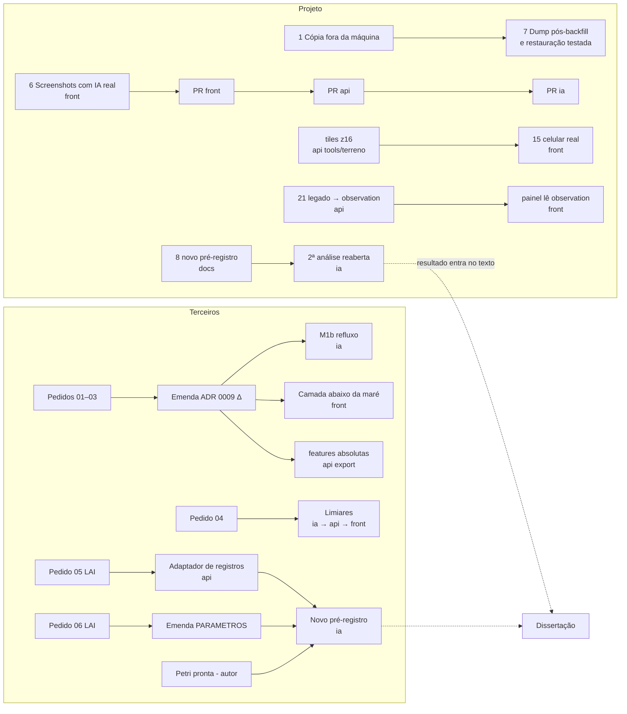

# Roadmap pós-revisão do MAPi

- Data: 2026-10-11 · Tarefa: F5-ARQ-01 · Autor: Arquiteto (nível Máximo)
- Fontes: `.claude/mapi/PROGRESSO.md` (tarefas pendentes, bloqueios e pergunta 31), `docs/REVISAO-CRITICA.md` (RC-xx),
  `docs/PRONTIDAO-ACADEMICA.md` (lacunas L1–L16 e T1–T8), `docs/MATRIZ-PRIORIDADE-FASE-1.md`, ADRs 0001–0009.
- Escopo: o que ficou para depois da revisão. A rede de Petri está fora do escopo atual (decisão do autor, 2026-10-11);
  aparece só como dependência de terceiros (o próprio autor).
- O que depende de buscar informação fora do repositório está explicado em linguagem direta em
  `docs/PENDENCIAS-DE-INFORMACAO.md`.

## 1. Como ler

- **Impacto:** A = afeta a dissertação (validação, métricas, rastreabilidade, reprodutibilidade) ou ameaça perder dado;
  M = operação ou qualidade do sistema; B = acabamento.
- **Esforço:** P ≤ 1 dia · M ≤ 1 semana · G > 1 semana. É estimativa do Arquiteto, sem medição, com a mesma escala
  da matriz da Fase 1.
- **Ordem:** primeiro A com P, depois A com M, depois M com P, e assim por diante.
- **Nível do agente:** Rápido (tarefa mecânica), Equilibrado (implementação com teste), Máximo (desenho de pesquisa,
  ADR ou pré-registro). "Humano" quando só o Lucas ou o orientador podem fazer.
- **Repos:** api = projeto-mapi-api, ia = projeto-mapi-ai, front = projeto-mapi-front. A seta indica a ordem: `api → ia`
  quer dizer que a parte da api tem de terminar antes da parte da ia.

## 2. Itens que dependem só do projeto

| # | Item | Impacto | Esforço | Repos e dependência | Nível | Origem |
|---|---|---|---|---|---|---|
| 1 | ~~Cópia dos 4 dumps, das entradas e dos escores fora da máquina, com os `.sha256` (o `/home` estava 96% ocupado)~~ **feito em 2026-10-11: Google Drive (PR #54)** | A | P | nenhuma; destino decidido pelo Lucas | Rápido + humano | F5-OPS-03; pergunta 31; RC-01; PRONTIDAO L2 |
| 2 | Lucas confirma por escrito as escolhas da §2 e da §4.2 do pré-registro e as decisões de método do MEMO §5; orientador lê pré-registro, MEMO e ADRs 0006/0009 | A | P | nenhuma | Humano | RC-25; RC-11; PRONTIDAO L6; cabeçalho do `PRE-REGISTRO-AVALIACAO.md` |
| 3 | ~~Handoff da Fase 4 (`docs/HANDOFF-fase-4.md` e `handoff/fase-4.json`)~~ **feito: `docs/HANDOFF-fase-4.md`** | A | P | nenhuma | Rápido | F4-ARQ-01 |
| 4 | Medir o efeito do deslocamento de ~1 h do lado do Open-Meteo no máximo diário de chuva, declarado como análise de sensibilidade posterior | A | P | api | Equilibrado | F2-DADOS-10; RC-16; INTERPRETACAO §3; PRONTIDAO L8 |
| 5 | Registrar qual modelo de reanálise o archive do Open-Meteo usou em cada período (2021-04 → 2024-12) | A | P | api | Rápido | PRONTIDAO L7; PRE-REGISTRO-AVALIACAO §10, item 5 |
| 6 | Fotografar popup e cartão com o selo experimental e com o painel rastreável (F4-FRONT-01c, concluída), com backend e IA reais de pé; até hoje só há screenshots com a API desligada | A | P | api + ia de pé → front | Equilibrado | F4-FRONT-01b §3; `docs/revisao/fase-4/F4-FRONT-01c-F3-FRONT-03.md`; PRONTIDAO L4 |
| 7 | Dump depois do backfill de chuva 2021-02 → 2021-09, com SHA-256 e manifesto; depois testar `reproduzir.sh fontes` a partir do dump restaurado em banco vazio | A | P | depende do item 1 (disco); api → ia | Rápido, depois Equilibrado | PRONTIDAO L3; F5-ACAD-02 (lacunas) |
| 8 | 2ª análise com pluviômetro: ficou "não testada" (portão §2.1 reprovado pelo critério C2d). Só reabre com **novo** pré-registro que traga critério de plausibilidade com fonte (o piso de 800 mm/ano era `[sem fonte]`) e resolva a diferença 3/4 × 4/4 leituras. Antes, decidir se vale a pena: a ANA chega a 34,8 mm/h, abaixo de 60,1 mm/h, então a versão central degeneraria de novo | A | M | docs (pré-registro) → ia | Máximo | PROGRESSO, F2-DADOS-11 e F4-IA-17; `PRE-REGISTRO-ANALISE-2.md` §5 e "Emendas" |
| 9 | ~~Fusão em `main` por PRs por tema (prevista para 2026-10-11 pelo orquestrador), na ordem do ADR 0007: front (com `feature/frontend-hardening-audit` do autor) → api (`integracao/fase-2`, que já inclui o terreno, + `revisao/fase-0`) → ia (`fix/contrato-ia`, `feat/avaliacao-f1` e `feature/cenarios-alagamento-ia` do autor). Depois, remedir testes, cobertura e contraste no commit de `main`~~ **feito em 2026-10-11: PRs #21–#50** | A | M | front → api → ia | Equilibrado + checkpoint do Arquiteto | F5-ARQ-02; RC-02 |
| 10 | Remedir as medidas antes/depois que comparam coisas diferentes: export (mesma base, n ≥ 30, frias incluídas, máximo e p95 separados), cobertura (mesmo método, CSV commitado, classes antigas à parte), volume (largo com largo) | A | M | api | Equilibrado | RC-07; RC-08; RC-09 |
| 11 | Guardar a resposta bruta do Nominatim por ocorrência, com hash; renomear o nível `STREET` para `STREET_NO_NUMBER` | A | M | api | Equilibrado | RC-17; PRONTIDAO L13 |
| 12 | Área contribuinte: a API e o painel já mostram a faixa do snap (F4-FRONT-01c). Falta o texto da dissertação e o export (`terrain_*`) tratarem a grandeza como faixa e conciliar 573 046 × 573 223 m² | A | P | api; docs | Rápido | RC-18; PRONTIDAO L11 |
| 13 | Guardar os pareceres dos checkpoints em `docs/revisao/checkpoints/` ou declarar a ausência na metodologia | A | P | nenhuma | Rápido | RC-11; PRONTIDAO L12 |
| 14 | Fixar o ambiente Python da avaliação (imagem por digest ou `requirements.txt` com `--hash` e versão do Python) | A | P | ia | Rápido | PRONTIDAO L15 |
| 15 | Terreno C3 continua no limite (2,20 MB; medianas 2,95–2,98 s contra 3 s, depois da F3-FRONT-03): fixar por escrito agregação, n ≥ 5 e ferramenta, e medir em celular real. Se reprovar, decidir pelo ADR 0008 | M | M | api (`tools/terreno`) → front | Equilibrado | F3-FRONT-03; ADR 0008, cabeçalho; RC-12 |
| 16 | Segurança antes de qualquer uso fora da máquina: `JWT_SECRET` e senhas padrão no compose, registro aberto, admins de revisão órfãos (≥ 5) | M | P | api | Equilibrado | MATRIZ item 10; RC-20; `docker-compose.yml` linhas 11 e 61 |
| 17 | Adendo ao ADR 0005: o PostGIS não tem chamada `ST_*` no código e o raster saiu do banco (ADR 0008) | M | P | api | Equilibrado + checkpoint | RC-10 |
| 18 | Tirar o H2 do `pom.xml` (ADR 0004) | M | M | api | Equilibrado | RC-13; `pom.xml` linha 141 |
| 19 | Gauge de idade do dado para Open-Meteo e maré, e regra de alerta no Prometheus | M | P | api | Rápido | F2-BACK-07 (pendência) |
| 20 | Conferir visualmente os slides 6, 8 e 9 do deck da disciplina (não foi renderizado) | M | P | nenhuma | Humano ou Rápido | F4-IA-07 |
| 21 | Plano de aposentadoria do legado (`sensor_data`, `weather_data`, `flood_events`) ou migração do painel para `observation` | M | G | api → front | Equilibrado + checkpoint | RC-14; ADR 0006 §8 |
| 22 | Transações abertas durante HTTP externo, pools (Hikari 10 = executor 10), dividir `MapiServiceImpl` (798 linhas) e `MapView` (1 168 linhas), 15 lacunas de documentação OpenAPI | B | M | api; front | Equilibrado | MATRIZ itens 11, 14 e 15; F2-BACK-03 |
| 23 | Contraste AA (4,5:1) para texto nas cores de risco | B | P | front | Equilibrado | RC-19 |
| 24 | Avaliações das 5 skills de projeto (com e sem skill) | B | M | nenhuma | Equilibrado | F0-ARQ-07; RC-23 |

## 3. Itens que dependem de terceiros

O que destrava cada item, com quem e o que fazer enquanto não chega, está em `docs/PENDENCIAS-DE-INFORMACAO.md`.

| # | Item | Depende de | Impacto | Esforço depois de chegar | Repos e dependência | Nível | Origem |
|---|---|---|---|---|---|---|---|
| T1 | Fechar Δ (NR da DHN ↔ datum do MDT), emendar o ADR 0009 e só então liberar refluxo de maré (M1b), camada "abaixo da maré" e features de maré em valor absoluto | CHM/DHN, IBGE, PE3D (pedidos 01, 02, 03) | A | M (emenda) + G (M1b e nova análise pré-registrada) | docs (ADR) → api (export, terreno) → front (camada) → ia (M1b) | Máximo (ADR e pré-registro) + Equilibrado | ADR 0009; bloqueio F3-PED-01 |
| T2 | Limiares MEDIUM/HIGH pela taxa de falso alarme aceita | Defesa Civil (pedido 04) | M | P | ia (`metadata.json`) → api (valida) → front (legenda) | Equilibrado | MODELAGEM-IA, decisão 6; bloqueio F4-PED-01 |
| T3 | Rótulo com hora e endereço: auditoria do rótulo atual, casos de "não alagou" e conjunto de teste novo e disjunto (2025–2026). Com ≥ 43 dias positivos com local, reabrir a pergunta supervisionada, sempre com novo pré-registro | Defesa Civil do Recife via LAI (pedido 05) | A | G | api (adaptador novo no pipeline) → ia (pré-registro e avaliação) | Máximo + Equilibrado | MEMO §3.2; INTERPRETACAO §6.2; bloqueio F4-PED-03 |
| T4 | Capacidade da galeria (`q_p`) e soleira com fonte, em vez de faixa sem fonte | EMLURB/URB Recife via LAI (pedido 06) | A | M | docs (emenda a PARAMETROS) → ia (nova análise pré-registrada) | Máximo | PRE-REGISTRO-AVALIACAO §10, item 9; INTERPRETACAO §4.1 |
| T5 | Publicar os CSVs de maré derivados das tábuas, a camada de terreno fora da máquina local e o dataset | Termos de uso da DHN e do PE3D (pedidos 01 e 03) e das demais fontes | A | P | api; front | Rápido | FONTES-E-LICENCAS, "Pendências"; RC-21 |
| T6 | Rede de Petri: export no formato da MODELAGEM-IA §2.2 e novo pré-registro para H3, H4 e o emulador | O autor, quando a Petri estiver pronta | A | G | autor → ia | Máximo | PROGRESSO, decisão de 2026-10-11; F4-IA-14 (descartado) |
| T7 | Forçante com escala de intensidade certa nos anos com rótulo: pluviômetro urbano com hora confiável em 2023–2024 | Cemaden, APAC ou ANA (série histórica; disponibilidade não verificada) | A | M | api → ia | Equilibrado + Máximo (pré-registro) | INTERPRETACAO §4.1; PRONTIDAO T8 |
| T8 | ANA ao vivo pelo Hidro-WebService | Credencial da ANA | M | P | api | Equilibrado | PROGRESSO, F2-DADOS-07 e F2-DADOS-10 |

## 4. Dependências entre repositórios

## 5. Ordem sugerida para as próximas duas semanas

1. Itens 1, 2 e 3 (nenhum depende de código; o 1 protege contra perda de dado).
2. Itens 4, 5, 6, 12, 13 e 14 (curtos e fecham lacunas de banca).
3. Item 9 (fusão em `main`, já em curso), depois o item 10 (remedir no commit de `main`) e o item 7.
4. Item 8 só se o autor e o orientador acharem que uma 2ª análise com pluviômetro ainda vale o custo.
5. Enviar os pedidos 01–06 o quanto antes: os prazos da LAI são de 20 dias, prorrogáveis por mais 10 (pedidos 05 e 06),
   e nada na seção 3 anda sem as respostas.
