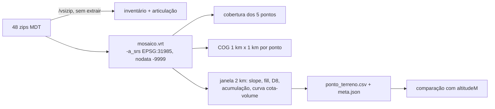

# Terreno PE3D no MAPi

Tarefas F3-GEO-01 (processar rasters), F3-GEO-04 (atributos por ponto, só em CSV) e F3-GEO-05
(comparação com a altitude atual). Data da execução: 2026-10-10. Termos conforme `docs/GLOSSARIO.md`.

Reprodução: `tools/terreno/run.sh` (um comando, inclui a validação e os testes; ver `tools/terreno/README.md`). Saídas em
`../terreno/` (fora do git). Toda cota deste documento é **ortométrica** (datum do MDT) e **não pode
ser comparada com maré** até o ADR 0009 (referência vertical) ser aprovado.

## 1. Procedimento

- Ferramentas: imagem `ghcr.io/osgeo/gdal:ubuntu-small-3.10.0`, digest
  `sha256:383e17c221d48031c5ac4fe7500d95adccb05d719a9685542c1e8d2d84ef50e0` (GDAL 3.10.0, Python 3.12.3,
  numpy 1.26.4; fonte: `ponto_terreno.meta.json`). Python roda com `-I`. Nada instalado no sistema.
- Mosaico: `gdalbuildvrt -a_srs EPSG:31985 -srcnodata -9999 -vrtnodata -9999` sobre os 48
  `/vsizip/<zip>/<folha>.tif`. SHA-256 do VRT: `d63e3b123507631b276eb98a1d247d3337655e50d4456168b61b582dc5408070`
  (fonte: `terreno/mosaico.vrt.sha256`; o VRT referencia os caminhos de montagem `/dados/...` do container).
- Hidrologia: **WhiteboxTools v2.4.0** (binário oficial Linux amd64, zip com SHA-256
  `370493b569aaf84977fde95921f96d4a39c1820a2d36d907da9d53772295f440`, binário `96bb47a9d1f0fe8a3cb46df524242c990eab9bc2ae1930e540e09328331172e4`;
  fonte: `terreno/whitebox/binario.sha256`), baixado e verificado por `run.sh whitebox`, executado dentro do container GDAL.
  Passos por janela de 2 km: `FillDepressions` (profundidade), `FillDepressions --fix_flats` -> `D8Pointer` -> `D8FlowAccumulation`
  (área). O Priority-Flood próprio (Barnes et al., 2014; `richdem` não compila no ambiente) ficou como verificação cruzada
  testada (seção 7) e como motor alternativo (`MOTOR=proprio`, sem download). Motivo da troca: seção 7.
  Declividade: `gdaldem slope -p` (Horn) via `gdal.DEMProcessing`.
- Disco: saídas totais 107 MB, 88 MB deles o binário do Whitebox (fonte: `du -sh terreno`, `du -sh terreno/whitebox`), muito abaixo do teto de 1 GB. `/home` ficou em 4,3 GB livres (fonte: `df -h`).

## 2. Inventário (F3-GEO-01)

| Item | Valor | Fonte |
|---|---|---|
| Folhas | 48 zips, 1.111.529.514 bytes zipados | `terreno/inventario.csv` (soma de `zip_bytes`) |
| Conteúdo por zip | 1 `.tif` + 1 `.tfw` | `unzip -l` |
| Tipo / nodata | Float32 / -9999 em todas | `inventario.csv` |
| Pixel | 1 m em 46 folhas; 0,99986 m em 2 (`SO-B-III`, `SO-B-IV`) | `inventario.csv` |
| Extensão (EPSG:31985) | E 276.017–296.878 m; N 9.096.714–9.124.483 m | `inventario.csv` (min/max) |
| Mosaico VRT | 20.861 x 27.770 px, pixel 0,999994 m | `terreno/mosaico_gdalinfo.txt` |
| Pixels válidos | 381.892.319 de 579.309.970 do retângulo do VRT (66 %) | `estimativas_cog.json` |
| Cota mínima / máxima | -4,55 m / 135,68 m | `inventario.csv` (z_min, z_max) |

Achados que **divergem do briefing**:

1. Os `.tif` **têm CRS embutido** (SIRGAS 2000 / UTM 25S, idêntico ao EPSG:31985 por `IsSame` nas 48 folhas;
   coluna `crs_igual_epsg31985`). O `-a_srs EPSG:31985` do VRT é redundante, mas mantido por segurança.
2. O `.tfw` **não é usado** pelo GDAL (o GeoTIFF já tem georreferência). Conferido à parte: em 48/48 folhas o `.tfw`
   coincide com o geotransform do `.tif` (canto = centro do pixel - 0,5 pixel; coluna `tfw_confere_com_geotransform`).
3. A extensão leste-oeste começa em E = 276 km, fora da faixa 280–300 km do briefing; N dentro de 9.090–9.130 km.
   Os 5 pontos têm E entre 278,2 e 291,2 km e N entre 9.102 e 9.109 km, coerentes com a RMR (fonte: `cobertura.csv`).
4. Duas folhas com pixel 0,99986 m forçam o VRT a pixel médio de 0,999994 m (reamostragem por vizinho mais próximo,
   deslocamento máximo de ≈ 0,02 m ao longo de uma folha). Áreas usam o tamanho real do pixel; o efeito (6 ppm) é desprezível.
5. A grade tem 66 % de pixels válidos: várias folhas de borda de mar/rio são parciais (ex.: `SO-B-IV` com 671.155 de ~8,6 M).

Articulação das folhas (contorno em EPSG:4326): `terreno/articulacao_folhas.geojson` (48 polígonos).

## 3. Cobertura dos 5 pontos críticos

Coordenadas: seed em `MapiServiceImpl.seedPilotData()` (linhas 573–620), transformadas de WGS84 para 31985 pelo GDAL (`osr`, ordem x=lon).

| Ponto | E / N (m) | Pixel válido | Folha de origem | Cota do pixel (m) |
|---|---|---|---|---|
| AV_RECIFE_IBURA | 287.648 / 9.103.269 | sim | SC-25-V-A-III-1-NO-F-III | 1,427 |
| CIN_UFPE | 284.973 / 9.109.074 | sim | SC-25-V-A-III-1-NO-C-II | 7,665 |
| AGAMENON_DERBY | 291.232 / 9.109.409 | sim | SC-25-V-A-III-1-NO-D-II | 2,640 |
| MASCARENHAS_IMBIRIBEIRA | 290.100 / 9.102.151 | sim | SC-25-V-A-III-1-NO-F-IV | 2,069 |
| **JABOATAO_CENTRO** | 278.160 / 9.103.376 | **não (nodata)** | nenhuma | — |

(fonte: `terreno/cobertura.csv`.) **JABOATAO_CENTRO está dentro do retângulo do mosaico, mas em área sem folha**;
o pixel válido mais próximo está a **1.410 m** (`dist_pixel_valido_mais_proximo_m`). Não há atributo de terreno
para esse ponto com os 48 zips atuais. Os 4 pontos cobertos têm 100 % de pixels válidos na janela de 1 km.

## 4. Recortes COG e tamanhos

`gdal_translate -of COG -co COMPRESS=DEFLATE -co PREDICTOR=3 -projwin ...` (janela 1.000 x 1.000 px alinhada à grade
do mosaico, centrada no ponto; fonte dos limites: `cobertura.csv`).

| Recorte | Bytes medidos |
|---|---|
| AV_RECIFE_IBURA.tif | 3.020.119 |
| CIN_UFPE.tif | 2.802.963 |
| AGAMENON_DERBY.tif | 2.908.331 |
| MASCARENHAS_IMBIRIBEIRA.tif | 2.939.427 |

(fonte: `terreno/recortes_tamanhos_bytes.txt`.) ≈ 2,8–3,0 MB por km², ≈ 2,9 bytes/pixel; float32 com ruído do LiDAR comprime pouco (4 bytes -> ≈ 2,9).

**Estimativas (nada gerado)** para o ADR de armazenamento (F3-GEO-02). Método: bytes por pixel válido de COG
(DEFLATE + PREDICTOR=3, com overviews do driver) de 4 folhas inteiras gravadas em memória (`/vsimem`) — 2,94; 3,12; 3,17 e 3,47 B/pixel —
multiplicados pelos pixels válidos (fonte: `terreno/estimativas_cog.json`).

| Produto | Pixels válidos | Tamanho estimado (min – máx; média) |
|---|---|---|
| COG do mosaico inteiro | 381.892.319 | 1,12 – 1,33 GB; ≈ 1,21 GB (≈ o tamanho dos zips, 1,11 GB) |
| COG do bbox dos 5 pontos + 2 km (E 282.973–293.232; N 9.100.151–9.111.409) | 110.516.788 | 0,32 – 0,38 GB; ≈ 0,35 GB |

A amostra tem 4 folhas, todas da zona urbana; folhas rurais/de relevo mais suave podem comprimir diferente (incerteza não quantificada).
O bbox inclui Jaboatão Centro? Não: o bbox cobre os 4 pontos com terreno (o ponto de Jaboatão está sem dado).

## 5. Atributos por ponto (F3-GEO-04)

Parâmetros (fonte: `ponto_terreno.meta.json`): cota = mediana dos pixels válidos com centro a ≤ 3 m e a ≤ 5 m; declividade =
média de `gdaldem slope -p` em janela quadrada de lado 50 m e 100 m; hidrologia numa **janela de 2 km x 2 km** centrada no
ponto (2.000 x 2.000 px); snap da acumulação: regra da seção 5.1 (pixel de maior acumulação a ≤ 10 m); curva: passo 5 cm, 0 a 2 m acima do fundo.

| Ponto | cota_rua_m (3 m) | cota_rua_m (5 m) | decliv. 50 m (%) | decliv. 100 m (%) | prof. depressão (m) | área contribuinte (m²) |
|---|---|---|---|---|---|---|
| AV_RECIFE_IBURA | 1,392 | 1,401 | 6,25 | 6,24 | 0,098 | 208 |
| CIN_UFPE | 7,679 | 7,683 | 4,08 | 3,69 | 0,155 | 82.378 |
| AGAMENON_DERBY | 2,580 | 2,571 | 4,60 | 4,40 | 0,000 | 62 |
| MASCARENHAS_IMBIRIBEIRA | 2,068 | 2,077 | 3,12 | 3,73 | 0,271 | 10.103 |
| JABOATAO_CENTRO | sem dado | | | | | |

**Mudança em relação à primeira versão deste documento** (Priority-Flood próprio com acumulação na árvore de descoberta):
áreas eram 573.046 / 84.947 / 61 / 34 m². Cota, declividade e profundidade de depressão não mudaram; a área contribuinte do
Ibura caiu 99,96 % e a de Mascarenhas subiu 297 vezes, porque o roteamento nos planos do DEM preenchido mudou (seção 7).
Quem já tiver usado os valores antigos como feature precisa regerar o CSV de treino.

(fonte: `terreno/ponto_terreno.csv`; mais colunas: mín/máx na vizinhança, nº de pixels, declividade máxima, `fill_no_ponto_m`, exutório.)
Pixels usados: 26–30 (raio 3 m) e 76–81 (raio 5 m); 2.500 e 10.000 (janelas de declividade).

Curva cota-volume (`terreno/curva_cota_volume.csv`, 41 níveis por ponto, colunas `volume_acumulado_m3` e `m3_por_cm`). Definição:
bacia = células cujo caminho D8 passa pelo exutório (pixel de snap); fundo = célula de menor cota da bacia a ≤ 50 m do ponto;
V(z) = soma de (z - cota) das células da bacia ligadas ao fundo por caminho (8 vizinhos) com cota < z.

| Ponto | Fundo (m) e distância ao ponto | Área molhada a +2 m (m²) | Volume a +2 m (m³) |
|---|---|---|---|
| AV_RECIFE_IBURA | 1,330 a 9,1 m | 208 | 348 |
| CIN_UFPE | 7,570 a 20,6 m | 77.784 | 57.587 |
| AGAMENON_DERBY | 2,499 a 8,9 m | 62 | 117 |
| MASCARENHAS_IMBIRIBEIRA | 2,031 a 6,4 m | 4.613 | 4.796 |

(fonte: `terreno/ponto_terreno.csv`, colunas `fundo_bacia_*` e `curva_*_2m_*`.)

### 5.1 Regra de snap da área contribuinte

**Regra (código: `maximo_no_raio` em `terreno.py`; parâmetro `raio_snap_acumulacao_m = 10`)**: a área contribuinte do ponto é a
acumulação D8 do **pixel de maior acumulação cujo centro está a ≤ 10 m do ponto**, considerando só pixels válidos. Empate: o mais
próximo do ponto e, persistindo, o de menor (linha, coluna); assim a saída é determinística. O pixel escolhido é o exutório da bacia
(`exutorio_x_utm`, `exutorio_y_utm`, `snap_dist_m`). É a mesma lógica da ferramenta `SnapPourPoints` do WhiteboxTools (máximo de
acumulação dentro de uma distância de snap).

Por que 10 m (**premissa, não medição**): as coordenadas do seed são pontos marcados à mão sobre vias ("Entrada do Ibura", "Derby"),
com seis casas decimais (0,1 m) mas sem acurácia conhecida. Tomei como incerteza de localização a ordem de grandeza da meia-largura de
uma via urbana somada a um erro de marcação de poucos metros, isto é, ≈ 10 m. Não há levantamento de campo nem traçado de ruas/galerias
no repositório para fixar um valor melhor; o tamanho real de via por ponto fica como melhoria (cruzar com o traçado de vias).
Em 1 m de resolução o pixel do ponto sozinho (raio 0) é uma cabeceira de 1 a 4 células (tabela abaixo) e **não** deve ser usado como feature.

Sensibilidade ao raio (m², engine Whitebox; fonte: `ponto_terreno.csv`, colunas `area_contribuinte_m2_snap{0,5,10,20}m`):

| Ponto | 0 m | 5 m | **10 m** | 20 m | `snap_dist_m` (10 m) | exutório em plano criado pelo fill |
|---|---|---|---|---|---|---|
| AV_RECIFE_IBURA | 4 | 28 | **208** | 10.880 | 9,1 | sim |
| CIN_UFPE | 1 | 82.298 | **82.378** | 82.483 | 10,0 | sim |
| AGAMENON_DERBY | 1 | 26 | **62** | 14.875 | 8,9 | não |
| MASCARENHAS_IMBIRIBEIRA | 23 | 9.616 | **10.103** | 12.364 | 9,4 | sim |

Leitura: de 5 para 10 m a área é estável em CIn e Mascarenhas (+0,1 % e +5 %) e é multiplicada por 7,4 em Ibura e 2,4 em Agamenon; de 10
para 20 m ela salta em Ibura (52 vezes) e Agamenon (240 vezes), sinal de que o raio de 20 m alcança outro eixo de drenagem. O valor
de 10 m é, portanto, uma escolha que depende do ponto; **a incerteza deve ser carregada para o modelo** (usar as colunas de 5 e 20 m
como faixa, ou `log10` da área, e não tratar o valor como exato).

Interpretação com cautela:

- **A área depende de qual pixel é tomado como "o ponto"**; o valor da tabela (raio 10 m) é uma escolha, não uma medida. Para Agamenon e Ibura a bacia
  é de dezenas a centenas de m²: o ponto não está sobre um eixo de drenagem do MDT (que não vê bueiros, galerias nem edificações), então a área derivada
  **não** representa a bacia de captação real das galerias.
- O MDT é terreno nu (sem edificações): o escoamento por vias entre quadras é plausível, mas o fluxo por galerias subterrâneas não existe no modelo.
- Profundidade de depressão: pequena (0 a 0,27 m) e depende da resolução de 1 m; AGAMENON_DERBY dá 0 (o pixel não está em depressão fechada).
  Máximo num raio de 5 m: 0,286 / 0,240 / 0,000 / 0,302 m (Ibura / CIn / Agamenon / Mascarenhas).
- Curva do Ibura: a bacia de 208 m² é pequena; o fundo está a 9,1 m do ponto e 0,06 m abaixo da cota da rua (1,392 m); a curva descreve o armazenamento só dessa bacia.
- Efeito de borda: janela de 2 km; fora dela o terreno é tratado como saída (nodata). Nenhuma bacia tocou a borda (`bacia_toca_borda_janela = False`
  nos 4 pontos) nem ficou adjacente a nodata (`bacia_adjacente_a_nodata = False`); a maior bacia (CIn, 0,082 km²) cabe com folga. Em 2 km, uma bacia > 4 km² seria truncada (limite inferior).
- Declividade máxima na janela de 50 m chega a 62 % no Ibura (`declividade_max_pct_50m`: aterro/talude; não é rua).

Registro do que gerou os números (`ponto_terreno.meta.json`): folha de origem por ponto, SHA-256 do VRT e do `terreno.py`
(`a86cc985ffa1e8414b88052a01aef0dd9593aff195d20c4011cc9404cb4124b5` nesta versão), versões de software (inclui Whitebox e SHA-256 do binário) e parâmetros.
**SHA-256 de `ponto_terreno.csv` após duas execuções seguidas: `114ddd32679176010c45b514842b00b8a755671e4f6edbba8be2b78483fbb405` (idêntico nas duas).**

## 6. Comparação com a altitude atual (F3-GEO-05)

Origem da `altitudeM`: `MapiServiceImpl.createFloodPoint` (linhas 187–193) copia `weather.elevation()` da resposta do Open-Meteo `/forecast`
(`WeatherServiceImpl.getWeatherData`) quando o request não traz altitude; o seed não traz. **Não é valor fixo.** Os valores gravados no banco não foram lidos
(banco não tocado). Reconsultei o mesmo endpoint em 2026-10-10 ~13:18 UTC (`terreno/altitude_open_meteo.csv`); presume-se igualdade com o gravado, **sem confirmação**.
Risco adicional: se o Open-Meteo estivesse fora na criação, o fallback (`WeatherServiceImpl`, `getWeatherDataFallback`) devolve `elevation = 0.0` e este seria gravado como altitude.

| Ponto | altitudeM (Open-Meteo) | cota_rua_m (3 m) | Diferença MDT - Open-Meteo (m) |
|---|---|---|---|
| AV_RECIFE_IBURA | 3,0 | 1,392 | -1,608 |
| CIN_UFPE | 11,0 | 7,679 | -3,321 |
| AGAMENON_DERBY | 8,0 | 2,580 | -5,420 |
| MASCARENHAS_IMBIRIBEIRA | 3,0 | 2,068 | -0,932 |
| JABOATAO_CENTRO | 62,0 | sem dado | — |

(fonte: `terreno/comparacao_altitude.csv`.) n = 4: diferença média **-2,82 m** (todas negativas, logo média absoluta também 2,82 m); máximo em módulo **5,42 m** (Agamenon).

Fonte da diferença (o que se sabe e o que é hipótese):

- Escala: o Open-Meteo entrega um valor por célula de DEM global de ordem de 90 m (a documentação do Open-Meteo não foi consultada; valor de ~90 m vem da skill `mapi-geo-pe3d` — `[sem fonte verificada]`), arredondado a metro inteiro nos 5 casos observados.
  O MDT mede 1 m e a mediana de ≈ 28 pixels numa rua. Um ponto de rua plana próximo a morro ou canal recebe a média da célula inteira.
- Hipótese (não testada): o DEM global tende a ser de superfície (copas, telhados), o que o eleva em relação ao terreno nu; as quatro diferenças têm o mesmo sinal, o que é coerente, mas 4 pontos não provam.
- Datum: o datum vertical do DEM global e o do MDT PE3D podem diferir; **não verificado** (ver ADR 0009).
- Tempo: MDT é de 2016; Open-Meteo não tem data de referência declarada aqui.
- Implicação: a `altitudeM` atual não serve como cota da rua; use `cota_rua_m` do MDT (com a ressalva da referência vertical).

## 7. Validação da hidrologia contra o WhiteboxTools (F3-GEO-07)

Objetivo: a área contribuinte é feature do modelo; um algoritmo próprio sem validação não se defende. Referência: WhiteboxTools v2.4.0
(Lindsay, 2016), mesmas janelas de 2 km dos 4 pontos cobertos, mesma entrada para as duas implementações. Reprodução: `run.sh validar`
(saídas `terreno/validacao_whitebox.csv` e `.json`, com versão e hash do binário); testes: `run.sh testes`.

**Testes unitários** (`tools/terreno/tests/test_hidrologia.py`, pytest no container GDAL; 9 testes, 9 passam): cone, plano inclinado,
poço único (preenche até o menor transbordo: 2 m), poço fechado (8 m), duas bacias separadas por divisor, platô, platô dentro de depressão,
nodata interno e ponderação diagonal do D8. O teste do plano inclinado **reprovou** a primeira versão (acumulação na árvore de descoberta
do Priority-Flood: a água escoava na diagonal em vez da reta; coluna oeste 6, 5, 4, 3, 2, 1, 1 em vez de 8 por linha).
Corrigido no código próprio com D8 de máxima declividade (diagonal ponderada por raiz de 2; planos seguem a árvore do Priority-Flood).

**Comparação** (fonte: `validacao_whitebox.csv`). Método "árvore" = primeira versão; "D8 próprio" = Priority-Flood + D8 de máxima
declividade; "breach" = `BreachDepressionsLeastCost --dist=500 --fill` do próprio Whitebox (segunda opinião independente do fill).

1. **Fill / profundidade de depressão no ponto: concordância exata.** A diferença do fill entre o Priority-Flood próprio e o `FillDepressions`
   é 0,0 m em todas as células a mais de 300 px da borda da janela (`fill_dif_max_interno_m`). Profundidade no ponto (m), própria / Whitebox:
   Ibura 0,0982 / 0,0982; CIn 0,1550 / 0,1550; Agamenon 0,0000 / 0,0000; Mascarenhas 0,2710 / 0,2710; diferença absoluta 0 nos 4 (relativa 0 %).
   Nas bordas o Whitebox **não** trata a borda da grade como saída e eleva até 2,26 m células a menos de 300 px do limite (`fill_dif_max_janela_m`: 0,85 / 2,26 / 1,59 / 1,03 m);
   por isso as estatísticas internas ignoram 300 px e o ponto (a 1.000 px da borda) não é afetado.
   Chama atenção que o fill eleva 21 a 29 % das células da janela (860.932 a 1.163.203 de 4 milhões): o MDT tem muitos poços (buracos de edificação, lacunas) e planos extensos.
2. **Direção D8 fora de planos** (células com vizinho estritamente mais baixo; ponteiro próprio vs. `D8Pointer`): árvore 53,5–55,5 %;
   **D8 próprio 97,1–99,5 %** (Ibura 97,76; CIn 97,06; Agamenon 99,48; Mascarenhas 99,35). O resíduo vem de empates de declividade (a ordem de desempate do Whitebox não é documentada).
3. **Área contribuinte no pixel de snap, raio 10 m** (m²), com a diferença absoluta e relativa em relação ao Whitebox (referência):

| Ponto | Whitebox (ref.) | D8 próprio | dif. abs. / rel. | Árvore (1ª versão) | dif. rel. | Whitebox breach | dif. rel. a ref. |
|---|---|---|---|---|---|---|---|
| AV_RECIFE_IBURA | 208 | 573.223 | +573.015 / +275.488 % | 573.050 | +275.405 % | 229 | +10,1 % |
| CIN_UFPE | 82.378 | 85.081 | +2.703 / +3,3 % | 84.948 | +3,1 % | 88.787 | +7,8 % |
| AGAMENON_DERBY | 62 | 62 | 0 / 0 % | 62 | 0 % | 68 | +9,7 % |
| MASCARENHAS_IMBIRIBEIRA | 10.103 | 271 | -9.832 / -97,3 % | 35 | -99,65 % | 13.188 | +30,5 % |

4. **Sensibilidade ao raio de snap** (m²; Whitebox ref. / D8 próprio; fonte: `acc_snap{R}m_*` do CSV):

| Ponto | 0 m | 5 m | 10 m | 20 m |
|---|---|---|---|---|
| AV_RECIFE_IBURA | 4 / 54 | 28 / 573.065 | 208 / 573.223 | 10.880 / 583.866 |
| CIN_UFPE | 1 / 3 | 82.298 / 157 | 82.378 / 85.081 | 82.483 / 85.667 |
| AGAMENON_DERBY | 1 / 1 | 26 / 26 | 62 / 62 | 14.875 / 13.456 |
| MASCARENHAS_IMBIRIBEIRA | 23 / 115 | 9.616 / 235 | 10.103 / 271 | 12.364 / 336 |

**Leitura.** Profundidade de depressão e fill concordam por completo, e a direção D8 do código próprio concorda em ≥ 97 % fora de planos. A área contribuinte,
porém, **diverge de forma relevante em 2 dos 4 pontos** (Ibura e Mascarenhas, fatores de 2.755 e 37 vezes) e concorda em CIn (+3,3 %) e Agamenon (0 %). A causa é o roteamento
dentro dos planos criados pelo fill (de 21 a 29 % das células): o Priority-Flood leva a água pela árvore de descoberta; o Whitebox aplica gradiente (`--fix_flats`). As duas variantes
independentes do Whitebox (fill e breach) concordam entre si no raio de 10 m (+10 %, +8 %, +10 %, +31 %) e o código próprio é o *outlier*, então a divergência é do roteamento próprio e não de ruído do método de depressão.
O valor numérico correto de acumulação num plano é indeterminado pelo DEM; a faixa fill-versus-breach (≤ 31 % a 10 m) é uma estimativa da incerteza algorítmica.

**Decisão.** Como o Priority-Flood próprio diverge de forma relevante, o pipeline (`run.sh`, etapa `atributos`) passou a usar o WhiteboxTools para fill, ponteiro D8 e acumulação.
O binário é baixado com hash fixado (aborta se diferir) e roda no mesmo container; o comando continua único (`tools/terreno/run.sh`). O código próprio permanece como verificação cruzada testada e como
motor alternativo (`MOTOR=proprio`). A bacia e a curva cota-volume reaproveitam o ponteiro do Whitebox (`par_do_whitebox`).
Limite da validação: concordância entre ferramentas **não** é verdade de campo; nenhum dos motores vê galerias.

## 8. Limitações

1. **Voo de 2016** (ano conforme a skill `mapi-geo-pe3d`; os arquivos de uma folha têm data 30–31/03/2016 no zip, que não é necessariamente a data do voo): obras, aterros, canais e drenagem posteriores não aparecem.
2. **MDT, não MDE**: só terreno nu. `MDE - MDT` (edificação/vegetação) indisponível; não há como separar rua de calçada elevada nem ver telhados.
3. **Sem galerias, bueiros nem canais cobertos**: a hidrologia mostra só escoamento superficial; área contribuinte e curva cota-volume são proxies.
4. **Jaboatão Centro sem cobertura** (1.410 m do dado mais próximo); precisa de outras folhas ou de fonte alternativa.
5. **Efeito de borda**: janela de 2 km; sem truncamento nos 4 pontos, mas não generalizável para pontos em bacias maiores.
6. **Sensibilidade de snap** da área contribuinte (seção 5) e resolução de 1 m para profundidades de depressão de poucos centímetros.
7. **Hidrologia validada só contra outra ferramenta** (seção 7), não contra campo; a área contribuinte em planos criados pelo fill é indeterminada (faixa fill-breach até 31 % a 10 m, e mais entre motores).
8. **Referência vertical pendente**: cota ortométrica; nenhuma regra de refluxo deve usar a cota em número absoluto até o ADR 0009 ser aprovado. Este documento não compara nada com maré.
9. Amostra de 4 folhas para estimar o tamanho do COG; ruído do LiDAR domina a taxa de compressão.
10. Duas folhas têm pixel 0,99986 m; VRT reamostra por vizinho mais próximo (efeito de ≈ 0,02 m).
11. `ponto_terreno` está só em CSV; a tabela no banco depende da migração (fora do escopo; banco não alterado).
