# MAPi — visão geral do sistema

- Data: 2026-10-11 · Estado: `main` dos 3 repositórios ativos (api, ai, front), pilha local verificada no navegador.
- Para quem: o autor e quem for rodar ou manter o sistema. Detalhes de cada parte estão nos documentos citados.

## 1. O que o sistema faz

O MAPi acompanha 5 pontos críticos de alagamento na Região Metropolitana do Recife. Ele faz 4 coisas:

1. Coleta dados ao vivo de chuva, rio, maré, clima e ondas.
2. A cada ciclo de coleta, pede a um modelo uma probabilidade de alagamento por ponto.
3. Mostra num mapa: sensores, pontos, risco, terreno (hipsometria do PE3D) e o detalhe de cada local.
4. Guarda o histórico com proveniência, para exportar datasets e reproduzir a avaliação da dissertação.

A previsão é **experimental**: o modelo não foi validado. O painel diz isso ao lado de cada classe (ADR 0007, emenda 1).

## 2. Componentes (docker compose, projeto `projeto-mapi-api`)

| Serviço | Tecnologia | Porta | Papel |
|---|---|---|---|
| `postgres` | PostgreSQL 16 + TimescaleDB 2.30 + PostGIS (`timescale/timescaledb-ha:pg16.15-ts2.30.2`) | 127.0.0.1:5433 | Banco único; schema só por Flyway (V1–V15, ADR 0003) |
| `mapi-api` | Java 21, Spring Boot 3.4 | 8080 (Actuator na 9404) | Coleta, pipeline de ingestão, API REST, ciclo de previsão, export |
| `mapi-ai` | Python, FastAPI, XGBoost | 127.0.0.1:8000 | `POST /v1/predict/flood`; o LSTM de rio não é carregado |
| `mapi-front` | React + Vite, servido por nginx | 3000 | Mapa (MapLibre); faz proxy de `/api` para a API e serve `/terrain/` (tiles do PE3D) |
| `prometheus`, `grafana` | Prometheus 2.55, Grafana 11.3 | Grafana em 127.0.0.1:3001 | Métricas e painéis |
| `k6`, `k6-spike` | k6 0.54 | — | Teste de carga, só sob demanda (`--profile loadtest`) |

Como subir: `docker compose -p projeto-mapi-api up -d` dentro de `projeto-mapi-api/`. Os tiles do terreno ficam fora das
imagens e entram por volume. Para entrar, cadastre um usuário na tela de login ou use o admin local, definido por
`ADMIN_BOOTSTRAP_*`; as credenciais ficam fora do repositório.

## 3. Fluxo de dados

```mermaid
flowchart LR
  subgraph Fontes
    OM[Open-Meteo<br/>clima atual + chuva 24 h]
    MAR[Open-Meteo Marine<br/>ondas]
    TM[TabuaMare / DHN<br/>maré]
    APAC[APAC<br/>pluviômetros, rio, Cemaden]
    ANA[ANA<br/>chuva e rio]
    CKAN[Dados Recife CKAN<br/>ocorrências de alagamento]
    ARQ[Open-Meteo Archive / ERA5-Land<br/>histórico]
  end
  Fontes --> ING[Pipeline ADR 0006<br/>raw_observation → validação/quarentena → observation]
  ING --> DB[(TimescaleDB)]
  DB --> AMB[Dado ambiental por ponto<br/>MapiServiceImpl]
  AMB --> CIC[Ciclo de previsão<br/>fim de cada coleta]
  CIC --> IA[mapi-ai<br/>XGBoost]
  IA --> FP[(flood_predictions)]
  FP --> API[API REST] --> FRONT[Mapa]
  DB --> EXP[Export CSV + manifesto] --> AVAL[Avaliação F1<br/>projeto-mapi-ai/avaliacao]
```

### 3.1 Coleta (agendada na API)

| Tarefa | Frequência | O que traz | Situação em 2026-10-11 |
|---|---|---|---|
| APAC Cemaden | 3 min | chuva (pluviômetros Cemaden via APAC) | funcionando |
| APAC meteorologia | 5 min | chuva e rio das estações APAC | funcionando |
| ANA | 15 min | chuva e rio (telemetria) | funcionando desde 2026-10-12 (credenciais em `projeto-mapi-api/.env`, fora do git) |
| Open-Meteo (clima) | 1 h, e sob demanda com cache | temperatura, umidade, pressão, vento, radiação, chuva das últimas 24 h | funcionando |
| Tábua de maré | 1 dia | maré prevista (Porto do Recife, `pe02`) | funcionando |

Histórico, carregado por endpoints de admin (`/api/admin/ingestion/...`):
- Open-Meteo Archive: chuva horária até 2026-09-30;
- ERA5-Land: umidade do solo;
- ANA: até 2026-10-10;
- ocorrências do CKAN, revalidadas e geocodificadas.

Cada carga é um `ingestion_run` com proveniência. Uma correção vira nova versão em `observation_revision`, e nada é
sobrescrito (ADR 0006, `docs/INGESTAO.md`). Todo instante fica em UTC no banco e é exibido em America/Recife (ADR 0001).

### 3.2 Previsão (ADR 0007)

1. Ao fim de cada ciclo de coleta, a API monta, para cada ponto ativo, o payload da IA:
   - chuva atual e acumulados de 3, 6, 12 e 24 h;
   - maré e nível do rio;
   - 9 variáveis de clima e de onda;
   - sensores no raio de 3 km.
2. Os acumulados de chuva vêm da grade horária do pipeline. Quando essa grade não cobre a hora atual (o arquivo de
   reanálise tem atraso de dias), eles vêm das últimas 24 h do Open-Meteo forecast, com a origem declarada em `rainSource`.
3. Valor ausente nunca vira zero em silêncio. Ou vai como **imputado e declarado** (`imputedFeatures`), ou a IA recusa
   com 422 e a previsão sai `UNKNOWN / INSUFFICIENT_DATA`.
4. A resposta tem `riskLevel` (`LOW`, `MEDIUM`, `HIGH` ou `UNKNOWN`), probabilidade, `modelVersion` (`unversioned`), `issuedAt`
   em ISO-8601 com `Z` e `modelValidationStatus = NOT_VALIDATED`.
5. Ler um ponto não grava nada: o GET devolve a última previsão gravada pelo ciclo.

Correções de 2026-10-11 (PRs api #56–#58 e ai #10):
- desde 06/09 toda previsão saía `UNKNOWN`, porque o backend não mandava as 9 variáveis de clima;
- as datas saíam como número, e o painel quebrava;
- a chuva acumulada ia como zero;
- um sensor de rio sem unidade derrubava a previsão de Jaboatão.

### 3.3 Front

- Mapa MapLibre sobre o mapa-base CARTO, com sensores (por tipo), pontos críticos (pela cor do risco) e o raio de 3 km.
- Barra direita com três botões que abrem painéis, um por vez: **Camadas**, **Terreno (hipsometria)** e **Legenda de risco**.
- Clique no mapa: card "Análise de local", com clima, chuva, maré e sensores no raio. Clique num ponto ou sensor: popup
  acima dele (o mapa se desloca para o popup caber) e, a partir dele, o painel analítico completo.
- Estados honestos: "Previsão indisponível" nunca usa cor de risco nem porcentagem; o selo "Previsão experimental —
  modelo não validado" acompanha a classe.

## 4. Arquivos do PE3D: o que são, como são usados e onde ficam

### 4.1 O que são

O Programa Pernambuco Tridimensional (PE3D) fez um levantamento a laser (LiDAR) em 2016. Dele saiu um **Modelo Digital
de Terreno (MDT)**: uma grade de 1 m × 1 m com a cota do terreno nu, sem prédios nem árvores, em metros.

| Item | Valor |
|---|---|
| Onde estão | `MAPI/Modelo digital de terreno (RASTER)/` — **48 zips**, 1,1 GB (fora do git; baixados do portal do PE3D) |
| Conteúdo de cada zip | 1 folha `MDT-SB-25-Y-C-....tif` (GeoTIFF Float32) + `.tfw` |
| Projeção | SIRGAS 2000 / UTM 25S (EPSG:31985), embutida no GeoTIFF |
| Pixel / nodata | 1 m / −9999 (fora da área levantada ou água) |
| Extensão do conjunto | E 276–297 km, N 9.097–9.124 km (≈ 21 × 28 km, Recife e arredores); 66 % do retângulo tem dado |
| Cota | −4,6 a 135,7 m; datum vertical **não declarado** pelo PE3D (ADR 0009) |
| Licença | termo de uso não localizado (pedido 03) |

### 4.2 Como são processados (sem descompactar)

Tudo roda pelo `tools/terreno/run.sh`, numa imagem GDAL 3.10 fixada por digest. Os zips são lidos direto (`/vsizip`),
sem extrair nada. Etapas:

1. **Mosaico virtual** (`terreno/mosaico.vrt`, 28 KB): junta as 48 folhas num raster só, sem copiar dados.
2. **Atributos por ponto** (janela de 2 km em volta de cada ponto crítico, hidrologia pelo WhiteboxTools 2.4):
   - cota da rua;
   - declividade;
   - profundidade da depressão;
   - área contribuinte;
   - curva cota-volume.

   Saída em `terreno/ponto_terreno.csv`, `ponto_terreno.meta.json` e `curva_cota_volume.csv`. Jaboatão Centro fica fora
   das folhas (a 1,4 km da mais próxima) e sai `NO_DATA`.
3. **COG em Web Mercator** (`terreno/cog3857/terrain_3857.tif`, 1,0 GB): base para gerar os tiles.
4. **Tiles do mapa** (`terreno/tiles-mosaico-z10-16/terrain_hypsometry.pmtiles`, 34 MB):
   - PNG já coloridos pela paleta `tools/terreno/paleta_hipsometrica.txt` (0 a 20+ m);
   - zooms 10 a 16;
   - cobrem o mosaico inteiro, sem os tiles vazios.

   Comando: `BBOX_MODE=mosaico ZOOM_MIN=10 ZOOM_MAX=16 TILES_VARIANT=mosaico-z10-16 TETO_MB=4096 tools/terreno/run.sh cog3857 tiles`.
   Antes de 2026-10-11 os tiles cobriam só a faixa dos pontos mais 2 km, a partir do zoom 12.

### 4.3 Onde são salvos e como chegam ao sistema

| Produto | Onde fica | Quem usa |
|---|---|---|
| Zips originais | `MAPI/Modelo digital de terreno (RASTER)/` | só o `run.sh` (leitura) |
| Mosaico, recortes, COG, Whitebox, logs | `MAPI/terreno/` (fora do git, reproduzível) | `run.sh` |
| Atributos por ponto (3 arquivos) | `MAPI/terreno/` → **banco** (`terrain_run`, `point_terrain`, `point_terrain_curve`; V9) | API: `GET /api/pontos/{slug}/terrain`, colunas `terrain_*` do export, painel do ponto |
| Carga no banco | `POST /api/admin/terrain/runs` (admin) lê `/terreno` montado no container; carga idempotente pelo SHA-256 dos 3 arquivos | — |
| Tiles PMTiles | copiados para `projeto-mapi-front/public/terrain/` (ignorado pelo git; só o manifesto é versionado) → nginx do front serve `/terrain/` por volume | camada "Terreno (hipsometria)" no mapa, lida por range requests (`pmtiles://`) |
| Grade de altitude (5 m) | `MAPI/terreno/altitude/mdt_5m_cm.i16` + `mdt_5m.json` (46 MB; `run.sh grade_altitude`), lida pela API em `/terreno/altitude` | campo `localElevation` de `GET /api/environmental-data`: altitude no card "Análise de local" (fora da área do MDT, Open-Meteo de 90 m, marcado como aproximado) |
| Entradas da avaliação F1 | `MAPI/avaliacao-f1/entradas/ponto_terreno.csv` e `curva_cota_volume.csv` (cópias congeladas, com hash) | modelo físico do balde (projeto-mapi-ai `avaliacao/`) |

### 4.4 Limites que valem para tudo que usa o MDT

- **Só cotas relativas** (ADR 0009, emendas 1 e 2). O desnível até a maré está medido (Δ = +0,821 m), mas o viés do MDT em
  relação ao datum oficial não está. Por isso nenhuma regra compara "maré lá fora" com "cota da rua", e o refluxo de maré
  está fora do escopo.
- O MDT é de 2016; obras depois disso não aparecem. A área contribuinte é sensível ao ponto de partida da rede de drenagem
  (faixa documentada em `docs/TERRENO-PE3D.md` §5.1). A soleira não sai do MDT.
- O modelo de IA ao vivo **não** usa o MDT. A altitude que ele recebe é a do Open-Meteo. O MDT entra no painel, no
  export e no modelo físico da avaliação.

## 5. Estado verificado em 2026-10-11

| Verificação | Resultado |
|---|---|
| Testes | api 245 · ia 9 · front 90 + build — todos passando |
| Pilha | 4 serviços de pé; API saudável; front 200 |
| Previsão ao vivo | 5 pontos com previsão válida (LOW) a cada ciclo; chuva acumulada real, com a origem declarada |
| Mapa | conferido no navegador em desktop e em 390 px: barra de botões, painéis, popups, card e camada de terreno |

O que ainda depende de fora (detalhes em `docs/PENDENCIAS-DE-INFORMACAO.md`):
- termos de uso (DHN, PE3D e demais fontes) antes de publicar qualquer coisa;
- teste da camada de terreno num celular real;
- leitura do orientador.

Riscos conhecidos:
- API (8080) e front (3000) abertos para a rede local, com o `JWT_SECRET` padrão do compose. Isso é aceitável em casa,
  mas não em rede pública (roadmap item 16).
- O modelo é experimental e não validado (`docs/RESULTADOS-AVALIACAO-F1.md`).
