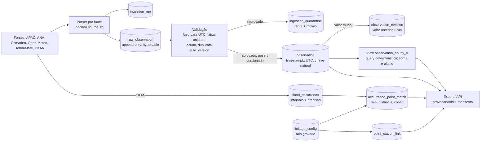

# 0006 — Pipeline de ingestão: staging bruto, validação e série consolidada em UTC

- Status: **aprovado** (2026-10-10, Lucas: perguntas 14–19). Dado de desenvolvimento descartado após o snapshot; contrato de proveniência aprovado; rótulo só "alagamento" (sem "inundação"); fuso de ANA/APAC 24h/Cemaden verificado por correlação com Open-Meteo após a primeira carga; migrações V3–V6 aprovadas.
- Checkpoint: v1 reprovada (5 pontos); v2 corrige a borda da hora, o `REVALIDATE`, o dedupe A→B→A e o escopo (sem compressão nem continuous aggregates agora) e registra limitações. **v2 APROVADA** em 2026-10-10 com 2 ressalvas, aplicadas: casos T2e×T4 separados; normalização de `source_ts_text`.
- Data: 2026-10-10
- Decisores: Agente 4 + Agente 1 (autor), checkpoint Máximo (pendente), Lucas
- Tarefa: F2-DADOS-05 (inclui a política de retenção e compressão de F2-DADOS-06, seção 9)
- Depende de: ADR 0005 (banco). **Este ADR assume PostgreSQL + TimescaleDB (+ PostGIS)**; se 0005 mudar de motor, as seções 3, 5, 8 e 9 (hypertable, `time_bucket`, continuous aggregate, compressão) precisam ser reescritas; as seções 1, 2, 4, 6 e 7 não dependem do motor.
- Respeita: 0001 (UTC), 0002 (camadas), 0003 (Flyway), 0004 (Testcontainers).

## Contexto

Os documentos da Fase 1 mostram que o banco atual não permite rastrear nem reconstruir o dado de uma dissertação:

- Nenhum endpoint de ingestão é repetível. `weather_data` não tem constraint única e a "idempotência" é a heurística `>8000 linhas no ano` (`HistoricalDataServiceImpl.java:234`, segundo `docs/revisao/fase-1/F1-BACK-03.md` §1). Em `sensor_data` o primeiro valor gravado vence (`V1__baseline_schema.sql:45`, `UNIQUE (sensor_id, timestamp)`), então a agência não consegue corrigir um valor.
- Cinco tratamentos de fuso nas mesmas colunas `TIMESTAMP WITHOUT TIME ZONE` (`docs/CONSISTENCIA-ENTRE-REPOS.md` §3; `V1__baseline_schema.sql:18,51,80,101`).
- Histórico APAC/ANA não grava `raw_data`, instante de coleta nem versão; a ANA troca `sensor_id` pelo slug do ponto (`AnaHistoricalServiceImpl.java:83-91`) e perde a identidade da estação (F1-BACK-03 §2).
- Granularidades misturadas na mesma coluna (`accumulated_precipitation`: diário APAC e sub-horário ANA/Cemaden), agregadas por `max` no export; o total diário da APAC vira pico às 00:00 (F1-BACK-03 §4).
- Rótulo circular: `alignFloodEventsToRainPeaks` sobrescreve a hora do evento CKAN com o pico de chuva (`HistoricalDataServiceImpl.java:99-125`). Matriz de prioridade, itens 1 e 4 (`docs/MATRIZ-PRIORIDADE-FASE-1.md`).
- Raios de vínculo (3 km, 2 km) são literais no código e não são gravados (F1-BACK-03 §8).
- Volume atual: 5 pontos críticos; `sensor_data` 555 linhas e `weather_data` 40 linhas, de 2026-09-05 a 2026-10-01 (`docs/snapshots/2026-10-10-pre-revisao.md`, SHA-256 `3ace3cde…dedd`). **Não existe histórico de 5 anos em lugar nenhum**; a carga histórica será feita do zero com o pipeline novo (decisão do autor, `docs/HANDOFF-fase-1.md`, pergunta 12).

Decisões do autor que este ADR não reabre: UTC na persistência (0001); desativar o realinhamento de eventos ao pico de chuva e reimportar o CKAN preservando a data original, com precisão declarada "dia" quando não houver hora; `flood_predictions` fora dos resultados da dissertação.

## Opções consideradas

### A — Tabela única com colunas de proveniência
Acrescentar `source`, `run_id`, `ingested_at`, `content_hash`, `version` a `sensor_data` e `weather_data`, mais `UNIQUE` novas.
- A favor: menor mudança, nenhum leitor novo, uma migration pequena.
- Contra: o valor tratado sobrescreve o original, então reinterpretar o fuso (ADR 0001) ou mudar uma regra exige rebaixar a fonte, que pode ter sido revisada (F1-BACK-03 §7, itens 2 e 4). Correção da agência perde a versão anterior. Quarentena não tem onde viver. O formato largo (25 colunas quase todas nulas por fonte em `sensor_data`) não carrega unidade, resolução nem flag por variável. Não atende ao requisito de banca "mostre o valor como a agência o entregou".

### B — Camadas separadas: staging bruto append-only, validação com quarentena, série consolidada versionada (escolhida)
- A favor: o bruto é a evidência; tudo que vem depois é reconstruível por regra versionada; correção retroativa tem trilha; fuso e unidade são resolvidos em um lugar só; cada valor aponta para a execução que o produziu.
- Contra: mais tabelas e um passo a mais por leitura; os leitores atuais (export, API) precisam migrar; consome mais disco (mitigado na seção 9).

### C — Event sourcing completo
O log de eventos imutável é a única verdade; toda tabela (inclusive pontos, vínculos, usuários) é projeção, com replay.
- A favor: auditoria máxima; replay de qualquer estado do sistema.
- Contra: exige infraestrutura de log/projeções que o projeto não tem (um backend monolítico em camadas, ADR 0002); esforço G sem ganho para a dissertação além do que B já dá nas séries. B já aplica o princípio onde importa (série observada e rótulo); o resto (usuários, pontos) não precisa de replay.

### Sub-opção de layout da série consolidada
- **Largo** (uma linha por instante, uma coluna por variável, como hoje): menos linhas, mas flag de qualidade, unidade, resolução e versão por variável não cabem; variável nova exige migration.
- **Longo** (uma linha por fonte, estação, variável, instante): escolhido. Custo: ~7× mais linhas para o clima (seção 9), compensado por compressão com `segmentby` na própria chave.

## Decisão

**Adotar B, em formato longo, com migração aditiva em passos (V3 em diante).** Nada do que existe é alterado ou apagado nos passos propostos; `sensor_data` e `weather_data` ficam congeladas e somem só com aprovação explícita (seção 8).

### 1. Camadas e tabelas

Nomes em inglês `snake_case`, como no baseline. Tipos temporais sempre `timestamptz`.

**`ingestion_run`** (tabela comum): uma linha por execução (seção 2).

**`raw_observation`** (hypertable por `ingested_at`, append-only, sem `UPDATE`/`DELETE` pela aplicação): uma linha por registro de fonte (estação × instante), não por resposta HTTP.

| Coluna | Conteúdo |
|---|---|
| `id` (uuid), `ingested_at` (`timestamptz`) | `ingested_at` é a coluna de partição, por isso entra na PK `(id, ingested_at)` |
| `run_id` | execução que baixou |
| `source` | `APAC_METEO24H`, `APAC_PORTAL`, `ANA_SOAP`, `CEMADEN`, `OPEN_METEO_ARCHIVE`, `OPEN_METEO_CURRENT`, `OPEN_METEO_MARINE`, `TABUA_MARE`, `CKAN_RECIFE` |
| `station_id` | identificador **da fonte**, nunca o slug do ponto (corrige `AnaHistoricalServiceImpl.java:83-91`) |
| `collected_at` | instante em que o sistema recebeu o dado (relógio injetado, `Instant`) |
| `source_ts_text` | texto de data/hora exatamente como veio (auditoria) |
| `source_ts_norm` | o mesmo instante normalizado para ISO-8601 local da fonte, sem fuso aplicado; é ele que entra na identidade, para que uma troca de formato do texto pela agência não crie registro novo |
| `source_tz` | fuso declarado pelo parser (seção 4): IANA, `UTC` ou `UNVERIFIED` |
| `payload` (`jsonb`) | registro original sem transformação (para HTML da APAC: o trecho da tabela do dia, em texto) |
| `content_hash` | SHA-256 do `payload` canonicalizado (chaves ordenadas) |

Regra de escrita: o registro de origem é identificado por `(source, station_id, source_ts_norm)`. Antes de inserir, compara-se o `content_hash` **somente com a versão mais recente (maior `ingested_at`) desse registro de origem**. Igual = não insere e o `ingestion_run` conta `raw_unchanged`; diferente = linha nova (o bruto guarda todas as versões). Comparar só com a mais recente permite a volta A→B→A: se a agência corrige A para B e depois volta a A, o segundo A difere da versão mais recente (B) e entra como linha nova; comparar contra qualquer versão antiga descartaria a volta e deixaria o consolidado em B. Índice de apoio: `(source, station_id, source_ts_text, ingested_at DESC)`. Registros repetidos do mesmo registro de origem dentro de um lote são deduplicados na aplicação antes do `INSERT`. A checagem é serializada por fonte com `pg_advisory_xact_lock(hashtext(source))`, pois o TimescaleDB não aceita `UNIQUE` sem a coluna de partição. A resposta HTTP inteira também tem SHA-256 em `ingestion_run.params`.

**Validação** é um serviço puro (`service/ingestion/validation/`), sem acesso a HTTP, com `rule_version` (string, ex.: `2026.10.1`) e catálogo `variable_catalog` (variável, unidade canônica, mínimo e máximo físicos, resolução esperada, convenção de intervalo e agregação horária). Regras mínimas:

| Regra | Reprova quando | Motivo gravado |
|---|---|---|
| Fuso | `source_tz = UNVERIFIED` ou texto não parseável (nunca `now()` como fallback) | `TZ_UNVERIFIED`, `TS_UNPARSEABLE` |
| Faixa | valor fora de `[min, max]` do catálogo (ex.: chuva horária < 0 ou acima do limite físico; sentinelas como `-9999`) | `OUT_OF_RANGE`, `SENTINEL` |
| Unidade | unidade do payload diferente da esperada e sem conversão cadastrada | `UNIT_MISMATCH` |
| Duplicata | dois registros de origem **distintos** (identidade diferente) caindo na mesma chave natural no mesmo lote, com valores diferentes. Duas versões do **mesmo** registro de origem não são conflito: vence a mais recente (T2e) | `CONFLICT_IN_BATCH` |
| Lacuna | **não reprova**; gera flag `gap_before` e contagem em `ingestion_run`, e o horário vira `NULL` (nunca constante inventada) | — |

Os limites numéricos de faixa por variável **não** são fixados neste ADR: entram no `variable_catalog` com fonte citada (norma da agência ou literatura), e cada um fica `[sem fonte]` até ser preenchido.

**`ingestion_quarantine`** (tabela comum): `run_id`, `raw_id`, `raw_ingested_at`, `rule_id`, `rule_version`, `reason`, `detail` (jsonb), `quarantined_at`, `resolved_at`, `resolution`. Quarentena é revisável: corrigida a regra ou o fuso, a revalidação (seção 3, modo `REVALIDATE`) reprocessa as linhas e preenche `resolved_at`.

**`station`** (tabela comum): `(source, station_id)` PK, `name`, `lat`, `lon`, `municipality`, `attrs` (jsonb: `code`, bacia, rio, limiares de alerta que hoje são colunas de `sensor_data`, `V2__add_river_alert_levels.sql`). Para Open-Meteo, a "estação" é a coordenada solicitada; a coordenada real da grade vai em `attrs.grid_lat/grid_lon` (hoje perdida, F1-BACK-03 §2).

**`observation`** (hypertable por `ts_utc`, série consolidada):

| Coluna | Conteúdo |
|---|---|
| `source`, `station_id`, `variable`, `resolution`, `ts_utc` | **chave natural** `UNIQUE (source, station_id, variable, resolution, ts_utc)` |
| `value` (double), `unit`, `qualifier` | `qualifier` guarda, por exemplo, `PREAMAR`/`BAIXA_MAR` |
| `interval_start_utc` | início do intervalo representado; igual a `ts_utc` para medida instantânea |
| `quality_flag` | `OK`, `GAP_BEFORE`, `IMPUTED_NONE` (reservado; o pipeline não imputa) |
| `revision` (int, começa em 1), `status` | `ACTIVE` ou `RETRACTED` |
| `run_id`, `raw_hash`, `rule_version`, `value_hash` | proveniência do **valor vigente** |

`resolution` é ISO-8601: `PT5M`, `PT10M`, `PT15M`, `PT1H`, `P1D`, `EVENT` (extremos de maré). Como `resolution` faz parte da chave, o total diário da APAC (`P1D`) e a leitura horária da ANA para a mesma estação nunca colidem nem se misturam.

**Upsert versionado** (uma instrução SQL por lote, dentro de uma transação por lote, como manda a skill `mapi-clean-arch-java` §3):

- O lote é **deduplicado antes** do `ON CONFLICT` (uma linha por chave natural; vence a de bruto mais recente), porque o PostgreSQL falha ("ON CONFLICT DO UPDATE command cannot affect row a second time") se a mesma chave aparece duas vezes no mesmo comando.
- `INSERT ... ON CONFLICT (chave natural) DO UPDATE SET value = EXCLUDED.value, status = 'ACTIVE', revision = observation.revision + 1, run_id = EXCLUDED.run_id, ... WHERE observation.value_hash IS DISTINCT FROM EXCLUDED.value_hash OR observation.status <> 'ACTIVE'`. Valor igual e `ACTIVE` não toca na linha (idempotência); uma chave `RETRACTED` com o mesmo valor **é reativada** (`status = 'ACTIVE'`, nova `revision`), necessário quando uma revalidação desloca uma linha e outra a traz de volta.
- Um gatilho `AFTER UPDATE` copia a linha antiga para **`observation_revision`** (tabela comum: chave natural, `revision`, valor anterior, `run_id` anterior, `superseded_by_run_id`, `superseded_at`). A trilha do que mudou é essa tabela.
- Nada é apagado: quando uma revalidação muda a chave natural (por exemplo, correção de fuso muda `ts_utc`), as linhas antigas passam a `status = RETRACTED` e a trilha registra o motivo. Leituras usam apenas `ACTIVE` (view `observation_current`).
- Suporte a `UPDATE`/`INSERT ... ON CONFLICT` em chunk comprimido depende da versão do TimescaleDB; **a verificar na imagem fixada pelo ADR 0005** e coberto pelo teste T2b (seção 10).

### 2. Proveniência

**`ingestion_run`**:

| Coluna | Conteúdo |
|---|---|
| `id` (uuid) | identificador da execução |
| `source`, `kind` | `kind`: `LIVE`, `BACKFILL`, `REPROCESS` |
| `mode` | `REFETCH` ou `REVALIDATE` (seção 3) |
| `params` (jsonb) | URL e parâmetros efetivos, `timezone` pedido, `sha256` da(s) resposta(s) |
| `interval_start`, `interval_end` (`timestamptz`) | intervalo `[t0, t1)` solicitado; `NULL` em coleta ao vivo |
| `code_version` | commit git do backend (`git.properties` ou variável de build), `parser_version`, `rule_version` |
| `started_at`, `finished_at`, `status` | `RUNNING`, `OK`, `PARTIAL`, `FAILED` |
| contagens | `fetched`, `raw_inserted`, `raw_unchanged`, `valid`, `quarantined`, `obs_inserted`, `obs_updated`, `obs_unchanged`, `absent_in_refetch` |
| `parent_run_id`, `error_summary` | encadeia reprocessamentos; erro de agência não vira "sucesso 0/0" (`status = FAILED`) |

**`provenanceId` exposto nas respostas [MUDA CONTRATO, PRECISA DE APROVAÇÃO]:**

- Formato: string UUID do `ingestion_run` que produziu o valor vigente (`run_id` em `observation`), acompanhada de `revision` (inteiro) quando o valor já foi corrigido.
- Onde, no nível de valor:
  - `SensorResponseDTO` (`dto/SensorResponseDTO.java:14`, devolvido por `/api/sensors/latest`, `/api/sensors/{sensorId}/latest` e `/api/sensors/{sensorId}/history`, `SensorController.java:24,30,37`): acrescentar `provenanceId` e `revision`.
  - `WeatherResponseDTO` (`/api/weather`, `WeatherController.java:22`): idem.
- Onde, no nível de dataset: as linhas do export são agregadas (`UnifiedDataDTO`, `/api/export/ia-dataset/*`) e não têm um único valor de origem por linha. **Não** se acrescenta `provenanceId` por linha ali. O export ganha um **manifesto** (`datasetId` = SHA-256 do CSV; período; fusos; raios e `linkage_config.id`; `rule_version`; lista de `run_id` por fonte e variável; contagem de linhas com flag), devolvido em `GET /api/export/ia-dataset/{slug}/manifest` e no cabeçalho `X-Dataset-Id`. O CSV passa a ter cabeçalho com unidade e fuso e colunas `*_flag` (alinhado ao item 5 da matriz).
- Mudança correlata que o ADR 0001 já implica: `UnifiedDataDTO.timestamp` (`UnifiedDataDTO.java:12-13`) e `SensorResponseDTO.timestamp` (`SensorResponseDTO.java:21-22`) usam o padrão `yyyy-MM-dd'T'HH:mm:ss`, sem fuso. Em UTC, o contrato deve serializar ISO-8601 com `Z` (`Instant`). **Também muda contrato**; aprovar junto, para o front (`America/Recife` só na exibição) e a IA mudarem uma vez só. Os campos novos são aditivos, e a troca do formato do timestamp é o ponto de quebra.

### 3. Reprocessamento idempotente de `[t0, t1]` de uma fonte

Comando: `POST /api/admin/ingestion/runs` (papel `ADMIN`), corpo `{ "source": "...", "from": "2026-01-01T00:00:00Z", "to": "2026-02-01T00:00:00Z", "mode": "REFETCH|REVALIDATE" }`. Nome de endpoint é proposta, a aprovar junto da seção 2.

1. Abre `ingestion_run (kind = REPROCESS, parent_run_id = último run OK da fonte no intervalo)` e toma o advisory lock da fonte; um reprocessamento por fonte por vez.
2. `REFETCH`: baixa de novo `[t0, t1)` da agência. Cada registro passa pela regra de escrita do staging (mesmo hash = não insere; hash novo = nova linha). `REVALIDATE`: não vai à agência; seleciona o bruto **pelo instante de origem** (`source_ts_text` interpretado com o `source_tz` antigo **e** o novo; entra o registro cujo instante caia em `[t0, t1)` por qualquer dos dois, o que equivale a alargar a janela pelo deslocamento máximo de fuso entre as regras, hoje 3 h) e reaplica as regras com a `rule_version` atual (usado quando muda regra, faixa ou fuso). A seleção é sobre o bruto, não sobre o `ts_utc` do consolidado, porque uma correção de fuso desloca o `ts_utc`. No `REFETCH`, os registros `raw_unchanged` **também são revalidados** (a regra pode ter mudado desde a última execução); só não geram linha nova no bruto.
3. Valida e faz o upsert versionado dos registros selecionados no passo 2 (pelo instante de origem). Se a nova chave natural difere da antiga (fuso deslocou `ts_utc`), a linha antiga vai a `RETRACTED` e a nova é inserida ou reativada, **mesmo que o novo `ts_utc` caia fora de `[t0, t1)`**; a janela restringe a seleção da origem, não o destino. Registros de origem fora da janela não são lidos nem escritos.
4. Registro ausente na nova resposta **não** apaga o consolidado; conta em `absent_in_refetch` para revisão humana.
5. Nada a atualizar na leitura horária: ela é uma query sobre `observation` (seção 5). Fecha o `status` do run.
6. Fecha o `ingestion_run` com as contagens. A trilha do que mudou é: `observation_revision` filtrada por `superseded_by_run_id = <run>`; linhas novas por `run_id = <run>` e `revision = 1`; linhas retiradas por `status = RETRACTED`.

Propriedade verificada por teste (seção 10, T1/T5): rodar o mesmo `[t0, t1]` duas vezes seguidas sobre a mesma resposta da fonte deixa `raw_inserted = 0`, `obs_inserted = 0`, `obs_updated = 0` na segunda e o hash da tabela no intervalo idêntico.

### 4. Fuso: regra por fonte e onde a conversão acontece

**A conversão acontece na validação (staging → consolidada), nunca no parser nem na gravação do bruto.** O parser só declara `source_tz`; o bruto guarda o texto original e o fuso declarado; a validação converte para `Instant` com `java.time` (`ZoneId`), sem depender do fuso da JVM (`TZ=UTC` no container como defesa, ADR 0001). Isso permite corrigir uma regra de fuso e reprocessar com `REVALIDATE`, sem rebaixar a fonte. A tabela vem de `docs/revisao/fase-1/F1-BACK-03.md` §5.

| Fonte | `source_tz` declarado | Regra de conversão | Estado |
|---|---|---|---|
| Open-Meteo archive | `UTC` | pedir `timezone=GMT` explícito (hoje implícito, `HistoricalDataServiceImpl.java:245-253`) e conferir `utc_offset_seconds` da resposta; parsear como UTC | confirmar `utc_offset_seconds = 0` na primeira carga |
| Open-Meteo current e marine | `UTC` | trocar `timezone=auto` (`WeatherServiceImpl.java:47`, `MarineServiceImpl.java:37`) por `GMT` | mudança de código (F2-BACK-01) |
| ANA SOAP (histórico e ao vivo) | `UNVERIFIED` | **linhas vão para a quarentena `TZ_UNVERIFIED`** até haver evidência: leitura de um XML bruto e correlação cruzada com Open-Meteo/APAC em tempestade conhecida. Hoje o histórico aplica `minusHours(3)` (`AnaHistoricalServiceImpl.java:119`) e o ao vivo não aplica nada | bloqueante; resultado entra neste ADR |
| APAC portal (diário) | `America/Recife` | dia civil `D` vira o intervalo `[D 00:00, D+1 00:00)` em Recife = `[D 03:00Z, D+1 03:00Z)`; `ts_utc` = fim do intervalo, `interval_start_utc` = início, `resolution = P1D` | decidido |
| APAC meteorologia24h e Cemaden ao vivo | `UNVERIFIED` | idem ANA: amostra do campo `Data-hora` do `raw_data` contra `collected_at` | bloqueante |
| TabuaMare/DHN | valor de `tide_tables.timezone` | ler a coluna (`SELECT DISTINCT timezone FROM tide_tables`), hoje ignorada (`TideTableSyncServiceImpl.java:117`) e converter dia + hora por esse fuso | a consultar no banco |
| CKAN Recife | `America/Recife` | data sem hora: intervalo `[00:00, 24:00)` local, precisão `DAY`; com hora: instante, precisão `HOUR` | decidido |
| Relógio do sistema | `UTC` | `Clock` injetado e `Instant.now()`; proibido `LocalDateTime.now()` na ingestão | ADR 0001 |

`UNVERIFIED` é um estado de primeira classe: força a verificação antes de a fonte entrar na série consolidada, em vez de herdar um palpite. O bruto dessas fontes é guardado desde já; quando a verificação sair, `REVALIDATE` consolida o que ficou em quarentena.

**Dados de desenvolvimento existentes (555 leituras de sensor, 40 de clima, 2026-09-05 a 2026-10-01; fonte: snapshot).** Opções, para o autor escolher:

- **Opção 1 — descartar após o snapshot (recomendada).** O snapshot SHA-256 `3ace3cde…dedd` já é a evidência do "antes". Argumento: 595 linhas não sustentam nenhum resultado; as 40 de clima misturam archive (UTC) e coletor (`timezone=auto`) na mesma coluna, distinguíveis só por heurística de minutos (F1-BACK-03 §5); só o fluxo ao vivo tem `raw_data`, e o fuso da ANA/APAC/Cemaden é `UNVERIFIED`. Custo: zero código de migração de dado.
- **Opção 2 — reinterpretar por fonte.** Importar como `raw_observation` com `legacy = true`, `source_tz` por fonte (a tabela acima) e `ingested_at` desconhecido (`NULL` ou data do snapshot). Argumento: preserva a linha. Contra: depende da verificação empírica do fuso de três fontes e exige regra para separar archive de coletor; ganho científico nulo com 4 semanas.
- **Opção 3 — manter como legado fora do dataset.** Deixar `sensor_data`/`weather_data` como estão, sem leitor. Argumento: nada a decidir agora. Contra: duas verdades no banco e risco de alguém voltar a lê-las.

### 5. Granularidade e reamostragem

**Grade canônica do dataset: horária.** A tabela `observation` guarda cada fonte na resolução original (`PT5M`, `PT10M`, `PT1H`, `P1D`, `EVENT`); a hora é derivada.

**Convenção de rótulo: o instante `t` de uma linha horária é o fim do intervalo.** A linha `t` contém só informação com timestamp em `(t − 1 h, t]` e, portanto, estava inteira disponível em `t`. Justificativa de vazamento temporal (skill `mapi-ml-pipeline` §2: "feature só usa informação disponível em `t`"): se a hora fosse rotulada pelo início, a linha `t` conteria chuva de `(t, t+1 h]` e uma previsão feita em `t` com horizonte `H` usaria o futuro; o erro é do tamanho do próprio horizonte (3 h e 6 h). Rotular pelo fim torna a janela "para trás" natural, como exige a skill. Convenção de cada variável registrada em `variable_catalog.interval_convention`; **a convenção de rótulo do Open-Meteo (valores acumulados "da hora anterior", rotulados no fim da hora) não está citada no código nem verificada aqui: confirmar na documentação da API antes da primeira carga** (a regra do pipeline é normalizar tudo para "fim do intervalo", qualquer que seja a convenção da fonte).

| Variável | Agregação à hora | Regra | Falta de dado |
|---|---|---|---|
| Chuva incremental (ANA, Cemaden, APAC 24 h, Open-Meteo `precipitation`) | **soma** dos incrementos em `(t−1h, t]` | se a fonte entrega acumulado corrente, converte para incremento por diferença antes (confirmar por fonte, `[a verificar]`) | menos de 80% das leituras esperadas na hora = `NULL` + `GAP`; o limiar de 80% é proposta [sem fonte] |
| Estado (nível de rio, umidade, pressão, temperatura, vento, rádio) | **última** leitura em `(t−1h, t]` | estado conhecido em `t`; nunca máximo ou média sobre horas vizinhas | sem leitura = `NULL` |
| Total diário APAC (`P1D`) | **não entra na grade horária** | série separada `precipitation_daily_total`; disponível a partir do fim do dia local (03:00Z do dia seguinte) e só pode alimentar feature a partir desse instante | — |
| Maré (extremos, `EVENT`) | não reamostrada | série horária de maré é **derivada** por interpolação documentada entre extremos consecutivos (inclusive de dias vizinhos, corrigindo o degrau em `TideServiceImpl.java:182-186`); exceção legítima de lookahead `t+1..t+6` já prevista na skill | — |

Implementação (v2): a hora é uma **view comum** `observation_hourly_v`, query determinística sobre `observation_current`, sem materialização, com `hour_end_utc = time_bucket('1 hour', ts_utc - interval '1 microsecond') + interval '1 hour'`. A subtração de 1 µs implementa o intervalo `(t−1h, t]`: uma leitura às 15:00:00 exatas cai na linha das 15:00; uma às 15:00:00,000001 ou 15:01 cai na das 16:00. O `time_bucket('1 hour', ts_utc) + 1 hour` simples agruparia `[t, t+1h)` e jogaria a leitura das 15:00:00 na linha das 16:00, contradizendo a convenção. `n_readings` e `n_expected` alimentam o limiar de completude. Variáveis já horárias (Open-Meteo, `PT1H`) entram com o próprio `ts_utc`, já normalizado para fim do intervalo. **Não há continuous aggregate nesta versão:** com 5 pontos (~1,5 milhão de linhas em 5 anos) a query é barata, e um agregado `materialized_only` desatualizado produziria um export diferente do banco, ferindo a reprodutibilidade. Eles voltam por medição (seção 9). O export nunca usa `max` entre estações ou resoluções: a escolha da estação do ponto vem de `point_station_link` (seção 7).

### 6. Rótulos CKAN

Sem realinhamento ao pico de chuva (`alignFloodEventsToRainPeaks` e o endpoint em `HistoricalDataController.java:76` saem do fluxo; remoção do código é tarefa F2-BACK). O rótulo é construído em três tabelas:

- **`flood_occurrence`** (uma linha por registro do CKAN, versionada como a série): `ckan_package_id`, `ckan_resource_id`, `ckan_record_id`, `raw_hash`, `run_id`, `address_text`, `occurred_from` e `occurred_to` (`timestamptz`, intervalo `[from, to)`), `temporal_precision` (`HOUR` ou `DAY`), `cobrade_code`, `cobrade_text`, `geocoded_lat/lon`, `geocode_method`. O bruto vai para `raw_observation` com `source = CKAN_RECIFE`.
- **`occurrence_point_match`**: `occurrence_id`, `flood_point_id`, `distance_m`, `radius_m`, `linkage_config_id`, `method` (`NEAREST_WITHIN_RADIUS`), `rule_version`, `matched_at`. Mudar o raio cria **novas** linhas com outra `linkage_config`; as anteriores permanecem (permite análise de sensibilidade do rótulo).
- **Filtro Cobrade** como configuração gravada (`label_filter`: lista de códigos aceitos, `config_id`), registrada no manifesto. Padrão: manter **alagamento**; excluir **deslizamento** e **enxurrada** (skill `mapi-ml-pipeline` §4). Os códigos oficiais da tabela Cobrade e o nome real do campo no CKAN **precisam ser conferidos contra a base** antes de implementar (`[a verificar]`; F1-BACK-03 não relata o campo Cobrade).

Precisão temporal: uma ocorrência `DAY` **nunca é convertida em hora** pelo pipeline. O export expõe `labelPrecision`. Como casar um rótulo diário com horizonte de 3 ou 6 h é decisão da formulação do ML (pergunta 9 da matriz, item 6), não da ingestão.

### 7. Raio de vínculo

Tabela **`linkage_config`**: `id`, `kind` (`SENSOR_POINT` ou `OCCURRENCE_POINT`), `radius_m`, `method`, `created_at`, `created_by`, `note`. Valor inicial copiado do código atual (3000 m; o 2000 m da APAC histórica é unificado): `[sem fonte]` como critério, apenas a continuidade do que existe (F1-BACK-03 §8). Configurável por propriedade (`AppProperties`) com default; cada uso grava o `linkage_config.id`.

Tabela **`point_station_link`**: `flood_point_id`, `source`, `station_id`, `variable_scope`, `distance_m`, `radius_m`, `linkage_config_id`, `method` (`NEAREST`, `ALL_WITHIN`), `valid_from`, `valid_to`. Substitui, para o export, as junções sem metadado `flood_point_pluviometers` etc. (`V1__baseline_schema.sql:134-147`) e unifica as duas definições de "sensor do ponto" (por id e por raio, F1-BACK-03 §8). A distância usa uma só implementação (`util/GeoUtils.java` Haversine ou `ST_Distance` geografia, se 0005 adotar PostGIS), eliminando a lei dos cossenos em JPQL.

Sensibilidade do raio (1, 2, 3, 5 km) fica possível porque cada vínculo é versionado; executar essa análise é tarefa do ML, não da ingestão.

### 8. Migração incremental via Flyway (V3 em diante)

Cada passo (V3 a V6 agora; V7 adiada) é uma migration, **aditiva**, aplicada somente com aprovação do Lucas (regra da revisão, ADR 0003). O snapshot da Fase 2 (`docs/snapshots/2026-10-10-pre-revisao.md`) é o "antes".

| Passo | Cria | Toca no existente? |
|---|---|---|
| `V3__ingestion_registry.sql` | `ingestion_run`, `station`, `variable_catalog`, `source_registry` (fonte, `source_tz`, estado de verificação) | não |
| `V4__raw_observation_and_quarantine.sql` | `raw_observation` (hypertable), `ingestion_quarantine`, índices `(source, station_id, content_hash)` | não |
| `V5__observation_timeseries.sql` | `observation` (hypertable, `UNIQUE` natural), `observation_revision`, gatilho de revisão, views `observation_current` e `observation_hourly_v` | não |
| `V6__labels_and_linkage.sql` | `flood_occurrence`, `occurrence_point_match`, `label_filter`, `linkage_config`, `point_station_link` | não (referencia `flood_points.id`) |
| `V7__compression_retention_policies.sql` **(adiada)** | políticas da seção 9, só quando um limiar de medição for atingido | só as tabelas novas |
| (código, não migration) | ingestores passam a escrever em staging e validação; leitores (export, `/api/sensors`, `/api/weather`) passam a ler `observation`; `alignFloodEventsToRainPeaks` desativado | — |
| `V8` (**fora deste ADR, aprovação explícita própria**) | aposentar `sensor_data`, `weather_data`, `hourly_precipitation`; nenhum `DROP`/`DELETE`/`ALTER ... TYPE` entra antes | destrutivo |

Observações: (a) o continuous aggregate `hourly_precipitation` do baseline (`V1__baseline_schema.sql:68-77`) permanece intocado; (b) como `sensor_data`/`weather_data` serão congeladas e a carga histórica parte do zero, **não** se acrescenta `UNIQUE` em `weather_data` nem `ALTER ... TYPE timestamptz` nas tabelas antigas (a matriz, item 4, aceitava qualquer das duas formas); (c) como o banco local já tem `flyway_schema_history` com baseline, V3 em diante rodam sem tocar V1/V2; (d) a Fase 3 (PostGIS, terreno) é aditiva sobre `flood_points` e independente deste pipeline.

### 9. Retenção e compressão (F2-DADOS-06): plano condicionado a medição

**Nada desta seção é aplicado agora (V7 adiada).** Com 5 pontos o volume é de ~1,5 milhão de linhas de clima em 5 anos e o disco não pede compressão. A seção fixa o plano e o **gatilho** que o aciona; antes disso, as tabelas nascem sem política.

**Limiares que disparam V7** `[sem fonte]` (propostos, ajustáveis pelo autor; a primeira medição de tamanho e p95 depois da carga histórica vai para `docs/medidas/`): (a) `pg_total_relation_size('observation')` + `raw_observation` > 5 GB; ou (b) p95 do export de 1 ponto × 5 anos > 5 s medido por k6 sobre a view horária; ou (c) número de pontos ativos ≥ 50. Continuous aggregates só entram se (b) ocorrer com a view já indexada, e então com `materialized_only = false` ou com verificação de frescor no manifesto.

**Volume e premissas** (fonte: `docs/revisao/fase-1/F1-BACK-03.md` §6, quando não indicado; "derivado" = conta deste ADR sobre essas premissas):

- Clima por ponto: 7 variáveis × 8.760 h = 61.320 linhas longas/ano/ponto (derivado). Em 5 anos: 5 pontos = 1,53 milhão (F1-BACK-03: 219.000 ponto-horas × 7 = 1.533.000); 50 pontos = 15,3 milhões; 200 pontos = 61,3 milhões. Com ~160 B/linha incluindo o índice único (estimativa de ordem de grandeza, mesma metodologia do F1-BACK-03 §6, a validar com `pg_total_relation_size` após carga): 0,25 GB, 2,5 GB, 9,8 GB, sem compressão.
- Sensores: não escalam com o número de pontos (estações são regionais). Ao vivo, 100 estações a cada 10 min = 5,26 milhões de leituras/ano (F1-BACK-03 §6, premissa a confirmar com `SELECT count(DISTINCT sensor_id)`); em formato longo com 1 a 3 variáveis por leitura, 5,3 a 15,8 milhões de linhas/ano (derivado), ou 0,8 a 2,5 GB/ano sem compressão. Histórico APAC diário: 150 estações × 365 × 5 = 273.750 linhas.
- Staging bruto: ~500 B de `payload` por leitura (F1-BACK-03 §6, `raw_data`) → ~3,4 GB/ano de payload ao vivo (derivado de 5,26 milhões × ~650 B com cabeçalho e hash); Open-Meteo por ponto-hora ~300 B (estimativa) → 66 MB para 5 pontos × 5 anos; 2,6 GB para 200 pontos × 5 anos.
- Conclusão: o disco não é o gargalo em nenhum cenário: somando clima (até 9,8 GB com 200 pontos), sensores (4 a 12,6 GB em 5 anos) e staging ao vivo (~17 GB em 5 anos), o pior caso fica na casa de 40 GB sem compressão (derivado). Compressão e retenção existem para manter consultas de export rápidas e porque o staging ao vivo é o item que mais cresce; **a política abaixo é conservadora porque o bruto é a evidência da banca**.

| Tabela | `chunk_time_interval` | Compressão | `segmentby` | `orderby` | Retenção |
|---|---|---|---|---|---|
| `raw_observation` | 7 dias | após 14 dias | `source, station_id` | `ingested_at DESC` | **sem `drop_chunks`**. Reavaliar quando o disco do host passar do limite definido pelo autor; antes de apagar qualquer chunk, exportar para arquivo (CSV.gz ou Parquet) com SHA-256 registrado, e só com aprovação explícita |
| `observation` | 30 dias | após 60 dias (chunk de 30 dias fechado + 30 dias de janela para correção da agência) | `source, station_id, variable, resolution` | `ts_utc DESC` | **nenhuma** (é a série da dissertação) |
| `observation_revision`, `ingestion_run`, `ingestion_quarantine` | tabela comum | não | — | — | nenhuma |
| continuous aggregates horários (condicionais) | 30 dias | após 90 dias | `source, station_id, variable` | `bucket DESC` | nenhuma |

Justificativas: (1) `segmentby` na chave natural da série dá lotes contíguos por estação e variável, os padrões de leitura do export (uma estação, uma variável, um intervalo); com ~750 segmentos por chunk (≈250 estações × 3 variáveis, premissa) e leituras a cada 10 min, cada segmento acumula 4.320 linhas por chunk de 30 dias, acima do tamanho de lote de compressão do TimescaleDB (1.000 linhas); a série diária APAC fica com 30 linhas por segmento e compressão menos eficiente, aceitável pelo volume (273.750 linhas). (2) A janela de 30 dias entre fechar o chunk e comprimi-lo cobre a correção retroativa típica sem descomprimir; correções mais antigas funcionam (teste T2b), porém mais lentas. (3) O staging ao vivo é comprimido cedo, mas a consulta de deduplicação por hash em chunks comprimidos só acontece no reprocessamento, que é raro. (4) As razões de compressão esperadas **não são assumidas**: medir com `hypertable_compression_stats` e registrar no `docs/MODELO-DE-DADOS.md` (`[sem fonte]` até a medição).

**Continuous aggregates (condicionais, não criados agora):** se o limiar (b) for atingido, `observation_hourly_sum` (chuva) e `observation_hourly_last` (estados), com o mesmo rótulo de fim de hora da seção 5 (`time_bucket(..., ts_utc - interval '1 microsecond') + 1 hour`). Política de refresh: `start_offset = 7 dias`, `end_offset = 1 hora`, a cada 15 min; correção além de 7 dias e todo reprocessamento precisariam chamar `refresh_continuous_aggregate` explicitamente, e o manifesto deveria registrar o frescor. Opcional, para auditoria: um agregado diário da soma horária de chuva para conferir contra o total diário APAC (`P1D`) — checagem de consistência entre fontes, não entra no dataset.

### 10. Como testar (Testcontainers, ADR 0004)

Testes de integração com a imagem fixada no ADR 0005 (PostgreSQL + TimescaleDB), schema criado por Flyway real (V1 em diante). Fixtures com respostas reais anonimizadas e salvas em `src/test/resources/ingestion/<fonte>/` (arquivo + SHA-256 no nome). Parsing e regras de validação puras têm testes unitários com Mockito, sem banco.

| Teste | O que prova | Asserções mínimas |
|---|---|---|
| T1 Idempotência | Reexecutar o mesmo `[t0, t1]` sobre a mesma resposta não duplica | 2ª execução: `raw_inserted = 0`, `obs_inserted = 0`, `obs_updated = 0`; `count(*)` e hash ordenado da tabela no intervalo idênticos; 2 linhas em `ingestion_run`; com concorrência (2 threads, mesma fonte) o advisory lock impede duplicata |
| T2a Correção retroativa | Agência corrige um valor | fixture v2 com 1 valor alterado: `observation` tem o valor novo, `revision = 2`, `run_id` novo; `observation_revision` tem o valor antigo e o `run_id` antigo; demais linhas intactas (`revision = 1`); `raw_observation` tem as duas versões |
| T2b Correção em chunk comprimido | A política de compressão não quebra a correção | `compress_chunk` manual, depois repetir T2a; mesmo resultado esperado |
| T2c Hora | A correção chega à hora | a linha de `observation_hourly_v` reflete o valor novo sem nenhum refresh |
| T2d A→B→A | Volta ao valor original é registrada | fixtures v1=A, v2=B, v3=A: `raw_observation` com 3 linhas, `observation` = A com `revision = 3`, `observation_revision` com A e B; duas respostas A seguidas (v1, v1) continuam gerando `raw_unchanged` |
| T2e Lote com versões repetidas do mesmo registro de origem | Sem erro de linha afetada duas vezes | lote com duas versões do **mesmo** `(source, station_id, source_ts_norm)` e valores diferentes: sem exceção, vence a mais recente. Registros de origem distintos na mesma chave natural vão para quarentena `CONFLICT_IN_BATCH` (T4) |
| T3 Fuso | Conversão por fonte e independência da JVM | tabela parametrizada: Open-Meteo `2026-10-10T14:00` UTC → `14:00Z`; APAC dia `2026-10-10` → intervalo `[2026-10-10T03:00Z, 2026-10-11T03:00Z)`; CKAN `10/10/2026` → `DAY`, mesmo intervalo; CKAN com hora `10/10/2026 14:30` → `17:30Z`; ANA com `UNVERIFIED` → quarentena `TZ_UNVERIFIED`. Rodar a suíte com `-Duser.timezone=UTC` e `-Duser.timezone=America/Recife`: resultados idênticos |
| T4 Quarentena | Regras reprovam com motivo | valor `-9999`, unidade trocada, duplicata conflitante no lote: 0 linhas em `observation`, linhas em `ingestion_quarantine` com `rule_id` e `reason`; lacuna gera `NULL` e flag, nunca constante |
| T5 Intervalo | Reprocessar `[t0, t1]` só afeta o intervalo de origem | hash de linhas cuja origem está fora do intervalo igual antes e depois; `REVALIDATE` com `rule_version` nova reclassifica quarentena e preenche `resolved_at` |
| T5b Revalidação com deslocamento de fuso | `REVALIDATE` não perde dado | corrigir `source_tz` de `UNVERIFIED`/`UTC` para `America/Recife` e revalidar `[t0, t1)`: linhas antigas `RETRACTED`, novas `ACTIVE` (inclusive as que caem fora da janela), contagem de registros de origem igual; reverter a regra e revalidar reativa as originais com o mesmo valor (`status = ACTIVE`) |
| T6 Hora | Soma, último e convenção de fim | leituras 14:05, 14:20, 14:50, **15:00:00 exatas** e 15:01: a linha das 15:00 usa as quatro primeiras (a de 15:00:00 pertence a `(14:00, 15:00]`) e a de 15:01 vai para 16:00; chuva = soma; nível = última; hora com < 80% das leituras → `NULL`; total `P1D` ausente da grade horária; teste de vazamento: alterar uma leitura posterior a `t` não muda a linha `t` |
| T7 Rótulo e raio | CKAN sem realinhamento; raio gravado | registro CKAN `DAY` fica `DAY` com o intervalo original e nenhum horário de chuva é consultado; registros Cobrade de deslizamento e enxurrada ficam fora; `occurrence_point_match.radius_m` e `linkage_config_id` preenchidos; trocar o raio gera novas linhas sem apagar as antigas |
| T8 Migração | V3–V6 aplicam sem perda | Flyway em banco vazio e em banco com baseline V1; contagem de linhas de `sensor_data` e `weather_data` igual antes e depois; teste estático: nenhum `DROP`, `DELETE`, `TRUNCATE` ou `ALTER ... TYPE` em V3–V6 |
| T9 Proveniência | O `provenanceId` aponta para uma execução real | `GET /api/sensors/{id}/latest` devolve `provenanceId` que existe em `ingestion_run` e cujo `source` coincide |

## Consequências

**Melhora.** Todo valor consolidado aponta para a execução, a versão do código e a resposta bruta que o produziu. Corrigir fuso ou regra vira `REVALIDATE`, sem rebaixar a fonte. O dedupe "primeiro vence" e a heurística `>8000` somem. Rótulo e feature deixam de ser correlatos por construção. A banca pode auditar o caminho valor → `run_id` → `raw_observation` → fonte.

**Piora.** Mais tabelas e um passo de validação por leitura; disco do staging cresce (~3,4 GB/ano de payload ao vivo, derivado acima); o formato longo multiplica linhas do clima por ~7; leitores precisam migrar (export, sensores, clima); correção em chunk comprimido é mais lenta.

**Precisa mudar.** (1) Código de ingestores, validação, leitores e job de reprocessamento (F2-BACK-01, F2-BACK-02), com Testcontainers (ADR 0004) antes. (2) Verificação empírica do fuso de ANA, APAC meteorologia24h e Cemaden (bloqueia a entrada dessas fontes na série). (3) Timeouts e falha de agência como `FAILED` (matriz, item 8) — este ADR só define onde o status é gravado. (4) Glossário: incluir *staging*, *quarentena*, *série consolidada*, *proveniência* ampliada (`provenanceId`, `ingestion_run`) antes do uso em código. (5) `docs/MODELO-DE-DADOS.md` (F2-DADOS-04) deve nascer já com estas tabelas.

**Como medir.** Contagem de `ingestion_run` por status e fonte; razão `quarantined / fetched` por regra; tamanho por tabela (`pg_total_relation_size`) frente aos limiares da seção 9; tempo de export de 1 ponto × 5 anos antes/depois (k6, mesma base de medidas de `docs/medidas/`); 100% dos testes T1–T9 verdes.

## Contratos que mudam e precisam de aprovação (resumo)

1. `provenanceId` e `revision` em `SensorResponseDTO` e `WeatherResponseDTO` (aditivo).
2. Timestamps dos DTOs em ISO-8601 com `Z` (quebra o padrão `yyyy-MM-dd'T'HH:mm:ss` de `UnifiedDataDTO.java:12-13` e `SensorResponseDTO.java:21-22`).
3. Manifesto do export (`/manifest`, `X-Dataset-Id`), CSV com unidade, fuso e `*_flag`.
4. Endpoint administrativo de reprocessamento e remoção do endpoint de realinhamento.
5. Cada migration V3–V6 (V7 adiada), individualmente.

## Perguntas para o autor

1. Dados de desenvolvimento (seção 4): opção 1 (descartar após o snapshot, recomendada), 2 (reinterpretar) ou 3 (legado fora do dataset)?
2. Aprova os contratos do resumo acima, principalmente a troca do formato de timestamp?
3. Inundação (Cobrade) entra no rótulo junto com alagamento? A skill só manda excluir deslizamento e enxurrada.
4. Rótulo `DAY` com horizonte de 3 e 6 h: a ingestão guarda a precisão e não decide; confirma que a decisão fica na formulação do ML (pergunta 9)?
5. Limite de disco que dispara a discussão sobre `drop_chunks` do staging bruto.
6. Quem verifica o fuso de ANA/APAC/Cemaden (amostra bruta + correlação com tempestade) e em que data? Sem isso, essas fontes ficam em quarentena.

## Limitações registradas

1. **Backtest com valor revisado.** `observation` guarda o valor vigente. Features de treino e de backtest construídas sobre ela usam o valor **já corrigido**, não o que era conhecido no instante `t` (a agência pode ter revisado depois). Isso é uma forma de vazamento leve. A informação para reconstruir a leitura "as-of" `t` existe (`observation_revision` com `superseded_at`), mas a consulta as-of **não será implementada agora**; o relatório do ML deve declarar a limitação.
2. **Skew de fonte no clima.** O treino usa Open-Meteo **archive** (reanálise) e a produção usa **current**/previsão (`OPEN_METEO_CURRENT`); distribuições e atraso diferem. Fontes ficam separadas em `source`, o que permite medir a diferença, mas o ADR não a elimina; declarar no relatório do ML e, se possível, treinar também com `current` coletado.
3. Faixas físicas, limiar de 80% de completude e raios iniciais são `[sem fonte]` até serem preenchidos.

## Condições que reabririam a decisão

- ADR 0005 trocar o motor ou a imagem (hypertable, compressão e continuous aggregate deixam de valer; seção 9 e 5 refeitas).
- Medição mostrar compressão ou latência de export fora do aceitável com o formato longo (voltar a largo apenas para o clima).
- Uma agência fornecer versão/revisão explícita no payload (a `revision` passaria a usar o valor da fonte).
- Volume real de staging ao vivo exceder o disco antes de existir política de arquivamento.
- Verificação do fuso mostrar que uma fonte muda de fuso ao longo do tempo (exigiria `source_tz` por período).
