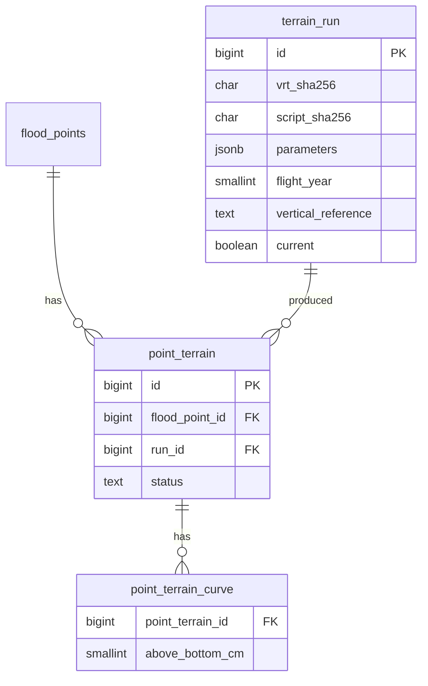
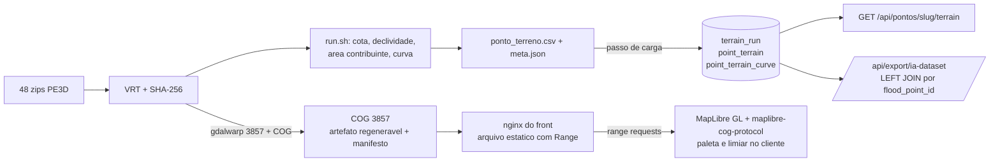

# 0008 — Armazenamento do terreno do PE3D

- Status: **aprovado** (2026-10-10, Lucas, pergunta 24): migração V9 do terreno e camada COG em EPSG:3857. Checkpoint Máximo: v1 reprovada; v2 aprovada com 2 ressalvas aplicadas (limites do critério 4 fixados antes de medir; vizinho mais próximo).
- **Resultado do critério 4 (2026-10-10, F3-FRONT-01): C1 REPROVADO** — tráfego do zoom 14 ao 17 = 20,95 MB (limite 5 MB; só o zoom 14 = 4,53 MB, 129 requisições 206) e tempo até aparecer = 5,8 s de mediana (5,69/5,80/5,96; limite 3 s), Playwright 1.48.2, Fast 4G (9/1,5 Mbps, 170 ms) + CPU 4×, ponto AGAMENON_DERBY, máquina sem GPU. Critério (iii) passou (`@geomatico/maplibre-cog-protocol@0.10.0`, MIT). **Decisão efetiva: C3 (tiles pré-gerados)**, pelo plano de retorno; limites mantidos. COG 3857 = 459 MB (estimativa era 0,35 GB) em 21,8 s; relatório `docs/revisao/fase-3/F3-FRONT-01.md`.
- Data: 2026-10-10
- Decisores: Agente 5 (Engenheiro Geoespacial, autor) com Agentes 4 (Dados) e 1 (Backend), checkpoint Máximo (pendente), Lucas
- Tarefa: F3-GEO-02

## Contexto

O MAPi precisa de duas coisas do terreno do PE3D (MDT 1 m, voo de 2016):

1. **Atributos por ponto crítico** (cota da rua, declividade, área contribuinte, profundidade da depressão, curva cota-volume). São features do modelo e entram no CSV de treino por junção (requisito do autor).
2. **Uma camada visual** no front (MapLibre GL): hipsometria e, no futuro, "áreas abaixo da cota de maré".

Fatos medidos ou estimados (fonte: `docs/TERRENO-PE3D.md`, branch `feat/terreno-pe3d`):

| Item | Valor | Natureza |
|---|---|---|
| Folhas / zips | 48 / 1.111.529.514 bytes (1,11 GB) | medido (`inventario.csv`) |
| Recorte COG de 1 km x 1 km por ponto | 2,80 a 3,02 MB | medido |
| COG do mosaico inteiro | ≈ 1,21 GB (1,12 a 1,33) | estimado de 4 folhas urbanas |
| COG do bbox dos pontos + 2 km | ≈ 0,35 GB (0,32 a 0,38) | estimado |
| Pontos críticos | 5; 4 com terreno; JABOATAO_CENTRO sem folha (pixel válido mais próximo a 1.410 m) | medido (`cobertura.csv`) |
| Processamento completo | ≈ 80 s com `tools/terreno/run.sh` | medido |
| Saídas atuais (CSV, COGs, JSON) | 12 MB | medido (`du -sh terreno`) |
| Disco local | `/home` ≈ 4,5 GB livres; `/` ≈ 8 GB | medido (`df -h`) |

Restrições herdadas:

- ADR 0005: PostgreSQL 16 + TimescaleDB + PostGIS 3.6.4 numa imagem; a migração V7 já cria `postgis` e `postgis_raster`.
- ADR 0009 (aprovado pelo autor em 2026-10-10): enquanto Δ (NR da DHN para datum do MDT) não for aprovado, nenhuma camada, regra ou feature compara cota absoluta com maré. A camada inicial é **hipsometria e cotas relativas**. `cota_rua_m` e a curva cota-volume são calculáveis já, no datum do MDT.
- Pontos críticos novos são raros: 5 hoje, cadastro manual (`flood_points`).
- Reprodutibilidade: hash do VRT, folhas, versão do script e parâmetros precisam acompanhar cada número.

## Opções consideradas

### A — Só atributos derivados em tabela relacional (`point_terrain` + curva cota-volume)

- A favor: atende o requisito do autor sem custo; kilobytes; junção direta no export; nenhum serviço novo.
- Contra: sem raster, o front não desenha hipsometria. Isso não cobre a necessidade 2.
- Custo: nenhum de infraestrutura.
- Uso: é a base de qualquer escolha (os atributos ficam no banco de qualquer forma). Sozinha, insuficiente.

### B — Raster completo no PostGIS (`postgis_raster`)

- In-db (`raster2pgsql`, tiles de raster em linhas): 1,21 GB de mosaico (ou 0,35 GB do bbox) dentro do banco que também guarda a série temporal. Infla backup, `pg_dump` e volume do compose, com disco local de ≈ 4,5 GB livres. Para o front ainda faltaria um gerador de tiles: `ST_AsPNG`/`ST_AsRaster` por requisição é lento e exigiria um serviço entre o banco e o MapLibre.
- Out-db (raster referencia arquivo no disco): o banco passa a depender de caminho de arquivo; o arquivo continua existindo, então não elimina o armazenamento em arquivo e acrescenta acoplamento (o caminho tem de existir dentro do container do banco).
- A favor: consulta espacial em SQL (`ST_Value`, `ST_Clip`) num só lugar; extensão já instalada (V7).
- Contra: não resolve o desenho no front; troca simplicidade por operação de banco; pesa no backup para um dado que muda uma vez a cada novo voo. Nenhum requisito do projeto exige consultar pixels em SQL: os atributos já são calculados em lote (80 s).
- Descartada.

### C — Raster em arquivo + atributos no banco

Os atributos vão para o banco (A). O raster fica fora do banco, como arquivo estático. Variações para chegar ao front:

- **C1 — COG em EPSG:3857 servido como arquivo estático e lido direto pelo cliente** (range requests).
- **C2 — COG + servidor de tiles (TiTiler ou similar).**
- **C3 — Tiles raster pré-gerados** (pasta XYZ ou um arquivo PMTiles), servidos como estáticos.

**C2.** Flexível (paleta e limiar dinâmicos no servidor), mas é um serviço Python a mais para subir, monitorar e atualizar, com acesso ao COG e CORS. Para 5 pontos e uma camada que muda a cada novo voo, é mais operação do que o problema pede. Fica como caminho de evolução.

**C1 x C3 (a escolha real).** A primeira versão deste ADR descartou C1 com dois argumentos errados (cliente baixaria o COG inteiro; reprojeção no navegador). Corrigindo:

- Um COG é lido por **range requests**: o cliente baixa o cabeçalho e só os blocos da área visível, usando as overviews em zoom baixo. Não baixa 0,35 GB nem 1,21 GB.
- A reprojeção EPSG:31985 para 3857 é feita **uma vez no build** (`gdalwarp` seguido de COG em 3857), não no navegador. A cota é resampleada por **vizinho mais próximo** (`-r near`): a camada de limiar ("abaixo de uma cota") compara a cota bruta pixel a pixel, e o bilinear criaria valores intermediários perto do limiar. Os atributos por ponto não são afetados, porque vêm do raster original em 31985.
- Ambos exigem plugin de protocolo no MapLibre: C1 usa `maplibre-cog-protocol`; C3 com PMTiles usa `pmtiles`. A dependência não separa as opções. C3 com pasta XYZ não exige plugin (raster tiles nativos do MapLibre).

| Critério | C1 (COG 3857, range) | C3 (tiles pré-gerados) |
|---|---|---|
| Dado guardado | cota **bruta** float32 | pixel já colorido (PNG) ou, se Terrain-RGB, cota codificada |
| Limiar dinâmico no cliente ("áreas abaixo de uma cota"; futura camada de maré com Δ do ADR 0009) | sim, sem regenerar nada | não, salvo Terrain-RGB (perde a simplicidade que motivou C3) |
| Maturidade da biblioteca | `maplibre-cog-protocol`: projeto pequeno, mantenedor único [verificar versão, manutenção e licença antes de adotar; sem fonte] | tiles XYZ: nativo do MapLibre; PMTiles: projeto Protomaps, mais usado [verificar] |
| Tamanho em disco | 1 arquivo; ≈ 0,35 GB estimado para o bbox (em 3857 e com overviews pode mudar) [medir] | pirâmide de tiles de tamanho [sem fonte; medir] |
| Tráfego por visita | blocos float32 comprimidos da área visível; decodificação DEFLATE e paleta no cliente (CPU de celular a medir) | PNGs pequenos, sem decodificação especial |
| Cache | por faixa de bytes; exige `ETag`/`Last-Modified` estáveis | cache HTTP trivial por tile, CDN-friendly |
| nginx | arquivo estático com suporte a `Range` (nativo); não aplicar gzip nem recompressão sobre o `.tif`; `Accept-Ranges: bytes`; CORS se a origem for outra | arquivo estático; PMTiles também exige `Range`; pasta XYZ não |
| Acessibilidade e legenda | paleta no cliente: troca de paleta (daltonismo), legenda gerada do mesmo array de cores, valor da cota ao tocar no mapa | paleta fixa no tile; trocar exige regenerar; legenda mantida à mão em sincronia |
| Reprodutibilidade | 1 arquivo, 1 hash | 1 hash (PMTiles) ou manifesto de pasta |
| Operação | um arquivo para copiar | pasta ou arquivo para copiar |

## Decisão

**Atributos por ponto no banco (`terrain_run`, `point_terrain`, `point_terrain_curve`) e raster como um único COG em EPSG:3857 servido como arquivo estático pelo nginx do front e lido pelo cliente por range requests (C1). Raster fora do banco; sem servidor de tiles.**

Por quê, em uma frase: o COG guarda a **cota bruta**, então o limiar ("abaixo de uma cota") e a paleta ficam no cliente. Isso cobre a camada inicial (hipsometria relativa) e a camada de maré quando o Δ do ADR 0009 for registrado, sem regenerar tiles e sem serviço novo. C3 venceria se a medição abaixo reprovar C1.

Detalhes:

1. **Fonte de verdade**: os 48 zips do PE3D (fora do git, 1,11 GB), o VRT identificado por SHA-256 e o script `tools/terreno/terreno.py` (SHA-256). O COG 3857 é **artefato de build regenerável**, não dado primário; não vai ao git.
2. **Build do COG**: `gdalwarp` do VRT (recortado ao bbox dos pontos + 2 km) para EPSG:3857, depois COG com `COMPRESS=DEFLATE`, `PREDICTOR=3`, overviews. O tempo desta etapa **não está nos 80 s medidos**: [sem fonte; medir quando implementada].
3. **Camada inicial (ADR 0009 aprovado, mas Δ ainda sem valor)**: só hipsometria, cota do MDT, legenda "cota do MDT, não comparável com maré". Nenhuma camada ou limiar compara cota absoluta com maré até haver Δ ± incerteza registrado. Quando houver, o cliente aplica o limiar sobre a cota bruta, e a incerteza do Δ deve aparecer na legenda.
4. **Critério de aceitação de C1 (medir antes de fechar)**: (i) tráfego da camada de terreno em uma visita típica (abrir o mapa num ponto e navegar do zoom 14 ao 17) **≤ 5 MB**; (ii) tempo até a camada aparecer **≤ 3 s** no Chrome DevTools com perfil "Fast 4G" e CPU 4× mais lenta (aproximação de celular de gama média); (iii) `maplibre-cog-protocol` mantido, com licença compatível, e funcionando com a versão de MapLibre do front. Se (i) ou (ii) reprovarem, ou (iii) falhar, a decisão passa para C3 (reabertura abaixo). Os limites de (i) e (ii) foram **fixados antes de qualquer medição** (proposta do Arquiteto, 2026-10-10, ajustável pelo autor só antes de medir), para que a escolha entre C1 e C3 não seja feita depois de ver o resultado.
5. **Manifesto do build** (arquivo `terrain_manifest.json` ao lado do COG, e copiado em `terrain_run`): hash do VRT, bbox, CRS de saída, método de resampling, paleta (se algum PNG for gerado), níveis de overview (zooms), versão do GDAL e digest da imagem, parâmetros do COG e **hash SHA-256 do arquivo final**.
6. **Carga no banco por script, não pelo backend**: `tools/terreno/` gera o CSV; um passo de carga (`\copy` ou script) grava as linhas. O backend Java só lê. Raster nunca passa pela JVM.
7. **Operação pela Prefeitura/Defesa Civil**: novo ponto crítico = cadastrar em `flood_points`, rodar `tools/terreno/run.sh` com o novo ponto, carregar o CSV e copiar o COG novo para o nginx. Sem serviço novo.
8. **JABOATAO_CENTRO** (sem folha): linha com `status = 'NO_DATA'` e atributos nulos. Não se interpola; não se usa o pixel a 1.410 m.

### Esquema proposto (migração aditiva futura) **[aprovar]**

Número: próximo livre na criação. Hoje V1 a V8 existem (V7 = extensões PostGIS, V8 = auditoria de `flood_predictions`, na branch `integracao/fase-2`), então V9 se nada entrar antes; confirmar na data. Aditiva: só `CREATE TABLE`. Flyway é a fonte única do schema (ADR 0003). Nomes em inglês `snake_case`, como no baseline e no ADR 0006.

**`terrain_run`** (uma linha por execução do pipeline; proveniência comum a todos os pontos)

| Coluna | Tipo | Unidade / conteúdo |
|---|---|---|
| `id` | `bigint` identity, PK | |
| `run_at` | `timestamptz` not null | UTC (ADR 0001) |
| `vrt_sha256` | `char(64)` not null | hash do mosaico (hoje `d63e3b12...5408070`; fonte: `mosaico.vrt.sha256`) |
| `script_sha256` | `char(64)` not null | hash de `terreno.py` (trocar por commit quando o script entrar no git) |
| `gdal_image_digest` | `text` not null | digest da imagem GDAL (hoje `sha256:383e17c2...`) |
| `software_versions` | `jsonb` not null | GDAL, Python, numpy |
| `sheets` | `text[]` not null | folhas de origem usadas |
| `parameters` | `jsonb` not null | raio da cota (m), janelas de declividade (m), janela de hidrologia (m), snap (m), passo da curva (cm), altura máxima da curva (m) |
| `flight_year` | `smallint` not null | 2016 (data exata do voo: pendente do relatório do PE3D) |
| `vertical_reference` | `text` not null | `'MDT datum not confirmed (hypothesis: normal height, Imbituba/REALT 2018)'`; declarada, sem Δ (ADR 0009) |
| `vertical_reference_adr` | `text` | `'0009'` |
| `raster_manifest` | `jsonb` | conteúdo do `terrain_manifest.json` (hash do COG, bbox, resampling, versão do GDAL, paleta, zooms) |
| `raster_sha256` | `char(64)` | hash do COG 3857 final; nulo se a execução não gerou raster |
| `current` | `boolean` not null default false | uma só vigente (índice único parcial `WHERE current`) |

**`point_terrain`** (um registro por ponto e execução; histórico preservado; o export usa a vigente)

| Coluna | Tipo | Unidade / conteúdo |
|---|---|---|
| `id` | `bigint` identity, PK | |
| `flood_point_id` | `bigint` not null, FK `flood_points(id)` | |
| `run_id` | `bigint` not null, FK `terrain_run(id)` | |
| `status` | `text` not null, check in (`OK`, `NO_DATA`) | `NO_DATA` = ponto fora das folhas |
| `source_sheet` | `text` | folha do pixel do ponto |
| `street_elevation_m` | `double precision` | m, datum do MDT (mediana, raio dos parâmetros) |
| `elevation_pixel_count` | `smallint` | pixels válidos usados |
| `mean_slope_pct` | `double precision` | %, `gdaldem slope -p` (Horn), média na janela |
| `max_slope_pct` | `double precision` | % |
| `depression_depth_m` | `double precision` | m, `fill − MDT` no ponto |
| `contributing_area_m2` | `double precision` | m², D8, snap dos parâmetros |
| `bottom_elevation_m` | `double precision` | m, cota do fundo da bacia da curva |
| `bottom_distance_m` | `double precision` | m, distância fundo-ponto |
| `diagnostics` | `jsonb` | sensibilidade ao snap (0/5/10/20 m), `bacia_toca_borda_janela`, `bacia_adjacente_a_nodata` |
| `created_at` | `timestamptz` not null | UTC |

Restrições: `UNIQUE (flood_point_id, run_id)`; atributos nulos se `status = 'NO_DATA'`. Raio e janela que viram a coluna única (o CSV traz 3 m e 5 m; 50 m e 100 m) ficam em `parameters`, não duplicados em colunas. [Proposta 3 m e 100 m: sem fonte além da skill `mapi-geo-pe3d`; comparar com a sensibilidade medida, por exemplo cota 1,392 vs 1,401 no Ibura.]

**`point_terrain_curve`** (curva cota-volume; 41 níveis por ponto, passo de 5 cm, de 0 a 2 m acima do fundo; fonte: `curva_cota_volume.csv`)

| Coluna | Tipo | Unidade / conteúdo |
|---|---|---|
| `point_terrain_id` | `bigint` not null, FK | |
| `above_bottom_cm` | `smallint` not null | cm acima do fundo da bacia (0, 5, ..., 200) |
| `elevation_m` | `double precision` not null | m, datum do MDT |
| `cumulative_volume_m3` | `double precision` not null | m³ |
| `m3_per_cm` | `double precision` not null | m³ por cm |
| `wet_area_m2` | `double precision` | m² |

PK `(point_terrain_id, above_bottom_cm)`. Ordem de grandeza: 4 pontos x 41 linhas = 164 linhas (calculado do CSV).

Nenhuma coluna guarda "nível de maré", "folga" nem "abaixo da maré": dependem do Δ do ADR 0009, ainda sem valor.

### Fluxos

### Como o backend e o export consomem

Sem implementar agora; contrato para a tarefa de backend.

- **Endpoint de terreno**: `GET /api/pontos/{slug}/terrain`, seguindo o padrão `/api/pontos/...` existente (renomear `/api/pontos` não cabe neste ADR). Campos em camelCase e inglês (`floodPointSlug`, `status`, `streetElevationM`, `meanSlopePct`, `maxSlopePct`, `depressionDepthM`, `contributingAreaM2`, `volumeCurve[]` opcional, `provenance {vrtSha256, scriptSha256, flightYear, verticalReference, runAt}`). Lê a execução `current`. `verticalReference` sempre preenchido; a documentação diz que `streetElevationM` não é comparável com maré até haver Δ. Ponto `NO_DATA` responde 200 com `status = "NO_DATA"` e atributos nulos, nunca zero. O endpoint não serve raster.
- **Export**: o `DataExportController` (`/api/export/ia-dataset`) faz `LEFT JOIN` de `point_terrain` (execução `current`) por `flood_point_id` e acrescenta `terrain_street_elevation_m`, `terrain_mean_slope_pct`, `terrain_depression_depth_m`, `terrain_contributing_area_m2`. Pontos sem dado saem com nulo; o tratamento é do pipeline de ML. Incluir `terrain_run_id` (ou o hash do VRT) no export. A curva não vai no CSV por linha; se virar feature, entra como escalares derivados, a definir no ADR de features.
- **Front**: a URL do COG vem de configuração do front (variável de ambiente), não da API. A paleta e a legenda são do front.

## Consequências

Melhora:
- Atributos auditáveis: cada linha aponta para hash do VRT, hash do script, parâmetros e referência vertical declarada; o raster tem hash e manifesto próprios.
- Banco pequeno (centenas de linhas), backup inalterado, nenhum serviço novo; custo adicional = um arquivo estático no nginx.
- A camada de maré futura não exige regenerar raster, só mudar o limiar no cliente.
- Reexecutar o pipeline de atributos custa ≈ 80 s (medido).

Piora ou fica pendente:
- Dependência de `maplibre-cog-protocol` (projeto pequeno [verificar]) e de CPU do cliente para decodificar float32; mitigação: critério de aceitação 4 e plano de retorno para C3.
- nginx precisa servir `Range` corretamente, sem gzip sobre o `.tif`, com CORS e cache de validação; configuração a testar.
- Tamanho do COG 3857 e tempo do build do raster: [sem fonte; medir]. Os 0,35 GB são de COG em 31985.
- O limiar no cliente expõe a cota bruta a quem baixar o arquivo; isso é aceitável para dado público do PE3D, mas confirmar a licença de redistribuição em `FONTES-E-LICENCAS.md` [verificar].
- MDT de 2016, terreno nu, sem galerias; a área contribuinte de Agamenon (61 m²) e Mascarenhas (34 m²) não representa a captação real (fonte: `TERRENO-PE3D.md`, seção 5). O `diagnostics` torna isso visível.
- Validação independente da hidrologia contra `richdem`/`whitebox` não foi feita (pendência do `TERRENO-PE3D.md`).

O que muda: uma migração aditiva **[aprovar]**; passo de carga e passo de COG 3857 em `tools/terreno/`; um `LEFT JOIN` no export; um endpoint de leitura; uma camada raster no front; configuração de `Range` no nginx.

Como medir: (i) após a carga, 5 pontos (4 `OK`, 1 `NO_DATA`) conferindo com `ponto_terreno.csv`; (ii) `run.sh` reproduz o mesmo `vrt_sha256` e o mesmo `raster_sha256` com as mesmas versões; (iii) MB trafegados e tempo até a camada em celular de gama média (critério 4).

## Condições que reabririam a decisão

1. O critério de aceitação 4 reprovar (tráfego, tempo em celular ou plugin sem manutenção/incompatível): adotar C3 (tiles pré-gerados) e, se o limiar dinâmico ainda for exigido, Terrain-RGB.
2. Servir o limiar do nível de maré previsto exigir cálculo mais pesado ou proteção do dado: avaliar C2 (servidor de tiles).
3. Os pontos críticos passarem de dezenas, ou a Prefeitura passar a cadastrar áreas: avaliar B (raster consultável em SQL) ou C2.
4. Novo voo, MDE ou MDT de resolução diferente fazendo o COG 3857 exceder o disco do host do nginx.
5. A licença do PE3D não permitir redistribuir a cota bruta publicamente.
6. A tabela de proveniência não bastar para a banca reproduzir os números.
7. A Prefeitura exigir edição de pontos ou terreno por interface: passa a valer um fluxo de carga com perfil e auditoria.
