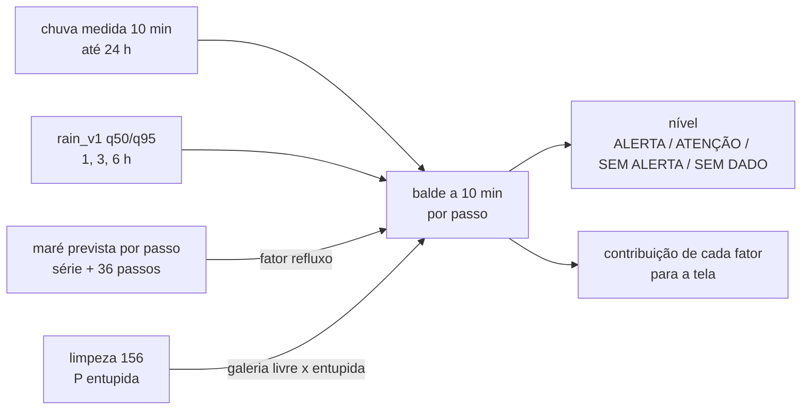

# 0030 — Alerta único por ponto

- Status: aprovado (Lucas, 22/11/2026: aval para completar todas as fases da onda 16, ponto de parada C incluído)
- Data: 2026-11-22
- Decisores: Claude (autor), Lucas
- Tarefa: O16-F2 (onda 16, Fase 2)

## Contexto

Em 22/11 o ciclo do alerta por ponto (3 min) calculava dois alertas de alagamento diferentes
(`docs/ONDA16-ESTADO-INICIAL.md`, seção 1):

| | Mostrado na tela | Invisível |
|---|---|---|
| Rota da IA | `POST /v1/flood/forecast` (rain_v1 q50/q95 → balde a 10 min → 15 cm) | `POST /v1/bucket/point10` (ADR 0026) |
| Horizonte | 1, 3 e 6 h | 60 min |
| Maré (refluxo) | não | sim, da hora de agora até +60 min |
| Limpeza (Central 156) | não | sim, mistura galeria livre e entupida |
| Gravação | `flood_forecast_point` (V38), SSE `flood-forecast` | `alert_point_state` e `alert_point_cycle` (V34), SSE `alert-state` |
| Quem lê | mapa, card, painel | ninguém (`useAlertaPontos` não é chamado) |

Os dois ajustes da onda 14 (refluxo, ADR 0009 emenda 3; limpeza, `docs/PRE-REGISTRO-ENTUPIMENTO-156.md`) só existiam no
alerta que ninguém via. A Fase 1 deixou um efeito colateral registrado: com a capacidade da galeria entupida
`f_E = 0` ([sem fonte], faixa 0 a 0,5) e o regime permanente da emenda 1 (π_E = 0,596 em Mascarenhas), o alerta do
ADR 0026 passaria a dar `PROVAVEL` em Mascarenhas com qualquer chuva forte (π_E ≥ 0,5 = `mapi.limpeza.prob-on`).

## Opções consideradas

### A — Manter os dois alertas

A favor: nada muda. Contra: o que se calcula, o que se valida e o que se mostra continuam diferentes; a maré e a
limpeza não chegam à tela; qualquer validação teria de escolher um dos dois.

### B — Mostrar o alerta do ADR 0026 e aposentar o `/v1/flood/forecast`

A favor: já tem maré e limpeza. Contra: horizonte de 60 min só; cenário q80 em vez de q50/q95; não tem SHAP, contrafactual
nem decomposição; as telas da onda 13 a 15 foram feitas para o `/v1/flood/forecast`.

### C — Um alerta só: o `/v1/flood/forecast` recebe a maré e a limpeza como fatores por ponto

A favor: um caminho, um número, uma validação. A maré entra em todo o horizonte (6 h), porque é previsível. Contra: o
ciclo manda mais dados para a IA (maré de até 180 passos); a limpeza exige decidir como a mistura vira nível.

## Decisão

Opção C. O nível mostrado continua vindo de `POST /v1/flood/forecast`, com a mesma regra (ALERTA se a lâmina do cenário
q50 chega a 15 cm; ATENÇÃO se só a do q95 chega). Maré e limpeza viram **fatores por ponto**, cada um com um modo
configurável e com a sua contribuição na resposta.

### 1. Modos dos fatores

| Modo | O que faz |
|---|---|
| `OFF` | não calcula |
| `INFO` | calcula e devolve a contribuição; não muda o nível |
| `NIVEL` | calcula, devolve a contribuição e muda o nível |

| Fator | Modo padrão | Por quê |
|---|---|---|
| Refluxo de maré | `NIVEL` nos pontos com saída cadastrada (Ibura, Derby, Mascarenhas) | maré prevista pela tábua e pela reserva harmônica; soleira do cadastro ESIG; Δ = 0,821 m com fonte (ADR 0009, emenda 1) |
| Limpeza | `INFO` | o efeito no nível depende de `f_E`, que não tem fonte. Com `f_E = 0` e π_E = 0,596, Mascarenhas daria ALERTA com qualquer chuva que enchesse uma galeria fechada: o nível seria decidido por um número sem fonte. Passa a candidato a `NIVEL` quando a Fase 4 der uma faixa de capacidade com fonte |

Pontos sem saída cadastrada (CIn, Jaboatão) devolvem o refluxo como `NAO_SE_APLICA` com o motivo. Pontos com menos de 10
limpezas casadas (CIn) devolvem a limpeza como `SEM_DADO` com o motivo; isso nunca vira "galeria livre" escondida.

### 2. Maré em cada passo do horizonte

A API manda a maré prevista (m, NR da DHN) no fim de cada passo da série medida e nos 36 passos de 10 min das próximas
6 h, da mesma fonte da maré do ponto (`TideLevelService`: tábua TabuaMare e reserva harmônica, regra V36). A previsão de 6 h
usa a maré das próximas 6 h, não a de agora. Fator por passo, igual ao do ADR 0009 emenda 3:

`f_refluxo = clamp((soleira_NR + D − maré_NR) / D, 0, 1)`, com `soleira_NR = soleira_MDT − viés_MDT + Δ`.

- Cenário central: viés do MDT = 0 (decide o nível).
- Cenário de viés: MDT − RN = −0,369 m (mediana em 17 RRNN em terra, `docs/extratos/referencia-vertical.md`): a soleira
  sobe 0,369 m. Calculado em todo ciclo e devolvido como sensibilidade (lâmina e nível no cenário). Nunca decide.
- Falta maré em algum passo com o refluxo em `NIVEL`: `SEM_DADO` com motivo `MARE_AUSENTE`. Maré ausente nunca vira
  "maré baixa".

### 3. Limpeza

A probabilidade de a galeria estar entupida vem do `LimpezaService` (regime pelo tempo desde a limpeza ou regime permanente,
emenda 1 da 156). O balde roda duas vezes, com a galeria livre e com a capacidade `f_E`. Para cada horizonte e cenário:

`P(lâmina ≥ 15 cm) = (1 − p_E) · 1[livre ≥ 15] + p_E · 1[entupida ≥ 15]` (mistura, como no pré-registro).

Em `NIVEL`: ALERTA se essa probabilidade, no cenário q50, chega a `prob-on` (0,5); ATENÇÃO se só a do q95 chega. Em `INFO`
(padrão): só a contribuição ("se a galeria estiver entupida, chance de 60%, a lâmina chegaria a 42 cm em 3 h").

### 4. Contribuição de cada fator na resposta

`explanation.factors.refluxo`: modo, se foi aplicado, soleira, Δ, viés, fator agora, períodos do horizonte em que a maré
reduz a saída (início, fim, redução média e máxima, em UTC), diferença de lâmina por horizonte e cenário (com e sem maré),
cenário de viés e um texto ("a maré reduz a saída da galeria em 62% entre 14h00 e 15h30").

`explanation.factors.limpeza`: modo, regime, p_E, f_E, dias desde a limpeza, lâmina com a galeria entupida e probabilidade
da mistura por horizonte e cenário, o nível que a mistura daria e um texto.

A decomposição por passo ganha a maré e o fator de saída de cada passo.

### 5. O alerta do ADR 0026

Deixa de gravar nível de alagamento e fica **só para a conferência de latência e a conferência da chuva forte**:

- O ciclo para de chamar `POST /v1/bucket/point10` (`mapi.alerta.ponto-balde.enabled = false`; reversível).
  `point_flood` passa a `DESLIGADO` (V47), sem lâmina.
- `alert_point_cycle` continua gravando os instantes de cada trecho; o instante da IA passa a ser o da resposta do
  `/v1/flood/forecast` e o envio pelo SSE passa a ser o do `flood-forecast`. A latência medida passa a ser a do alerta
  mostrado.
- `rain_alert` continua só como entrada da conferência diária da chuva forte (confere o limiar de probabilidade do rain_v1
  contra a chuva medida). Não é alerta de alagamento e não vai para a tela. Os SSE `alert-state` e `alert-transition` param
  (nenhuma tela os lê).
- `useAlertaPontos` sai do front.

Por que não aposentar de vez: o ciclo do ADR 0026 é onde a latência da estação ao SSE é medida desde 17/11, e a conferência
diária tem relatórios gravados (`alert_latency_report`). Aposentar perderia essa série sem ganho. O `/v1/bucket/point10`
continua na IA para a reprise e o registro de 5 anos.

### 6. Gravação

`flood_forecast_point` (V38) ganha, na V47, as colunas `refluxo_mode`, `limpeza_mode`, `refluxo_delta_cm` (efeito da maré
na lâmina do cenário e horizonte servidos), `limpeza_p_entupida` e `bias_scenario_level`. A resposta inteira, com as
contribuições, continua no `payload`.

## Consequências

- Melhor: o que se calcula, o que se valida e o que se mostra passam a ser a mesma coisa. A tela pode dizer "a maré segura a
  saída até 15h30" porque esse número está no alerta.
- Pior: o refluxo muda o nível em Ibura, Derby e Mascarenhas sem validação contra alagamento (o viés do MDT é a maior
  incerteza; o cenário de viés vai junto em todo ciclo). Ibura e Derby continuam `TERRENO_EM_REVISAO` até a Fase 3.
- Medir: quantas vezes e em quanto o refluxo e a limpeza mudam a lâmina nos 5 anos de chuva medida
  (`projeto-mapi-ai/reports/fatores/RELATORIO.md`); a mesma conta entra na validação de 2027 (Fase 9).
- Modo sombra continua ligado.

## Condições que reabririam a decisão

- Faixa de capacidade da galeria com fonte (Fase 4): a limpeza pode passar a `NIVEL`.
- Medida do viés do MDT na saída da galeria ou constantes harmônicas do CHM (pedido 01): muda o cenário central.
- Validação de 2027 mostrar que o refluxo piora o POD ou o FAR contra o mesmo alerta sem refluxo.
