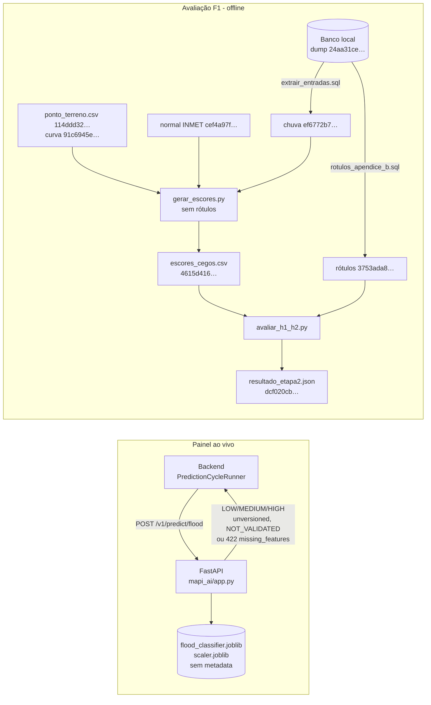

# Arquitetura da IA (projeto-mapi-ai)

- Data: 2026-10-11 · Tarefa: F5-ARQ-01 · Autor: Arquiteto (nível Máximo)
- Base: duas branches, ambas no GitHub (`git ls-remote --heads origin`, 2026-10-11) e nenhuma em `main` no momento desta
  escrita (a fusão, junto com os commits do autor em `feature/cenarios-alagamento-ia`, está prevista para 2026-10-11):
  - `fix/contrato-ia` @ `331f6c5`: serviço de inferência usado pelo painel. Parte de `feature/cenarios-alagamento-ia` (`42a0fc3`)
    e acumula `docs/remove-mapi-edge` e `feat/model-version-unversioned`.
  - `feat/avaliacao-f1` @ `abbd831`: avaliação pré-registrada da dissertação (pasta `avaliacao/`). Parte de `main` (`6bbdc15`).
- Fontes: PROGRESSO (F1-IA-02, F4-IA-04/08/13/15, F5-ACAD-02), `docs/MODELAGEM-IA.md`, ADR 0007,
  `docs/PRE-REGISTRO-AVALIACAO.md`, `docs/RESULTADOS-AVALIACAO-F1.md`, `avaliacao/README.md` (no repositório da IA).
- A rede de Petri está fora do escopo atual (decisão do autor, 2026-10-11; PROGRESSO, "Decisões").

## 1. Visão atual

O repositório tem hoje duas partes com papéis diferentes. Elas não se misturam.

### 1.1 Serviço de inferência (painel ao vivo)

FastAPI com `POST /v1/predict/flood` e `GET /health` (`mapi_ai/app.py` em `fix/contrato-ia`). Carrega
`models/flood_classifier.joblib` e `models/scaler.joblib`, os mesmos artefatos sem metadata do início
(F0-A01; versionados em `42a0fc3`). Por isso o painel trata a saída como demonstração:

- a resposta traz `model_version = "unversioned"` e `model_validation_status = "NOT_VALIDATED"`
  (ADR 0007 §3 e emenda 1; PROGRESSO, F4-IA-04 e F4-IA-08);
- feature ausente ou nula devolve 422 com `missing_features`, em vez de virar 0,0 (PROGRESSO, F4-IA-08);
- lat/lon ausente devolve 422 (antes devolvia 500);
- 8 testes pytest cobrem o contrato (`tests/test_contrato_predicao.py`; contados com `grep -c "def test"`).

O classificador não entra nos resultados da dissertação (decisão do Lucas, 2026-10-10: `flood_predictions`
fora dos resultados).

### 1.2 Avaliação F1 (dissertação)

Pasta `avaliacao/` em `feat/avaliacao-f1`, 948 linhas de Python em 9 arquivos, testes incluídos (medido em
F5-ARQ-01: `git show feat/avaliacao-f1:<arquivo> | wc -l`).

| Arquivo | Papel | Origem |
|---|---|---|
| `balde.py` | Modelo físico M1 (balde por ponto, método racional, curva cota-volume do terreno) | PROGRESSO, F4-IA-13 |
| `entradas.py`, `gerar_escores.py` | Etapa 1 cega: escores de M1 e das baselines B2 (normal mensal INMET) e B3 (regra IDF); o código aborta se encontrar coluna de rótulo | PROGRESSO, F4-IA-13 |
| `avaliar_h1_h2.py` | Etapa 2: junção com rótulos, AUC, bootstrap por episódio, regra de parada | PROGRESSO, F4-IA-15 |
| `dados/extrair_entradas.sql`, `extrair_entradas.sh` | Extração versionada da chuva do banco (hash `ef6772b7…`) | PROGRESSO, F5-ACAD-02 |
| `dados/rotulos_apendice_b.sql` / `.csv` | Consulta fixa dos rótulos e sua saída congelada (`3753ada8…`) | RESULTADOS §2 |
| `reproduzir.sh` | Modo `congelado` (offline) e modo `fontes` (a partir do banco), com conferência de hash em cada etapa | PROGRESSO, F5-ACAD-02 |
| `tests/` | 27 testes: balanço de massa do balde, valores de Clopper–Pearson, 8 casos de regressão contra a saída congelada de `f6ddacf` | PROGRESSO, F5-ACAD-02 |

### 1.3 Diagrama

## 2. O que mudou em relação ao início

| Métrica | Antes | Depois | Origem |
|---|---|---|---|
| Features zeradas na inferência | 9 de 28 | 0 imputação silenciosa: ausente vira 422 com `missing_features` | PROGRESSO, "Medidas" (F1-IA-02) e F4-IA-08 |
| Baselines implementados | 0 de 4 | B2 e B3 implementados, mais variantes de limiar de B3 e B3-24h | PROGRESSO, "Medidas"; RESULTADOS §8 |
| Artefatos com metadata | 0 de 3 | 0 de 3 (inalterado; agora exibidos como "não validado") | `handoff/fase-0.json`; REVISAO-CRITICA RC-03 |
| Horizonte do classificador legado | H = 0 (nowcast) | inalterado; a formulação supervisionada foi abandonada | PROGRESSO, F1-IA-02 e F4-IA-02 (descartado) |
| Reprodução da avaliação por comando único | não existia | `reproduzir.sh congelado` refaz escores e resultado byte a byte | PROGRESSO, "Medidas" (F5-ACAD-02) |
| Testes Python | nenhum registrado | 8 (contrato) + 27 (avaliação) | PROGRESSO, F4-IA-08 e F5-ACAD-02 |
| Código no GitHub | só `main` e 3 branches `feature/*` | `feat/avaliacao-f1` e `fix/contrato-ia` enviados | PRONTIDAO L1; PROGRESSO, "Decisões" (2026-10-11) |

Mudança de desenho, além do código: a pergunta deixou de ser "um classificador supervisionado prevê
alagamento por ponto com 3–6 h" e passou a ser F1, com o modelo físico como principal, a unidade dia × cidade
e as baselines com limiar externo (PROGRESSO, decisão de 2026-10-11; MODELAGEM-IA §0). O motivo foi a
escassez de rótulo: 18 dias com alagamento em 5 anos, todos com precisão de dia (PROGRESSO, F2-BACK-16 e
F2-BACK-18; MEMO-ESCASSEZ-DE-ROTULO).

## 3. O que continua pendente

| Pendência | Origem |
|---|---|
| As duas branches e `feature/cenarios-alagamento-ia` (commits do autor) entram em `main` por PR, previsto para 2026-10-11 | orquestrador; `git log main..` |
| O classificador do painel continua sem dataset, features nem validação registrados | RC-03; PRONTIDAO §3 |
| Ambiente Python sem hashes de pacote e sem versão de Python fixada (só `requirements.txt` com versões) | PRONTIDAO L15 |
| Restauração do dump em banco vazio não testada no modo `fontes`; criação do venv não exercitada | PROGRESSO, F5-ACAD-02 |
| 2ª análise (balde com pluviômetro ANA) classificada "não testada": o portão §2.1 reprovou (critério C2d). Reabrir só com novo pré-registro e critério de plausibilidade com fonte | PROGRESSO, F4-IA-17 (descartado); `docs/PRE-REGISTRO-ANALISE-2.md`, "Emendas" |

## 4. Visão alvo (só o que já está decidido)

- **Contrato** (ADR 0007): a IA aplica os limiares e os grava no `metadata.json` do artefato; o backend
  só valida enum, faixa e coerência. `model_version` real (o exemplo do ADR é `xgb-h3-2026.11.0+a1b2c3d`;
  ao cliente vai só a parte semântica, o hash fica na auditoria) substitui `unversioned` quando houver
  artefato versionado (ADR 0007, linhas 52, 59 e 80). A IA nunca emite `UNKNOWN`.
- **Validação** (ADR 0007, emenda 1): `VALIDATED` só passa a valer quando um ADR o permitir. Até lá, toda
  resposta é `NOT_VALIDATED`.
- **Limiares MEDIUM/HIGH**: pela taxa de falso alarme que a Defesa Civil aceitar (pedido 04); até lá,
  curva inteira, sem limiar operacional (PROGRESSO, decisão de 2026-10-10; MODELAGEM-IA, decisão 6).
- **Modelo principal**: o balde M1 parametrizado só por fontes externas, sem olhar os eventos. Qualquer
  avaliação nova sobre os 18 dias já usados é exploratória; avaliação nova exige outro pré-registro com
  dias disjuntos (PRE-REGISTRO-AVALIACAO; INTERPRETACAO-F1 §6).
- **Refluxo de maré (M1b)** só depois de o ADR 0009 fixar Δ.
- **Rede de Petri, emulador de ML, H3 e H4**: fora do escopo; voltam só com novo pré-registro (PROGRESSO,
  decisão de 2026-10-11).
