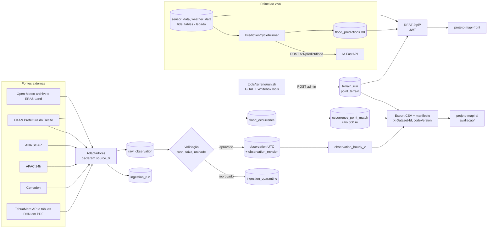

# Arquitetura do backend (projeto-mapi-api)

- Data: 2026-10-11 · Tarefa: F5-ARQ-01 · Autor: Arquiteto (nível Máximo)
- Base: branch `integracao/fase-2`, HEAD `013cd36` (migrações V1–V15; inclui `feat/ana-chuva-horaria` em `5c8dc53` e
  `feat/terreno-cog3857` em `013cd36`). No momento desta escrita, `main..integracao/fase-2` tinha 108 commits
  (`git rev-list --count`, 2026-10-11). A fusão em `main`, por PRs por tema, está prevista para 2026-10-11 (orquestrador).
- Fontes: `.claude/mapi/PROGRESSO.md` (tarefas e tabela "Medidas antes e depois"), ADRs 0001–0009,
  `docs/HANDOFF-fase-{0..3}.md`, `docs/API.md`, `docs/INGESTAO.md`, `docs/MODELO-DE-DADOS.md`.
- Números que medi nesta tarefa estão marcados "(medido em F5-ARQ-01)", com o comando.

## 1. Visão atual

O backend continua um monólito Spring Boot 3.4 em Java 21, com a arquitetura em camadas que o
`agents.md` descreve: `controller → service → repository → model`, com `dto` e `mapper` ao lado (ADR 0002).
O ADR 0002 decidiu manter essa estrutura e congelá-la com ArchUnit. Isso foi feito: 4 regras com
0 violações e 2 regras com violações antigas congeladas (PROGRESSO, F5-REV-02a).

Tamanho em `2e2e5bf` (antes das duas últimas integrações): 243 arquivos e 16 419 linhas em `src/main/java`; 54 arquivos
e 5 651 linhas em `src/test/java` (medido em F5-ARQ-01: `git show 2e2e5bf:<arquivo> | wc -l` somado por arquivo).
O método é diferente da "soma por pacote" da Fase 0 (RC-22), então a comparação com o antes é aproximada.

### 1.1 Peças principais

| Peça | O que faz | Decisão | Origem |
|---|---|---|---|
| Banco | PostgreSQL 16.15 + TimescaleDB 2.30.2 + PostGIS 3.6.4, imagem fixa `timescale/timescaledb-ha:pg16.15-ts2.30.2` | ADR 0005 | PROGRESSO, F2-DADOS-08 |
| Schema | Só Flyway, V1 a V15. O `TimescaleSetup.sql` ficou como histórico | ADR 0003 | `git ls-tree integracao/fase-2` |
| Fuso | Todo instante em UTC (`timestamptz`). Cada fonte declara `source_tz`; fonte sem fuso verificado fica em quarentena | ADR 0001, ADR 0006 | PROGRESSO, F2-BACK-01 |
| Pipeline de ingestão | `raw_observation` (bruto, só acrescenta) → validação → `ingestion_quarantine` ou `observation` (upsert versionado, `observation_revision`) → `observation_hourly_v` | ADR 0006 | `docs/INGESTAO.md` |
| Adaptadores no pipeline | Open-Meteo archive, ERA5-Land, CKAN (ocorrências), ANA (SOAP), APAC 24h, Cemaden, TabuaMare (API), tábuas DHN em CSV, maré horária interpolada | ADR 0006 | PROGRESSO, F2-BACK-12/14/15 |
| Fuso por fonte | Cemaden: verificado UTC−3 (V13). ANA: verificada UTC−3 (V14). APAC 24h: sem poder para o teste, segue em quarentena | ADR 0006 | PROGRESSO, F2-DADOS-07 e F2-DADOS-10 |
| Chuva horária da ANA | Leituras de 15 min (incremento com carimbo no fim) agregadas por hora em `observation_hourly_v`, exigindo 4/4 leituras; leitura após lacuna fica fora da soma (V15); coluna `ana_precipitation` (+`_missing`) no export. 2021–2024: 79 942 h válidas, máx. 34,8 mm/h | ADR 0006 | PROGRESSO, F2-DADOS-11 |
| Rótulo | `flood_occurrence` (CKAN, só "alagamento", precisão DAY/HOUR) + `occurrence_point_match` (raio gravado em `linkage_config`, padrão 500 m) | ADR 0006 | PROGRESSO, F2-BACK-12/13 |
| Export de treino | `/api/export/ia-dataset` + `/manifest`, cabeçalho `X-Dataset-Id`, colunas `label_day`/`label_h3`/`label_h6`, `<var>_missing` em vez de imputação, `terrain_*`, features de maré, `codeVersion` do build | ADR 0006 | PROGRESSO, F2-BACK-12/13/22, F5-REV-02a |
| Predição | `PredictionCycleRunner` chama a IA no ciclo de coleta e grava `flood_predictions` (colunas de auditoria V8). GET não grava. Resposta com `riskLevel`, `degradationReason`, `modelVersion` e `modelValidationStatus` | ADR 0007 e emenda 1 | PROGRESSO, F2-BACK-08/11, F4-IA-04 |
| Terreno | Tabelas `terrain_run`, `point_terrain`, `point_terrain_curve` (V9); carga idempotente por `POST /api/admin/terrain/runs`; leitura por `GET /api/pontos/{slug}/terrain` | ADR 0008 | PROGRESSO, F3-BACK-01 |
| Legado ainda ativo | `sensor_data`, `weather_data`, `flood_events`, `tide_tables` alimentam o painel do front. O pipeline novo alimenta o export | ADR 0006 §8 (aposentar só com aprovação) | REVISAO-CRITICA, RC-14 |
| Observabilidade local | Prometheus, Grafana e k6 no compose; gauge `mapi_collector_last_data_age_seconds{source}` | — | PROGRESSO, F2-BACK-07 |

### 1.2 Diagrama

## 2. O que mudou em relação ao início

Antes = linha de base de 2026-10-10 em `main` (`accba26`). Depois = `integracao/fase-2`.

| Métrica | Antes | Depois | Origem |
|---|---|---|---|
| Testes executados | 20 (0 falhas) | 240 (0 falhas), em `5c8dc53` | PROGRESSO, "Medidas"; surefire |
| Cobertura de linhas / ramos | 26,1% / 17,6% | 64,8% / 51,5% (em `5c8dc53`) | PROGRESSO, "Medidas"; JaCoCo 0.8.12. Métodos diferentes entre antes e depois (RC-08) |
| Cobertura do export | 0,6% | 74,6% (em `7ccc0e8`, antes da reescrita do export) | PROGRESSO, "Medidas" (RC-08 d) |
| Timeouts HTTP nos clientes externos | 0 | todos os clientes | PROGRESSO, F2-BACK-07 |
| Tratamentos de fuso nas mesmas colunas | 5 | 0 na série consolidada (`source_tz` por fonte) | PROGRESSO, "Medidas" |
| Gravações em `flood_predictions` por GET | 1 | 0 | PROGRESSO, F2-BACK-08 |
| Export de 5 anos, 1 ponto | 40,9 s (maior de 10) | 2,47 s (maior das 10 quentes; a fria deu 2,83 s) | PROGRESSO, F2-BACK-09 e F2-BACK-22. Bases diferentes (RC-07) |
| Operações no OpenAPI | 46 | 52 | PROGRESSO, "Medidas"; `docs/openapi/` |
| Violações das regras de camada | não medido | 0 (4 regras ArchUnit) | PROGRESSO, F5-REV-02a |
| Migrações Flyway | V1–V2 | V1–V15 | `git ls-tree integracao/fase-2` |
| Linhas em `observation` | 0 | 1,78 M (878 MB) | PROGRESSO, F2-BACK-09 |
| Portas de banco e IA em 0.0.0.0 | 2 | 0 | PROGRESSO, F1-QA-02 |
| `codeVersion` no manifesto | `"unknown"` | commit completo do build (`-dirty` se houver alteração) | PROGRESSO, F5-REV-02a |
| `MapiServiceImpl` | 775 linhas | 798 linhas (não foi dividido) | MATRIZ item 14; medido em F5-ARQ-01 (`git show … \| wc -l`) |

Correções que mudam a validade dos dados, além dos números:

- O realinhamento do rótulo ao pico de chuva (rótulo circular) foi removido. `align-events` responde 410
  (PROGRESSO, F2-BACK-06).
- O export não imputa mais constantes: ausente sai vazio, com `<var>_missing` (PROGRESSO, F2-BACK-12).
- `wipe-database` só existe no perfil `dev` (PROGRESSO, F2-BACK-05).
- Falha de fonte não vira mais "sucesso 0/0": os fallbacks `List.of()` saíram (PROGRESSO, F2-BACK-07).
- O CKAN de 2022 foi recuperado com mapeamento de colunas por perfil de valores. Os dias com alagamento
  na cidade passaram de 15 para 18 (PROGRESSO, F2-BACK-18).

## 3. O que continua igual ou pendente

| Pendência | Por que importa | Origem |
|---|---|---|
| H2 continua no `pom.xml` | O ADR 0004 manda tirar quando os testes Testcontainers cobrirem os antigos | `pom.xml` em `integracao/fase-2`, linha 141; RC-13 |
| `JWT_SECRET` com valor padrão público no compose; senhas padrão `mapi123` | Risco só se o stack sair da máquina local | `docker-compose.yml` em `integracao/fase-2`, linhas 11 e 61; MATRIZ item 10 |
| Painel lê o legado; export lê o pipeline | "Duas verdades no banco", risco que o próprio ADR 0006 apontava (linha 196) | RC-14 |
| PostGIS sem chamada `ST_*` no código | O ADR 0005 deu o raster como decisivo, mas o ADR 0008 tirou o raster do banco | RC-10 |
| Respostas do Nominatim não guardadas | A posição do rótulo não se reproduz do zero | RC-17 |
| 15 lacunas de documentação OpenAPI no código | `docs/API.md` lista quais | PROGRESSO, F2-BACK-03 |
| Plausibilidade da chuva da ANA | O critério C2d da F2-DADOS-11 reprovou na leitura literal (39167000, 2024: 781 mm contra piso de 800 mm `[sem fonte]`); valores > 30 mm aparecem sempre depois de lacuna | PROGRESSO, F2-DADOS-11 |
| Build dentro de git worktree lê o commit errado | Build de release tem de sair de clone comum ou do Docker com `GIT_COMMIT` | PROGRESSO, F5-REV-02a |

## 4. Visão alvo (só o que já está decidido em ADR)

- **Camadas, sem migração para domínio puro.** Lógica nova pode nascer sem anotação de framework; o que
  existe não é movido. ArchUnit impede regressão (ADR 0002).
- **Schema só por migração aditiva.** Remoção ou troca destrutiva só com ADR aprovado (ADR 0003).
- **Testes de repositório, migração e ingestão em Testcontainers; H2 sai** (ADR 0004).
- **Compressão e continuous aggregates só quando um gatilho for atingido:** mais de 5 GB, p95 do export
  de 5 anos acima de 5 s ou 50 pontos ou mais. Os três gatilhos estão marcados `[sem fonte]` no próprio ADR
  (ADR 0006 §9). Sem `drop_chunks`.
- **Aposentadoria de `sensor_data` e `weather_data`** só com aprovação explícita e migração própria
  (ADR 0006 §8).
- **Contrato de predição canônico** (ADR 0007): enum fechado `LOW/MEDIUM/HIGH/UNKNOWN`, `null` em falha,
  `modelValidationStatus` com padrão `NOT_VALIDATED`. `VALIDATED` vindo da IA é rebaixado até existir um ADR que o
  permita; só então a coluna entra no banco (emenda 1).
- **Terreno:** atributos por ponto no banco, raster fora dele, servido como tiles PMTiles pelo nginx do
  front (ADR 0008, decisão efetiva C3).
- **Referência vertical:** nenhuma regra, feature ou camada compara cota absoluta com maré até um Δ com
  incerteza ser aprovado em ADR (ADR 0009).
