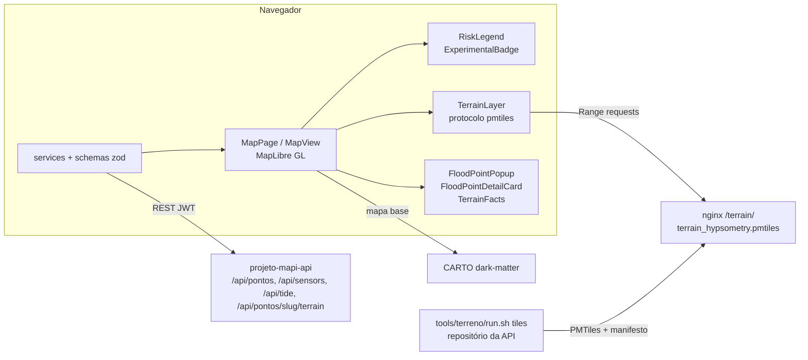

# Arquitetura do front (projeto-mapi-front)

- Data: 2026-10-11 · Tarefa: F5-ARQ-01 · Autor: Arquiteto (nível Máximo)
- Base: branch `wip/preservacao-2026-10-11` @ `8570183`, no GitHub. `main..8570183` tem 21 commits
  (`git rev-list --count`, 2026-10-11). Nada estava em `main` no momento desta escrita; a fusão por PR, junto com os
  commits do autor em `feature/frontend-hardening-audit`, está prevista para 2026-10-11 (orquestrador).
- Histórico da branch: `25640e2` preserva o WIP do Lucas junto com os patches de agentes F2-FRONT-01, F3-FRONT-01/02 e
  F4-FRONT-01a (PROGRESSO, decisão de 2026-10-11). Depois vieram `cb0dc70` (selo experimental), `7700e6b` (resíduos
  visuais), `237a5be` (rastreabilidade do painel) e `8570183` (terreno com zoom nativo máximo 16).
- Fontes: PROGRESSO (F1-FRONT-02, F2-FRONT-01, F3-FRONT-01/02/03, F4-FRONT-01a/b/c), ADRs 0007, 0008 e 0009,
  `docs/revisao/fase-3/` e `docs/revisao/fase-4/`.

## 1. Visão atual

SPA em React 19, TypeScript, Vite 8, MapLibre GL 5, `pmtiles` 4.5.0 e zod 4 (`package.json` em `237a5be`, inalterado em `8570183`).
Servida por nginx, que também entrega os tiles do terreno em `/terrain/` com suporte a Range (PROGRESSO,
F3-FRONT-01). O código fica em `src/features/` (64 arquivos), com `components/`, `hooks/`, `lib/` e `pages/`
ao lado (contagem por pasta com `git ls-tree`, medido em F5-ARQ-01).

| Peça | O que faz | Decisão | Origem |
|---|---|---|---|
| Contrato de predição | Schema zod tolerante: enum `LOW/MEDIUM/HIGH/UNKNOWN`, campos novos opcionais; `modelValidationStatus` ausente ou desconhecido vira `NOT_VALIDATED` | ADR 0007 e emenda 1 | PROGRESSO, F2-FRONT-01 e F4-FRONT-01b |
| Mapeamento de risco | Uma cópia só (`utils/risk.ts`); `UNKNOWN` com um único tratamento neutro ("Previsão indisponível") | ADR 0007 §1 | PROGRESSO, F2-FRONT-01 |
| Selo experimental | `ExperimentalBadge`: "Previsão experimental — modelo não validado" no popup e no cartão, para LOW/MEDIUM/HIGH | ADR 0007, emenda 1 | PROGRESSO, F4-FRONT-01b |
| Legenda de risco | Permanente, com a frase "Classes experimentais: modelo não validado" | — | PROGRESSO, F4-FRONT-01a/b |
| Camada de terreno | Hipsometria em PMTiles com zoom nativo até 16 e overzoom no 17, abaixo das vias, opacidade 0,7; interruptor e legenda "datum não confirmado — cotas relativas" | ADR 0008 (C3) e ADR 0009 | PROGRESSO, F3-FRONT-02, F3-FRONT-03 e F4-FRONT-01b |
| Atributos de terreno | `TerrainFacts` lê `GET /api/pontos/{slug}/terrain`: cota, área contribuinte e a faixa do snap, que a API já expõe | ADR 0008 | PROGRESSO, F4-FRONT-01c |
| Estado de erro e vazio | Indicador real de conexão, banner com o último dado válido e "Tentar de novo"; avisos `aria-live` no lugar de `alert()` | — | PROGRESSO, F4-FRONT-01a |
| Painel do ponto | Chuva com a grandeza e a fonte reais (sem "24 h" quando não há 24 h); maré em "m (NR da DHN)" com explicação (ADR 0009) | ADR 0009 | PROGRESSO, F4-FRONT-01c |

### 1.1 Diagrama

## 2. O que mudou em relação ao início

| Métrica | Antes | Depois | Origem |
|---|---|---|---|
| Tratamentos visuais de `UNKNOWN` | 3 | 1 | PROGRESSO, "Medidas" (F1-FRONT-02 → F2-FRONT-01) |
| Cópias do mapeamento de risco | 4 | 1 | PROGRESSO, F2-FRONT-01 |
| Enum com `CRITICAL`/`EXTREME` inexistentes no backend | sim | não | PROGRESSO, F1-ARQ-01 e decisão de 2026-10-10 |
| Testes do front | 5 | 89 | PROGRESSO, "Medidas" e F4-FRONT-01c (`npm test`) |
| Botões só-ícone sem nome acessível | 8 | 0 | PROGRESSO, F4-FRONT-01a |
| `alert()` | 9 | 0 (avisos `aria-live`) | PROGRESSO, F4-FRONT-01a |
| Contraste mínimo das cores de risco (branco sobre a cor) | 2,15:1 | 3,19:1 | PROGRESSO, "Medidas". Abaixo de 4,5:1, a meta AA para texto normal (RC-19) |
| Largura mínima utilizável | 836 px | ~360 px | PROGRESSO, "Medidas" (por código, sem verificação visual) |
| Menor fonte | 7 px | 12 px | PROGRESSO, F4-FRONT-01a |
| Camada de terreno, C1 (COG) | — | 20,95 MB e 5,8 s, reprovada (limites 5 MB e 3 s) | ADR 0008, cabeçalho; F3-FRONT-01 |
| Camada de terreno, C3 (PMTiles) | — | 3,39 MB e 2,89 s; remedido em 3,002 s e 2,983 s; com zoom nativo 16, 2,20 MB e medianas de 2,95–2,98 s, ainda no limite | ADR 0008, cabeçalho; F3-FRONT-02, F4-FRONT-01b e F3-FRONT-03 |
| POST de predição a cada clique (gravava auditoria) | sim | não: a previsão vem do ciclo de coleta e o GET não grava | PROGRESSO, F1-FRONT-02 e F2-BACK-08 |
| `MapView.tsx` | 1 106 linhas | 1 168 linhas (não foi dividido) | `handoff/fase-0.json`; medido em F5-ARQ-01 (`git show 8570183:… \| wc -l`) |
| Bundle do MapPage | 1 215 244 B | não remedido `[sem fonte]` | PROGRESSO, "Medidas" |
| Ocorrências de `any` | 0 | não remedido `[sem fonte]` | PROGRESSO, "Medidas" |

Atenção, vinda da REVISAO-CRITICA (RC-02): as medidas do front antes de `25640e2` não saíam de nenhum
commit. Agora saem da branch de preservação, mas ainda precisam ser remedidas no commit final que entrar em
`main`.

## 3. O que continua pendente

| Pendência | Origem |
|---|---|
| Terreno no limite de 3 s mesmo depois da otimização (WebP e pré-busca descartados); falta o teste em celular real | ADR 0008; PROGRESSO, F3-FRONT-03 |
| Agregação, n e ferramenta do critério de 3 s não foram fixados por escrito antes da medição | RC-12 |
| Popup e cartão com o selo sem screenshot com a API e a IA reais | `docs/revisao/fase-4/F4-FRONT-01b.md` §3 |
| Contraste abaixo de 4,5:1 nas cores de risco para texto normal | RC-19 |
| Prédios do mapa base cobrem partes do terreno em zoom alto | F4-FRONT-01b §3 |
| Tipos gerados a partir do OpenAPI, polling sem abort, bundle de 1,2 MB | MATRIZ item 15 |
| Separar o WIP do Lucas dos patches de agentes em commits próprios antes do PR | RC-02 |

## 4. Visão alvo (só o que já está decidido em ADR)

- **Contrato** (ADR 0007): o front aceita a ausência dos campos novos, mostra `UNKNOWN` como neutro e nunca
  como risco baixo, e mostra o selo enquanto `modelValidationStatus` não for `VALIDATED`. A ordem de implantação é
  front → backend → IA.
- **Terreno** (ADR 0008): tiles pré-gerados (C3), servidos como estático pelo nginx, dentro de 5 MB por visita
  e 3 s em Fast 4G com CPU 4×. Novo ponto crítico = regerar os tiles com `tools/terreno/run.sh` e copiar para o
  nginx; nenhum serviço novo.
- **Referência vertical** (ADR 0009): a legenda diz que as cotas são relativas. Camada "abaixo da maré" e
  qualquer limiar que compare cota com maré só depois de um Δ aprovado em ADR; a incerteza do Δ entra na legenda.
