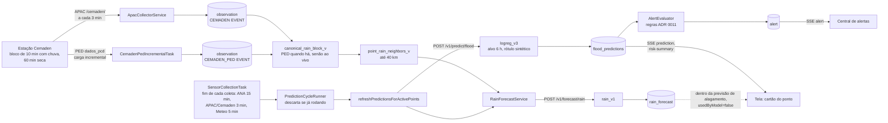

# Caminho do alerta: retrato antes da mudança (Etapa 0)

- Data: 2026-11-17 (dia seco). Nada foi alterado para escrever este retrato.
- Leitura do código na `main` dos três repositórios e do banco `mapi_db` em produção local (contêiner `mapi-db`).

DADOS DA REDE OBSERVACIONAL DO CEMADEN/MCTIC.

## Diagrama

## 1. Entradas do `rain_v1` em produção

| Item | Como é hoje | Origem |
|---|---|---|
| Fonte | Blocos de chuva de `canonical_rain_block_v`: por estação canônica e instante, a PED quando tem bloco, senão a coleta ao vivo (APAC `/cemaden/`) | `RainForecastRepository.neighborReadings`; ADR 0023 |
| Estações | As de `point_rain_neighbors_v` a até 40 km do ponto | idem |
| Janela | 6 h 30 min antes de agora (`LOOKBACK = 390 min`) | `RainForecastServiceImpl.java:37` |
| Formato | Um bloco por leitura, com carimbo no fim. Na grade de 10 min do modelo, o bloco inteiro cai no slot do seu fim | `mapi_ai/rain/features.py`, função `grid` |
| Regra de idade | Estação válida se tem alguma leitura em (t − 70 min, t]; sem isso fica ausente, nunca zero | `features.py`, `grid` |
| Instante da previsão | `issued_at` = leitura mais nova arredondada para cima a 10 min, **não o relógio**. Se a coleta para, a previsão continua emitida para o instante da última leitura, e a rota devolve `latest_reading_age_minutes` | `mapi_ai/rain/serve.py`, linha do `t = ...` |
| Open-Meteo | Rodada da véspera; o modelo de 1 h (`gb_rede`) não a usa | `models/v4/rain/metadata.json` |

**Tamanho de bloco e atraso da coleta ao vivo hoje (dia seco).** Leituras de 2026-11-17 01:30 a 12:00 UTC, período em que a API não reiniciou; bloco = intervalo até a leitura anterior da mesma estação; atraso = `raw_observation.collected_at − ts_utc` (fonte: consulta em `observation` × `raw_observation`, 2026-11-17 12:10 UTC):

| Bloco | Leituras | Estações | Atraso mediano | p90 | Máximo |
|---|---|---|---|---|---|
| 10 min | 82 | 6 | 8,0 min | 14,0 min | 68,9 min |
| 11 a 60 min | 308 | 39 | 3,1 min | 16,1 min | 58,9 min |

Nos 9 dias de coleta (desde 2026-11-08), o atraso mediano bruto passa de 100 min, mas ele está contaminado pelas paradas da API: ao subir, o coletor reentrega a janela de 24 h, e a leitura é gravada com o instante da reentrega. Só 20 leituras ao vivo tiveram chuva nesse período. **Não há medida de atraso em dia de chuva** (pendência do 2.1).

Achado: na coleta ao vivo, `observation.interval_start_utc` é igual a `ts_utc` (bloco de duração zero). O tamanho do bloco só se recupera pela leitura anterior. A PED grava o início do bloco.

## 2. Frequência do ciclo

- O ciclo de previsão roda ao fim de **cada** coleta agendada (ANA 15 min, APAC/Cemaden 3 min, APAC Meteorologia 5 min), no `taskExecutor`. Se o anterior ainda roda, o novo é descartado (`PredictionCycleRunner.triggerAfterCycle`). Na prática, a cada ~3 min (log da API, 11:58 a 12:08 UTC).
- Cada rodada chama, por ponto ativo, a previsão de chuva e depois a de alagamento. A de chuva grava no máximo uma linha por slot de 10 min (`ON CONFLICT DO NOTHING`): 30 emissões por ponto nas últimas 6 h.
- A tela recebe pelo SSE (`/api/stream`, ADR 0012), ao fim de cada ciclo, os eventos `prediction` (um por ponto) e `risk-summary`; os alertas vêm pelo evento `alert` na hora em que são criados.

## 3. O que a tela mostra

| Lugar | O que mostra | Rota |
|---|---|---|
| Cartão do ponto (`FloodPointDetailCard`, `FloodPointPopup`, `MobilePointSheet`) | Destaque: nível de risco `LOW/MEDIUM/HIGH/UNKNOWN` e probabilidade do `logreg_v3` (alagamento em 6 h, rótulo sintético). Abaixo, `RainForecastSummary`: chuva medida e faixa prevista de 1, 3 e 6 h, com a nota "O modelo de alagamento em uso ainda não recebe esta previsão" (`usedByModel = false`) | `/api/pontos`, `/api/flood-predictions`, SSE `prediction` |
| Painel Agora (`LivePanel`) | Contagem por nível de risco do `logreg_v3` e selo de aviso oficial do INMET | `/api/pontos/risk-summary`, SSE `risk-summary` |
| Tela Modelo | Conferência diária da previsão de chuva (30 dias) | `/api/rain-forecast/accuracy` |
| Simulador | Balde, sob demanda, passo de 1 h | `/api/model/simulate/bucket` → IA `/v1/simulate/bucket` |
| Alertas | Alertas das regras do ADR 0011 (risco, chuva horária, rio, maré, fonte velha) | `/api/alerts`, SSE `alert` |

As três coisas não conversam: o risco do destaque vem de um modelo que não usa a previsão de chuva; a previsão de chuva não dispara nada; o balde só roda no simulador.

## 4. Código em produção contra a `main`

| Repositório | Contêiner | `main` | Situação |
|---|---|---|---|
| api | `ae41240` (`/actuator/info`, build 2026-11-17 00:50 UTC, `dirty: clean`) | `c7b3c98` | igual em código: a diferença `ae41240..c7b3c98` são 4 arquivos de skill (`.claude/skills`, `skills-lock.json`) |
| ai | sem identificador de versão na imagem; `/health` informa `logreg_v3` e `rain_v1` | `83e906e` (2026-11-17 00:49 UTC) | imagem criada às 00:50 UTC, 1 min depois do último commit; provável, não provado |
| front | sem identificador de versão no pacote | `84820f2` (2026-11-17 00:49 UTC) | idem |

Falta à IA e ao front um identificador de versão do código servido; sem ele, o item 8 do critério de pronto não se prova. Pendência resolvida na Etapa 4 (`/health` da IA e `version.json` do front).

## 5. Entradas dos modelos servidos

| Modelo | Entradas | Posição ou altitude? |
|---|---|---|
| `logreg_v3` (servido em `/v1/predict/flood`) | `rain_0_1h`, `rain_1_3h`, `rain_3_6h`, `rain_6_12h`, `rain_12_24h`, `tide_level`, `hour_sin`, `hour_cos`, `month_sin`, `month_cos` | não (fonte: `projeto-mapi-ai/models/v3/metadata.json`) |
| `rain_v1` (servido em `/v1/forecast/rain`) | 33 da rede (`p_*`, setores, anéis, estado da rede, hora e mês) e 3 do Open-Meteo em 3 h e 6 h | não. Latitude e longitude só calculam distância e setor das estações |
| `xgb_v2` (carregado, não servido; volta com `MAPI_MODEL_GENERATION=v2`) | inclui `latitude` e `longitude` | **sim**: não pode voltar a ser servido sem retreino |
| Legado `flood_classifier` + LSTM (carregados, só servem sem v2 e v3) | `prepare_scenario_features` exige latitude e longitude | sim, caminho morto |

## 6. Terreno por ponto (`point_terrain`)

Uma só versão do processamento: `terrain_run` 2 (2026-11-08, WhiteboxTools 2.4.0, PE3D 2016, MDT 1 m; datum não confirmado, ADR 0009). Curva cota-volume com 41 degraus de 5 cm (`point_terrain_curve`).

| Ponto | Status | Cota da rua (m) | Profundidade da depressão (m) | Área de contribuição (m²) | Fundo (m) |
|---|---|---|---|---|---|
| AV_RECIFE_IBURA | OK | 1,392 | 0,098 | 208 | 1,330 |
| CIN_UFPE | OK | 7,679 | 0,155 | 82.378 | 7,570 |
| AGAMENON_DERBY | OK | 2,580 | 0,000 | **62** | 2,499 |
| JABOATAO_CENTRO | **NO_DATA** (fora do PE3D) | — | — | — | — |
| MASCARENHAS_IMBIRIBEIRA | OK | 2,068 | 0,271 | 10.103 | 2,031 |

(fonte: `SELECT ... FROM point_terrain JOIN flood_points`, 2026-11-17)

## O que mudou depois

Ver `docs/RELATORIO-ALERTA-20MIN.md`, seção 1.
