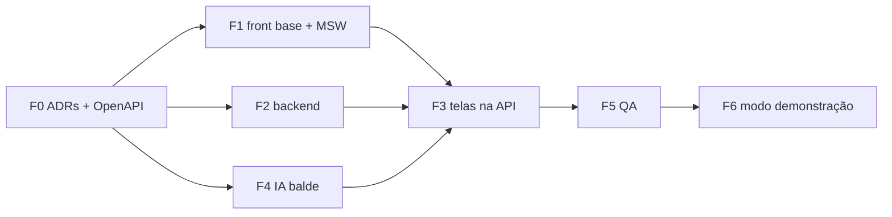

# Redesign e telas novas — tabela da F0

- Data: 2026-10-21
- Fonte do design: artifact "MAPi" (design system, versão `1792589609-ccbc`) e canvas "MAPi — Telas" (versão `1792592292-2acb`), lidos em 2026-10-21.
- Estado: **aprovada** (2026-10-21, Lucas, perguntas 32–41).

## 1. Tela → endpoint → componente → teste

Rota do front em `projeto-mapi-front`. "Novo" = endpoint ou tabela que ainda não existe. Contratos novos em `docs/openapi/redesign-telas.yaml`.

| # | Tela (board do canvas) | Rota | Endpoints | Componentes principais | Teste |
|---|---|---|---|---|---|
| 1 | Mapa ao vivo (`Main`) | `/map` | `GET /api/pontos`, `GET /api/sensors/latest`, `GET /api/environmental-data`, `GET /api/tide/{harbor}`; **novo** `GET /api/stream` (SSE), **novo** `GET /api/pontos/risk-summary` | `MapView`, `RiskBadge` (marker), `RiskLegend`, `Nav`, `NoticeRegion`, painel de contagem por nível | vitest de `RiskBadge`/contagem; MSW; Playwright do fluxo principal |
| 2 | Análise do ponto (`PontoDetalhe`) | `/pontos/:slug` | `GET /api/pontos/{slug}`, `GET /api/pontos/{slug}/terrain`; **novo** `GET /api/pontos/{slug}/predictions?from&to` | `FloodPointDetailCard`, `TerrainFacts`, gráfico de série, `ExperimentalBadge`, aviso ADR 0009 | vitest (UNKNOWN sem %, aviso de cota); IT do endpoint de série |
| 3 | Sensores (`Sensor`) | `/sensores` | `GET /api/sensors/inventory`, `GET /api/sensors/{id}/history`; **alterado** `GET /api/sensors/latest?type=` com `ageSeconds` e `stale` | `SensorSidebar`, `SensorDetailCard`, gráfico `chart-1` | vitest do estado "sem resposta"; IT do filtro |
| 4 | Central de alertas (`Alertas`) | `/alertas` | **novos** `GET /api/alerts`, `POST /api/alerts/{id}/ack`, CRUD `/api/alert-rules`; eventos `alert` no SSE | lista de alertas, editor de regra, `NoticeRegion` | unitário do avaliador de regras; IT ack; vitest da lista |
| 5 | Linha do tempo do evento (`Evento`) | `/eventos` | **novo** `GET /api/events/timeline?from&to` | gráfico multi-série (`chart-1..5`), faixas de risco por ponto | IT de agregação; vitest |
| 6 | Simulador do balde (`Simulador`) | `/modelo/simulador` | backend **novo** `POST /api/model/simulate/bucket` → IA **nova** `POST /v1/simulate/bucket` | formulário de chuva, gráfico de lâmina | pytest de regressão contra `avaliacao/balde.py`; vitest |
| 7 | Desempenho do modelo (`Modelo`) | `/modelo` | **novo** `GET /api/model/evaluation` | tabela AUC com IC, lista de dias de teste | IT: SHA-256 do JSON = `dcf020cb…`; vitest |
| 8 | Tábua de maré (`Mare`) | `/mare` | `GET /api/tabua-mare/*`, `GET /api/tide/*` | gráfico `chart-2`, tabela de preamar/baixa-mar | vitest |
| 9 | Saúde dos dados (`Dados`) | `/admin/dados` | `GET /api/admin/ingestion/check-integrity`, `GET .../runs/{id}`; **novos** `GET /api/admin/ingestion/runs` (paginado), `GET /api/admin/ingestion/sources` | tabela de fontes, histórico de execuções | IT paginação; vitest |
| 10 | Cadastro de pontos (`Pontos`) | `/admin/pontos` | `POST /api/pontos`; **novos** `PATCH /api/pontos/{slug}`, `GET /api/pontos/station-suggestions?lat&lon&radiusM=3000` | formulário, mapa de clique, lista de estações sugeridas | IT PATCH e sugestão; vitest do formulário |
| 11 | Relatos (`Relatos`) | `/relatos` | `POST /api/eventos-alagamento`; **novos** `POST /api/reports`, `GET /api/reports?status=`, `PATCH /api/reports/{id}` | fila de relatos, diálogo confirmar/descartar | IT confirmar → `FloodEvent`; vitest |
| 12 | Relatório (`Relatorio`) | `/relatorio` | só endpoints existentes e o da linha do tempo | página com CSS `@media print` | vitest de renderização; checagem manual de impressão |
| 13 | Usuários e perfis (`Usuarios`) | `/admin/usuarios` | `GET /api/auth/me`; **novos** `GET /api/admin/users`, `PATCH /api/admin/users/{id}`, `POST /api/admin/invites` | tabela, seletor de perfil | IT de autorização por perfil (matriz do ADR 0010) |
| 14 | Minha rua (`Publico`) | `/minha-rua` (sem login) | **novo** `GET /api/public/risk?lat&lon` | busca de endereço, `RiskBadge`, `ExperimentalBadge` | IT de limite de taxa (429); vitest |
| 15 | Login (`Login`) | `/login` | `/api/auth/*` | formulário, mensagens reais da API | vitest das mensagens de erro |
| 16 | Celular: mapa, ponto, relato (`Mobile*`) | as mesmas rotas, responsivas | os de cima; relato usa `POST /api/reports` | layouts ≤ 390 px, alvos ≥ 44 px | Playwright em viewport 390×844; Lighthouse |

## 2. Achados da leitura que mudam o inventário do prompt

1. **Relatos não cabem em `POST /api/pontos/scenarios`.** `FloodScenarioLabel` é um vetor de features para treino (chuva, maré, rio, ondas, `isFlooded`); não tem status, autor, endereço nem ponto. A fila de relatos precisa de tabela própria (`flood_report`, Flyway V17). Ver pergunta 3.
2. **`FloodEvent` não alimenta a avaliação.** Os rótulos da avaliação F1 vêm de `flood_occurrence` (CKAN, V6). Um relato confirmado que vira `FloodEvent` não contamina o pré-registro, desde que continue fora de `flood_occurrence`.
3. **O simulador do canvas não é o M1a real.** `sim.js` usa passo de 5 min, curva prismática e um "freio de maré" (`tideBrake`). O `balde.py` é horário, usa a curva de volume do terreno (`point_terrain_curve`) e roda com `g ≡ 1`. O freio de maré é a variante B2b, vetada até fechar Δ (decisão de 2026-10-10, ADR 0009). O simulador real fica sem controle de maré.
4. **Não existe `@PreAuthorize` no backend.** A autorização é só por `requestMatchers` em `SecurityConfig`. O ADR 0010 propõe ligar `@EnableMethodSecurity` e manter os matchers como primeira barreira.
5. **Persistência ainda usa `LocalDateTime`** em `FloodEvent` (e outras entidades). Tabelas novas usam `TIMESTAMPTZ` e `Instant` (ADR 0001).
6. **Front sem MSW, sem cliente de cache (React Query) e sem Playwright/axe.** Entram como dependências novas (pergunta 7).
7. **JSON da avaliação conferido.** `avaliacao-f1/resultado_etapa2.json` tem SHA-256 `dcf020cb57a3d1cce5e4a7c0efc36db0fc47d4841759dad5fb58be3e6c9fac14`, igual ao registrado em `projeto-mapi-ai/avaliacao/HASHES.sha256` (fonte: `sha256sum`, 2026-10-21). O arquivo está fora do git.
8. **Migração livre:** a última é `V15__ana_chuva_horaria.sql`. As novas começam em V16.

## 3. Migrações propostas

| Versão | Conteúdo | ADR |
|---|---|---|
| V16 | CHECK de `users.role` aceita `OPERADOR`; coluna `users.active`; tabela `user_invite` | 0010 |
| V17 | `flood_report` (relato: lat, lon, texto, `status` PENDING/CONFIRMED/DISCARDED, `reported_by`, `reviewed_by`, `flood_event_id`, `TIMESTAMPTZ`) | — (pergunta 3) |
| V18 | `alert_rule`, `alert` | 0011 |

Número só é atribuído quando a migração for criada (decisão de 2026-10-10).

## 4. Ordem de execução

## 5. Perguntas

Estão no `PROGRESSO.md` (perguntas 32 a 41).
